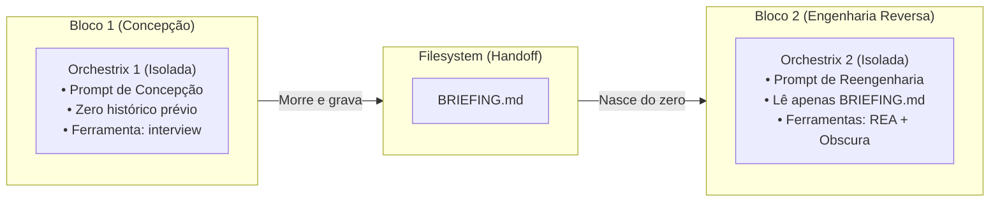

# 🏛️ Regra Universal: Orchestrix Cirúrgica por Bloco & Auto-Discovery de Modelos no Symbiont

## 1. O Princípio Inviolável da Orchestrix Universal

> **Nenhum bloco do looping compartilha sessão de memória com outro bloco.**
> A Orchestrix isolada **não é um fallback**; ela é o **padrão arquitetural obrigatório para 100% dos blocos**, independentemente de usar 9Router, Claude Code, Antigravity, OpenCode ou Ollama.



### Por que a Orchestrix Isolada é Obrigatória em Qualquer Cenário?
1. **Economia Matemática de Tokens:** A conversa não cresce para 150k tokens. Cada bloco consome apenas de 2k a 8k tokens no total.
2. **Zero Alucinação Cruzada:** O modelo no Bloco 2 não se confunde com erros ou suposições descartadas no Bloco 1.
3. **Liberdade Tecnológica:** 
   * Bloco 1 pode rodar no Claude Code (`claude -p`).
   * Bloco 2 pode rodar no 9Router com combo `code-pro`.
   * Bloco 3 pode rodar no Ollama local (`qwen2.5-coder`).

---

## 2. Detecção Ativa e Passiva de Modelos no Symbiont

Assim como o Symbiont já audita os Harnesses instalados no sistema operacional (Hub 5), ele expande o motor de scanner para mapear a **Matriz Viva de Modelos**:

```
[ Hub 5 / Scanner do Symbiont ]
  │
  ├── 1. Scanner de Harnesses: (Claude Code, Antigravity, OpenCode, Cursor)
  │
  └── 2. Scanner de Modelos & Motores:
        ├── Ollama Local (:11434) ➔ Executa `ollama list` e mapeia tags locais
        ├── Variáveis de Ambiente ➔ Detecta chaves ativas (Anthropic, Gemini, Groq)
        ├── CLIs com Sessão Ativa ➔ Mapeia modelos da assinatura do usuário
        └── 9Router Detectado?
              ├── SIM: Consulta `/v1/models` e lista os Combos (code-pro, code-fast, flash)
              └── NÃO: Oculta opções de gateway e exibe opções diretas
```

### Resultado no Looping Builder (N8N):
Quando o usuário abre as opções de um bloco no canvas visual:
* O menu de modelos **só exibe o que está verde no inventário do Symbiont**.
* Se o 9Router estiver online, os combos aparecem no topo como recomendados.
* Se o usuário estiver offline ou sem gateway, aparecem os modelos nativos do harness ou do Ollama.
