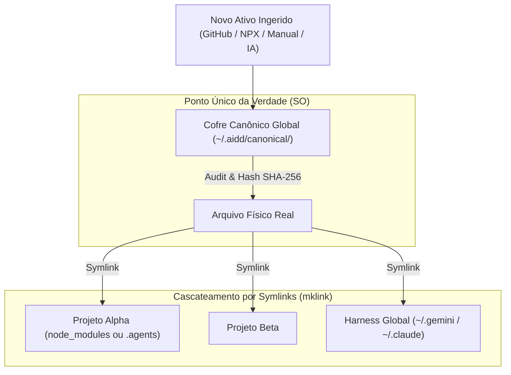

# 🧭 Adendo Arquitetural: Roteamento Cognitivo por Bloco & Ciclo de Injeção Canônica

## 1. Roteamento de Modelo por Bloco no Looping

Cada bloco do DAG possui um **contrato de saída imutável** (o handoff), mas o **cérebro que processa a tarefa** pode ser configurado em 3 modalidades flexíveis:

```
                  ┌──────────────────────────────────────────────┐
                  │                 BLOCO DO DAG                 │
                  ├──────────────────────────────────────────────┤
                  │ Handoff: IMUTÁVEL (Ex: ESTRUTURA_REVERSA.json)│
                  ├──────────────────────────────────────────────┤
                  │          MODALIDADE DE ROTEAMENTO:           │
Entrada ─────────>│  [1] Sugerido   (Recomendação de Benchmark)  │─────────> Saída
                  │  [2] Manual     (Travado pelo Usuário)       │
                  │  [3] Autônomo   (Auto-Cost / Auto-Tokens)    │
                  └──────────────────────────────────────────────┘
```

### As 3 Modalidades de Roteamento por Nó:

1. **Sugerido (Heurística Especialista):**
   * O Symbiont analisa a tarefa do nó e estampa uma recomendação:
     * *Nó de Engenharia Reversa (REA):* Sugere `Claude Sonnet 4.5` (maior capacidade de desmontagem lógica).
     * *Nó de Concepção Rápida (Interview):* Sugere `Gemini Flash Lite` (ultra-rápido, interativo e barato).
   * O usuário visualiza a tag: `[Sugerido: Sonnet 4.5] (Aceitar / Mudar)`.

2. **Escolhido pelo Usuário (Manual / Override):**
   * O desenvolvedor tem controle absoluto. Se ele quiser forçar um modelo local (`Ollama / Qwen 2.5 Coder`) para privacidade total, ou um modelo 1M context (`Gemini 1.5 Pro`) para economizar tokens pagos, ele trava o dropdown no bloco.

3. **Autônomo (Dynamic Engine via 9Router):**
   * O usuário ativa a flag `roteamento: auto`.
   * O 9Router avalia em tempo de execução:
     * *Payload pequeno (<10k tokens)?* Usa combo leve e rápido.
     * *Payload massivo (>100k tokens)?* Roteia diretamente para o Gemini 1M nativo, evitando estouro de contexto no Kiro.

---

## 2. Ciclo de Injeção Canônica: Como Novos Ativos Nascem no SO

Para garantir que o sistema operacional permaneça **eternamente limpo e desduplicado**, o fluxo de qualquer novo ativo (skill, MCP, script) segue uma via única:



### Regras do Ciclo de Vida:
1. **Injeção Centralizada:** Qualquer novo ativo é gravado **exclusivamente** no diretório canônico do SO (`~/.aidd/canonical/skills/` ou `~/.aidd/canonical/mcps/`).
2. **Cascateamento por Symlink:** O projeto que precisa daquele recurso nunca recebe uma cópia física; ele recebe um `mklink` (link simbólico) apontando para o arquivo canônico do SO.
3. **Atualização em Cadeia:** Quando você atualiza uma skill (ex: melhora o prompt do `interview`), todos os projetos que a utilizam são atualizados instantaneamente em tempo real, com zero duplicação de bytes no disco.
