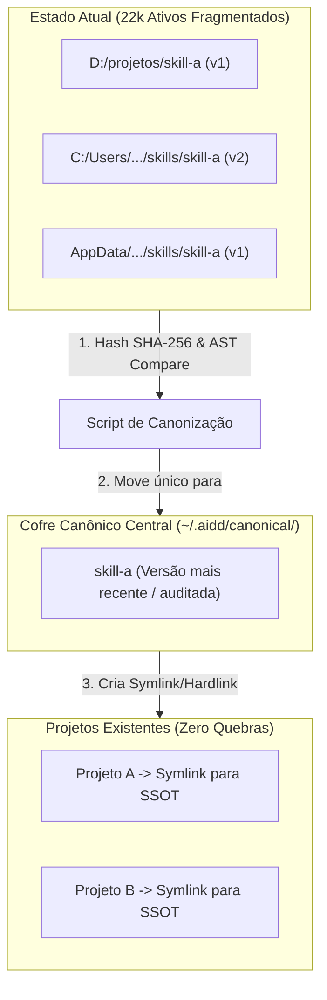

# 🌐 Espec Arquitetural v2: Looping Studio (N8N Style), Canonização de SO & Graph Engineering

## 1. O que é entregue ao final da construção visual? (O Runtime)

Quando o usuário monta o fluxo visualmente no estilo **N8N / Make** (ligando nós, portas, handoffs e gates), o Symbiont não cospe código desorganizado. Ele entrega uma **tríade determinística**:

```
[ N8N Visual Canvas (Symbiont) ]
              │
              ▼
   ┌────────────────────────────────────────────────────────┐
   │ 1. O Contrato: DAG Declarativo (pipeline.dag.json)     │
   │    • Matriz de nós, dependências, gates e handoffs     │
   ├────────────────────────────────────────────────────────┤
   │ 2. O Motor de Execução: Runner Nativo em Go (ou Rust)  │
   │    • Executa cada nó em processo isolado e cirúrgico   │
   │    • Valida os gates (Pass/Fail) antes de abrir o prox │
   ├────────────────────────────────────────────────────────┤
   │ 3. A Casca Universal: Skill Hub / Entrypoint           │
   │    • Um arquivo leve (<20 linhas) compatível com       │
   │      Claude Code, Antigravity, OpenCode ou CLI puro.   │
   └────────────────────────────────────────────────────────┘
```

### Por que essa lógica é imbatível?
1. **Universalidade Total:** O `pipeline.dag.json` é agnóstico. Se o usuário estiver no Claude Code, a Skill Hub lê o passo atual do DAG. Se estiver no terminal Linux puro, o binário em Go executa os passos sequencialmente.
2. **Zero Bloat:** Não precisa de containers Docker ou runtimes pesados de 500MB.

---

## 2. A Morte dos Subagentes Pesados: Orchestrix Cirúrgicas

Subagentes convencionais duplicam prompts do sistema, carregam dezenas de ferramentas na memória e devoram 50k a 100k tokens a cada troca de turno.

### O Modelo Orchestrix Cirúrgica (Single-Task Context)
Em vez de instanciar um "subagente completo":
* **Turno Estéril:** A etapa do loop é disparada com **apenas 1 ferramenta** (ex: só o MCP do REA + Obscura).
* **Contexto Vazio:** Ele não herda os 80k tokens de conversas passadas; herda apenas o artefato de entrada gerado pelo nó anterior (ex: `BRIEFING.md`).
* **Handoff Seco:** Terminou a análise? Ele cospe `ANALISE_REA.json` e o processo morre. Contexto limpo, zero vazamento de tokens.

---

## 3. Desduplicação & Canonização dos 22k Ativos sem Quebrar Nada

Você tem 22.000 arquivos espalhados em vários diretórios e discos. Ter tudo isso duplicado gera confusão, fragmentação de versões e lentidão de busca.

### A Estratégia de "Symlink Transparent Federation":



1. **Varredura por Hash e AST:** Identifica duplicatas exatas e variantes da mesma skill/MCP.
2. **Eleição do Canônico:** A versão mais recente ou mais completa é promovida para o repositório central (`~/.aidd/canonical/skills/`).
3. **Substituição por Symlinks:** Os outros 10 locais onde ela existia viram links simbólicos (`mklink` no Windows).
   * **Resultado:** O projeto antigo continua achando que o arquivo está lá. Nenhuma rota quebra, o consumo de disco cai em 80% e qualquer melhoria feita na skill reflete em todo o sistema.

---

## 4. Graph Engineering: O Mapa de Rotas do Ecossistema

Sem um grafo, o sistema é cego: ele não sabe se a saída da Skill A encaixa na entrada da Skill B.

### Como o Grafo Estrutura Tudo:
* **Nós (Nodes):** Cada Skill, MCP, Script e Hook catalogado.
* **Arestas (Edges):** Relações de **Consome** e **Produz**.
  * Exemplo: `aidd-spec` **consome** `tipo:Briefing` e **produz** `tipo:ExecutableSpec`.
  * Exemplo: `aidd-tdd` **consome** `tipo:ExecutableSpec` e **produz** `tipo:TestSuitePass`.
* **Roteamento Ótimo:** Quando você diz no N8N: *"Quero ir de uma URL web até uma spec de clone"*, o Graph Engine calcula o caminho mais curto de nós:
  `URL` ➔ `Obscura (Headless)` ➔ `REA (Dissecador)` ➔ `Impeccable (Tokens)` ➔ `aidd-spec (Regras)`.
