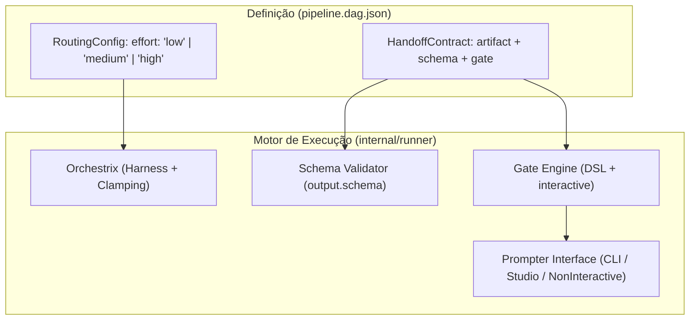

# 📋 SPEC: Evolução do Motor Go do LegoLoop com Harness Engineering

> **Status:** Proposta Técnica para Revisão e Validação Humana (Stop-Gate 02)  
> **Data:** 2026-11-01  
> **Referência de Intenção:** [docs/intents/2026-11-01_INTENT_HARNESS_ENGINEERING_GO.md](file:///C:/Users/trcnologia/Desktop/LegoLoop/docs/intents/2026-11-01_INTENT_HARNESS_ENGINEERING_GO.md)  
> **Módulos Afetados:** `internal/dag/`, `internal/gate/`, `internal/runner/`, `internal/orchestrix/`, `internal/cli/`

---

## 1. Visão Geral e Arquitetura

Esta especificação formaliza a integração das 3 propostas de **Harness Engineering** no motor Go do LegoLoop:
1. **Schema Enforcement Contratual:** Validação estrita de contratos de artefatos de saída tanto em nível declarativo (`output.schema` no DAG) quanto via expressão de gate (`schema_valid(schema, file)`).
2. **Effort Clamping Cognitivo:** Parametrização e clamping explícito do esforço de raciocínio de modelos (`effort: "low" | "medium" | "high"`), propagando aos backends de harness (`agy`, `omp`, `opencode`, `mimo`, `ollama`, `9Router`) com tolerância no-op e telemetria rastreável nos `Notes` do `NodeReport`.
3. **Interactive Gates (Auditoria Interativa):** Introdução de pontos de parada interativos via expressão DSL de gate (`interactive("pergunta")` ou `prompt("mensagem")`) e controle no runner/CLI com suporte a confirmação em terminal TTY, auto-aprovação (`--yes`) e modo headless seguro (`--non-interactive`).



---

## 2. Contratos de Dados & I/O

### 2.1. DAG: `HandoffContract` e `RoutingConfig` (`internal/dag/types.go`)

```go
type EffortLevel string

const (
	EffortLow    EffortLevel = "low"
	EffortMedium EffortLevel = "medium"
	EffortHigh   EffortLevel = "high"
)

type RoutingConfig struct {
	Mode     Mode        `json:"mode"`
	Model    string      `json:"model,omitempty"`
	Effort   EffortLevel `json:"effort,omitempty"` // low, medium, high
	Fallback string      `json:"fallback,omitempty"`
	Combo    string      `json:"combo,omitempty"`
}

type HandoffContract struct {
	Artifact string `json:"artifact"`
	Schema   string `json:"schema,omitempty"` // Caminho relativo ao workdir para JSON Schema ou validador
	Gate     string `json:"gate"`
}
```

* **Regra de Parsing:** Valores de `effort` fora de `""`, `"low"`, `"medium"`, `"high"` resultam em erro fatal de compilação do DAG em `dag.Parse`.

### 2.2. DSL de Gates: `internal/gate/`

* Novas funções builtin registradas:
  1. `schema_valid(schema_path, target_path)`: Retorna `kBool`. Abre `schema_path` e valida a conformidade do JSON presente em `target_path`. Em caso de JSON inválido ou violação de tipagem de campos, retorna `false` ou erro formatado.
  2. `interactive(prompt_text)` / `prompt(prompt_text)`: Retorna `kBool`. Invoca `env.Prompter.Prompt(prompt_text)`.

```go
type Prompter interface {
	Prompt(message string) (bool, error)
}

type Env struct {
	Root     RootFS
	ExitCode int
	Prompter Prompter
}
```

### 2.3. Runner: `internal/runner/runner.go`

```go
type Options struct {
	Workdir        string
	Parallelism    int
	DefaultTimeout time.Duration
	Executor       Executor
	AllowScripts   bool
	AutoApprove    bool     // --yes: aprova automaticamente gates interativos
	NonInteractive bool     // --non-interactive: rejeita gates interativos se não houver TTY
	Prompter       gate.Prompter
	OnNodeStart    func(nodeID string)
	OnNodeFinish   func(nr NodeReport)
}
```

* **Schema Enforcement no Runner:** Antes de avaliar os gates ou promover artefatos no modo isolado, se `n.Output.Schema != ""`, o runner valida o artefato contra o schema. Se inválido, marca `StatusGateFailed` com mensagem explicativa `"schema enforcement falhou: <detalhe>"`.
* **Effort Telemetry:** O `NodeReport.Notes` recebe registros como `"effort 'low' repassado ao harness"` ou `"effort 'high' registrado (backend no-op)"`.

### 2.4. CLI: Flags em `legoloop run` (`internal/cli/`)

* `-y, --yes`: Ativa `AutoApprove = true`.
* `--non-interactive`: Força rejeição se não houver TTY interativo.
* Em terminal interativo padrão: exibe no `stderr`/`stdout` a pergunta e lê `[A]provar / [R]ejeitar` do `Stdin`.

---

## 3. Critérios Binários de Aceite (Gates Mecânicos)

* [ ] **G1 (Schema no DAG):** `dag.Parse` aceita campo `schema` em `output` e rejeita caminhos inválidos ou schemas corrompidos se presentes.
* [ ] **G2 (Builtin schema_valid):** Expressão `schema_valid("schema.json", "out.json")` compila e avalia corretamente como booleano (sucesso para JSON em conformidade, falha para violação).
* [ ] **G3 (Schema Enforcement Automático):** Nó com `output.schema` definido que produza artefato incompatível falha com `status == "gate_failed"`.
* [ ] **G4 (Effort Clamping no DAG & Runner):** `RoutingConfig` valida `effort` (`low`, `medium`, `high`) e orquestrador repassa ou anota no `NodeReport.Notes` sem quebrar backends incompatíveis.
* [ ] **G5 (Builtin interactive & Prompter):** Expressão `interactive("Aprovar?")` chama `Prompter.Prompt`. Em modo `--yes`, aprova automaticamente sem bloquear. Em modo interativo de terminal, lê do usuário.
* [ ] **G6 (Regressão Zero & Build Go):** Todos os testes de `go test ./...` continuam passando (100% verde) e o binário `bin/legoloop.exe` recompila sem warnings.
