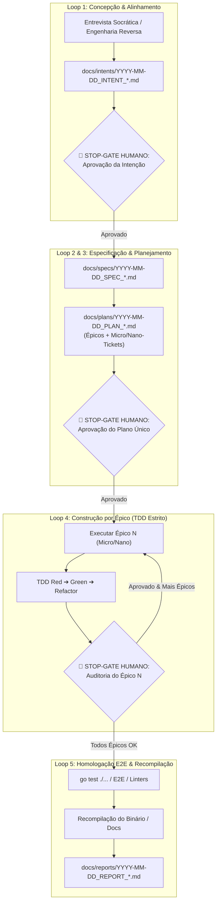

# 📋 SPEC: Refatoração da Skill `aidd-legoloop-mega-pipeline`

> **Status:** Proposta para Revisão e Validação Humana  
> **Data:** 2026-11-01  
> **Artefato Alvo:** `C:\Users\trcnologia\.gemini\config\skills\aidd-legoloop-mega-pipeline\SKILL.md`  
> **Referência de Intenção:** [docs/intents/2026-11-01_INTENT_REFATORACAO_SKILL_MEGA_PIPELINE.md](file:///C:/Users/trcnologia/Desktop/LegoLoop/docs/intents/2026-11-01_INTENT_REFATORACAO_SKILL_MEGA_PIPELINE.md)

---

## 1. Visão Geral e Propósito

A skill `aidd-legoloop-mega-pipeline` é o cérebro orquestrador do ecossistema LegoLoop. Sua especificação precisa impedir fisicamente a **afobação cognitiva**, assegurar a execução em **contexto estéril** e garantir que qualquer trabalho de engenharia de software seja planejado de forma unificada e executado **bloco a bloco por Épico**, com **Stop-Gates de Auditoria Humana obrigatórios**.

---

## 2. As 7 Leis Invioláveis do Mega Pipeline

A nova especificação da skill deve fixar 7 leis universais que o agente não pode violar em hipótese alguma:

1. **Zero Context Bloat (Orchestrix Cirúrgica por Bloco):**
   * Cada nó do grafo ou passo de execução nasce em contexto estéril, consome exclusivamente o artefato pai (`input`), gera o artefato contratado (`output`) e encerra seu ciclo.
2. **Stop-Gates de Auditoria Humana Obrigatórios (Anti-Afobação):**
   * O agente é terminantemente proibido de gerar código de produção antes da aprovação explícita de `INTENT.md`, `SPEC.md` e `PLAN.md`.
   * Ao finalizar um Épico, o agente **deve pausar imediatamente**, apresentar o sumário das entregas e aguardar aprovação humana expressa antes de tocar no Épico seguinte.
3. **Plano Único e Hierárquico (Épicos ➔ Micro/Nano-Tickets):**
   * O planejamento deve ser consolidado em um único arquivo `docs/plans/YYYY-MM-DD_PLAN_*.md`.
   * Todo Épico contém seus micro-tickets (unidades TDD de módulo/arquivo) e nano-tickets (ajustes cirúrgicos < 4k tokens: lints, tipagens, tokens CSS).
4. **Provider-Awareness & Roteamento Cognitivo com Clamping:**
   * Cada ticket deve explicitar a cota de modelo e esforço de raciocínio (`--effort low|medium|high`), evitando que modelos caros/lentos gastem cota em tarefas atômicas.
5. **TDD Estrito & Zero Stubs:**
   * Red-Green-Refactor obrigatório para código de produção.
   * Proibição total de `TODO`, `pass`, `// implementar depois` ou mocks simulados.
6. **Padronização ISO de Nomenclatura:**
   * Todos os artefatos em `docs/` devem portar o prefixo `YYYY-MM-DD_<NOME>.<ext>`.
7. **Idioma e Estilo Silencioso:**
   * Comunicação e documentação 100% em **Português do Brasil (PT-BR)**.
   * Respostas concisas, links clicáveis (`file://`) e pensamento em estilo telegráfico (Caveman).

---

## 3. Matriz Hierárquica de Roteamento Cognitivo

| Nível do Ticket | Definição & Escopo | Cota / Contexto | Modelos Sugeridos | Effort Flag |
|---|---|---|---|---|
| **Épico (Macro)** | Arquitetura, especificação de domínio, DAG global e contratos de integração. | > 20k tokens | `Claude 3.7 Sonnet`, `Gemini 2.0 Pro`, `GPT-4o` | `--effort high` |
| **Micro-ticket** | Implementação de módulo, endpoint, componente ou suíte de testes TDD. | 4k a 20k tokens | `Claude 3.5 Sonnet`, `Gemini 2.0 Flash`, `Qwen 2.5 Coder 32B` | `--effort medium` |
| **Nano-ticket** | Fix cirúrgico, assert pontual, lint fix, renomeação de variáveis, CSS token. | < 4k tokens | `Gemini 2.0 Flash-Lite`, `Claude 3.5 Haiku`, `Ollama Local (7B/14B)` | `--effort low` |

---

## 4. Estrutura dos 5 Sub-Loops e seus Gates Mecânicos

### Contratos e Entregas por Loop:

* **Loop 1 (Concepção):**
  * *Entrada:* Demanda inicial do usuário.
  * *Saída:* `docs/intents/YYYY-MM-DD_INTENT_<TEMA>.md`.
  * *Gate:* Confirmação explícita do usuário no chat.
* **Loop 2 (Reengenharia/Design - Condicional):**
  * *Entrada:* Alvo de tela, site ou binário existente.
  * *Saída:* `TOKENS.css` ou `REVERSE_ANALYSIS.json`.
  * *Gate:* Conformidade semântica e ausência de inventos visuais.
* **Loop 3 (Especificação & Plano Unificado):**
  * *Entrada:* `INTENT.md` aprovado.
  * *Saídas:* `docs/specs/YYYY-MM-DD_SPEC_<TEMA>.md` e `docs/plans/YYYY-MM-DD_PLAN_<TEMA>.md`.
  * *Gate:* O `PLAN.md` deve conter todos os Épicos numerados, com seus micro e nano tickets mapeados para arquivos específicos e modelos roteados. Aprovação formal do usuário antes de qualquer código.
* **Loop 4 (Construção TDD por Épico):**
  * *Regra de Execução:* O agente executa apenas os tickets pertencentes ao Épico ativo. Ao finalizar, apresenta a evidência e para.
  * *Gate de Saída:* Validação humana obrigatória para liberar o Épico subsequente.
* **Loop 5 (Homologação & Fechamento):**
  * *Ações:* Validação da suíte de testes completa, recompilação obrigatória se houver código Go (`go build -o bin/legoloop.exe ./cmd/legoloop`), fechamento da sessão e emissão do relatório final `docs/reports/YYYY-MM-DD_REPORT_<TEMA>.md`.

---

## 5. Critérios Binários de Aceite da Refatoração da Skill

* [ ] **G1 (Frontmatter Válido):** O arquivo `SKILL.md` deve conter cabeçalho YAML com `name: aidd-legoloop-mega-pipeline`, `description` e comandos canônicos (`/legoloop`, `/mega-pipeline`, etc.).
* [ ] **G2 (Cláusula Anti-Afobação Explícita):** O documento deve declarar em caixa alta e regras estritas que é proibido pular para a fase de código sem `PLAN.md` aprovado.
* [ ] **G3 (Matriz de Esforço/Modelos):** A tabela de roteamento deve incluir a coluna de `Effort Flag` (`--effort low|medium|high`).
* [ ] **G4 (Protocolo de Stop-Gates por Épico):** O texto deve orientar como o agente estrutura o `PLAN.md` com os blocos de Stop-Gate de Auditoria Humana entre cada Épico.
* [ ] **G5 (Protocolo ISO de Nomenclatura):** Exigência formal do prefixo `YYYY-MM-DD_` em todos os artefatos.
* [ ] **G6 (Conformidade com AGENTS.md):** 100% de compatibilidade com as regras operacionais do repositório LegoLoop.
