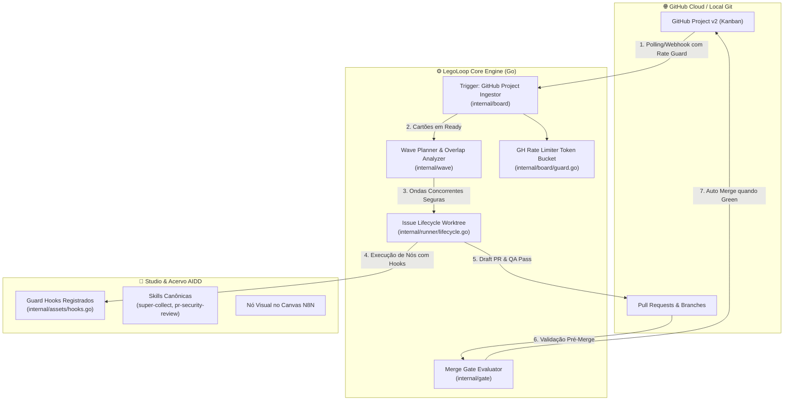

# 🧩 LegoLoop — Especificação de Integração: Super-Board & Board-Driven Looping (v1.0)

> **Documento:** `docs/specs/2026-11-01_SPEC_SUPER_BOARD_INTEGRATION.md`  
> **Status:** Aprovado para Implementação  
> **Autor / Arquitetura:** LegoLoop Architecture Core + AIDD  
> **Data:** 01/11/2026  
> **Origem / Referência:** `EricTechPro/super-board` (v3.3.0)  

---

## 1. Visão Executiva & Proposta de Valor

O objetivo desta especificação é incorporar ao **LegoLoop** os padrões arquiteturais de esteira autônoma orientada a eventos externos (**GitHub Projects v2 / Kanban**) e robustez operacional comprovados pelo projeto `super-board`, preservando a **Orchestrix Cirúrgica Estéril** (Go nativo, zero-subagent, consumo mínimo de tokens).

### Ganhos Imediatos:
1. **Board-Driven Looping:** O LegoLoop deixa de ser apenas ativado localmente por CLI/Studio e passa a atuar como um *worker autônomo* que drena colunas de quadros Kanban do GitHub (`Ready ➔ Building ➔ QA ➔ Review ➔ Done`).
2. **Planejamento de Ondas Anti-Colisão (`Wave Planner`):** Algoritmo que inspeciona o grafo de arquivos das tarefas e agenda em paralelo apenas issues que não gerem conflito de merge (`file overlap`).
3. **Persistência de Ciclo de Vida por Issue (Git Branch Lifecycle):** Extensão do isolamento de worktree já existente no LegoLoop (`internal/runner/isolated.go`) para acompanhar a issue desde a criação da branch até o PR e o Merge Gate.
4. **Blindagem de Segurança e Quotas:** Guard Hooks nativos contra deleções fora do workspace, proteção de branches críticas e *token bucket* para a GitHub API evitando banimento por rate limit.

---

## 2. Diagrama Arquitetural da Integração



---

## 3. Especificação dos Componentes Técnicos

### 3.1. Módulo `internal/board` (Ingestão & Rate Limiting)
* **`Client`:** Cliente HTTP para GitHub GraphQL API (`v4`) e REST (`v3`) que utiliza o token `GITHUB_TOKEN` ou `gh auth token`.
* **`TokenBucketGuard`:**
  * Garante teto de chamadas por hora (mínimo de segurança: 200 requisições livres antes de disparar onda).
  * Se a cota restante for `< 100`, retorna `ErrRateLimitExhausted` (Exit 79), congelando o estado graciosamente sem corromper branches.
* **`Card` e `BoardState`:**
  ```go
  type Card struct {
      ID          string   `json:"id"`
      Number      int      `json:"number"`
      Title       string   `json:"title"`
      Body        string   `json:"body"`
      Status      string   `json:"status"` // "Backlog", "Ready", "Building", "QA", "Review", "Done"
      Labels      []string `json:"labels"`
      Assignees   []string `json:"assignees"`
      Branch      string   `json:"branch,omitempty"`
      PRNumber    int      `json:"pr_number,omitempty"`
  }
  ```

### 3.2. Módulo `internal/wave` (Wave Planner & File Overlap)
* **Objetivo:** Agrupar cards da coluna `Ready` em ondas paralelas (`Wave`) com garantia de zero colisão de arquivos.
* **Algoritmo:**
  1. Extrair de cada card os arquivos ou pacotes afetados (via análise de corpo da issue ou git diff preditivo).
  2. Construir grafo de adjacência de conflito entre cards: aresta existe se `Files(CardA) ∩ Files(CardB) ≠ ∅`.
  3. Colorir o grafo ou particionar em conjuntos independentes máximos.
  4. Retornar `[]Wave`, onde cada `Wave` contém apenas cards mutuamente independentes.

### 3.3. Extensão do Runner: `internal/runner/lifecycle.go`
* O LegoLoop já isola nós em `HEAD --detach`. Adicionamos o gerenciamento de branch com PR:
  * `PrepareIssueWorktree(ctx, repoDir, card)`: Cria worktree baseado em branch `issue-<number>-<slug>`.
  * `CommitAndDraftPR(ctx, card)`: Comita alterações no worktree, faz push para a branch remota e abre Draft PR.
  * `CleanupIssueWorktree(ctx, card)`: Remove worktree com `git worktree remove --force` sem perder a branch local/remota.

### 3.4. Guard Hooks & Acervo Canônico (`internal/assets/hooks.go`)
Integrar no catálogo de hooks reconhecidos pelo scanner do LegoLoop:
1. `guard-delete-outside`: Valida se ferramentas de filesystem ou scripts bash tentam deletar diretórios pais (`../`) ou absolutos fora da raiz do worktree.
2. `guard-protected-push`: Bloqueia tentativas de `git push origin main` / `master` por agentes autônomos.
3. `guard-secrets`: Detecta padrões de chaves de provedores de IA (`sk-`, `AIzaSy`, `ghp_`) em arquivos prestes a serem commitados.
4. `cleanup-wt`: Limpeza automática e periódica de worktrees mortos ou com processo associado finalizado.

---

## 4. Critérios de Aceite Binários (Acceptance Criteria)

- [ ] **AC-01 (Rate Guard):** `TokenBucketGuard` interrompe a execução com erro tipado se a cota GraphQL do GitHub for inferior a 100 chamadas.
- [ ] **AC-02 (Wave Planner Overlap):** Se Card #1 toca `cmd/main.go` e Card #2 toca `cmd/main.go`, eles **devem** ser alocados em ondas separadas (`Wave[0]` e `Wave[1]`).
- [ ] **AC-03 (Wave Planner Disjunto):** Se Card #1 toca `pkg/a/` e Card #3 toca `pkg/b/`, ambos **devem** ser alocados na mesma `Wave[0]`.
- [ ] **AC-04 (Issue Worktree):** A criação de worktree para issue gera uma branch rastreável e não interfere no `HEAD` do repositório principal.
- [ ] **AC-05 (Guard Push):** Tentativa de comando `git push origin main` executada sob o hook é rejeitada com código de saída $\neq 0$.
- [ ] **AC-06 (Scanner de Hooks):** O scanner de assets (`internal/assets`) indexa e expõe os guard hooks no Studio com metadados corretos.

---

## 5. Plano de Micro e Nano Tickets (TDD Estrito)

### Épico SB-01: GitHub Board Ingestor & Rate Guard
- [ ] **TICK-SB-101 (Nano):** Criar `internal/board/types.go` com structs `Card`, `Wave`, `BoardState` e interfaces de `BoardClient`.
- [ ] **TICK-SB-102 (Nano):** Implementar `internal/board/guard.go` com verificação de cota GraphQL e testes unitários com mocks de cabeçalhos HTTP.
- [ ] **TICK-SB-103 (Micro):** Implementar `internal/board/client.go` para leitura de issues e transição de colunas via GitHub API.

### Épico SB-02: Wave Planner & File Overlap Engine
- [ ] **TICK-SB-201 (Nano):** Criar `internal/wave/overlap.go` para extração de caminhos de arquivos citados no corpo de tickets.
- [ ] **TICK-SB-202 (Micro):** Implementar algoritmo de partição de ondas concorrentes em `internal/wave/planner.go` com testes para grafos com conflito e disjuntos.

### Épico SB-03: Issue Lifecycle Worktree & PR Automation
- [ ] **TICK-SB-301 (Micro):** Implementar `internal/runner/lifecycle.go` para provisionamento de worktrees com branch dedicada e testes de criação/cleanup.
- [ ] **TICK-SB-302 (Nano):** Implementar verificação pré-merge com o motor de gates do LegoLoop (`internal/gate`).

### Épico SB-04: Guard Hooks & Canonização
- [ ] **TICK-SB-401 (Nano):** Portar os scripts de guard hook de Python/Shell para hooks compatíveis com o ciclo `PreToolUse` e `PreCommit` do LegoLoop.
- [ ] **TICK-SB-402 (Nano):** Atualizar `internal/assets/hooks.go` e testes de cascata profunda para reconhecer os novos hooks na taxonomia do SO.
- [ ] **TICK-SB-403 (Micro):** Registrar o bloco `Trigger: GitHub Project Kanban` no catálogo de peças do Studio (`internal/studio/pieces.go`).
