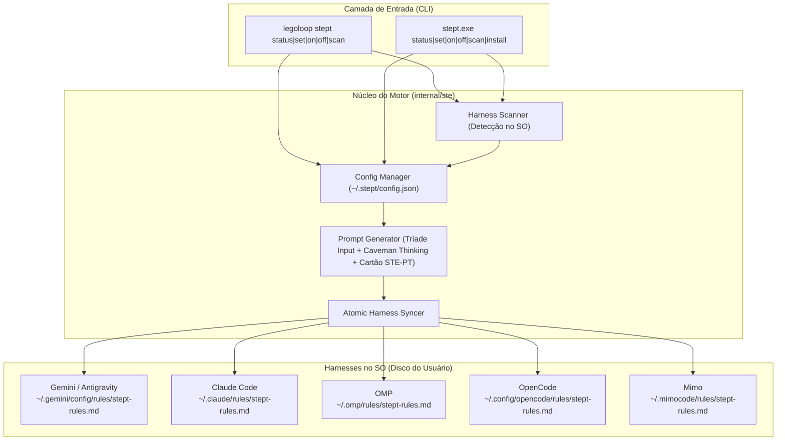

# 📋 SPEC: Alternador Universal e Granular de Governança, Economia de Tokens e Output STE-PT para Harnesses

> **Status:** APPROVED / EM EXECUÇÃO  
> **Data:** 2026-11-06  
> **Versão:** 2.0.0  
> **Autor:** Antigravity (Fusão Addy Osmani + Matt Pocock + AIDD-Spec)  
> **Referência da Intenção:** [docs/intents/2026-11-05_INTENT_STEPT_SWITCH.md](../intents/2026-11-05_INTENT_STEPT_SWITCH.md)  
> **Alvo Primário:** `internal/ste`, `internal/cli`, `cmd/legoloop`, `C:\Users\trcnologia\Desktop\stept-cli`  
> **Consome:** INTENT aprovada · **Produz:** PLAN e ROUTE  
> **Template:** TEMPLATE_SPEC.md v2.0.0  

---

## 1. Premissas Técnicas Assumidas (Addy Osmani)

> [!IMPORTANT]
> A IA lista abaixo todas as premissas técnicas adotadas para evitar decisões silenciosas:
1. **Runtime Go e Zero Dependências:** Implementação 100% baseada na biblioteca padrão do Go (`encoding/json`, `os`, `path/filepath`, `strings`, `fmt`). Nenhuma dependência externa será adicionada ao `go.mod` no LegoLoop nem no projeto standalone.
2. **Governança da Tríade de Economia de Tokens:**
   * **Input (Entrada):** Regra contratual explícita instruindo a IA a isolar comandos imperativos e substantivos de ação, descartando saudações e ruído; hook local determinístico (sem LLM) onde suportado nativamente pelo harness.
   * **Thinking (Raciocínio):** Injeção compulsória do bloco **Caveman Ultra** no raciocínio interno (frases telegráficas, sem artigos, proibição de carregar arquivos de log inteiros no contexto).
   * **Output (Resposta):** Suporte modular a 4 modos de saída:
     - `off`: Desativa a governança e exclui o arquivo de regra do harness.
     - `stept`: Cartão de Ação ASD-STE100 estruturado em todas as ações com efeito.
     - `caveman`: Respostas curtas, secas e telegráficas.
     - `hibrido` *(Padrão de Ouro)*: Caveman no Thinking + Resposta Concisa no Chat + Cartão STE-PT obrigatório antes de qualquer ação com efeito.
3. **Persistência Centralizada com Herança e Scanner Dinâmico:** O estado é persistido em `~/.stept/config.json`. A configuração possui um perfil `padrao` e sobreposições opcionais por harness em `harnesses`. A lista de ferramentas ativas é alimentada por um scanner dinâmico que detecta harnesses no SO (via subcomando `scan` e flag `--rescan`), evitando caminhos engessados.
4. **Injeção Atômica e Não-Invasiva:** As regras são materializadas em arquivos dedicados (`stept-rules.md`). Nenhuma regra alheia do usuário é tocada ou apagada; ferramentas ausentes não têm pastas fantasmas criadas (salvo `--create-dirs`); no modo `off`, apenas o arquivo `stept-rules.md` do respectivo harness é excluído do disco.
5. **Standalone Comercial em Go com PATH Universal:** O projeto standalone `C:\Users\trcnologia\Desktop\stept-cli` é 100% em Go, sem wrappers CLI invasivos, com comando `stept install` para configuração automática de PATH no escopo do usuário (Windows `%LOCALAPPDATA%\stept\bin`, Linux/macOS `~/.local/bin`).
6. **Hermeticidade nos Testes & Prova de Mutações (Regra 8):** Testes unitários nunca tocam em caminhos reais do usuário (`~/.stept` ou `~/.gemini`), rodando sempre em `t.TempDir()`. O Épico 04 contém a prova obrigatória de mutação deliberada nos 4 pontos críticos.

---

## 2. Fronteiras de Ação & Regras de Governança (Boundaries — Addy Osmani)

* **Sempre Fazer:**
  * Desenvolver via TDD estrito (teste unitário falhando antes do código de produção).
  * Manter funções pequenas, enxutas e de responsabilidade única (< 35 linhas, verificado via `tools/funclen`).
  * Tratar caminhos de arquivo com compatibilidade Windows/POSIX (`filepath.Join`, `filepath.Clean`).
  * Validar rigorosamente enumerações e inputs antes de gravar no disco.
  * Recompilar o binário `bin/legoloop.exe` ao final de cada alteração em Go.
* **Perguntar Antes:**
  * Adicionar qualquer dependência nova ao `go.mod`.
  * Alterar a estrutura do `glossario.json` ou do `Cartao` existente em `internal/ste/`.
  * Modificar regras globais preexistentes em `AGENTS.md`.
* **Nunca Fazer:**
  * Criar funções vazias com `TODO`, `pass` ou mocks simulados (Zero Stubs).
  * Fazer chamadas de rede ou telemetria externa.
  * Usar "wrappers" que interceptem ou mascarem binários reais dos harnesses no PATH.
  * Deletar regras globais alheias presentes nos diretórios dos harnesses (como `caveman-global.md`).

---

## 3. Visão Geral, Arquitetura & Costuras de Teste (Test Seams — Pocock)

A solução é composta por um motor central compartilhado de configuração, scanner e injeção de regras, exposto em duas superfícies operacionais complementares:

1. **Subcomando no LegoLoop (`legoloop stept`):** Integrado à CLI do projeto para uso em pipelines e desenvolvedores do ecossistema.
2. **Projeto Comercial Standalone (`stept-cli`):** Binário isolado em `C:\Users\trcnologia\Desktop\stept-cli`, com compilação instantânea, árvore limpa, instalador universal de PATH e documentação comercial.

### Diagrama de Fronteiras (Mermaid)



### Costuras de Teste (Test Seams — Pocock)
* **Costura Primária (Highest Seam):**
  `Sync(cfg *Config, baseDir string, createDirs bool) ([]HarnessStatus, error)`
  Permite passar uma raiz fictícia (`t.TempDir()`), simulando os diretórios `home` de todos os harnesses sem tocar no disco real do usuário.
* **Costura Secundária:**
  `PromptRegra(perfil ConfigPerfil) string`
  Função pura que gera a regra markdown a ser gravada nos arquivos de regras dos agentes, testada por asserções textuais exatas para os modos `stept`, `caveman` e `hibrido`.
* **Costura Terciária (Scanner Seam):**
  `ScanHarnesses(baseDir string) []HarnessInfo`
  Detecta harnesses presentes dentro da raiz informada ou no PATH simulado.
* **Dublês Permitidos:** Apenas sistema de arquivos isolado via raiz temporária `t.TempDir()`.

---

## 4. Contratos de Dados & Schemas Formais

```go
package ste

import (
	"errors"
)

// ErrInvalido sinaliza valor inválido para modo, pausa ou harness.
var ErrInvalido = errors.New("ste: entrada inválida no alternador")

// Modo define a frequência e estilo de exibição das respostas.
type Modo string

const (
	ModoOff     Modo = "off"
	ModoStept   Modo = "stept"
	ModoCaveman Modo = "caveman"
	ModoHibrido Modo = "hibrido"
)

// Pausa define a política de interrupção antes de ações com efeito.
type Pausa string

const (
	PausaNunca      Pausa = "nunca"
	PausaDestrutivo Pausa = "destrutivo"
	PausaSempre     Pausa = "sempre"
)

// HarnessID identifica de forma única os harnesses suportados.
type HarnessID string

const (
	HarnessGemini   HarnessID = "gemini"
	HarnessClaude   HarnessID = "claude"
	HarnessOMP      HarnessID = "omp"
	HarnessOpenCode HarnessID = "opencode"
	HarnessMimo     HarnessID = "mimo"
)

// ConfigPerfil define a tupla de modos para um harness ou padrão.
type ConfigPerfil struct {
	Modo     Modo   `json:"modo"`
	Pausa    Pausa  `json:"pausa"`
	Thinking string `json:"thinking,omitempty"` // "caveman" (padrão)
}

// Config representa a estrutura persistida em ~/.stept/config.json.
type Config struct {
	Padrao    ConfigPerfil               `json:"padrao"`
	Harnesses map[HarnessID]ConfigPerfil `json:"harnesses,omitempty"`
}

// HarnessStatus reporta o estado em tempo real de um harness.
type HarnessStatus struct {
	ID        HarnessID    `json:"id"`
	Nome      string       `json:"nome"`
	Instalado bool         `json:"instalado"`
	Caminho   string       `json:"caminho"`
	Ativo     bool         `json:"ativo"`
	Perfil    ConfigPerfil `json:"perfil"`
	Origem    string       `json:"origem"` // "override" | "padrao"
}

// Validate valida a integridade das configurações.
func (c ConfigPerfil) Validate() error {
	switch c.Modo {
	case ModoOff, ModoStept, ModoCaveman, ModoHibrido:
	default:
		return ErrInvalido
	}
	switch c.Pausa {
	case PausaNunca, PausaDestrutivo, PausaSempre:
	default:
		return ErrInvalido
	}
	return nil
}
```

---

## 5. Critérios Binários de Aceite por Nó / Ticket (BDD)

### Épico 01 — Motor de Configuração, Persistência e Regras STE-PT

* [ ] `AC-E01.1`: **Persistência e Resolução de Herança de Configuração**
  * **Dado que:** Uma configuração possui `padrao = {modo: "hibrido", pausa: "destrutivo"}` e um override para `claude = {modo: "stept", pausa: "sempre"}`.
  * **Quando:** Invocada a resolução para `gemini` (sem override) e para `claude` (com override).
  * **Então:** `gemini` recebe o perfil padrão com origem `"padrao"`, e `claude` recebe o perfil específico com origem `"override"`.
* [ ] `AC-E01.2`: **Validação Estrita de Enums**
  * **Dado que:** Uma chamada tenta definir modo `"invalido"` ou pausa `"aleatoria"`.
  * **Quando:** O método `Validate()` ou a função de salvamento é invocada.
  * **Então:** Retorna `ErrInvalido` e nenhuma alteração é persistida no disco.
* [ ] `AC-E01.3`: **Geração do Prompt Canônico ASD / STE-PT com Caveman Thinking**
  * **Dado que:** Um perfil `{modo: "hibrido", pausa: "destrutivo"}` é passado para geração de prompt.
  * **Quando:** `PromptRegra(perfil)` é executado.
  * **Então:** O markdown gerado contém o bloco contratual de **Caveman Thinking**, diretivas de input imperativo, a estrutura estrita de `Cartao` (`AÇÃO`, `AVISO`, `O QUE VAI ACONTECER`, `EFEITO`, `SE DER ERRADO`, `DECISÃO`) e a diretiva exata de pausa para ações destrutivas.

### Épico 02 — Scanner Dinâmico, Sincronizador de Harnesses & CLI Integrada

* [ ] `AC-E02.1`: **Scanner Dinâmico de Harnesses no SO**
  * **Dado que:** Diretórios de teste são configurados em uma raiz temporária com Gemini e Claude presentes e OMP ausente.
  * **Quando:** A função de scanner é executada com subcomando `scan`.
  * **Então:** Retorna Gemini e Claude como `Instalado=true` e OMP como `Instalado=false`, sem criar diretórios vazios.
* [ ] `AC-E02.2`: **Injeção Atômica e Remoção Limpa por Harness**
  * **Dado que:** O diretório de regras do Gemini existe e o modo é configurado para `hibrido`, seguido de um comando `off`.
  * **Quando:** A sincronização é disparada para ativar e depois desativar.
  * **Então:** `stept-rules.md` é gravado atomicamente na ativação e completamente removido na desativação, sem tocar em nenhum outro arquivo da pasta.
* [ ] `AC-E02.3`: **Comando `legoloop stept status` e Modificadores de CLI**
  * **Dado que:** Múltiplos harnesses estão presentes no ambiente temporário.
  * **Quando:** Os comandos `legoloop stept status`, `legoloop stept set --harness gemini --modo hibrido` e `legoloop stept scan` são chamados.
  * **Então:** Exibe tabela formatada no stdout com colunas `HARNESS`, `INSTALADO`, `STATUS`, `MODO`, `PAUSA`, `ORIGEM` e `CAMINHO`, retornando exit code 0.

### Épico 03 — Projeto Standalone em Go no Desktop (`stept-cli`)

* [ ] `AC-E03.1`: **Materialização e Compilação Isolada no Desktop**
  * **Dado que:** O diretório `C:\Users\trcnologia\Desktop\stept-cli` é criado com o código Go independente espelhando o núcleo.
  * **Quando:** O comando `go build -o bin/stept.exe ./cmd/stept` é executado na raiz do projeto standalone.
  * **Então:** O executável `bin/stept.exe` é gerado sem erros e executa `stept status` com êxito.
* [ ] `AC-E03.2`: **Instalador Universal de PATH (`stept install`)**
  * **Dado que:** O binário standalone é executado com o subcomando `install`.
  * **Quando:** A instalação de PATH no escopo do usuário é disparada.
  * **Então:** No Windows injeta `%LOCALAPPDATA%\stept\bin` no PATH do usuário; no Unix grava em `~/.local/bin`, sem exigir elevação de privilégios.
* [ ] `AC-E03.3`: **Documentação Completa e Manual Comercial**
  * **Dado que:** A pasta do projeto no Desktop está concluída.
  * **Quando:** Verificados os arquivos de documentação.
  * **Então:** Devem existir `README.md` (visão comercial, instalação de 1 linha) e `MANUAL.md` (referência detalhada dos comandos, flags e matriz de modos).
* [ ] `AC-NF.1`: **Critério Não-Funcional: Desempenho e Latência Sub-10ms**
  * **Dado que:** O comando `stept status` ou `stept set` é executado no terminal.
  * **Quando:** Medido o tempo de execução no SO.
  * **Então:** A execução completa (leitura de config + varredura de diretórios + output) encerra em menos de 10ms.

### Épico 04 — Testes de Mutação (Regra 8) & Homologação Final

* [ ] `AC-E04.1`: **Mutação M1 — Seletor de Herança e Resolução Padrão**
  * **Dado que:** Uma mutação deliberada força a resolução a ignorar o override e sempre retornar o padrão.
  * **Quando:** A suíte de testes de `internal/ste` é executada.
  * **Então:** O teste específico de herança falha comprovadamente; ao reverter a mutação, o teste volta a ficar verde.
* [ ] `AC-E04.2`: **Mutação M2 — Validação Estrita de Enums**
  * **Dado que:** Uma mutação deliberada faz `Validate()` aceitar modos desconhecidos.
  * **Quando:** A suíte de testes de validação é executada.
  * **Então:** O teste de validação falha imediatamente; ao reverter, o teste volta a passar.
* [ ] `AC-E04.3`: **Mutação M3 — Geração do Bloco Caveman Thinking e Cartão STE-PT**
  * **Dado que:** Uma mutação deliberada remove o bloco de Caveman Thinking ou altera os cabeçalhos do Cartão ASD.
  * **Quando:** O teste de geração de prompt é executado.
  * **Então:** A asserção de conteúdo do prompt falha imediatamente; ao reverter, o teste volta a passar.
* [ ] `AC-E04.4`: **Mutação M4 — Remoção Atômica Limpa no Modo Off**
  * **Dado que:** Uma mutação deliberada faz o modo `off` deixar resquícios de arquivos ou tentar apagar a pasta inteira.
  * **Quando:** O teste de sincronização no modo `off` é executado.
  * **Então:** O teste falha comprovadamente; ao reverter, a remoção atômica limpa é confirmada.

---

## 6. Comandos Operacionais & Critério de Conclusão Global (Addy Osmani)

### Comandos de Verificação Mecânica
* **Build LegoLoop:** `go build -o bin/legoloop.exe ./cmd/legoloop`
* **Test LegoLoop:** `go test -count=1 ./internal/ste/... ./internal/cli/...`
* **Build Standalone:** `cd C:\Users\trcnologia\Desktop\stept-cli && go build -o bin/stept.exe ./cmd/stept`
* **Test Standalone:** `cd C:\Users\trcnologia\Desktop\stept-cli && go test -count=1 ./...`
* **Estática e formatação:** `go vet ./...` e `gofmt -l .` (saída vazia).
* **Linter de funções curtas:** `go run ./tools/funclen internal` (nenhuma função > 35 linhas).
* **Dependências intactas:** `git diff --exit-code go.mod go.sum` (somente stdlib).

### Critério de Done Global
A especificação técnica é considerada **100% CONCLUÍDA** quando:
- [ ] 100% dos critérios binários `AC-E01.*` a `AC-E04.*` e `AC-NF.1` estiverem marcados como atendidos (`[x]`).
- [ ] Os testes unitários passarem com exit code 0 em ambos os projetos.
- [ ] 100% das 4 mutações deliberadas forem detectadas e registradas em relatório de mutações.
- [ ] Os binários `bin/legoloop.exe` e `Desktop\stept-cli\bin\stept.exe` estiverem compilados e testados.
- [ ] Zero arquivos temporários ou órfãos residuais.

---

🛑 **STOP-GATE 02 DE AUDITORIA HUMANA — STATUS:** `APROVADO` ✅  
*Especificação v2 validada e pronta para materialização do PLAN e da ROUTE.*
