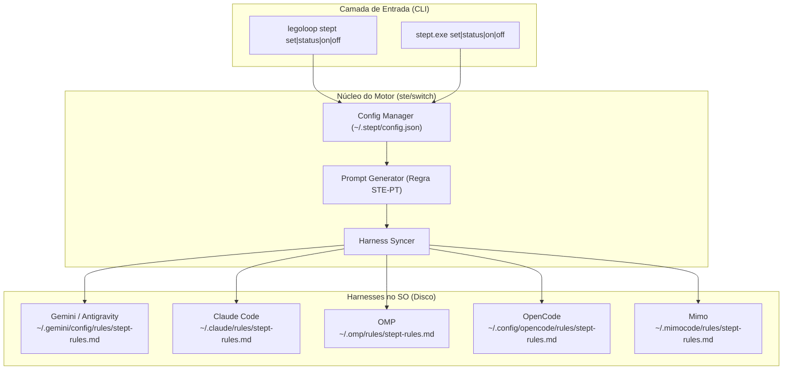

# 📋 SPEC: Alternador Global e Granular de Output STE-PT para Harnesses

> **Status:** Proposta para Revisão  
> **Data:** 2026-11-05  
> **Versão:** 1.0.0  
> **Autor:** Antigravity (Fusão Addy Osmani + Matt Pocock + AIDD-Spec)  
> **Referência da Intenção:** [docs/intents/2026-11-05_INTENT_STEPT_SWITCH.md](../intents/2026-11-05_INTENT_STEPT_SWITCH.md)  
> **Alvo Primário:** `internal/ste`, `internal/cli`, `cmd/legoloop`, `C:\Users\trcnologia\Desktop\stept-cli`  
> **Consome:** INTENT aprovada · **Produz:** PLAN e ROUTE  
> **Template:** TEMPLATE_SPEC.md v2.0.0  

---

## 1. Premissas Técnicas Assumidas (Addy Osmani)

> [!IMPORTANT]
> A IA lista abaixo todas as premissas técnicas adotadas para evitar decisões silenciosas:
1. **Runtime Go e Zero Dependências:** Implementação 100% baseada na biblioteca padrão do Go (`encoding/json`, `os`, `path/filepath`, `strings`, `fmt`). Nenhuma dependência externa será adicionada ao `go.mod`.
2. **Persistência Centralizada com Herança:** O estado do alternador é persistido em `~/.stept/config.json`. A configuração possui um perfil `padrao` e sobreposições opcionais por harness em um mapa `harnesses`. Se um harness não tiver sobreposição declarada, ele herda o perfil padrão.
3. **Injeção Atômica e Não-Destrutiva:** As regras nos harnesses são materializadas em arquivos dedicados de regras (ex.: `stept-rules.md`). Nenhuma regra preexistente do usuário é deletada ou sobrescrita; quando o modo é `off`, apenas o arquivo `stept-rules.md` do respectivo harness é excluído do disco.
4. **Reuso do Pacote `internal/ste`:** O motor de alternância e geração de regras será incorporado ao pacote existente `internal/ste/` no LegoLoop, aproveitando os tipos de `Cartao` e mantendo a coesão do domínio STE-PT.
5. **Hermeticidade nos Testes:** Testes unitários nunca tocam em caminhos reais do usuário (`~/.stept` ou `~/.gemini`). Todas as suítes utilizam `t.TempDir()` e injeção de diretório base via opções ou dependências injetáveis.

---

## 2. Fronteiras de Ação & Regras de Governança (Boundaries — Addy Osmani)

* **Sempre Fazer:**
  * Desenvolver via TDD estrito (teste unitário falhando antes do código de produção).
  * Manter funções pequenas, enxutas e de responsabilidade única (< 35 linhas).
  * Tratar caminhos de arquivo com compatibilidade Windows/POSIX (`filepath.Join`, `filepath.Clean`).
  * Validar rigorosamente enumerações e inputs antes de gravar no disco.
  * Recompilar o binário `bin/legoloop.exe` ao final das alterações em Go.
* **Perguntar Antes:**
  * Adicionar qualquer dependência nova ao `go.mod`.
  * Alterar a estrutura do `glossario.json` ou do `Cartao` existente em `internal/ste/`.
  * Modificar regras globais preexistentes em `AGENTS.md`.
* **Nunca Fazer:**
  * Criar funções vazias com `TODO`, `pass` ou mocks simulados (Zero Stubs).
  * Fazer chamadas de rede ou telemetria externa.
  * Deletar regras globais alheias presentes nos diretórios dos harnesses (como `caveman-global.md`).

---

## 3. Visão Geral, Arquitetura & Costuras de Teste (Test Seams — Pocock)

A solução é composta por um motor central compartilhado de configuração e injeção de regras, exposto em duas superfícies operacionais complementares:

1. **Subcomando no LegoLoop (`legoloop stept`):** Integrado à CLI do projeto para uso em pipelines e desenvolvedores do ecossistema.
2. **Projeto Comercial Standalone (`stept-cli`):** Binário isolado em `C:\Users\trcnologia\Desktop\stept-cli`, com compilação instantânea, árvore limpa, manual completo de distribuição e documentação comercial.

### Diagrama de Fronteiras (Mermaid)



### Costuras de Teste (Test Seams — Pocock)
* **Costura Primária (Highest Seam):**
  `Sync(cfg *Config, baseDir string) ([]HarnessStatus, error)`
  Permite passar uma raiz fictícia (`t.TempDir()`), simulando os diretórios `home` de todos os harnesses sem tocar no disco real do usuário.
* **Costura Secundária:**
  `PromptRegra(perfil ConfigPerfil) string`
  Função pura que gera a regra markdown a ser gravada nos arquivos de regras dos agentes, testada por asserções textuais exatas.
* **Dublês Permitidos:** Apenas sistema de arquivos isolado via raiz temporária `t.TempDir()`.

---

## 4. Contratos de Dados & Schemas Formais

```go
package ste

import (
	"errors"
	"strings"
)

// ErrInvalido sinaliza valor inválido para modo, pausa ou harness.
var ErrInvalido = errors.New("ste: entrada inválida no alternador")

// Modo define a frequência de exibição do Cartão STE-PT.
type Modo string

const (
	ModoOff     Modo = "off"
	ModoHibrido Modo = "hibrido"
	ModoEstrito Modo = "estrito"
)

// Pausa define a política de interrupção antes de ações com efeito.
type Pausa string

const (
	PausaNunca      Pausa = "nunca"
	PausaDestrutivo Pausa = "destrutivo"
	PausaSempre     Pausa = "sempre"
)

// HarnessID identifica de forma única os harnesses suportados.
type HarnessID string

const (
	HarnessGemini   HarnessID = "gemini"
	HarnessClaude   HarnessID = "claude"
	HarnessOMP      HarnessID = "omp"
	HarnessOpenCode HarnessID = "opencode"
	HarnessMimo     HarnessID = "mimo"
)

// ConfigPerfil define a tupla de 2 eixos para um harness ou padrão.
type ConfigPerfil struct {
	Modo  Modo  `json:"modo"`
	Pausa Pausa `json:"pausa"`
}

// Config representa a estrutura persistida em ~/.stept/config.json.
type Config struct {
	Padrao    ConfigPerfil             `json:"padrao"`
	Harnesses map[HarnessID]ConfigPerfil `json:"harnesses,omitempty"`
}

// HarnessStatus reporta o estado em tempo real de um harness.
type HarnessStatus struct {
	ID        HarnessID    `json:"id"`
	Nome      string       `json:"nome"`
	Instalado bool         `json:"instalado"`
	Caminho   string       `json:"caminho"`
	Ativo     bool         `json:"ativo"`
	Perfil    ConfigPerfil `json:"perfil"`
	Origem    string       `json:"origem"` // "override" | "padrao"
}

// Validate valida a integridade das configurações.
func (c ConfigPerfil) Validate() error {
	switch c.Modo {
	case ModoOff, ModoHibrido, ModoEstrito:
	default:
		return ErrInvalido
	}
	switch c.Pausa {
	case PausaNunca, PausaDestrutivo, PausaSempre:
	default:
		return ErrInvalido
	}
	return nil
}
```

---

## 5. Critérios Binários de Aceite por Nó / Ticket (BDD)

### Épico 01 — Motor de Configuração, Persistência e Regras STE-PT

* [ ] `AC-E01.1`: **Persistência e Resolução de Herança de Configuração**
  * **Dado que:** Uma configuração possui `padrao = {modo: "hibrido", pausa: "destrutivo"}` e um override para `claude = {modo: "estrito", pausa: "sempre"}`.
  * **Quando:** Invocada a resolução para `gemini` (sem override) e para `claude` (com override).
  * **Então:** `gemini` recebe o perfil padrão com origem `"padrao"`, e `claude` recebe o perfil específico com origem `"override"`.
* [ ] `AC-E01.2`: **Validação Estrita de Enums**
  * **Dado que:** Uma chamada tenta definir modo `"invalido"` ou pausa `"aleatoria"`.
  * **Quando:** O método `Validate()` ou a função de salvamento é invocada.
  * **Então:** Retorna `ErrInvalido` e nenhuma alteração é persistida no disco.
* [ ] `AC-E01.3`: **Geração do Prompt Canônico ASD / STE-PT**
  * **Dado que:** Um perfil `{modo: "hibrido", pausa: "destrutivo"}` é passado para geração de prompt.
  * **Quando:** `PromptRegra(perfil)` é executado.
  * **Então:** O markdown gerado contém a estrutura estrita de `Cartao` (`AÇÃO`, `AVISO`, `O QUE VAI ACONTECER`, `EFEITO`, `SE DER ERRADO`, `DECISÃO`) e a diretiva exata de pausa para ações destrutivas.

### Épico 02 — Sincronizador de Harnesses & CLI Integrada no LegoLoop

* [ ] `AC-E02.1`: **Injeção Atômica de Regras por Harness**
  * **Dado que:** O diretório de regras do Gemini (`~/.gemini/config/rules/`) existe e o modo está configurado para `hibrido`.
  * **Quando:** A função de sincronização é executada.
  * **Então:** O arquivo `stept-rules.md` é criado com o prompt correspondente, com permissões adequadas e sem alterar outros arquivos.
* [ ] `AC-E02.2`: **Remoção Limpa no Modo Off**
  * **Dado que:** Um harness possui `stept-rules.md` ativo e o comando `stept off --harness gemini` é executado.
  * **Quando:** O sincronizador é disparado.
  * **Então:** O arquivo `stept-rules.md` é removido fisicamente e os demais arquivos da pasta permanecem intactos.
* [ ] `AC-E02.3`: **Comando `legoloop stept status` Formata Tabela**
  * **Dado que:** Múltiplos harnesses estão presentes no ambiente temporário.
  * **Quando:** O comando `legoloop stept status` é chamado.
  * **Então:** Exibe uma tabela limpa no stdout com as colunas `HARNESS`, `INSTALADO`, `STATUS`, `MODO`, `PAUSA`, `ORIGEM` e `CAMINHO`, retornando exit code 0.

### Épico 03 — Projeto Standalone no Desktop (`stept-cli`)

* [ ] `AC-E03.1`: **Materialização e Compilação Isolada no Desktop**
  * **Dado que:** O diretório `C:\Users\trcnologia\Desktop\stept-cli` é criado com o código Go independente.
  * **Quando:** O comando `go build -o bin/stept.exe ./cmd/stept` é executado na raiz do projeto standalone.
  * **Então:** O executável `bin/stept.exe` é gerado sem erros e executa `stept status` com êxito.
* [ ] `AC-E03.2`: **Documentação Completa e Manual Comercial**
  * **Dado que:** A pasta do projeto no Desktop está concluída.
  * **Quando:** Verificados os arquivos de documentação.
  * **Então:** Devem existir `README.md` (visão comercial, instalação e guia rápido) e `MANUAL.md` (referência detalhada dos comandos, flags e matriz de 2 eixos).
* [ ] `AC-NF.1`: **Critério Não-Funcional: Desempenho e Latência Sub-10ms**
  * **Dado que:** O comando `stept status` ou `stept set` é executado no terminal.
  * **Quando:** Medido o tempo de execução no SO.
  * **Então:** A execução completa (leitura de config + varredura de diretórios + output) encerra em menos de 10ms.

---

## 6. Comandos Operacionais & Critério de Conclusão Global (Addy Osmani)

### Comandos de Verificação Mecânica
* **Build LegoLoop:** `go build -o bin/legoloop.exe ./cmd/legoloop`
* **Test LegoLoop:** `go test -count=1 ./internal/ste/... ./internal/cli/...`
* **Build Standalone:** `cd C:\Users\trcnologia\Desktop\stept-cli && go build -o bin/stept.exe ./cmd/stept`
* **Test Standalone:** `cd C:\Users\trcnologia\Desktop\stept-cli && go test -count=1 ./...`
* **Estática e formatação:** `go vet ./...` e `gofmt -l .` (saída vazia).
* **Linter de funções curtas:** `go run ./tools/funclen internal` (nenhuma função > 35 linhas).
* **Dependências intactas:** `git diff --exit-code go.mod go.sum` (somente stdlib).

### Critério de Done Global
A especificação técnica é considerada **100% CONCLUÍDA** quando:
- [ ] 100% dos critérios binários `AC-E01.*`, `AC-E02.*`, `AC-E03.*` e `AC-NF.1` estiverem marcados como atendidos (`[x]`).
- [ ] Os testes unitários passarem com exit code 0 em ambos os projetos.
- [ ] Os binários `bin/legoloop.exe` e `Desktop\stept-cli\bin\stept.exe` estiverem compilados e testados.
- [ ] Zero arquivos temporários ou órfãos residuais.

---

🛑 **STOP-GATE 02 DE AUDITORIA HUMANA:**  
*As premissas assumidas, as fronteiras (boundaries), os contratos e os critérios binários acima atendem à sua expectativa?*  
*Somente após a aprovação explícita do usuário, deve-se gerar o PLAN (`docs/plans/2026-11-05_PLAN_STEPT_SWITCH.md`) e a ROUTE (`docs/routes/2026-11-05_ROUTE_STEPT_SWITCH.json`).*
