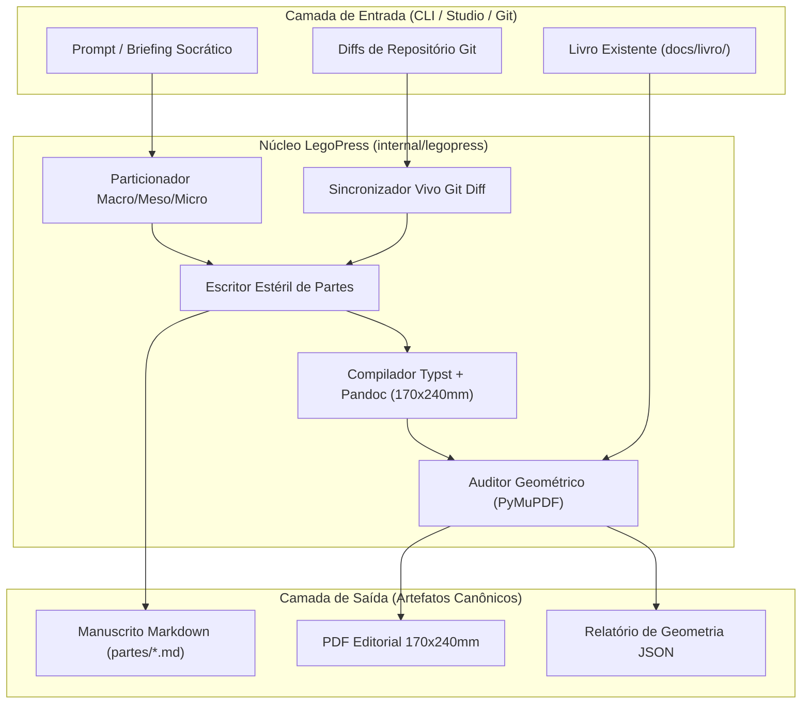

# 📋 SPEC: LegoPress™ — Pipeline Industrial e Template Canônico de Livros Técnicos

> **Status:** Proposta para Revisão  
> **Data:** 2026-11-06  
> **Versão:** 1.0.0  
> **Autor:** Heverton & Ecossistema LegoLoop (Fusão Addy Osmani + Matt Pocock + AIDD-Spec)  
> **Referência da Intenção:** [docs/intents/2026-11-06_INTENT_LEGOPRESS_PIPELINE.md](../intents/2026-11-06_INTENT_LEGOPRESS_PIPELINE.md)  
> **Alvo Primário:** `internal/legopress/`, `docs/templates/`, `cmd/legoloop/`  
> **Consome:** INTENT aprovada · **Produz:** PLAN e ROUTE  
> **Template:** TEMPLATE_SPEC.md v2.0.0  

---

## 1. Premissas Técnicas Assumidas (Addy Osmani)

1. **Premissa de Runtime:** Linguagem Go 1.23+ conforme o `go.mod` do projeto, utilizando exclusivamente tipos da standard library e zero dependências externas novas adicionadas ao `go.mod`.
2. **Premissa de Diagramação & Compilação:** Compilação tipográfica baseada em Pandoc e Typst (suportando tanto o binário CLI do sistema quanto o pacote Python `typst` como fallback), gerando PDF no formato físico padrão de 170mm x 240mm com margens de 18mm/20mm e entrelinha 1.45 a 1.5.
3. **Premissa de Auditoria Geométrica:** A validação geométrica automatizada inspeciona bounding boxes de texto e páginas via PyMuPDF (fitz) em modo headless, emitindo código de saída 0 apenas quando:
   - 100% dos cabeçalhos running headers estão em uma única linha horizontal.
   - 100% dos registros de tabelas estão em linha única, com fontes calibradas e sem hifenização forçada.
   - Zero páginas em branco ou órfãs (< 15 linhas) ocorrem no miolo (permitidas estritamente no encerramento de Partes).
4. **Premissa de Reuso:** Reuso estrito do mecanismo de stop-gates (`internal/gate/`), execução de DAG (`internal/dag/`) e servidor do Looping Studio (`internal/studio/`). Os novos módulos residem isoladamente no pacote `internal/legopress/`.

---

## 2. Fronteiras de Ação & Regras de Governança (Boundaries — Addy Osmani)

O pipeline e os agentes devem respeitar estritamente o sistema de fronteiras em 3 níveis:
* **Sempre Fazer:**
  * Desenvolver via TDD estrito (teste unitário falhando antes do código de produção).
  * Manter funções pequenas, enxutas e de responsabilidade única (< 35 linhas).
  * Tratar caminhos de arquivos de forma compatível com Windows e POSIX (`filepath.Join` / `filepath.ToSlash`).
  * Recompilar o binário `bin/legoloop.exe` ao final de qualquer alteração no código Go.
  * Validar todas as estruturas de dados contra esquemas JSON formais antes de qualquer I/O.
* **Perguntar Antes:**
  * Adicionar dependências externas novas ao `go.mod` ou bibliotecas globais.
  * Modificar o template visual base (`docs/livro/ativos/livro.typst`) de modo que altere livros já homologados.
  * Alterar a assinatura dos comandos existentes da CLI no `cmd/legoloop/`.
* **Nunca Fazer:**
  * Criar funções vazias com `TODO`, `pass` ou mocks simulados em código de produção (Lei #1: Zero Stubs).
  * Permitir que modelos de linguagem escrevam blocos de texto sem isolamento cirúrgico de contexto (Orchestrix estéril).
  * Injetar cabeçalhos com quebra de linha ou tabelas com textos comprimidos.

---

## 3. Visão Geral, Arquitetura & Costuras de Teste (Test Seams — Pocock)

A esteira **LegoPress™** opera como um pipeline modular de 4 modos operacionais:
1. **Criar (Greenfield):** `Briefing Socrático` ➔ `Fatiamento Macro/Meso/Micro` ➔ `Redação Estéril por Nó` ➔ `Compilação Typst` ➔ `Auditoria Geométrica`.
2. **Editar (Hotfix Cirúrgico):** `Auditoria Visual` ➔ `Diagnóstico de Colisão` ➔ `Patch de CSS/Typst/Markdown` ➔ `Recompilação`.
3. **Atualizar (Sync de Repositório):** `Git Diff Engine` ➔ `Mapeamento de Arquivos Afetados` ➔ `Regeneração de Nós Defasados`.
4. **Adequar (Transmutação Didática):** `Ingestão de Código/Docs` ➔ `Remoção de IA-slop e Jargões` ➔ `Estruturação Pedagógica LegoLoop`.

### Diagrama de Fronteiras (Mermaid)



### Costuras de Teste (Test Seams — Pocock)
* **Costura Primária (Highest Seam):**
  ```go
  func ExecuteLegoPress(ctx context.Context, req Request, runner CommandRunner) (*Result, error)
  ```
  Permite validar todo o ciclo da esteira injetando um `CommandRunner` mockado em testes unitários herméticos sem invocar programas externos.
* **Costura de Compilação:**
  ```go
  func (c *Compiler) Compile(manifest Manifest, destPDF string) error
  ```
* **Costura de Auditoria Geométrica:**
  ```go
  func (a *Auditor) AuditPDF(pdfPath string) (*GeometryReport, error)
  ```

---

## 4. Contratos de Dados & Schemas Formais

```go
package legopress

import (
	"errors"
	"strings"
)

var (
	ErrManifestoInvalido = errors.New("legopress: manifesto invalido")
	ErrGeometriaFalhou   = errors.New("legopress: falha na auditoria geometrica")
	ErrModoDesconhecido  = errors.New("legopress: modo operacional desconhecido")
)

type Mode string

const (
	ModeCreate  Mode = "create"
	ModeEdit    Mode = "edit"
	ModeSync    Mode = "sync"
	ModeAdapt   Mode = "adapt"
	ModeAudit   Mode = "audit"
)

type Part struct {
	ID       string   `json:"id"`
	Title    string   `json:"title"`
	File     string   `json:"file"`
	Level    int      `json:"level"`
	Words    int      `json:"words,omitempty"`
}

type Manifest struct {
	Title        string   `json:"title"`
	Subtitle     string   `json:"subtitle"`
	Author       string   `json:"author"`
	Format       string   `json:"format"` // "170x240mm"
	Template     string   `json:"template"`
	Parts        []Part   `json:"parts"`
	OutputPDF    string   `json:"output_pdf"`
}

func (m Manifest) Validate() error {
	if strings.TrimSpace(m.Title) == "" || len(m.Parts) == 0 {
		return ErrManifestoInvalido
	}
	for _, p := range m.Parts {
		if strings.TrimSpace(p.File) == "" {
			return ErrManifestoInvalido
		}
	}
	return nil
}

type GeometryReport struct {
	TotalPages       int      `json:"total_pages"`
	OrphanPages      []int    `json:"orphan_pages,omitempty"`
	BrokenHeaders    []int    `json:"broken_headers,omitempty"`
	MultiLineTables  []int    `json:"multiline_tables,omitempty"`
	Valid            bool     `json:"valid"`
}
```

---

## 5. Critérios Binários de Aceite por Nó / Ticket (BDD)

### Épico 01 — Fundação de Tipos, Validação e Particionador
* [ ] `AC-E01.1`: **Validação do Manifesto do Livro**
  * **Dado que:** Um manifesto JSON válido com 8 partes e formato `170x240mm` é recebido.
  * **Quando:** O método `Manifest.Validate()` é executado.
  * **Então:** Retorna `nil` e confirma integridade de todos os caminhos de partes.
* [ ] `AC-E01.2`: **Rejeição de Manifesto sem Partes**
  * **Dado que:** Um manifesto sem nenhuma parte é fornecido.
  * **Quando:** O método `Manifest.Validate()` é executado.
  * **Então:** Retorna o erro sentinela `ErrManifestoInvalido`.
* [ ] `AC-E01.3`: **Fatiamento Hierárquico em 3 Níveis**
  * **Dado que:** Um índice de tópicos é submetido ao `Partitioner`.
  * **Quando:** A função `PartitionIndex()` é invocada.
  * **Então:** Agrupa estritamente em `Macro` (nível 1), `Meso` (nível 2) e `Micro` (nível 3).

### Épico 02 — Motor de Compilação & Template Typst 170x240mm
* [ ] `AC-E02.1`: **Geração do Comando de Compilação Pandoc + Typst**
  * **Dado que:** O compilador é configurado com template `ativos/livro.typst` e saída `livro.pdf`.
  * **Quando:** O método `BuildArgs()` é executado.
  * **Então:** Produz a lista exata de argumentos com `--template`, `--pdf-engine typst` e variáveis de formato.
* [ ] `AC-E02.2`: **Detecção de Dependências Mecânicas**
  * **Dado que:** O compilador inicia o ciclo de vida.
  * **Quando:** O método `Doctor()` é disparado.
  * **Então:** Verifica a existência de `pandoc` e do compilador `typst` reportando status e versão.

### Épico 03 — Motor de Auditoria Mecânica & Verificação Geométrica
* [ ] `AC-E03.1`: **Detecção de Cabeçalho Quebrado**
  * **Dado que:** Um PDF gerado possui cabeçalho ocupando mais de 1 linha vertical na página 12.
  * **Quando:** O `Auditor.AuditPDF()` processa o arquivo.
  * **Então:** Reporta a página 12 em `BrokenHeaders` e define `Valid = false`.
* [ ] `AC-E03.2`: **Validação de Sucesso com PDF Perfeito**
  * **Dado que:** O PDF de 57 páginas do LegoLoop em conformidade estrita é auditado.
  * **Quando:** O `Auditor.AuditPDF()` processa o arquivo.
  * **Então:** Retorna `Valid = true`, com `OrphanPages`, `BrokenHeaders` e `MultiLineTables` vazios.

### Épico 04 — Motores de Adequação Didática & Atualização Viva por Git Diff
* [ ] `AC-E04.1`: **Sincronização Viva via Git Diff**
  * **Dado que:** O arquivo `internal/dag/runner.go` foi alterado no commit mais recente.
  * **Quando:** O motor `SyncEngine.DetectStaleParts()` é executado com base na rastreabilidade.
  * **Então:** Aponta exatamente `04-micro-o-motor-e-governanca.md` como defasado.
* [ ] `AC-E04.2`: **Purificação Didática contra IA-Slop**
  * **Dado que:** Um texto bruto de entrada contém introduções prolixas ("Com certeza, vou explicar...").
  * **Quando:** O `Transmuter.Sanitize()` é executado.
  * **Então:** Remove as saudações e converte diretamente para o estilo conciso didático LegoLoop.

### Épico 05 — Integração na CLI & Template Canônico de Rota
* [ ] `AC-E05.1`: **Execução do Subcomando CLI `legoloop legopress`**
  * **Dado que:** O usuário digita `legoloop legopress --help`.
  * **Quando:** O comando é interpretado pelo binário `bin/legoloop.exe`.
  * **Então:** Exibe os subcomandos `criar`, `editar`, `atualizar`, `adequar`, `auditar` e `preview` com exit code 0.
* [ ] `AC-E05.2`: **Validação do Grafo da Rota Canônica**
  * **Dado que:** O arquivo `docs/templates/TEMPLATE_ROUTE_LEGOPRESS.json` foi gerado.
  * **Quando:** O comando `legoloop validate docs/templates/TEMPLATE_ROUTE_LEGOPRESS.json` é executado.
  * **Então:** Valida o DAG com sucesso, zero ciclos e todos os nós com contratos de entrada/saída válidos.

---

## 6. Comandos Operacionais & Critério de Conclusão Global (Addy Osmani)

### Comandos de Verificação Mecânica
* **Build:** `go build -o bin/legoloop.exe ./cmd/legoloop`
* **Test:** `go test -v -count=1 ./internal/legopress/...`
* **Estática e formatação:** `go vet ./...` e `gofmt -l .` (saída vazia).
* **Validação de DAG:** `go run ./cmd/legoloop validate docs/templates/TEMPLATE_ROUTE_LEGOPRESS.json`

### Critério de Done Global
A especificação técnica é considerada **100% CONCLUÍDA** quando:
- [ ] 100% dos critérios binários `AC-E01.*` a `AC-E05.*` estiverem atendidos e validados por testes.
- [ ] O comando de **Test** passar com exit code 0.
- [ ] `go vet ./...` e `gofmt -l .` não reportarem nenhuma anomalia.
- [ ] O comando de **Build** recompilar com sucesso o binário `bin/legoloop.exe`.
- [ ] O template executável `docs/templates/TEMPLATE_ROUTE_LEGOPRESS.json` estiver homologado e versionado.
- [ ] Zero arquivos temporários ou órfãos residuais.

---

🛑 **STOP-GATE 02 DE AUDITORIA HUMANA:**  
*As premissas técnicas, a arquitetura com costuras de teste e os 11 critérios binários atendem à sua expectativa?*  
*Somente após a aprovação explícita do usuário, deve-se gerar o PLAN e a ROUTE.*
