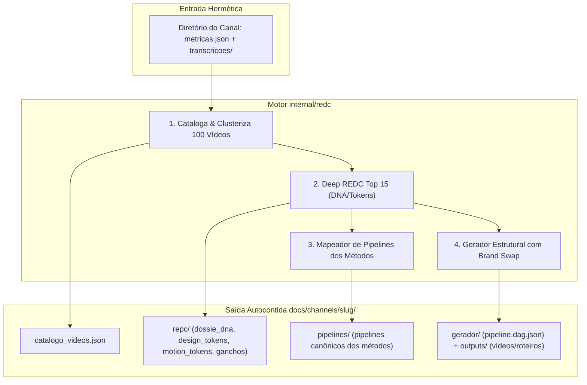

# 📋 SPEC: Mega-Pipeline REDC (Engenharia Reversa Profunda de Canais e Clonagem Metodológica/Estrutural)

> **Status:** Proposta para Revisão  
> **Data:** 2026-11-07  
> **Versão:** 1.0.0  
> **Autor:** LegoLoop (Fusão Addy Osmani + Matt Pocock + AIDD-Spec)  
> **Iniciativa:** I04 — Mega-Pipelines Audiovisuais e Automação de Canais  
> **Referência da Intenção:** [docs/intents/2026-11-07_INTENT_CANAL_REDC.md](../intents/2026-11-07_INTENT_CANAL_REDC.md)  
> **Alvo Primário:** `internal/redc`, `internal/cli`, `loops/legoloop-canal-redc`, `skills/legoloop-canal-redc`  
> **Consome:** INTENT aprovada · **Produz:** PLAN e ROUTE  
> **Template:** TEMPLATE_SPEC.md v2.0.0  

---

## 1. Premissas Técnicas Assumidas (Addy Osmani)

> [!IMPORTANT]
> A IA lista abaixo todas as premissas técnicas adotadas para evitar decisões silenciosas. Alerte no Stop-Gate 02 caso alguma premissa esteja incorreta:
1. **Runtime & Dependências:** Implementação 100% em Go padrão (`go.mod` intacto), usando exclusivamente a biblioteca padrão (`os`, `path/filepath`, `encoding/json`, `strings`, `sort`, `fmt`). Zero dependências externas novas.
2. **Armazenamento e Autocontenção:** Estrutura autocontida por canal em `docs/channels/<canal-slug>/`, garantindo total isolamento sem poluir outros diretórios do repositório.
3. **Ingestão Hermética e Segura:** Dados brutos dos 100 vídeos entram via arquivos locais (`transcricoes/*.txt`, `metricas.json` ou CSV estruturado). Sem scrapers ao vivo acoplados que causem fragilidade de rede ou quebra por bloqueio de API.
4. **Amostragem Inteligente (Lei de Pareto):** Tabulação e clustering temático de 100 vídeos; análise profunda (Deep REDC) executada sobre os Top 15 vídeos de maior tração/engajamento para síntese dos tokens de DNA, evitando explosão de tokens e dados redundantes.
5. **Reuso Interno:** Reaproveitamento das convenções canônicas de DAG do LegoLoop (`internal/dag`), runners estéreis e validação de contratos de I/O.

---

## 2. Fronteiras de Ação & Regras de Governança (Boundaries — Addy Osmani)

O pipeline e os agentes devem respeitar estritamente o sistema de fronteiras em 3 níveis:
* **Sempre Fazer:**
  * Desenvolver via TDD estrito (teste unitário falhando antes do código de produção).
  * Manter funções pequenas, enxutas e de responsabilidade única (< 35 linhas).
  * Validar rigorosamente todos os inputs e decodificações de JSON, incluindo sanitização de nomes de canal e caminhos (sem `..`, sem caminhos absolutos fora da raiz).
  * Tratar caminhos de forma compatível com Windows e POSIX (`filepath.Join` / `filepath.ToSlash`).
  * Recompilar o binário `bin/legoloop.exe` ao final de qualquer alteração em Go (AGENTS.md, regra 5).
* **Perguntar Antes:**
  * Adicionar qualquer nova dependência externa no `go.mod`.
  * Alterar schemas de canais existentes em `docs/channels/`.
  * Modificar contratos de comandos já consolidados no CLI (`legoloop canal ...`).
* **Nunca Fazer:**
  * Criar funções vazias com `TODO`, `pass`, `// implementar depois` ou mocks em produção (Lei #1: Zero Stubs).
  * Fazer polling em tasks de harness ou usar `invoke_subagent` (banido pelo AGENTS.md).
  * Commitar arquivos temporários ou quebrar a suíte global de testes.
  * Gerar nós acoplados que dependam de variáveis globais de outros blocos.

---

## 3. Visão Geral, Arquitetura & Costuras de Teste (Test Seams — Pocock)

A esteira REDC de Canais é dividida em 4 motores autocontidos orquestrados pelo pacote `internal/redc`:
1. **Motor de Ingestão e Catalogação:** Lê o diretório bruto de vídeos, extrai métricas (views, retenção, engajamento) e monta o `catalogo_videos.json` agrupando os métodos em clusters temáticos.
2. **Motor Deep REDC (Top 15):** Dissecar os 15 vídeos mais virais gerando `01_dossie_dna.json` (tom de voz, arquétipos, personas), `02_design_tokens.json` (paleta, tipografia, grids), `03_motion_tokens.json` (ritmo de corte a cada N segundos, aceleração, cartões 3D, zooms) e `04_matriz_ganchos.md` (fórmulas testadas de hooks nos primeiros 3s).
3. **Motor de Clonagem Metodológica:** Para cada cluster ou método detectado, gera um pipeline canônico executável em `docs/channels/<slug>/pipelines/` com Tríade, DAG e Skill.
4. **Motor Gerador Estrutural com Brand Swap:** Pipeline paramétrico que aceita `{ tema: string, marca: BrandTokens }`, aplica o esqueleto de retenção do canal clonado, mas substitui os tokens visuais e de voz pela marca do usuário em `docs/channels/<slug>/outputs/`.

### Diagrama de Fronteiras (Mermaid)



### Costuras de Teste (Test Seams — Pocock)
* **Costura Primária (Highest Seam):** `redc.ProcessChannel(ctx context.Context, input redc.ChannelInput, fs redc.FS) (redc.ChannelReport, error)`
* **Justificativa:** Permite testar o ciclo completo de análise, síntese e emissão de artefatos com injeção de sistema de arquivos em memória ou fixture hermética (`testdata/fixtures/sample_channel`).
* **Costuras Secundárias:**
  * `redc.CatalogVideos(raw []byte) ([]redc.VideoEntry, error)`: parser puro de metadados e métricas.
  * `redc.ExtractDNA(topVideos []redc.VideoEntry) (redc.ChannelDNA, error)`: sintetizador de tom, design e motion tokens.
  * `redc.GenerateMethodPipelines(clusters []redc.MethodCluster) ([]redc.MethodPipeline, error)`: gerador de pipelines canônicos.
  * `redc.GenerateStructuralVideo(req redc.GenerationRequest) (redc.GeneratedVideoSpec, error)`: motor de troca de marca e injeção temática.
* **Dublês Permitidos:** Apenas abstração do sistema de arquivos (`t.TempDir()`) e dados de entrada fixos em `testdata/fixtures/`. Zero rede.

---

## 4. Contratos de Dados & Schemas Formais

```go
package redc

import (
	"errors"
	"strings"
)

var (
	ErrCanalInvalido   = errors.New("redc: identificador do canal inválido")
	ErrVideosInsuf     = errors.New("redc: lote de vídeos insuficiente (mínimo 1 vídeo)")
	ErrDadosCorrompidos = errors.New("redc: dados brutos de métricas corrompidos")
	ErrTemaObrigatorio  = errors.New("redc: tema do usuário é obrigatório para geração")
)

type VideoEntry struct {
	ID           string   `json:"id"`
	Titulo       string   `json:"titulo"`
	Views        int64    `json:"views"`
	Likes        int64    `json:"likes"`
	Comentarios  int64    `json:"comentarios"`
	DuracaoSeg   int      `json:"duracao_seg"`
	Gancho3s     string   `json:"gancho_3s"`
	Metodo       string   `json:"metodo"`
	ClusterTema  string   `json:"cluster_tema"`
	Transcricao  string   `json:"transcricao"`
}

type ChannelDNA struct {
	TomDeVoz     string            `json:"tom_de_voz"`
	Arquetipo    string            `json:"arquetipo"`
	RitmoCortes  string            `json:"ritmo_cortes"`
	DesignTokens map[string]string `json:"design_tokens"`
	MotionTokens map[string]string `json:"motion_tokens"`
	TopGanchos   []string          `json:"top_ganchos"`
}

type BrandTokens struct {
	NomeMarca      string `json:"nome_marca"`
	CorPrimaria    string `json:"cor_primaria"`
	CorSecundaria  string `json:"cor_secundaria"`
	FonteTitulo    string `json:"fonte_titulo"`
	FonteCorpo     string `json:"fonte_corpo"`
	TomPreferido   string `json:"tom_preferido"`
}

type GenerationRequest struct {
	CanalSlug string      `json:"canal_slug"`
	Tema      string      `json:"tema"`
	Marca     BrandTokens `json:"marca"`
}

type ChannelReport struct {
	CanalSlug       string   `json:"canal_slug"`
	TotalVideos     int      `json:"total_videos"`
	AmostraDeepREDC int      `json:"amostra_deep_redc"`
	MetodosUnicos   int      `json:"metodos_unicos"`
	DiretorioSaida  string   `json:"diretorio_saida"`
	ArquivosCriados []string `json:"arquivos_criados"`
}
```

---

## 5. Critérios Binários de Aceite por Nó / Ticket (BDD)

### Épico 01 — Núcleo de Catalogação e Clusterização dos 100 Vídeos (`internal/redc`)

* [ ] `AC-E01.1`: **Catalogação determinística de métricas e ranking de viralidade**
  * **Dado que:** Uma pasta de fixtures contém `metricas.json` com 100 vídeos e transcrições associadas.
  * **Quando:** `redc.CatalogVideos` é executado com os dados brutos.
  * **Então:** Retorna 100 entradas ordenadas decrescentemente por score de tração (`views * 0.7 + engajamento * 0.3`), com metadados higienizados.
* [ ] `AC-E01.2`: **Clusterização de métodos sem redundância**
  * **Dado que:** Os 100 vídeos possuem metodologias repetidas sob títulos alternativos.
  * **Quando:** O clusterizador de métodos processa a lista indexada.
  * **Então:** Agrupa os vídeos em clusters únicos de métodos, isolando as variantes sem duplicar pipelines.
* [ ] `AC-E01.3`: **Caminho de falha para arquivo corrompido ou vazio**
  * **Dado que:** A entrada de métricas contém JSON malformado ou lista vazia.
  * **Quando:** `redc.CatalogVideos` é chamado.
  * **Então:** Retorna `ErrDadosCorrompidos` ou `ErrVideosInsuf`, sem efeito colateral no disco.

### Épico 02 — Motor Deep REDC dos Top 15 Vídeos (DNA, Tokens e Ganchos)

* [ ] `AC-E02.1`: **Extração do Dossiê DNA sobre os Top 15 vídeos virais**
  * **Dado que:** A lista catalogada possui os Top 15 vídeos de pico destacados.
  * **Quando:** `redc.ExtractDNA` é executado.
  * **Então:** Produz o `ChannelDNA` com tom de voz identificado, ritmo médio de cortes, design tokens (cores dominantes, tipografia), motion tokens (transições, cartões) e matriz dos top ganchos dos primeiros 3s.
* [ ] `AC-E02.2`: **Persistência determinística da pasta `repc/`**
  * **Dado que:** O `ChannelDNA` foi sintetizado com sucesso.
  * **Quando:** A persistência da árvore é disparada para `docs/channels/<slug>/repc/`.
  * **Então:** Grava `01_dossie_dna.json`, `02_design_tokens.json`, `03_motion_tokens.json` e `04_matriz_ganchos.md` com JSONs válidos e cabeçalhos Markdown limpos.

### Épico 03 — Gerador de Pipelines Canônicos dos Métodos e Gerador com Marca Própria

* [ ] `AC-E03.1`: **Geração de pipelines de métodos em `docs/channels/<slug>/pipelines/`**
  * **Dado que:** O catálogo possui N clusters metodológicos identificados.
  * **Quando:** O gerador de pipelines de métodos é acionado.
  * **Então:** Gera as pastas dos micro-pipelines canônicos com manifesto `.loop.json` e DAG acíclico executável.
* [ ] `AC-E03.2`: **Geração de vídeo com Brand Swap e tema autônomo**
  * **Dado que:** O canal foi analisado e o usuário fornece um novo tema (ex.: "Como criar agentes de IA") e tokens da sua marca.
  * **Quando:** `redc.GenerateStructuralVideo` é invocado.
  * **Então:** Gera a especificação de vídeo em `outputs/` preservando a estrutura de retenção do canal clonado, mas aplicando as cores, fontes e tom do usuário.

### Épico 04 — Comandos CLI, Grafo DAG e Skill Canônica

* [ ] `AC-E04.1`: **Comando CLI `legoloop canal redc`**
  * **Dado que:** O operador executa `legoloop canal redc <canal-dir> --amostra 15 --json`.
  * **Quando:** O comando finaliza com sucesso.
  * **Então:** Exit code é 0, o payload JSON contém `ChannelReport` e os caminhos criados em `docs/channels/<canal>/`.
* [ ] `AC-E04.2`: **Comando CLI `legoloop canal gerar`**
  * **Dado que:** O canal já foi processado e o comando `legoloop canal gerar <slug> --tema "..."` é chamado.
  * **Quando:** A execução conclui.
  * **Então:** Exit code é 0 e o artefato de roteiro/estrutura é emitido em `docs/channels/<slug>/outputs/`.
* [ ] `AC-E04.3`: **Validação do Grafo DAG `loops/legoloop-canal-redc/pipeline.dag.json`**
  * **Dado que:** O grafo acíclico do canal é submetido ao validador do LegoLoop.
  * **Quando:** `legoloop validate loops/legoloop-canal-redc/pipeline.dag.json` é executado.
  * **Então:** Retorna exit code 0 e confirmação de 0 ciclos.

---

## 6. Comandos Operacionais & Critério de Conclusão Global (Addy Osmani)

### Comandos de Verificação Mecânica
* **Build:** `go build -o bin/legoloop.exe ./cmd/legoloop`
* **Test:** `go test -v -count=1 ./internal/redc/... ./internal/cli/...`
* **Estática e formatação:** `go vet ./...` e `gofmt -l .` (saída vazia)
* **Funclen:** `go run ./tools/funclen internal` (todas as funções <= 35 linhas)
* **Dependências intactas:** `git diff --exit-code go.mod go.sum`

### Critério de Done Global
A especificação técnica é considerada **100% CONCLUÍDA** quando:
- [ ] 100% dos critérios binários `AC-E01.*` a `AC-E04.*` estiverem marcados como atendidos (`[x]`).
- [ ] O comando de **Test** passar com exit code 0.
- [ ] `go vet ./...` e `gofmt -l .` não reportarem nada.
- [ ] `funclen` validar todas as funções <= 35 linhas.
- [ ] O comando de **Build** recompilar com sucesso o binário `bin/legoloop.exe`.
- [ ] `legoloop validate loops/legoloop-canal-redc/pipeline.dag.json` validar sem erros.

---

🛑 **STOP-GATE 02 DE AUDITORIA HUMANA:**  
*As premissas assumidas, as fronteiras (boundaries), os contratos e os critérios binários acima atendem à sua expectativa?*  
*Somente após a aprovação explícita do usuário, deve-se gerar o PLAN (`TEMPLATE_PLAN.md`) e a ROUTE (`TEMPLATE_ROUTE.json`).*