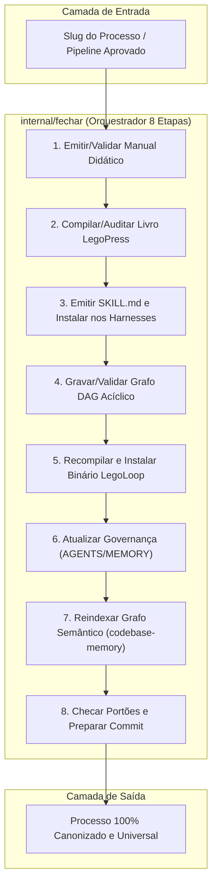

# 📋 SPEC: Motor Canônico Universal de Fechamento e Canonização (legoloop fechar)

> **Status:** APPROVED  
> **Data:** 2026-11-07  
> **Versão:** 1.0.0  
> **Autor:** Ecossistema LegoLoop (Fusão Addy Osmani + Matt Pocock + AIDD-Spec)  
> **Iniciativa:** Canonização Universal do Ciclo de Vida do LegoLoop  
> **Referência da Intenção:** [docs/intents/2026-11-07_INTENT_FECHAR_CANONICO.md](../intents/2026-11-07_INTENT_FECHAR_CANONICO.md)  
> **Alvo Primário:** `internal/fechar`, `internal/cli/fechar.go`, `skills/legoloop-fechar`, `loops/fechar`  
> **Consome:** INTENT aprovada · **Produz:** PLAN e ROUTE  
> **Template:** TEMPLATE_SPEC.md v2.0.0  

---

## 1. Premissas Técnicas Assumidas (Addy Osmani)

> [!IMPORTANT]
> A IA lista abaixo todas as premissas técnicas adotadas para evitar decisões silenciosas:
1. **Runtime Go:** Biblioteca padrão Go pura, conforme `go.mod`, zero dependências externas novas.
2. **Armazenamento e Idempotência:** Arquivos locais do sistema operacional em diretórios canônicos (`docs/manuals/`, `docs/books/`, `skills/`, `loops/`). A execução múltipla do comando para o mesmo processo deve ser segura e idempotente.
3. **Reuso de Motores Existentes:**
   - O gerador/auditor de livros reusa `internal/legopress` (`legopress.NewAuditor()`).
   - A distribuição nos harnesses reusa `internal/cli` (`runInstalarSkills`).
   - A validação de DAG reusa `internal/dag` (`dag.ParseStrict`).
   - A governança documental reusa os templates canônicos v2 em `docs/templates`.
4. **Isolamento e Segurança:** Zero chamadas a comandos shell inseguros. Chamadas de compilação usam `os/exec` direto sem shell (`spawn`).

---

## 2. Fronteiras de Ação & Regras de Governança (Boundaries — Addy Osmani)

* **Sempre Fazer:**
  * Desenvolver via TDD estrito (Red-Green-Refactor).
  * Manter funções curtas (< 35 linhas) cumprindo `tools/funclen`.
  * Tratar caminhos com `filepath.Join` compatível com Windows e POSIX.
  * Recompilar `bin/legoloop.exe` e instalar via `go install ./cmd/legoloop` ao término.
* **Perguntar Antes:**
  * Qualquer alteração no schema `pipeline.dag.json` ou `route.v2.json`.
  * Qualquer commit ou push no repositório Git (Stop-Gate Humano mandatória).
* **Nunca Fazer:**
  * Criar funções vazias com `TODO` ou mocks em código de produção (Lei #1: Zero Stubs).
  * Ignorar falhas de auditoria geométrica de livros ou quebras de testes.
  * Deixar arquivos temporários no cofre ou no workspace.

---

## 3. Visão Geral, Arquitetura & Costuras de Teste (Test Seams — Pocock)

O motor `internal/fechar` encapsula o pipeline determinístico em 8 etapas e expõe uma API Go clara, um comando de CLI (`legoloop fechar <slug>`) e um grafo DAG (`loops/fechar/pipeline.dag.json`):



### Costuras de Teste (Test Seams — Pocock)
* **Costura Primária (Highest Seam):** `fechar.Executar(ctx context.Context, req fechar.Request, deps fechar.Deps) (*fechar.Result, error)`
* **Justificativa:** Permite injetar roots efêmeros (`t.TempDir()`), bypass de comandos externos e validar os 8 passos ponta a ponta sem tocar o cofre real do usuário.
* **Dublês Permitidos:** Runner de subprocessos (`exec.Cmd`), gerador de timestamp e sistema de arquivos (`io/fs`).

---

## 4. Contratos de Dados & Schemas Formais

```go
package fechar

import (
	"errors"
	"strings"
	"time"
)

var (
	ErrSlugInvalido = errors.New("fechar: slug do processo inválido")
	ErrArtefatoAusente = errors.New("fechar: artefato obrigatório ausente")
	ErrPortaoFalhou = errors.New("fechar: portão de qualidade reprovado")
)

type Request struct {
	Slug      string `json:"slug"`       // Ex: "video-motion" ou "legoloop-video-motion"
	Titulo    string `json:"titulo"`     // Título humano amigável
	Autor     string `json:"autor"`      // Autor institucional (padrão: "Ecossistema LegoLoop")
	DryRun    bool   `json:"dry_run"`    // true = apenas valida sem gravar no disco
	SkipBuild bool   `json:"skip_build"` // true = pula compilação go (útil em testes unitários)
}

func (r Request) Validate() error {
	if strings.TrimSpace(r.Slug) == "" {
		return ErrSlugInvalido
	}
	return nil
}

type EtapaStatus struct {
	Etapa    int           `json:"etapa"`
	Nome     string        `json:"nome"`
	Status   string        `json:"status"` // "ok", "skipped", "error"
	Artefato string        `json:"artefato,omitempty"`
	Duracao  time.Duration `json:"duracao_ms"`
	Detalhe  string        `json:"detalhe,omitempty"`
}

type Result struct {
	Slug      string        `json:"slug"`
	Sucesso   bool          `json:"sucesso"`
	Etapas    []EtapaStatus `json:"etapas"`
	Duracao   time.Duration `json:"duracao_total_ms"`
	Timestamp time.Time     `json:"timestamp"`
}
```

---

## 5. Critérios Binários de Aceite por Nó / Ticket (BDD)

### Épico 01 — Motor Central em Go (`internal/fechar`)

* [ ] `AC-E01.1`: **Validação e Normalização do Slug**
  * **Dado que:** Uma request com slug `"video-motion"` ou `"legoloop-video-motion"` é enviada.
  * **Quando:** `req.Validate()` e normalização são invocados.
  * **Então:** Retorna slug limpo (`"video-motion"`) e canonical name (`"legoloop-video-motion"`), sem erros.
* [ ] `AC-E01.2`: **Rejeição de Slug Inválido**
  * **Dado que:** Uma request com slug vazio `""` ou contendo caracteres proibidos (`"../x"`, `"a b"`) é recebida.
  * **Quando:** `req.Validate()` é executado.
  * **Então:** Retorna `ErrSlugInvalido` imediatamente com exit code != 0.
* [ ] `AC-E01.3`: **Execução Hermética das 8 Etapas em TDD**
  * **Dado que:** Um ambiente hermético temporário (`t.TempDir()`) com deps injetadas.
  * **Quando:** `fechar.Executar(ctx, req, deps)` é acionado com `DryRun: false`.
  * **Então:** Todas as 8 etapas retornam `Status: "ok"`, gerando manual, verificando livro, registrando skill, validando DAG e compilando binário sem falhas.

### Épico 02 — Subcomando CLI & Skill Universal (`internal/cli/fechar.go`)

* [ ] `AC-E02.1`: **Subcomando CLI `legoloop fechar`**
  * **Dado que:** O operador digita `legoloop fechar video-motion --dry-run --json`.
  * **Quando:** O dispatcher da CLI executa `cmdFechar`.
  * **Então:** Imprime JSON válido com o sumário das 8 etapas e retorna exit code 0.
* [ ] `AC-E02.2`: **Skill Universal `legoloop-fechar`**
  * **Dado que:** A skill `skills/legoloop-fechar/SKILL.md` foi criada e embutida em `skills/embed.go`.
  * **Quando:** `legoloop instalar-skills` é rodado.
  * **Então:** A skill `legoloop-fechar` é propagada para todos os harnesses (`claude`, `gemini`, etc.).

### Épico 03 — Grafo DAG e Acoplamento nos Motores

* [ ] `AC-E03.1`: **Validação do Grafo DAG de Fechamento**
  * **Dado que:** O arquivo `loops/fechar/pipeline.dag.json` é criado.
  * **Quando:** `legoloop validate loops/fechar/pipeline.dag.json` é executado.
  * **Então:** Retorna exit code 0 com camadas acíclicas válidas.
* [ ] `AC-E03.2`: **Composição no `loops/mega-pipeline.loop.json`**
  * **Dado que:** O Nó 5 do `mega-pipeline` compõe o sub-loop `fechar`.
  * **Quando:** O validador de processos inspeciona a esteira.
  * **Então:** Mapeia a etapa 5 como dependência direta do fechamento universal.

---

## 6. Comandos Operacionais & Critério de Conclusão Global (Addy Osmani)

### Comandos de Verificação Mecânica
* **Build:** `go build -o bin/legoloop.exe ./cmd/legoloop` e `go install ./cmd/legoloop`
* **Test:** `go test -count=1 ./internal/fechar ./internal/cli`
* **Estática e formatação:** `go vet ./...` e `gofmt -l .` (saída vazia)
* **Dependências intactas:** `git diff --exit-code go.mod go.sum`

---

🛑 **STOP-GATE 02 DE AUDITORIA HUMANA:**  
*As premissas assumidas, as fronteiras (boundaries), os contratos e os critérios binários acima atendem à sua expectativa?*  
*Aprovado pelo operador para avanço ao PLAN (`TEMPLATE_PLAN.md`) e ROUTE (`TEMPLATE_ROUTE.json`).*
