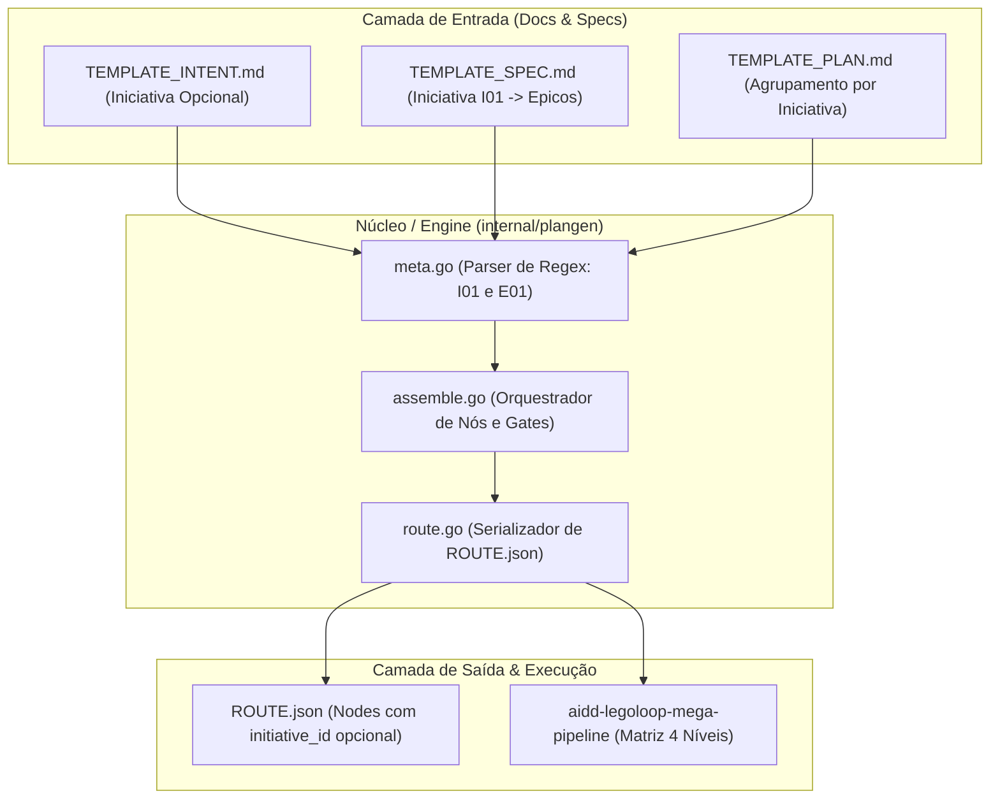

# 📋 SPEC: HIERARQUIA_INICIATIVA_LEGOLOOP

> **Status:** Concluído e Homologado  
> **Data:** 2026-11-07  
> **Versão:** 1.0.0  
> **Autor:** LegoLoop Mega Pipeline & Antigravity (Fusão Addy Osmani + Matt Pocock + AIDD-Spec)  
> **Referência da Intenção:** [docs/intents/2026-11-07_INTENT_HIERARQUIA_INICIATIVA.md](../intents/2026-11-07_INTENT_HIERARQUIA_INICIATIVA.md)  
> **Alvo Primário:** docs/templates, internal/plangen, skills/aidd-legoloop-mega-pipeline  
> **Consome:** INTENT aprovada · **Produz:** PLAN e ROUTE  
> **Template:** TEMPLATE_SPEC.md v2.0.0  

---

## 1. Premissas Técnicas Assumidas (Addy Osmani)

> [!IMPORTANT]
> A IA lista abaixo todas as premissas técnicas adotadas para evitar decisões silenciosas. Alerte no Stop-Gate 02 caso alguma premissa esteja incorreta:
1. **Zero Breaking Changes:** A introdução do nível **Iniciativa (`I01`, `I02`...)** é estritamente aditiva e opcional. Todo plano, rota ou spec existente que utilize apenas Épicos (`E01`, `E02`...) continua funcionando sem necessidade de migração.
2. **Nomenclatura Canônica Estrita:** O nível superior é batizado formalmente como **Iniciativa** (*Initiative*), identificado pela sigla `I` seguida de dois dígitos (`I01`, `I02`...), evitando colisões com `Tema` (já usado no título das specs) ou `Programa`.
3. **Padrão Go Stdlib:** Todas as alterações nos motores `internal/plangen` e testes utilizam exclusivamente a biblioteca padrão de Go, respeitando a invariante de zero novas dependências externas no `go.mod`.
4. **Fonte Única da Verdade (SSOT):** Os templates em `docs/templates/` continuam sendo a fonte canônica embutida via `//go:embed` nos binários; alterações nos arquivos de template devem sincronizar perfeitamente com os testes em `docs/templates/templates_test.go`.

---

## 2. Fronteiras de Ação & Regras de Governança (Boundaries — Addy Osmani)

* **Sempre Fazer:**
  * Desenvolver via TDD estrito (teste unitário falhando antes do código de produção).
  * Manter funções pequenas, enxutas e com responsabilidade única (< 35 linhas).
  * Validar a integridade de JSON schemas de rotas com e sem o campo de iniciativa.
  * Recompilar `bin/legoloop.exe` ao término da implementação com alteração em Go.
* **Perguntar Antes:**
  * Tornar qualquer campo de iniciativa mandatório em schemas antigos.
  * Modificar a assinatura de métodos públicos exportados em `internal/plangen`.
* **Nunca Fazer:**
  * Quebrar os planos legados ou testes de regressão existentes (`go test ./...`).
  * Inserir stubs, mocks desnecessários ou comentários `TODO` no código.
  * Introduzir camadas intermediárias como "Feature" ou "História".

---

## 3. Visão Geral, Arquitetura & Costuras de Teste (Test Seams — Pocock)

A arquitetura estende a Tríade de Planejamento permitindo que múltiplos Épicos pertençam a uma mesma Iniciativa guarda-chuva. O montador de rotas (`internal/plangen`) extrai metadados de Iniciativas da SPEC/PLAN e popula os nós da rota JSON com rastreabilidade completa.

### Diagrama de Fronteiras (Mermaid)



### Costuras de Teste (Test Seams — Pocock)
* **Costura Primária (Highest Seam):** A função pública `plangen.Generate(specPath, planPath string, opts Options) (*PlanResult, error)` e `templates.Route()`.
* **Justificativa:** Testa a transformação completa de markdown de entrada para artefatos de saída em disco e rotas JSON sem acoplamento a métodos privados.
* **Costuras Secundárias:** As funções de parsing de regex em `meta.go` (`parseInitiativeName`, `parseEpicName`) testadas via tabelas de caso herméticas em `internal/plangen/plangen_test.go`.
* **Dublês Permitidos:** Apenas `t.TempDir()` para isolamento de sistema de arquivos.

---

## 4. Contratos de Dados & Schemas Formais

```go
package plangen

// planMeta reúne o que PLAN e ROUTE compartilham com suporte a Iniciativas.
type planMeta struct {
	Date                            string
	Theme                           string
	Level                           SupervisionLevel
	SpecRel, PlanRel, RouteRel      string
	IntentRef                       string
	SpecLink, IntentLink, RouteLink string
	SpecFile, RouteName             string
	Initiatives                     map[int]string // I01 -> Nome da Iniciativa (opcional)
	Epics                           map[int]string // E01 -> Nome do Épico
	EpicInitiative                  map[int]int    // E01 -> I01 (vínculo pai-filho, opcional)
	SpecCriteria                    []string
}

// routeNode representa um nó do grafo executável com metadados de rastreabilidade.
type routeNode struct {
	ID             string `json:"id"`
	Label          string `json:"label"`
	Nature         string `json:"nature"`
	Type           string `json:"type"`
	InitiativeID   string `json:"initiative_id,omitempty"` // "I01" quando informado
	EpicID         string `json:"epic_id,omitempty"`       // "E01"
	HumanGateAfter bool   `json:"human_gate_after,omitempty"`
	// Demais campos permanecem intactos...
}
```

---

## 5. Critérios Binários de Aceite por Nó / Ticket (BDD)

### Épico 01 — Padronização de Templates & Schemas Canônicos (SSOT)

* [x] `AC-E01.1`: **Sincronia e Validade dos Templates SSOT**
  * **Dado que:** Os templates `TEMPLATE_INTENT.md`, `TEMPLATE_SPEC.md`, `TEMPLATE_PLAN.md` e `TEMPLATE_ROUTE.json` são atualizados para documentar a Iniciativa opcional.
  * **Quando:** A suíte `docs/templates/templates_test.go` é executada via `go test ./docs/templates/...`.
  * **Então:** Os testes passam com exit code 0, confirmando que os JSONs são válidos e os embeds em Go coincidem 100% com os arquivos no disco.
* [x] `AC-E01.2`: **Estrutura de Seções Numeradas Estável**
  * **Dado que:** Os templates markdown mantêm seus cabeçalhos numerados estáveis.
  * **Quando:** A função `TestDocumentHeadingsAreNumberedAndStable` for executada.
  * **Então:** As contagens esperadas de seções (Intent: 6, Spec: 6, Plan: 4) continuam rigorosamente satisfeitas.

### Épico 02 — Suporte a Iniciativas no Montador de Rotas (`internal/plangen`)

* [x] `AC-E02.1`: **Reconhecimento de Iniciativas em Planos**
  * **Dado que:** Um arquivo `PLAN.md` contém a declaração de `## Iniciativa I01 — Plataforma Central` e épicos aninhados.
  * **Quando:** `plangen.Generate` ou `newMeta` processa o conteúdo.
  * **Então:** Os metadados capturam `Initiatives[1] = "Plataforma Central"` e os nós gerados no `ROUTE.json` recebem `"initiative_id": "I01"`.
* [x] `AC-E02.2`: **Retrocompatibilidade com Planos Legados sem Iniciativa**
  * **Dado que:** Um arquivo `PLAN.md` legado contém apenas `Épico 01 — Teste` sem nenhuma menção a Iniciativas.
  * **Quando:** O processamento de geração de rota é executado.
  * **Então:** A rota JSON é gerada com sucesso, com `initiative_id` omitido (`omitempty`), mantendo paridade com o formato atual.
* [x] `AC-E02.3`: **Resiliência a Entradas Malformadas**
  * **Dado que:** Uma iniciativa é declarada com formato irregular (ex: `Iniciativa ABC` sem número).
  * **Quando:** O parser avalia a entrada.
  * **Então:** O sistema não sofre pânico (zero panics), ignora o identificador inválido ou aplica fallback gracioso para processamento normal de épicos.

### Épico 03 — Atualização Normativa da Skill do Mega Pipeline

* [x] `AC-E03.1`: **Matriz Hierárquica de 4 Níveis na Skill**
  * **Dado que:** O documento `skills/aidd-legoloop-mega-pipeline/SKILL.md` rege a atuação dos agentes.
  * **Quando:** Inspecionado após a entrega.
  * **Então:** A Seção 2 apresenta a tabela formal com os 4 níveis (Iniciativa ➔ Épico ➔ Micro ➔ Nano), seus tetos de contexto e heurísticas de esforço cognitivo.
* [x] `AC-NF.1`: **Conformidade Estrita de Invariantes**
  * **Dado que:** O código Go de `internal/plangen` e templates foi compilado e verificado.
  * **Quando:** São executados `go vet ./...`, `go run ./tools/funclen internal` e `git diff --exit-code go.mod go.sum`.
  * **Então:** Nenhuma função ultrapassa 35 linhas, zero warnings do vet e zero novas dependências externas adicionadas.

---

## 6. Comandos Operacionais & Critério de Conclusão Global (Addy Osmani)

### Comandos de Verificação Mecânica
* **Build:** `go build -o bin/legoloop.exe ./cmd/legoloop`
* **Test:** `go test -count=1 ./...`
* **Estática e formatação:** `go vet ./...` e `gofmt -l .` (saída vazia).
* **Funções Enxutas:** `go run ./tools/funclen internal` (todas $\le 35$ linhas).
* **Dependências intactas:** `git diff --exit-code go.mod go.sum`

### Critério de Done Global
A especificação técnica é considerada **100% CONCLUÍDA** quando:
- [x] 100% dos critérios binários `AC-E01.*`, `AC-E02.*`, `AC-E03.*` e `AC-NF.1` estiverem atendidos (`[x]`).
- [x] O comando de **Test** passar com exit code 0 em todos os pacotes.
- [x] `go vet ./...`, `gofmt -l .` e `funclen` passarem com zero ocorrências.
- [x] O comando de **Build** recompilar com sucesso o binário `bin/legoloop.exe`.
- [x] Zero arquivos temporários ou órfãos residuais.

---

🛑 **STOP-GATE 02 DE AUDITORIA HUMANA:**  
*As premissas assumidas, as fronteiras (boundaries), os contratos e os critérios binários acima atendem à sua expectativa?*  
*Somente após a aprovação explícita do usuário, deve-se gerar o PLAN (`TEMPLATE_PLAN.md`) e a ROUTE (`TEMPLATE_ROUTE.json`).*
