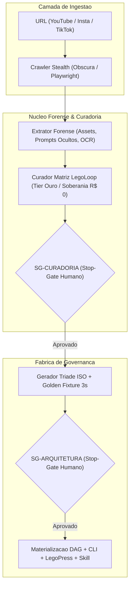

# 📋 SPEC: Pipeline Universal de Engenharia Reversa Audiovisual (legoloop-video-rea)

> **Status:** Proposta para Revisão  
> **Data:** 2026-11-07  
> **Versão:** 1.0.0  
> **Autor:** Heverton & Ecossistema LegoLoop (Fusão Addy Osmani + Matt Pocock + AIDD-Spec)  
> **Iniciativa:** LegoLoop Autonomous Evolution  
> **Referência da Intenção:** [docs/intents/2026-11-07_INTENT_LEGOLOOP_VIDEO_REA.md](../intents/2026-11-07_INTENT_LEGOLOOP_VIDEO_REA.md)  
> **Alvo Primário:** internal/videorea, internal/cli, loops/video-rea, docs/books/video-rea, skills/legoloop-video-rea  
> **Consome:** INTENT aprovada · **Produz:** PLAN e ROUTE  
> **Template:** TEMPLATE_SPEC.md v2.0.0  

---

## 1. Premissas Técnicas Assumidas (Addy Osmani)

> [!IMPORTANT]
> A IA lista abaixo todas as premissas técnicas adotadas para evitar decisões silenciosas. Alerte no Stop-Gate 02 caso alguma premissa esteja incorreta:
1. **Runtime Go e Zero Dependências:** Implementação estritamente em Go (conforme `go.mod`), sem novas dependências externas, reutilizando a biblioteca padrão e módulos do LegoLoop (`internal/matriz`, `internal/legopress`, `internal/dag`).
2. **Integração Stealth com Obscura e Playwright:** Raspagem e download de vídeos, descrições e comentários com headers furtivos e reaproveitamento do perfil CDP do Chrome do usuário para bypass de login (YouTube, Instagram, TikTok).
3. **Dissecação Forense com REA MCP:** Inspeção estática de arquivos baixados (`.skill`, `.zip`, `.json`, presets de vídeo), OCR em keyframes de código e inferência de prompts implícitos.
4. **Curadoria Integrada com a Matriz:** Cruzamento das capacidades identificadas no vídeo contra o inventário do cofre (`~/.aidd/skills`, MCPs, loops) via `internal/matriz`, recomendando substituições gratuitas Tier Ouro.
5. **Nomenclatura Canônica Obrigatória:** Todo novo pipeline gerado recebe compulsoriamente o prefixo `legoloop-*`.

---

## 2. Fronteiras de Ação & Regras de Governança (Boundaries — Addy Osmani)

* **Sempre Fazer:**
  * Desenvolver via TDD estrito (teste unitário falhando antes do código de produção).
  * Manter funções pequenas, enxutas e de responsabilidade única (< 35 linhas).
  * Validar rigorosamente todos os inputs e decodificações de JSON, incluindo URLs e caminhos sanitizados.
  * Recompilar o binário `bin/legoloop.exe` ao final de qualquer alteração em Go.
  * Gerar a esteira completa: `INTENT` ➔ `SPEC` ➔ `PLAN` ➔ `ROUTE` ➔ `BOOK` (LegoPress) ➔ `Golden Fixture` (3s) ➔ `DAG` ➔ `CLI` ➔ `Skill`.
* **Perguntar Antes:**
  * Alterar schemas persistidos no disco que possam quebrar retrocompatibilidade.
  * Adicionar dependências externas no `go.mod`.
* **Nunca Fazer:**
  * Criar funções vazias com `TODO`, `pass`, ou stubs simulados em código de produção (Lei #1: Zero Stubs).
  * Chamar comandos destrutivos sem isolamento hermético.
  * Ignorar testes falhando ou quebrar a suíte global.

---

## 3. Visão Geral, Arquitetura & Costuras de Teste (Test Seams — Pocock)

O pipeline `legoloop-video-rea` recebe uma URL externa (ou caminho de vídeo local), orquestra os motores de inspeção forense, curadoria e geração de governança, intercalados por dois stop-gates humanos obrigatórios (`SG-CURADORIA` e `SG-ARQUITETURA`).

### Diagrama de Fronteiras (Mermaid)



### Costuras de Teste (Test Seams — Pocock)
* **Costura Primária (Highest Seam):** `videorea.ProcessPipeline(cfg PipelineConfig) (*ExecutionSummary, error)` — orquestração ponta a ponta com injeção de dublês de rede nas bordas.
* **Costuras Secundárias:**
  * `videorea.ExtractForensics(input VideoInput) (*ForensicsDossier, error)`
  * `videorea.CurateAgainstMatrix(dossier *ForensicsDossier, inventory MatrixInventory) (*CurationReport, error)`
  * `videorea.GenerateGovernanceTriad(report *CurationReport, outDir string) (*TriadManifest, error)`
  * `videorea.SynthesizeGoldenFixture(durationSec float64, outDir string) (string, error)`
* **Dublês Permitidos:** HTTP downloader e exec de Playwright em `_test.go`.

---

## 4. Contratos de Dados & Schemas Formais

```go
package videorea

import (
	"errors"
	"strings"
)

var (
	ErrInvalidURL       = errors.New("videorea: url invalida ou plataforma nao suportada")
	ErrEmptyDossier     = errors.New("videorea: dossie forense vazio")
	ErrGateRejected     = errors.New("videorea: operacao rejeitada no stop-gate")
)

type Platform string

const (
	PlatformYouTube   Platform = "youtube"
	PlatformInstagram Platform = "instagram"
	PlatformTikTok    Platform = "tiktok"
	PlatformLocal     Platform = "local"
)

type ForensicsDossier struct {
	VideoURL        string            `json:"video_url"`
	Platform        Platform          `json:"platform"`
	Title           string            `json:"title"`
	TranscribedText string            `json:"transcribed_text"`
	ExplicitPrompts []string          `json:"explicit_prompts"`
	HiddenPrompts   []string          `json:"hidden_prompts"`
	ToolsIdentified []string          `json:"tools_identified"`
	HiddenTools     []string          `json:"hidden_tools"`
	OCRFindings     []string          `json:"ocr_findings"`
	SuggestedSlugs  []string          `json:"suggested_slugs"`
}

type CurationReport struct {
	SuggestedName   string            `json:"suggested_name"` // ex: "legoloop-video-talking-head"
	OriginalCost    string            `json:"original_cost"`  // ex: "R$ 180,00/mes"
	SovereignCost   string            `json:"sovereign_cost"` // ex: "R$ 0,00/mes"
	Replacements    map[string]string `json:"replacements"`   // ex: "Higgsfield" -> "Google AI Studio"
	Approved        bool              `json:"approved"`
}
```

---

## 5. Critérios Binários de Aceite por Nó / Ticket (BDD)

### Épico 01 — Ingestão Stealth & Crawler Multi-Plataforma

* [ ] `AC-E01.1`: **Detecção correta de plataforma e metadados**
  * **Dado que:** Uma URL válida de YouTube, Instagram ou TikTok é fornecida.
  * **Quando:** `videorea.DetectPlatform(url)` é invocado.
  * **Então:** Retorna a plataforma correta (`youtube`, `instagram`, `tiktok`) sem erro.
* [ ] `AC-E01.2`: **Tratamento de URL inválida**
  * **Dado que:** Uma string malformada ou plataforma desconhecida é passada.
  * **Quando:** `videorea.DetectPlatform("ftp://invalido")` é invocado.
  * **Então:** Retorna `ErrInvalidURL` e nenhum processo externo é disparado.

### Épico 02 — Dissecação Forense, Prompts Ocultos e OCR

* [ ] `AC-E02.1`: **Extração de prompts explícitos e dedução de prompts ocultos**
  * **Dado que:** A transcrição e a descrição do vídeo citam apenas parâmetros parciais de IA.
  * **Quando:** `videorea.ExtractForensics(...)` analisa a transcrição e os assets.
  * **Então:** O dossiê lista os prompts explícitos e reconstrói os prompts ocultos estruturados com variáveis.
* [ ] `AC-E02.2`: **Inspeção de assets e OCR de telas rápidas**
  * **Dado que:** Há arquivos `.skill` ou imagens de keyframes com janelas de código.
  * **Quando:** O dissecador forense é executado.
  * **Então:** As ferramentas ocultas e comandos de terminal são registrados em `OCRFindings`.

### Épico 03 — Curadoria com Matriz LegoLoop e Economia de Soberania

* [ ] `AC-E03.1`: **Mapeamento de ferramentas contra peças Tier Ouro**
  * **Dado que:** O dossiê aponta ferramentas pagas (ex: Higgsfield, After Effects, Whisper pago).
  * **Quando:** `videorea.CurateAgainstMatrix(dossier, matrix)` é executado.
  * **Então:** As substituições locais recomendadas (Google AI Studio, Remotion, Whisper local) são preenchidas com custo soberano de R$ 0,00.
* [ ] `AC-E03.2`: **Sugestão obrigatória de nomes canônicos `legoloop-*`**
  * **Dado que:** O tema do vídeo foi extraído com sucesso.
  * **Quando:** O curador sugere slugs para o novo pipeline.
  * **Então:** Todos os 3 slugs sugeridos contêm rigorosamente o prefixo `legoloop-*`.

### Épico 04 — Stop-Gate Humano e Fábrica de Governança

* [ ] `AC-E04.1`: **Stop-Gate de Curadoria (`SG-CURADORIA`)**
  * **Dado que:** O relatório de curadoria foi sintetizado.
  * **Quando:** O operador recusa ou aprova no gate.
  * **Então:** Se recusado, interrompe sem efeitos colaterais; se aprovado, emite a Tríade ISO (`INTENT`, `SPEC`, `PLAN`, `ROUTE`).
* [ ] `AC-E04.2`: **Geração do Golden Fixture (3s)**
  * **Dado que:** O novo pipeline foi aprovado para construção.
  * **Quando:** `videorea.SynthesizeGoldenFixture(...)` é invocado.
  * **Então:** Cria em `testdata/` um arquivo de vídeo fixture sintético com duração exata de 3.0 segundos.

### Épico 05 — Orquestrador DAG, CLI, Livro LegoPress e Skill

* [ ] `AC-E05.1`: **Grafo DAG Acíclico e Subcomando CLI**
  * **Dado que:** `loops/video-rea/pipeline.dag.json` foi criado.
  * **Quando:** `legoloop validate loops/video-rea/pipeline.dag.json` e `legoloop video-rea --help` rodam.
  * **Então:** Validação com 0 erros e CLI expõe os subcomandos operacionais.
* [ ] `AC-E05.2`: **Livro Didático LegoPress e Skill Canônica**
  * **Dado que:** O livro foi gerado em `docs/books/video-rea/`.
  * **Quando:** `bash docs/books/compilar.sh video-rea` e `legoloop legopress auditar` são executados.
  * **Então:** O PDF é compilado com sucesso e a geometria é aprovada com 100% de conformidade.

---

## 6. Comandos Operacionais & Critério de Conclusão Global (Addy Osmani)

### Comandos de Verificação Mecânica
* **Build:** `go build -o bin/legoloop.exe ./cmd/legoloop && go install ./cmd/legoloop`
* **Test:** `go test -v ./internal/videorea/...` e `go test -count=1 ./...`
* **Estática e formatação:** `go vet ./...` e `gofmt -l .` (saída vazia).
* **Auditoria de livro:** `legoloop legopress auditar docs/books/video-rea/*.pdf`

### Critério de Done Global
A especificação técnica é considerada **100% CONCLUÍDA** quando:
- [ ] 100% dos critérios binários `AC-E{N}.{M}` estiverem marcados como atendidos (`[x]`).
- [ ] Todos os testes unitários e de integração passarem com código 0.
- [ ] `funclen`, `go vet` e `gofmt -l .` passarem sem nenhuma violação.
- [ ] O binário for recompilado e instalado no PATH.
- [ ] O PDF do livro didático for compilado e auditado com geometria perfeita.

---

🛑 **STOP-GATE 02 DE AUDITORIA HUMANA:**  
*As premissas, contratos formais e critérios binários acima atendem à sua expectativa para o pipeline `legoloop-video-rea`?*  
*Somente após a aprovação explícita do usuário, deve-se gerar o PLAN (`TEMPLATE_PLAN.md`) e a ROUTE (`TEMPLATE_ROUTE.json`).*
