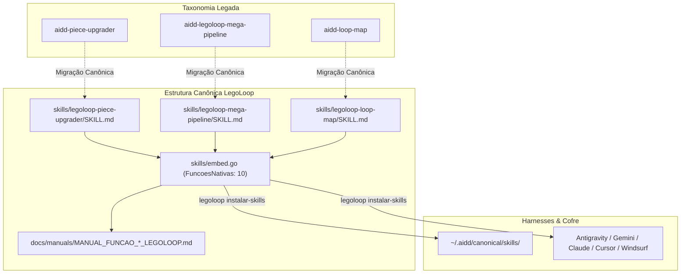

# 📋 SPEC: Normalização da Taxonomia das Skills Proprietárias do LegoLoop

> **Status:** Proposta para Revisão  
> **Data:** 2026-11-07  
> **Versão:** 1.0.0  
> **Autor:** Antigravity (Fusão Addy Osmani + Matt Pocock + AIDD-Spec)  
> **Iniciativa:** I03 — Governança e Taxonomia Canônica  
> **Referência da Intenção:** [docs/intents/2026-11-07_INTENT_NORMALIZACAO_TAXONOMIA_SKILLS.md](../intents/2026-11-07_INTENT_NORMALIZACAO_TAXONOMIA_SKILLS.md)  
> **Alvo Primário:** `skills/embed.go`, `skills/`, `internal/cli/instalar_skills.go`, `docs/manuals/`  
> **Consome:** INTENT aprovada · **Produz:** PLAN e ROUTE  
> **Template:** TEMPLATE_SPEC.md v2.0.0  

---

## 1. Premissas Técnicas Assumidas (Addy Osmani)

> [!IMPORTANT]
> A IA lista abaixo todas as premissas técnicas adotadas para evitar decisões silenciosas. Alerte no Stop-Gate 02 caso alguma premissa esteja incorreta:
1. **Padrão de Nomenclatura Canônica:** Toda skill nativa do ecossistema LegoLoop inicia obrigatoriamente com o prefixo `legoloop-` no seu diretório e no campo `name:` do frontmatter YAML.
2. **Retrocompatibilidade de Comandos:** Comandos legados do chat (como `/upgrade-piece`, `/elevar-peca`, `/aidd-legoloop-mega-pipeline`, `/loop-map`) são mantidos na lista `commands:` do frontmatter para garantir que o usuário não perca seus atalhos mentais.
3. **Distribuição Automatizada via Embed Go:** O binário `legoloop.exe` embute estaticamente via `//go:embed legoloop-*/*.md` todas as 10 skills canônicas, dispensando download de rede no comando `legoloop instalar-skills`.
4. **Isolamento de Peças de Terceiros:** Peças de trabalho de execução pontual do cofre (como `aidd-spec`, `aidd-tdd`, `aidd-rea`) não são alteradas nesta especificação, pois pertencem à biblioteca geral de blocos/peças de catálogo, e não ao motor operacional do LegoLoop.

---

## 2. Fronteiras de Ação & Regras de Governança (Boundaries — Addy Osmani)

O pipeline e os agentes devem respeitar estritamente o sistema de fronteiras em 3 níveis:
* **Sempre Fazer:**
  * Desenvolver via TDD estrito (teste unitário em `instalar_skills_test.go` verificando as 10 skills).
  * Manter a lista de `skills.FuncoesNativas` estritamente ordenada e tipada em `skills/embed.go`.
  * Redigir os manuais operacionais correspondentes em `docs/manuals/` com a taxonomia ISO padrão.
  * Recompilar o binário `bin/legoloop.exe` ao final da implementação em Go.
* **Perguntar Antes:**
  * Remover comandos antigos dos frontmatters (sempre preservar aliases).
  * Alterar a assinatura ou retorno da CLI `legoloop instalar-skills`.
* **Nunca Fazer:**
  * Deixar funções com `TODO`, `pass` ou stubs em código de produção Go.
  * Quebrar a compilação do pacote `skills` por inclusão de arquivos que não casem com `legoloop-*/*.md`.
  * Forçar exclusão de diretórios no SO sem garantir que os novos diretórios `legoloop-*` estejam devidamente criados e vinculados.

---

## 3. Visão Geral, Arquitetura & Costuras de Teste (Test Seams — Pocock)

A normalização consolida as 3 skills que operam o LegoLoop (`piece-upgrader`, `mega-pipeline` e `loop-map`) na árvore de fontes do produto em `skills/`, espelha-as em `docs/manuals/` e expande o vetor `skills.FuncoesNativas` em Go de 7 para 10 itens.

### Diagrama de Fronteiras (Mermaid)



### Costuras de Teste (Test Seams — Pocock)
* **Costura Primária (Highest Seam):** `skills.TodasAsSkills() (map[string][]byte, error)` e `cli.Run(ctx, []string{"instalar-skills", "--vault", vault, "--json"}, deps) int`.
* **Justificativa:** Valida ponta a ponta se o pacote Go embute os 10 arquivos `SKILL.md`, se o hash/leitura de cada um é válido e se a CLI distribui todos eles sem erro de I/O.
* **Costuras Secundárias:** `skills.ObterSkill(nome string) ([]byte, error)`.
* **Dublês Permitidos:** Diretório temporário `t.TempDir()` simulando o cofre e sistema de arquivos isolado em memória/disco efêmero.

---

## 4. Contratos de Dados & Schemas Formais

```go
// Contrato formal no pacote skills (skills/embed.go)
package skills

import (
	"embed"
)

// FS embute todos os SKILL.md de legoloop-*.
//
//go:embed legoloop-*/*.md
var FS embed.FS

// FuncoesNativas lista os nomes canônicos das 10 funções nativas do LegoLoop.
var FuncoesNativas = []string{
	"legoloop-fabricar",
	"legoloop-matriz",
	"legoloop-listar",
	"legoloop-refinar",
	"legoloop-remover",
	"legoloop-compor",
	"legoloop-legopress",
	"legoloop-piece-upgrader",
	"legoloop-mega-pipeline",
	"legoloop-loop-map",
}
```

---

## 5. Critérios Binários de Aceite por Nó / Ticket (BDD)

### Épico 01 — Materialização dos SKILL.md e Manuais Operacionais

* [ ] `AC-E01.1`: **Materialização dos SKILL.md Canônicos em `skills/`**
  * **Dado que:** As pastas `skills/legoloop-piece-upgrader`, `skills/legoloop-mega-pipeline` e `skills/legoloop-loop-map` existem no repositório.
  * **Quando:** O arquivo `SKILL.md` de cada uma for inspecionado.
  * **Então:** Cada um deve conter frontmatter YAML válido com `name: legoloop-*`, `description:` não-vazia e lista de comandos com os aliases legados e novos.
* [ ] `AC-E01.2`: **Manuais Operacionais em `docs/manuals/`**
  * **Dado que:** A pasta `docs/manuals/` armazena a documentação canônica das funções do produto.
  * **Quando:** Verificados os arquivos de manual.
  * **Então:** Devem existir `MANUAL_FUNCAO_PIECE_UPGRADER_LEGOLOOP.md`, `MANUAL_FUNCAO_MEGA_PIPELINE_LEGOLOOP.md` e `MANUAL_FUNCAO_LOOP_MAP_LEGOLOOP.md`, sem placeholders `{{...}}`.

### Épico 02 — Injeção no Core Go e Testes Unitários

* [ ] `AC-E02.1`: **Expansão de `skills.FuncoesNativas` para 10 itens**
  * **Dado que:** O pacote `skills/embed.go` define as funções nativas do LegoLoop.
  * **Quando:** O teste `TestInstalarSkills` for executado em `internal/cli/`.
  * **Então:** O resultado deve reportar 10 skills instaladas, e `len(skills.FuncoesNativas)` deve ser exatamente 10.
* [ ] `AC-E02.2`: **Tratamento de Erro para Skill Inexistente**
  * **Dado que:** Uma skill arbitrária `"legoloop-inexistente"` seja solicitada via `skills.ObterSkill`.
  * **Quando:** A função `ObterSkill` for chamada.
  * **Então:** Deve retornar erro contendo `"skill nativa não encontrada para \"legoloop-inexistente\""`.

### Épico 03 — Recompilação e Sincronização Universal

* [ ] `AC-E03.1`: **Recompilação Fresca do Binário**
  * **Dado que:** O código em Go foi alterado e validado via testes.
  * **Quando:** O comando `go build -o bin/legoloop.exe ./cmd/legoloop` for executado.
  * **Então:** O binário deve ser gerado sem erros (exit code 0).
* [ ] `AC-E03.2`: **Distribuição Real no Cofre e Harnesses**
  * **Dado que:** O comando `legoloop instalar-skills` seja executado no ambiente real.
  * **Quando:** A execução for concluída.
  * **Então:** As 10 skills canônicas devem estar presentes no cofre e refletidas nos harnesses do sistema.

---

## 6. Comandos Operacionais & Critério de Conclusão Global (Addy Osmani)

### Comandos de Verificação Mecânica
* **Build:** `go build -o bin/legoloop.exe ./cmd/legoloop`
* **Test:** `go test -count=1 ./internal/cli/... ./docs/templates/...`
* **Estática e formatação:** `go vet ./...` e `gofmt -l .` (saída vazia).
* **Dependências intactas:** `git diff --exit-code go.mod go.sum`

### Critério de Done Global
A especificação técnica é considerada **100% CONCLUÍDA** quando:
- [ ] 100% dos critérios binários `AC-E01.*`, `AC-E02.*` e `AC-E03.*` estiverem marcados como atendidos (`[x]`).
- [ ] O comando de **Test** passar com exit code 0.
- [ ] `go vet ./...` e `gofmt -l .` não reportarem nada.
- [ ] O comando de **Build** recompilar com sucesso o binário `bin/legoloop.exe`.
- [ ] `legoloop instalar-skills` distribuir as 10 skills com sucesso.

---

🛑 **STOP-GATE 02 DE AUDITORIA HUMANA:**  
*As premissas assumidas, as fronteiras (boundaries), os contratos e os critérios binários acima atendem à sua expectativa?*  
*Somente após a aprovação explícita do usuário, deve-se gerar o PLAN (`TEMPLATE_PLAN.md`) e a ROUTE (`TEMPLATE_ROUTE.json`).*
