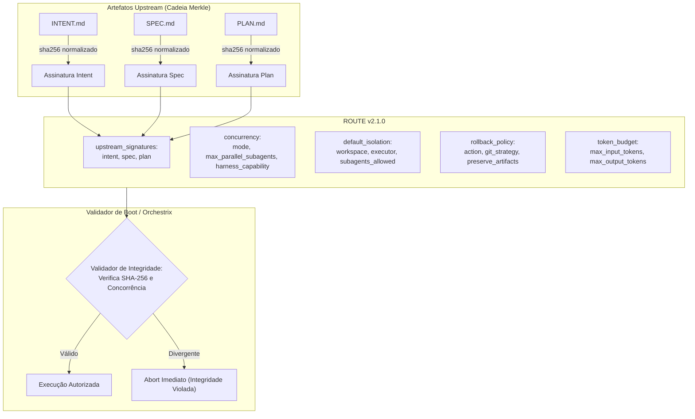

# 📋 SPEC: GOVERNANCA_ROUTE_V2_CONCORRENCIA

> **Status:** Proposta para Revisão  
> **Data:** 2026-11-07  
> **Versão:** 1.0.0  
> **Autor:** Antigravity & Engenharia LegoLoop (Fusão Addy Osmani + Matt Pocock + AIDD-Spec)  
> **Iniciativa:** I01 — Governança e Resiliência da Tríade Executável  
> **Referência da Intenção:** [docs/intents/2026-11-07_INTENT_ROUTE_V2_GOVERNANCE.md](../intents/2026-11-07_INTENT_ROUTE_V2_GOVERNANCE.md)  
> **Alvo Primário:** `docs/templates/`, `internal/plangen`, `internal/validator`, `internal/dag`  
> **Consome:** INTENT aprovada · **Produz:** PLAN e ROUTE  
> **Template:** TEMPLATE_SPEC.md v2.0.0  

---

## 1. Premissas Técnicas Assumidas (Addy Osmani)

> [!IMPORTANT]
> A IA lista abaixo todas as premissas técnicas adotadas para evitar decisões silenciosas. Alerte no Stop-Gate 02 caso alguma premissa esteja incorreta:
1. **Runtime Go e Zero Dependências Externas:** Toda a implementação usará exclusivamente a biblioteca padrão do Go (`crypto/sha256`, `encoding/hex`, `encoding/json`, `os`, `path/filepath`, `strings`). Zero pacotes novos no `go.mod`.
2. **Normalização Criptográfica Cross-Platform:** Para evitar discrepâncias de hash SHA-256 entre ambientes Windows (CRLF) e Linux/POSIX (LF), o cálculo do hash normalizará quebras de linha (`\r\n` $\rightarrow$ `\n`) antes da digestão criptográfica.
3. **Retrocompatibilidade com Rotas v2.0:** Documentos de rota legados sem o bloco `upstream_signatures` ou com o campo antigo `max_parallel_workers` continuarão válidos via unmarshaling tolerante com defaults seguros.
4. **Isolamento Estéril e Clamping de Subagentes:** Subagentes efêmeros limpos operam sem duplicação de system prompt ou histórico prévio de chat, disparados com teto delimitado (`max_parallel_subagents`), com fallback para execução síncrona/serial caso o harness não suporte workers isolados.

---

## 2. Fronteiras de Ação & Regras de Governança (Boundaries — Addy Osmani)

* **Sempre Fazer:**
  * Desenvolver via TDD estrito (teste unitário falhando comprovadamente antes do código de produção).
  * Manter funções pequenas, enxutas e de responsabilidade única (< 35 linhas, validado por `funclen`).
  * Validar rigorosamente caminhos relativos de arquivos upstream (`filepath.Clean`, sem `..` abusivo).
  * Recompilar o binário `bin/legoloop.exe` ao final de cada alteração em Go.
* **Perguntar Antes:**
  * Alterar campos obrigatórios existentes do cabeçalho que pudessem quebrar rotas v2.0 arquivadas.
  * Modificar o comportamento de outros comandos (`legoloop canonize`, `legoloop doctor`).
* **Nunca Fazer:**
  * Criar funções vazias com `TODO`, `pass`, `// implementar depois` ou mocks simulados em código de produção (Lei #1: Zero Stubs).
  * Fazer polling em chamadas assíncronas de tarefas.
  * Usar tags HTML em diagramas Mermaid ou descrições no chat.
  * Permitir que um nó execute se qualquer hash upstream falhar na verificação de integridade.

---

## 3. Visão Geral, Arquitetura & Costuras de Teste (Test Seams — Pocock)

A evolução da ROUTE v2.1 introduz uma barreira criptográfica de integridade no boot da execução e desacopla a orquestração em dimensões ortogonais:



### Costuras de Teste (Test Seams — Pocock)
* **Costura Primária (Highest Seam):** `plangen.AssembleRoute(m PlanMeta, tickets []Ticket, upstreams UpstreamFiles) (RouteDoc, error)` e `validator.VerifyRouteIntegrity(doc RouteDoc, baseDir string) error`.
* **Justificativa:** Permite testar todo o ciclo (geração do JSON, cálculo de hash dos arquivos reais em `t.TempDir()`, serialização, e validação com mutação forçada de arquivo) na fronteira pública sem acoplamento a detalhes internos de formatação.
* **Costuras Secundárias:** `crypto.HashNormalized(content []byte) string` — função pura de hashing com normalização CRLF $\rightarrow$ LF.
* **Dublês Permitidos:** Apenas sistemas de arquivos efêmeros em `t.TempDir()`. Zero mocks de estruturas internas.

---

## 4. Contratos de Dados & Schemas Formais

```go
package plangen

import (
	"crypto/sha256"
	"encoding/hex"
	"errors"
	"strings"
)

var (
	ErrHashMismatch    = errors.New("plangen: integridade criptográfica violada em arquivo upstream")
	ErrArquivoInvalido = errors.New("plangen: arquivo upstream inexistente ou ilegível")
)

// FileSignature representa o caminho e o hash de um artefato upstream.
type FileSignature struct {
	Path   string `json:"path"`
	SHA256 string `json:"sha256"`
}

// UpstreamSignatures agrega a assinatura encadeada dos 3 artefatos anteriores da Tríade.
type UpstreamSignatures struct {
	Intent *FileSignature `json:"intent,omitempty"`
	Spec   FileSignature  `json:"spec"`
	Plan   FileSignature  `json:"plan"`
}

// ConcurrencyStrategy governa a execução paralela de subagentes efêmeros limpos.
type ConcurrencyStrategy struct {
	Mode                 string `json:"mode"`                    // "serial" | "parallel_clean" | "hybrid"
	MaxParallelSubagents int    `json:"max_parallel_subagents"` // teto físico de workers (1 a 8)
	HarnessCapability    string `json:"harness_capability"`     // "none" | "subagent_cli_isolated" | "subagent_native"
	RateLimitThrottleMS  int    `json:"rate_limit_throttle_ms"`  // pausa preventiva anti-429
}

// RollbackPolicy define as ações mecânicas em caso de falha de um nó.
type RollbackPolicy struct {
	Action            string `json:"action"`              // "abort_pipeline" | "abort_and_clean" | "continue_on_non_critical"
	GitStrategy       string `json:"git_strategy"`        // "discard_uncommitted" | "stash_changes" | "none"
	PreserveArtifacts bool   `json:"preserve_artifacts"` // true para manter relatórios de erro
}

// RouteStrategyV21 expande a estratégia com concorrência e rollback fino.
type RouteStrategyV21 struct {
	SupervisionLevel   string              `json:"supervision_level"` // "micro" | "macro"
	Concurrency        ConcurrencyStrategy `json:"concurrency"`
	DefaultIsolation   RouteIsolation      `json:"default_isolation"`
	TDDEnforced        bool                `json:"tdd_enforced"`
	DefaultTimeoutSec  int                 `json:"default_timeout_sec"`
	RollbackPolicy     RollbackPolicy      `json:"rollback_policy"`
}

// HashNormalized calcula o SHA-256 após normalizar quebras de linha Windows para LF.
func HashNormalized(data []byte) string {
	normalized := strings.ReplaceAll(string(data), "\r\n", "\n")
	sum := sha256.Sum256([]byte(normalized))
	return hex.EncodeToString(sum[:])
}
```

---

## 5. Critérios Binários de Aceite por Nó / Ticket (BDD)

### Épico 01 — Atualização dos Templates Canônicos e Schemas (SSOT)

* [ ] `AC-E01.1`: **Atualização do TEMPLATE_ROUTE.json para v2.1.0**
  * **Dado que:** O arquivo `docs/templates/TEMPLATE_ROUTE.json` é carregado pelo pacote `docs/templates`.
  * **Quando:** `templates.RouteKeys()` for invocado.
  * **Então:** Retorna com sucesso sem erro, contendo as chaves `upstream_signatures`, `concurrency`, `rollback_policy` e `template_version: "2.1.0"`.
* [ ] `AC-E01.2`: **Conformidade em templates_test.go**
  * **Dado que:** A suíte `docs/templates/templates_test.go` é executada.
  * **Quando:** O comando `go test -count=1 ./docs/templates/...` roda.
  * **Então:** Todos os testes passam com exit code 0 e os nós continuam isomórficos.

### Épico 02 — Cálculo Criptográfico Merkle e Validação de Integridade

* [ ] `AC-E02.1`: **Geração Correta de Hashes Upstream (Caminho Feliz)**
  * **Dado que:** Arquivos reais de `INTENT.md`, `SPEC.md` e `PLAN.md` existem no disco em `t.TempDir()`.
  * **Quando:** O motor de planejamento monta a rota via `AssembleRouteWithSignatures(...)`.
  * **Então:** O objeto `routeDoc` resultante contém o bloco `upstream_signatures` com os hashes SHA-256 exatos calculados após normalização LF.
* [ ] `AC-E02.2`: **Bloqueio de Boot por Adulteração Upstream (Caminho de Falha)**
  * **Dado que:** Uma rota válida v2.1 foi gerada e, posteriormente, um caractere foi adicionado a `SPEC.md` no disco.
  * **Quando:** O validador de integridade `VerifyRouteIntegrity(...)` é invocado antes do boot.
  * **Então:** A função retorna `ErrHashMismatch`, indicando o caminho do arquivo corrompido e bloqueando a execução da DAG.
* [ ] `AC-E02.3`: **Equivalência Transparente CRLF vs LF**
  * **Dado que:** Dois arquivos possuem conteúdo idêntico, um salvo com CRLF (Windows) e outro com LF (POSIX).
  * **Quando:** `HashNormalized` é aplicado em ambos.
  * **Então:** Ambos produzem exatamente o mesmo hash SHA-256 hexadecimal.

### Épico 03 — Governança de Concorrência e Teto de Subagentes Limpos

* [ ] `AC-E03.1`: **Validação do Teto de Concorrência de Subagentes**
  * **Dado que:** Uma rota declara `max_parallel_subagents: 4` e `harness_capability: "subagent_cli_isolated"`.
  * **Quando:** O validador de rota checa os parâmetros de concorrência.
  * **Então:** Valida que `max_parallel_subagents` está no intervalo permitido [1, 8] e `mode` é válido.
* [ ] `AC-E03.2`: **Degradação Graciosa para Fila Serial**
  * **Dado que:** O ambiente declara `harness_capability: "none"` ou o usuário passa a flag de execução serial.
  * **Quando:** O despachante de nós prepara o lote de execução.
  * **Então:** Ajusta automaticamente o paralelismo efetivo para 1 (serial determinístico), registrando aviso no log sem quebrar o pipeline.

### Critério Não-Funcional

* [ ] `AC-NF.1`: **Performance e Zero Stubs**
  * **Dado que:** A suíte completa roda em ambiente local com testes de integridade.
  * **Quando:** `go test -count=1 ./...` e `go run ./tools/funclen internal` são executados.
  * **Então:** O tempo de checagem criptográfica por rota é inferior a 10ms, nenhuma função ultrapassa 35 linhas e zero funções vazias/mocks provisórios existem.

---

## 6. Comandos Operacionais & Critério de Conclusão Global (Addy Osmani)

### Comandos de Verificação Mecânica
* **Build:** `go build -o bin/legoloop.exe ./cmd/legoloop`
* **Test:** `go test -v -count=1 ./...`
* **Linter de Tamanho:** `go run ./tools/funclen internal` (todas as funções $\le 35$ linhas)
* **Formatação:** `gofmt -l .` (saída estritamente vazia)
* **Dependências Intactas:** `git diff --exit-code go.mod go.sum`

### Critério de Done Global
A especificação técnica é considerada **100% CONCLUÍDA** quando:
- [ ] 100% dos critérios binários `AC-E01.*`, `AC-E02.*`, `AC-E03.*` e `AC-NF.1` estiverem atendidos (`[x]`).
- [ ] O comando de **Test** passar com exit code 0 em toda a árvore.
- [ ] O comando de **Build** recompilar com sucesso `bin/legoloop.exe`.
- [ ] O linter `funclen` passar sem violações.

---

🛑 **STOP-GATE 02 DE AUDITORIA HUMANA:**  
*As premissas assumidas, as fronteiras (boundaries), os contratos e os critérios binários acima atendem à sua expectativa?*  
*Somente após a aprovação explícita do usuário, deve-se gerar o PLAN (`TEMPLATE_PLAN.md`) e a ROUTE (`TEMPLATE_ROUTE.json`).*
