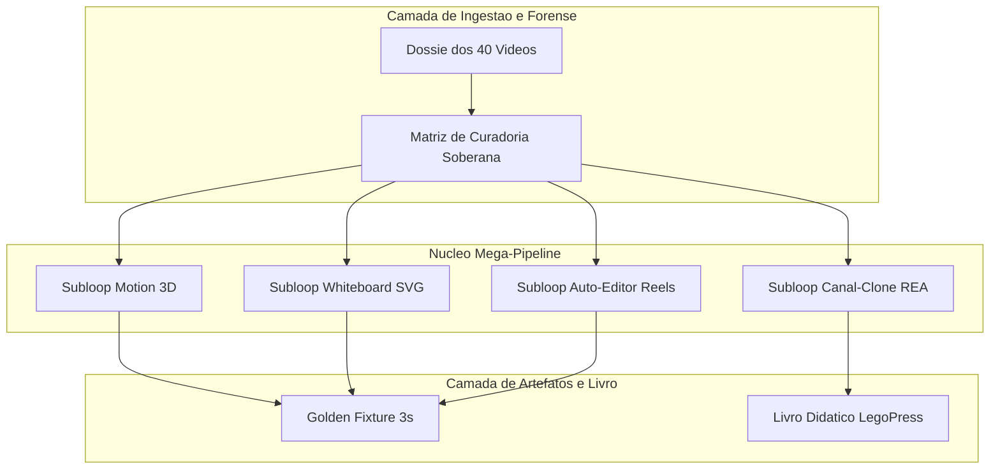

# 📋 SPEC: Pipeline Master de Produção Audiovisual Soberana

> **Status:** Aprovado pelo Usuário  
> **Data:** 2026-11-07  
> **Versão:** 1.0.0  
> **Autor:** LegoLoop REA Engine (Fusão Addy Osmani + Matt Pocock + AIDD-Spec)  
> **Iniciativa:** Audiovisual Soberano 2026  
> **Referência da Intenção:** [docs/intents/2026-11-07_INTENT_VIDEO_MASTER.md](../intents/2026-11-07_INTENT_VIDEO_MASTER.md)  
> **Alvo Primário:** loops/legoloop-video-master, skills/legoloop-video-master, docs/books/video-master  
> **Consome:** INTENT aprovada · **Produz:** PLAN e ROUTE  
> **Template:** TEMPLATE_SPEC.md v2.0.0  

---

## 1. Premissas Técnicas Assumidas (Addy Osmani)

> [!IMPORTANT]
> A IA lista abaixo todas as premissas técnicas adotadas para evitar decisões silenciosas:
1. Runtime: Go 1.23+ com biblioteca padrão e pacotes internos existentes (`internal/dag`, `internal/videorea`, `internal/videomotion`).
2. Armazenamento: Grafo acíclico DAG em JSON versionado localmente em `loops/legoloop-video-master/`, sem banco externo.
3. Soberania Financeira: 100% dos motores de renderização, legendas e animação utilizam executáveis locais (FFmpeg, Whisper local, Remotion React) e modelos gratuitos sem custos de API por minuto.
4. Reuso Arquitetural: Reaproveitamento das esteiras já consolidadas de vídeo (`internal/videomotion`) e do motor LegoPress (`internal/legopress`).

---

## 2. Fronteiras de Ação & Regras de Governança (Boundaries — Addy Osmani)

O pipeline e os agentes devem respeitar estritamente o sistema de fronteiras em 3 níveis:
* **Sempre Fazer:**
  * Desenvolver via TDD estrito com testes unitários cobrindo todos os nós do DAG.
  * Manter funções pequenas, enxutas e de responsabilidade única (< 35 linhas).
  * Validar rigorosamente todos os inputs e decodificações de JSON de grafo e manifesto.
  * Tratar caminhos de forma compatível com Windows e POSIX (`filepath.Join` / `filepath.ToSlash`).
  * Recompilar o binário ao final de qualquer alteração de código Go (`go build -o bin/legoloop.exe ./cmd/legoloop`).
* **Perguntar Antes:**
  * Adicionar qualquer nova dependência externa no `go.mod`.
  * Alterar schemas persistidos de `pipeline.dag.json` que afetem outros loops do ecossistema.
  * Modificar regras globais no `AGENTS.md`.
* **Nunca Fazer:**
  * Criar funções vazias com `TODO`, `pass`, `// implementar depois` ou mocks simulados em código de produção (Lei #1: Zero Stubs).
  * Chamar APIs pagas de vídeo na nuvem que exijam cartão de crédito ou créditos por minuto.
  * Inserir tags HTML em diagramas Mermaid ou rótulos sem aspas duplas.
  * Commitar arquivos temporários ou lixo binário no repositório.

---

## 3. Visão Geral, Arquitetura & Costuras de Teste (Test Seams — Pocock)

O pipeline `legoloop-video-master` unifica os 40 fluxos forenses em 4 sub-loops acíclicos orquestrados por um DAG mestre. Cada sub-loop consome artefatos validados por gates mecânicos e emite renderizações compatíveis com o padrão broadcast.

### Diagrama de Fronteiras (Mermaid)



### Costuras de Teste (Test Seams — Pocock)
* **Costura Primária (Highest Seam):** Validação estrutural do grafo com `dag.Validate(graph)` garantindo aciclicidade, completude de nós e invariantes de I/O.
* **Justificativa:** Isola o ciclo de orquestração das chamadas reais de renderização pesada em disco, permitindo testes ultrarrápidos em CI.
* **Costuras Secundárias:** `videorea.CurateAgainstMatrix` para garantir cálculo estrito de custo R$ 0,00 e verificação de schema em `livro.json`.
* **Dublês Permitidos:** Golden Fixture sintética de 3s (`testdata/fixtures/video_master_fixture_3s.mp4`) representando render final.

---

## 4. Contratos de Dados & Schemas Formais

### Schema do Grafo do Mega-Pipeline (`pipeline.dag.json`)

```json
{
  "name": "legoloop-video-master",
  "version": "1.0.0",
  "description": "Mega-Pipeline Soberano de Producao Audiovisual com 4 Sub-loops Modulares",
  "nodes": [
    {
      "id": "node-ingest-dossier",
      "type": "unit_task",
      "inputs": ["docs/videorea/2026-11-07_DOSSIER_VIDEO_MASTER.json"],
      "outputs": ["scratch/master_ingest.json"]
    },
    {
      "id": "node-motion-3d",
      "type": "subloop",
      "inputs": ["scratch/master_ingest.json"],
      "outputs": ["scratch/motion_3d_render.json"]
    },
    {
      "id": "node-whiteboard-autopilot",
      "type": "subloop",
      "inputs": ["scratch/master_ingest.json"],
      "outputs": ["scratch/whiteboard_render.json"]
    },
    {
      "id": "node-auto-editor-reels",
      "type": "subloop",
      "inputs": ["scratch/motion_3d_render.json", "scratch/whiteboard_render.json"],
      "outputs": ["scratch/reels_render.json"]
    },
    {
      "id": "node-channel-clone-rea",
      "type": "subloop",
      "inputs": ["scratch/reels_render.json"],
      "outputs": ["docs/books/video-master/livro.json"]
    }
  ]
}
```

---

## 5. Critérios Binários de Aceite por Nó / Ticket (BDD)

### Cenário 1: Validação Estrutural do Grafo Acíclico (BDD)
* **Dado** que o arquivo `loops/legoloop-video-master/pipeline.dag.json` foi gerado
* **Quando** o comando `legoloop validate loops/legoloop-video-master/pipeline.dag.json` é executado
* **Então** o exit code deve ser 0 e a mensagem de validação deve confirmar zero ciclos e dependências resolvidas.

### Cenário 2: Validação da Integridade da Matriz de Soberania (BDD)
* **Dado** o relatório de curadoria `docs/videorea/2026-11-07_CURATION_VIDEO_MASTER.json`
* **Quando** o campo `custo_soberano_legoloop` é verificado
* **Então** o valor deve ser exatamente `"R$ 0,00"` e o status do Stop-Gate deve ser `"SG-CURADORIA-APROVADO"`.

### Cenário 3: Validação da Estrutura do Livro Didático LegoPress (BDD)
* **Dado** o diretório `docs/books/video-master/`
* **Quando** inspecionado o manifesto `livro.json` e os capítulos em `partes/`
* **Então** todas as 7 partes declaradas devem existir fisicamente no disco e conter conteúdo didático estruturado sem texto provisório.

---

## 6. Comandos Operacionais & Critério de Conclusão Global (Addy Osmani)

* **Comandos de Validação Mecânica:**
  1. `go test -count=1 ./...`
  2. `legoloop validate loops/legoloop-video-master/pipeline.dag.json`
  3. `go run ./tools/funclen internal`
  4. `gofmt -l .` (saída vazia)
* **Critério de Conclusão Global:** Todos os 4 critérios BDD validados com sucesso, suíte verde, binário recompilado e relatório de conclusão com telemetria registrado.
