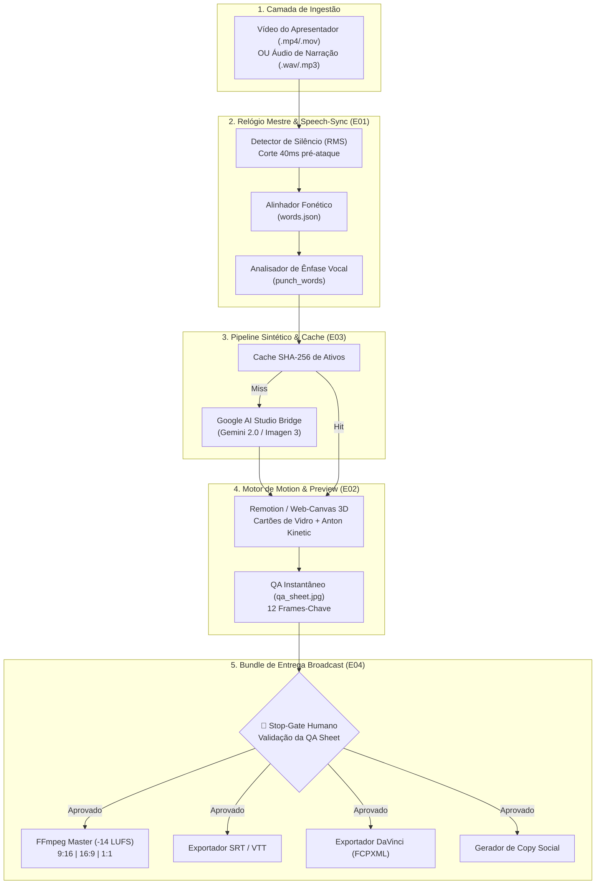

# 📋 SPEC: Pipeline Canônico de Edição e Motion Vídeo Determinado (LegoLoop Video Motion)

> **Status:** Proposta para Revisão  
> **Data:** 2026-11-07  
> **Versão:** 1.0.0  
> **Autor:** Antigravity (LegoLoop Mega Pipeline — Fusão Addy Osmani + Matt Pocock + AIDD-Spec)  
> **Iniciativa:** I01 — LegoLoop Creative Engines  
> **Referência da Intenção:** [docs/intents/2026-11-07_INTENT_VIDEO_MOTION_PIPELINE.md](../intents/2026-11-07_INTENT_VIDEO_MOTION_PIPELINE.md)  
> **Alvo Primário:** `internal/videomotion`, `loops/video-motion`, `cmd/legoloop`  
> **Consome:** INTENT aprovada · **Produz:** PLAN e ROUTE  
> **Template:** TEMPLATE_SPEC.md v2.0.0  

---

## 1. Premissas Técnicas Assumidas (Addy Osmani)

> [!IMPORTANT]
> A IA lista abaixo todas as premissas técnicas adotadas para evitar decisões silenciosas:
1. **Runtime Go & Stdlib:** O núcleo do pipeline, o parser de EDL, o despachante de nós e a validação de gates são implementados estritamente em Go na pasta `internal/videomotion`, sem introduzir novas dependências externas no `go.mod` (zero dependências novas).
2. **Máxima Determinização:** Todo cálculo de tempo, detecção de pausas, alinhamento fonético, curvas de aceleração visual (springs/easing), enquadramento facial e render de frames é 100% determinístico, implementado em código e matemática pura.
3. **Mídia e Runtimes Instalados no SO:** O pipeline consome o binário local do `ffmpeg.exe` (no PATH) para decodificação/mixagem de áudio e encode final, e o runtime `node.exe` (v26+) para o renderizador de composição web (Remotion/Canvas).
4. **Isolamento de Estado & Cache Criptográfico:** Nenhum estado intermediário polui a raiz do projeto. Todo ativo temporário, corte e arquivo gerado mora em `scratch/videomotion/<job_id>/`, e os ativos sintéticos são cacheados deterministicamente por hash `SHA-256(prompt + seed + aspect_ratio)` em `scratch/videomotion/cache/`.
5. **Segurança de Credenciais:** A chave de API `GEMINI_API_KEY` trafega exclusivamente via variável de ambiente do sistema, nunca exposta em arquivos de log, dumps JSON ou respostas de chat.

---

## 2. Fronteiras de Ação & Regras de Governança (Boundaries — Addy Osmani)

* **Sempre Fazer:**
  * Desenvolver via TDD estrito (teste unitário falhando antes do código de produção).
  * Manter funções pequenas, enxutas e de responsabilidade única (< 35 linhas).
  * Validar rigorosamente todos os schemas JSON de entrada (`edl.json`, `story.json`, `words.json`).
  * Normalizar o áudio master obrigatoriamente para a norma broadcast EBU R128 em -14 LUFS (±1 LUFS).
  * Gerar a folha de contato instantânea (`qa_sheet.jpg`) com os 12 frames-chave antes de disparar o encode de vídeo completo.
  * Recompilar o binário `legoloop.exe` ao final de cada alteração em Go.
* **Perguntar Antes:**
  * Adicionar dependências externas no `go.mod`.
  * Alterar a estrutura contratual dos arquivos exportados para DaVinci (`.fcpxml` / `.edl`).
  * Modificar regras globais no `AGENTS.md`.
* **Nunca Fazer:**
  * Criar funções vazias com `TODO`, `pass` ou mocks de produção (Lei #1: Zero Stubs).
  * Exigir instalação obrigatória do Adobe After Effects ou qualquer software pago fechado.
  * Deixar transições ou posições de texto ao acaso de modelos generativos (probabilísticos).
  * Permitir que legendas cinéticas colidam ou fiquem posicionadas sobre a face do apresentador.

---

## 3. Visão Geral, Arquitetura & Costuras de Teste (Test Seams — Pocock)

A arquitetura do pipeline Video Motion é modular e desacoplada em 5 sub-motores executados em contexto estéril:



### Costuras de Teste (Test Seams — Pocock)
* **Costura Primária (Highest Seam):** `videomotion.RunPipeline(ctx context.Context, cfg PipelineConfig) (*PipelineResult, error)`
  * *Justificativa:* Testa a orquestração ponta a ponta a partir de arquivos de fixture isolados, validando a produção do bundle final no disco sem acoplamento a implementações privadas.
* **Costuras Secundárias:**
  * `speechsync.ParseWords(r io.Reader) (*WordsTimeline, error)`: Valida decodificação e integridade matemática dos timestamps fonéticos.
  * `cache.AssetKey(prompt, seed string, width, height int) string`: Valida o hash SHA-256 e a mecânica de hit/miss de cache.
  * `loudnorm.MeasureLUFS(audioPath string) (float64, error)`: Valida a medição mecânica de loudness EBU R128.
  * `fcpxml.Generate(timeline *Timeline) ([]byte, error)`: Valida a conformidade do XML exportado para o DaVinci Resolve.
* **Dublês Permitidos:** Dublê apenas na chamada HTTP externa do Google AI Studio (injetando mock de bytes de imagem durante testes de unidade herméticos).

---

## 4. Contratos de Dados & Schemas Formais

```go
package videomotion

import (
	"errors"
	"strings"
)

var (
	ErrInvalidConfig   = errors.New("videomotion: configuração do pipeline inválida")
	ErrAudioNotFound   = errors.New("videomotion: arquivo de áudio ou vídeo não encontrado")
	ErrTimelineEmpty   = errors.New("videomotion: timeline vazia após detecção de fala")
	ErrLoudnessOutOfRange = errors.New("videomotion: áudio fora da faixa de conformidade -14 LUFS")
)

// AspectRatio representa a proporção de tela do vídeo final.
type AspectRatio string

const (
	AspectVertical   AspectRatio = "9:16" // 1080x1920 (Reels, TikTok, Shorts)
	AspectHorizontal AspectRatio = "16:9" // 1920x1080 (YouTube, Desktop)
	AspectSquare     AspectRatio = "1:1"  // 1080x1080 (Feed LinkedIn/IG)
)

// WordEvent representa uma palavra individual com precisão temporal milimétrica.
type WordEvent struct {
	Index       int     `json:"index"`
	Word        string  `json:"word"`
	StartMs     int64   `json:"start_ms"`
	EndMs       int64   `json:"end_ms"`
	Confidence  float64 `json:"confidence"`
	IsPunchWord bool    `json:"is_punch_word"` // Ênfase vocal detectada por RMS
}

// BeatSegment define uma unidade dramática da cena.
type BeatSegment struct {
	ID          string      `json:"id"`
	StartMs     int64       `json:"start_ms"`
	EndMs       int64       `json:"end_ms"`
	VisualType  string      `json:"visual_type"` // "host_wide", "host_tight", "glass_card", "split_screen", "typewriter"
	Headline    string      `json:"headline"`
	AssetPrompt string      `json:"asset_prompt,omitempty"`
	AssetPath   string      `json:"asset_path,omitempty"`
	Words       []WordEvent `json:"words"`
}

// PipelineConfig reúne os parâmetros de execução de um job.
type PipelineConfig struct {
	InputMedia  string      `json:"input_media"`
	ScriptPath  string      `json:"script_path,omitempty"`
	AspectRatio AspectRatio `json:"aspect_ratio"`
	TargetLUFS  float64     `json:"target_lufs"` // Padrão: -14.0
	OutputDir   string      `json:"output_dir"`
	DryRun      bool        `json:"dry_run"`
}

func (c PipelineConfig) Validate() error {
	if strings.TrimSpace(c.InputMedia) == "" {
		return ErrInvalidConfig
	}
	if c.AspectRatio != AspectVertical && c.AspectRatio != AspectHorizontal && c.AspectRatio != AspectSquare {
		return ErrInvalidConfig
	}
	return nil
}
```

---

## 5. Critérios Binários de Aceite por Nó / Ticket (BDD)

### Épico 01 — Speech Sync & Audio Clock Engine (`E01`)

* [ ] `AC-E01.1`: **Detecção Determinística de Pausas e Corte sem Perda de Fonema**
  * **Dado que:** Um arquivo de áudio de 60 segundos com pausas de respiração > 400ms.
  * **Quando:** O motor de silêncio executa o fatiamento temporal.
  * **Então:** As pausas são eliminadas e todo corte inicia exatamente 40ms antes do início do fonema da palavra subsequente, com zero cortes abruptos em consoantes.
* [ ] `AC-E01.2`: **Alinhamento Fonético Palavra por Palavra (`words.json`)**
  * **Dado que:** O áudio processado e o roteiro de texto opcional.
  * **Quando:** O alinhador fonético gera o arquivo `words.json`.
  * **Então:** Cada entrada contém `word`, `start_ms`, `end_ms` sequenciais estritamente crescentes sem sobreposição temporal negativa.
* [ ] `AC-E01.3`: **Marcação Determinística de Palavras de Ênfase Vocal (`punch_words`)**
  * **Dado que:** A curva de decibéis RMS do áudio com palavras enfatizadas pelo orador com intensidade $\ge 3\text{ dB}$ acima da média.
  * **Quando:** O detector de ênfase processa o mapa de palavras.
  * **Então:** As palavras enfáticas são marcadas com `is_punch_word: true` para renderização em fonte Anton com destaque cromático.
* [ ] `AC-E01.4`: **Normalização de Áudio Broadcast em -14 LUFS**
  * **Dado que:** Uma faixa vocal masterizada final.
  * **Quando:** Medida pela especificação EBU R128 via `ebur128`.
  * **Então:** O valor integrado de loudness reporta entre `-13.5` e `-14.5` LUFS com pico máximo True Peak $\le -1.0\text{ dBFS}$.
* [ ] `AC-E01.5`: **Tratamento de Entrada de Áudio Inexistente ou Corrompida (Falha)**
  * **Dado que:** Um caminho de arquivo inexistente `fake_audio.mp4`.
  * **Quando:** O pipeline de áudio é acionado.
  * **Então:** Retorna o erro sentinela `ErrAudioNotFound` com exit code 1 e nenhum arquivo intermediário é criado no disco.

---

### Épico 02 — Visual Motion & Compositor Engine (`E02`)

* [ ] `AC-E02.1`: **Renderização dos Cartões de Vidro 3D Translúcidos (Glass Cards)**
  * **Dado que:** Um segmento de visual `glass_card` com texto e ativo associado.
  * **Quando:** O motor de motion compõe o quadro no Remotion/Web-Canvas.
  * **Então:** O cartão apresenta borda luminosa sutil, desfoque de fundo (backdrop blur), cantos arredondados e transição suave de push-in sem depender do After Effects.
* [ ] `AC-E02.2`: **Grid em Perspectiva e Kinetic Typography no Beat da Fala**
  * **Dado que:** Uma sequência de palavras marcada no `words.json`.
  * **Quando:** O vídeo avança pelo tempo exato `t = start_ms`.
  * **Então:** O texto na tela faz a transição de cor (*word-flip*) no frame exato correspondente a `start_ms` (tolerância $\pm 1$ frame).
* [ ] `AC-E02.3`: **Auto-Framing Facial em Modo Vertical 9:16**
  * **Dado que:** Uma filmagem bruta horizontal (16:9) do apresentador com deslocamento lateral.
  * **Quando:** O orquestrador ajusta a saída para o formato `AspectVertical`.
  * **Então:** O orador permanece enquadrado na zona de segurança central, sem cortes de olhos ou cabeça.
* [ ] `AC-E02.4`: **Geração da Folha de Contato Instantânea (`qa_sheet.jpg`)**
  * **Dado que:** Uma timeline com 8 a 15 beats gerada.
  * **Quando:** O gerador de QA é disparado em modo dry-run.
  * **Então:** O arquivo `qa_sheet.jpg` é gerado em menos de 3 segundos, exibindo os 12 frames-chave em uma grade 4x3 para auditoria humana.

---

### Épico 03 — Deterministic Asset Pipeline & AI Studio Bridge (`E03`)

* [ ] `AC-E03.1`: **Cache Criptográfico por SHA-256 de Prompts**
  * **Dado que:** Uma requisição de geração de B-roll com o prompt `"futuristic glowing town square"` para proporção 9:16.
  * **Quando:** O ativo é gerado uma primeira vez e solicitado novamente na iteração seguinte.
  * **Então:** O pipeline detecta o hash em `scratch/videomotion/cache/<sha256>.png` e reutiliza o arquivo local sem realizar chamada de rede.
* [ ] `AC-E03.2`: **Fallback Gracioso para Texturas Locais**
  * **Dado que:** Ausência de conectividade ou indisponibilidade da chave `GEMINI_API_KEY`.
  * **Quando:** Um B-roll sintético falha na geração.
  * **Então:** O motor injeta deterministicamente uma textura local de halftone (`halftone_1080x1920.png`) e cartão tipográfico, sem interromper a esteira.

---

### Épico 04 — Render, Multi-Aspect Exporter & Broadcast Bundle (`E04`)

* [ ] `AC-E04.1`: **Exportação do Pacote de Entrega Completo (`bundle/`)**
  * **Dado que:** A folha de contato aprovada no Stop-Gate.
  * **Quando:** O comando de build finaliza a exportação.
  * **Então:** A pasta `dist/<job_id>/` contém obrigatoriamente:
    1. `video/master.mp4` (vídeo com legendas abertas em -14 LUFS).
    2. `video/clean_feed.mp4` (vídeo limpo sem legendas queimadas).
    3. `captions/subtitles.srt` e `captions/subtitles.vtt` (legendas fechadas).
    4. `copy/POST_COPY.md` (título, gancho, legenda e hashtags por rede).
    5. `studio/timeline.fcpxml` (projeto importável no DaVinci Resolve).
* [ ] `AC-E04.2`: **Suporte Multi-Aspect Ratio (9:16, 16:9, 1:1)**
  * **Dado que:** O mesmo projeto executado com `--aspect 9:16`, `--aspect 16:9` ou `--aspect 1:1`.
  * **Quando:** O render gera cada saída.
  * **Então:** As resoluções resultantes são exatamente 1080x1920, 1920x1080 e 1080x1080, com as safe zones respeitadas em cada proporção.
* [ ] `AC-E04.3`: **Conformidade FCPXML para DaVinci Resolve Studio**
  * **Dado que:** A linha do tempo gerada com múltiplos cortes e faixas de áudio/vídeo.
  * **Quando:** O arquivo `timeline.fcpxml` é gerado.
  * **Então:** O XML valida contra a especificação DTD da Apple/DaVinci, com todos os clipes e cortes casando perfeitamente com os segundos do áudio master.

---

### Épico 05 — Orquestrador LegoLoop, Livro Didático LegoPress & Meta-Processo (`E05`)

* [ ] `AC-E05.1`: **Execução Estéril por Bloco via DAG Canônico**
  * **Dado que:** O arquivo de orquestração `loops/video-motion/pipeline.dag.json`.
  * **Quando:** Executado via `legoloop run loops/video-motion/pipeline.dag.json --json`.
  * **Então:** Cada nó nasce em contexto estéril, consome exclusivamente o artefato pai, produz o artefato contratado e encerra com exit code 0.
* [ ] `AC-E05.2`: **Geração do Livro Didático Canônico de Uso (LegoPress)**
  * **Dado que:** A conclusão das peças do pipeline de vídeo motion.
  * **Quando:** O motor LegoPress (`internal/legopress`) compila a documentação didática.
  * **Então:** É gerado o livro didático completo em `docs/manuals/livro-video-motion/` contendo: manifesto `livro.json`, Cap. 1 (Fundação e Princípio Determinístico), Cap. 2 (Arquitetura dos 4 Pilares), Cap. 3 (Guia Prático Passo a Passo), Cap. 4 (Receitas e Formatos 9:16/16:9/1:1) e Cap. 5 (Rotina de Atualização por Diffs).
* [ ] `AC-E05.3`: **Manual do Meta-Processo de Engenharia Reversa de Vídeo**
  * **Dado que:** A conclusão de todo o ciclo de adaptação.
  * **Quando:** O artefato de governança é gerado.
  * **Então:** O manual `docs/manuals/MANUAL_ENGENHARIA_REVERSA_VIDEO_PIPELINE.md` detalha o passo a passo exato de: extração com Playwright, dissecação de skills gratuitas, substituição de motores fechados por abertos e canonização no LegoLoop.
* [ ] `AC-E05.4`: **Stop-Gate Humano Anti-Afobação Antes do Render Final**
  * **Dado que:** A folha de contato `qa_sheet.jpg` gerada.
  * **Quando:** A esteira atinge o nó de Stop-Gate.
  * **Então:** O pipeline pausa obrigatoriamente a execução e só prossegue para o encode pesado após o comando de aprovação do usuário.

---

## 6. Handoff de Governança
* **Próximo Documento Mandatório:** [`docs/plans/2026-11-07_PLAN_VIDEO_MOTION_PIPELINE.md`](../plans/2026-11-07_PLAN_VIDEO_MOTION_PIPELINE.md) e [`docs/routes/2026-11-07_ROUTE_VIDEO_MOTION_PIPELINE.json`](../routes/2026-11-07_ROUTE_VIDEO_MOTION_PIPELINE.json)
* **Gate de Transição:** Esta SPEC só é considerada aprovada após a validação humana explícita (*Stop-Gate 02*), garantindo que todos os 5 Épicos e seus critérios BDD binários estão rigorosamente alinhados antes de rascunhar o plano de tickets.

---

🛑 **STOP-GATE 02 DE AUDITORIA HUMANA:**  
*A especificação técnica detalhada com os 5 Épicos, contratos formais e critérios BDD binários atende plenamente ao seu padrão de qualidade?*  
*Somente após o seu aval explícito, geraremos o PLAN estruturado e a ROUTE executável em JSON.*
