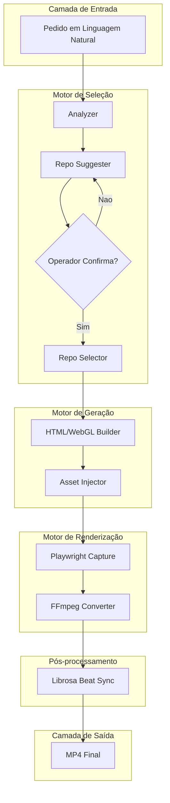

# 📋 SPEC: AI Motion Graphics — Pipeline Soberano com 10 GitHub Repos

> **Status:** Proposta para Revisão  
> **Data:** 2026-11-09  
> **Versão:** 1.0.0  
> **Autor:** MiMoCode (Fusão Addy Osmani + Matt Pocock + AIDD-Spec)  
> **Iniciativa:** I-AIMG — AI Motion Graphics  
> **Referência da Intenção:** [docs/intents/2026-11-09_INTENT_AI_MOTION_GRAPHICS.md](../intents/2026-11-09_INTENT_AI_MOTION_GRAPHICS.md)  
> **Alvo Primário:** `internal/motion/`, `loops/ai-motion-graphics/`, `skills/ai-motion-graphics/`  
> **Consome:** INTENT aprovada · **Produz:** PLAN e ROUTE  
> **Template:** TEMPLATE_SPEC.md v2.0.0  

---

## 1. Premissas Técnicas Assumidas (Addy Osmani)

> [!IMPORTANT]
> A IA lista abaixo todas as premissas técnicas adotadas para evitar decisões silenciosas. Alerte no Stop-Gate 02 caso alguma premissa esteja incorreta:
1. **Runtime Go conforme `go.mod`:** tipos nativos, zero dependências externas novas em `go.mod`. Playwright e FFmpeg são invocados como processos externos via `os/exec`.
2. **Armazenamento local:** artefatos em `docs/videorea/<slug>/` e `loops/ai-motion-graphics/`. Sem banco externo. Scratch files em `scratch/` dentro do workspace.
3. **Comunicação/segurança:** Playwright headless em `localhost` (porta efêmera). Nenhuma requisição externa durante renderização. Repos GitHub são clonados uma vez e cacheados localmente.
4. **Reuso:** `internal/pipeline` (validação DAG), `internal/provider` (LLM), `internal/fechar` (telemetria) serão reaproveitados. `internal/motion/` é pacote novo. Python/Librosa invocado via script externo (`scripts/beat_detect.py`).

---

## 2. Fronteiras de Ação & Regras de Governança (Boundaries — Addy Osmani)

* **Sempre Fazer:**
  * Desenvolver via TDD estrito (teste unitário falhando antes do código de produção).
  * Manter funções pequenas, enxutas e de responsabilidade única (< 35 linhas).
  * Validar rigorosamente todos os inputs e decodificações de JSON, incluindo caminhos (sem `..`, sem caminho absoluto fora da raiz).
  * Tratar caminhos de forma compatível com Windows e POSIX (`filepath.Join` / `filepath.ToSlash`).
  * Recompilar o binário ao final de qualquer ticket que altere Go (AGENTS.md, regra 5).
* **Perguntar Antes:**
  * Adicionar qualquer nova dependência externa no `go.mod`.
  * Alterar schemas persistidos no disco que possam quebrar retrocompatibilidade.
  * Alterar contratos públicos de CLI, de API do Studio ou de `pipeline.dag.json` / `ROUTE.json`.
  * Modificar regras globais no `AGENTS.md`.
* **Nunca Fazer:**
  * Criar funções vazias com `TODO`, `pass`, `// implementar depois` ou mocks simulados em código de produção (Lei #1: Zero Stubs). Dublês de teste ficam em `_test.go`, apenas nas bordas (E/S, LLM, relógio).
  * Commitar arquivos temporários, segredos ou variáveis de ambiente no git.
  * Ignorar testes falhando ou quebrar a suíte global de testes.
  * Usar `alert()`, `confirm()` ou emojis em frontend (quando houver UI).
  * NUNCA executar Playwright com `headless: false` em CI ou smoke tests.

---

## 3. Visão Geral, Arquitetura & Costuras de Teste (Test Seams — Pocock)

O pipeline `ai-motion-graphics` orquestra 10 repos open-source para produzir motion graphics em MP4. A arquitetura é um DAG acíclico com 5 fases: **Seleção → Geração → Renderização → Pós-processamento → Entrega**.

O motor de seleção analisa o pedido em linguagem natural e sugere repos do Tier 1 (5 essenciais) e Tier 2 (5 amplificadores). O operador confirma (fluxo híbrido). A geração produz HTML/WebGL usando os repos selecionados. Playwright captura frames headless. FFmpeg converte para MP4. Librosa sincroniza áudio.

### Diagrama de Fronteiras (Mermaid)



### Costuras de Teste (Test Seams — Pocock)
* **Costura Primária (Highest Seam):** `motion.Run(req Request) (*Result, error)` — função pública que orquestra o pipeline completo. Recebe `Request{Prompt, Scenario, Resolution, Duration}` e retorna `Result{MP4Path, DurationSec, Resolution, ReposUsed}`.
* **Justificativa:** A costura é o contrato externo do pacote. Testes de integração batem aqui com LLM falso e Playwright mockado nas bordas.
* **Costuras Secundárias:**
  * `suggestRepos(prompt string, scenario string) ([]RepoSuggestion, error)` — motor de seleção pura.
  * `buildHTML(repos []Repo, prompt string) (string, error)` — gerador de HTML/WebGL.
  * `captureFrames(html string, fps int, durationSec float64) ([]Frame, error)` — Playwright.
  * `framesToMP4(frames []Frame, audio string, out string) error` — FFmpeg.
  * `detectBeats(audioPath string) ([]float64, error)` — Librosa via script Python.
* **Dublês Permitidos (somente nas bordas):** LLM (falso), Playwright (mock processo), FFmpeg (mock processo), Librosa/Python (mock processo), filesystem (`t.TempDir()`). Nunca dublê de módulo interno.

---

## 4. Contratos de Dados & Schemas Formais

```go
// Contrato formal: tipos, erros sentinela e regras de validação.
package motion

import (
	"errors"
	"strings"
)

// ErrInvalidRequest sinaliza entrada que não satisfaz o contrato.
var ErrInvalidRequest = errors.New("motion: requisição inválida")

// ErrNoRepoSelected sinaliza que nenhum repo foi selecionado após confirmação.
var ErrNoRepoSelected = errors.New("motion: nenhum repo selecionado")

// ErrRenderFailed sinaliza falha na renderização Playwright/FFmpeg.
var ErrRenderFailed = errors.New("motion: falha na renderização")

// Scenario define o cenário de uso do motion graphic.
type Scenario string

const (
	ScenarioExplainer  Scenario = "explainer"
	ScenarioProductLaunch Scenario = "product_launch"
	ScenarioPixelArt   Scenario = "pixel_art"
)

// Request representa a requisição do operador.
type Request struct {
	Prompt     string   `json:"prompt"`
	Scenario   Scenario `json:"scenario"`
	Resolution string   `json:"resolution"` // ex: "1920x1080", "1080x1920"
	Duration   float64  `json:"duration"`   // segundos, > 0
	AudioPath  string   `json:"audio_path,omitempty"`
}

// Validate checa o contrato antes de qualquer E/S.
func (r Request) Validate() error {
	if strings.TrimSpace(r.Prompt) == "" {
		return ErrInvalidRequest
	}
	if r.Duration <= 0 {
		return ErrInvalidRequest
	}
	if !isValidScenario(r.Scenario) {
		return ErrInvalidRequest
	}
	return nil
}

// RepoSuggestion é a sugestão do motor de seleção.
type RepoSuggestion struct {
	ID       string  `json:"id"`
	Name     string  `json:"name"`
	Tier     int     `json:"tier"` // 1 ou 2
	Reason   string  `json:"reason"`
	Confidence float64 `json:"confidence"` // 0.0–1.0
}

// Result é o resultado do pipeline.
type Result struct {
	MP4Path     string   `json:"mp4_path"`
	DurationSec float64  `json:"duration_sec"`
	Resolution  string   `json:"resolution"`
	ReposUsed   []string `json:"repos_used"`
	Scenario    Scenario `json:"scenario"`
}
```

---

## 5. Critérios Binários de Aceite por Nó / Ticket (BDD)

### Épico 01 — Motor de Seleção de Repos

* [ ] `AC-E01.1`: **Sugestão correta para cenário explainer**
  * **Dado que:** um `Request{Prompt: "explique como um painel solar funciona", Scenario: "explainer", Resolution: "1920x1080", Duration: 30}`
  * **Quando:** `suggestRepos()` for invocado
  * **Então:** retorna lista com pelo menos `threejs` (Tier 1) e `react-postprocessing` (Tier 1), cada um com `Confidence >= 0.7` e `Reason` não vazio
* [ ] `AC-E01.2`: **Sugestão correta para cenário pixel art**
  * **Dado que:** um `Request{Prompt: "animacao pixel art de tempestade", Scenario: "pixel_art", ...}`
  * **Quando:** `suggestRepos()` for invocado
  * **Então:** retorna `pixelfx` (Tier 1) como primeira sugestão com `Confidence >= 0.8`
* [ ] `AC-E01.3`: **Caminho de falha — prompt vazio**
  * **Dado que:** um `Request{Prompt: "", Scenario: "explainer", Duration: 10}`
  * **Quando:** `Request.Validate()` for invocado
  * **Então:** retorna `ErrInvalidRequest`, nenhum efeito colateral no disco

### Épico 02 — Motor de Geração HTML/WebGL

* [ ] `AC-E02.1`: **Geração de HTML para Three.js**
  * **Dado que:** repos selecionados `[threejs]` e prompt `"grafico de barras 3D de receita anual"`
  * **Quando:** `buildHTML()` for invocado
  * **Então:** retorna string HTML contendo `<canvas` e `three` (import/require), com `< 50KB` de HTML gerado
* [ ] `AC-E02.2`: **Caminho de falha — nenhum repo selecionado**
  * **Dado que:** lista vazia de repos `[]Repo{}`
  * **Quando:** `buildHTML()` for invocado
  * **Então:** retorna `ErrNoRepoSelected`

### Épico 03 — Motor de Renderização Playwright + FFmpeg

* [ ] `AC-E03.1`: **Captura de frames via Playwright**
  * **Dado que:** HTML válido com animação CSS/JS e `fps=30`, `durationSec=3`
  * **Quando:** `captureFrames()` for invocado
  * **Então:** retorna exatamente 90 frames (30fps × 3s), cada frame com dimensões iguais à resolução do Request
* [ ] `AC-E03.2`: **Conversão frames → MP4 via FFmpeg**
  * **Dado que:** 90 frames PNG e áudio WAV de 3 segundos
  * **Quando:** `framesToMP4()` for invocado
  * **Então:** gera arquivo MP4 com `ffprobe` confirmando codec `h264`, duração `2.9s–3.1s`, resolução correta
* [ ] `AC-NF.1`: **Limite de tempo de renderização**
  * **Dado que:** request com `Duration=60` (60 segundos de vídeo)
  * **Quando:** pipeline completo executado
  * **Então:** tempo total de renderização `<= 300s` (5 min), sem memory leak (`GOMEMLIMIT` respeitado)

### Épico 04 — Sync de Áudio Librosa

* [ ] `AC-E04.1`: **Detecção de beats**
  * **Dado que:** arquivo WAV com batida a cada 0.5s (120 BPM)
  * **Quando:** `detectBeats()` for invocado (via `scripts/beat_detect.py`)
  * **Então:** retorna lista de timestamps com `>= 4` beats detectados, cada um dentro de `±50ms` do beat real
* [ ] `AC-E04.2`: **Caminho de falha — áudio inexistente**
  * **Dado que:** `AudioPath` aponta para arquivo inexistente
  * **Quando:** `detectBeats()` for invocado
  * **Então:** retorna erro, pipeline continua sem sync (fallback gracioso)

### Épico 05 — Skill Canônica & Livro Didático

* [ ] `AC-E05.1`: **Skill instalável**
  * **Dado que:** `skills/ai-motion-graphics/SKILL.md` existe e `legoloop instalar-skills` é executado
  * **Quando:** instalação concluída
  * **Então:** exit code 0, skill presente em todos os harnesses configurados
* [ ] `AC-E05.2`: **Livro Didático compilado**
  * **Dado que:** `docs/books/ai-motion-graphics/` com `livro.json` e `partes/`
  * **Quando:** `legoloop legopress auditar` for executado
  * **Então:** exit code 0, zero páginas órfãs

---

## 6. Comandos Operacionais & Critério de Conclusão Global (Addy Osmani)

### Comandos de Verificação Mecânica
* **Build:** `go build -o bin/legoloop.exe ./cmd/legoloop`
* **Test:** `go test -count=1 -v ./internal/motion/...`
* **Test global:** `go test -count=1 ./...`
* **Estática e formatação:** `go vet ./...` e `gofmt -l .` (saída vazia)
* **Funclen:** `go run ./tools/funclen internal` (nenhuma função > 35 linhas)
* **Dependências intactas:** `git diff --exit-code go.mod go.sum`

### Critério de Done Global
A especificação técnica é considerada **100% CONCLUÍDA** quando:
- [ ] 100% dos critérios binários `AC-E{N}.{M}` e `AC-NF.{K}` estiverem marcados como atendidos (`[x]`).
- [ ] O comando de **Test** passar com exit code 0.
- [ ] `go vet ./...` e `gofmt -l .` não reportarem nada.
- [ ] O comando de **Build** recompilar com sucesso o binário `bin/legoloop.exe`.
- [ ] Zero arquivos temporários ou órfãos residuais.
- [ ] Golden Fixture de 3s renderizada em `loop/fixture_3s.mp4`.

---

🛑 **STOP-GATE 02 DE AUDITORIA HUMANA (`SG-SPEC`):**  
*As premissas assumidas, as fronteiras (boundaries), os contratos e os critérios binários acima atendem à sua expectativa?*  
*Somente após a aprovação explícita do usuário, deve-se gerar o PLAN (`TEMPLATE_PLAN.md`) e a ROUTE (`TEMPLATE_ROUTE.json`).*
