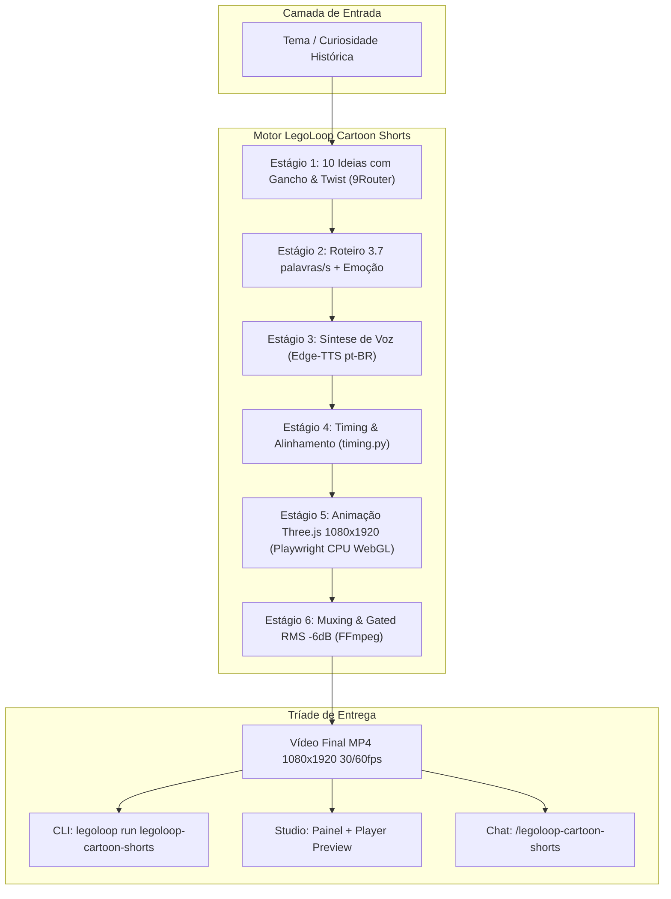

# 📋 SPEC: Pipeline Canônico LegoLoop Cartoon Shorts (legoloop-cartoon-shorts)

> **Status:** Proposta para Revisão (UNDER_REVIEW)  
> **Data:** 2026-11-09  
> **Versão:** 1.1.0  
> **Autor:** LegoLoop (Fusão Addy Osmani + Matt Pocock + AIDD-Spec)  
> **Iniciativa:** Soberania Audiovisual Local Tier Ouro  
> **Referência da Intenção:** [docs/intents/2026-11-09_INTENT_LEGOLOOP_CARTOON_SHORTS.md](../intents/2026-11-09_INTENT_LEGOLOOP_CARTOON_SHORTS.md)  
> **Alvo Primário:** `internal/videorea/`, `internal/cli/`, `loops/legoloop-cartoon-shorts/`, `skills/legoloop-cartoon-shorts/`, `web/studio/`  
> **Consome:** INTENT aprovada · **Produz:** PLAN e ROUTE  
> **Template:** TEMPLATE_SPEC.md v2.0.0  

---

## 1. Premissas Técnicas Assumidas (Addy Osmani)

> [!IMPORTANT]
> A IA lista abaixo todas as premissas técnicas adotadas com base na dissecação forense do motor oficial (`cartoon-audio-short` / `cartoon-short-kit`):
1. **Premissa de Runtime:** Go 1.24+ conforme `go.mod`, utilizando estritamente a biblioteca padrão para o orquestrador e runtime Node 22 + Python 3 para os scripts de renderização e timing herméticos.
2. **Premissa de Arquitetura Visual:** Personagens 2D "bean-head" desenhados em Canvas com contorno plum (cards 600x1000) posicionados em mundo 3D renderizado via Three.js r160 com texturas pintadas (`paint.js`), iluminação dinâmica e shader de contorno de tinta preta (*Ink Contract* com Normal/Depth pass).
3. **Premissa de Soberania (Custo Zero):** Substituição do ElevenLabs comercial por **Edge-TTS Neural Local (`pt-BR-AntonioNeural`)** interpretando as anotações de emoção entre colchetes (`[reflexivo]`, `[pausa curta]`, `[animado]`), e substituição do Claude Pro pelo **9Router Local**.
4. **Premissa de Áudio Determinístico:** Mixagem com trava de nível *Gated RMS* onde a trilha musical e os SFX ficam travados a exatamente **50% do nível da voz (-6 dB)**, com limitador de pico em -1 dBFS e loudness normalizado a -14 LUFS (via FFmpeg).
5. **Premissa de Confinamento:** Todos os artefatos intermediários e temporários residem estritamente dentro de `docs/videorea/legoloop-cartoon-shorts/scratch/`.

---

## 2. Fronteiras de Ação & Regras de Governança (Boundaries — Addy Osmani)

* **Sempre Fazer:**
  * Desenvolver via TDD estrito (teste unitário falhando antes do código de produção).
  * Manter funções pequenas, enxutas e de responsabilidade única (< 35 linhas).
  * Validar rigorosamente todos os inputs e decodificações de JSON, tratando caminhos de forma segura e multiplataforma (`filepath.Join`).
  * Recompilar o binário `bin/legoloop.exe` ao final de cada alteração em Go.
* **Perguntar Antes:**
  * Adicionar qualquer dependência nova no `go.mod` (proibido sem autorização explícita).
  * Alterar schemas existentes de `pipeline.dag.json` ou contratos da API HTTP do Studio.
* **Nunca Fazer:**
  * Criar funções vazias com `TODO`, `pass`, `// implementar depois` ou mocks simulados (Zero Stubs).
  * Utilizar subagentes de harness (`invoke_subagent`).
  * Gravar qualquer arquivo fora de `docs/videorea/legoloop-cartoon-shorts/scratch/`.

---

## 3. Visão Geral, Arquitetura & Costuras de Teste (Test Seams — Pocock)

O processo **LegoLoop Cartoon Shorts** implementa o fluxo de 4 estágios dissecado do motor oficial:



### Costuras de Teste (Test Seams — Pocock)
* **Costura Primária (Highest Seam):** `videorea.GenerateCartoonShort(ctx context.Context, req CartoonShortRequest, deps CartoonDeps) (*CartoonShortResult, error)`.
* **Costura Secundária 1 (Roteiro & Fatos):** `videorea.BuildCartoonScript(ctx context.Context, theme string, b brain.Brain) (*CartoonScript, error)`.
* **Costura Secundária 2 (TTS Edge com Emoção):** `videorea.SynthesizeEdgeTTS(ctx context.Context, text, voice, outAudioPath string, exec CommandExecutor) error`.
* **Costura Secundária 3 (Composição Visual & Mux):** `videorea.RenderCartoonScenes(ctx context.Context, script *CartoonScript, audioPath, outMP4Path string, exec CommandExecutor) error`.
* **Dublês Permitidos:** Dublês herméticos de `CommandExecutor` e `brain.Brain` em `_test.go` para validação offline.

---

## 4. Contratos de Dados & Schemas Formais

```go
package videorea

import (
	"errors"
	"strings"
)

var (
	ErrInvalidCartoonTheme   = errors.New("videorea: tema do cartoon short não pode ser vazio")
	ErrScriptGenerationFailed = errors.New("videorea: falha ao gerar roteiro do cartoon short")
	ErrTTSFailed             = errors.New("videorea: falha na síntese de voz Edge-TTS")
	ErrRenderFailed          = errors.New("videorea: falha na renderização visual do cartoon short")
)

type CartoonShortRequest struct {
	Theme        string `json:"theme"`
	DurationSec  int    `json:"duration_sec"` // 20 a 30 segundos recomendados
	Voice        string `json:"voice"`        // default: pt-BR-AntonioNeural
	OutputFolder string `json:"output_folder"`
	GenerateMP4  bool   `json:"generate_mp4"`
}

func (r CartoonShortRequest) Validate() error {
	if strings.TrimSpace(r.Theme) == "" {
		return ErrInvalidCartoonTheme
	}
	if r.DurationSec <= 0 {
		r.DurationSec = 30
	}
	if strings.TrimSpace(r.Voice) == "" {
		r.Voice = "pt-BR-AntonioNeural"
	}
	return nil
}

type CartoonScene struct {
	Index       int      `json:"index"`
	Timestamp   string   `json:"timestamp"`
	Narration   string   `json:"narration"`
	EmotionTag  string   `json:"emotion_tag"` // [reflexivo], [animado], etc.
	VisualCue   string   `json:"visual_cue"`
	Keywords    []string `json:"keywords"`
	AccentColor string   `json:"accent_color"`
}

type CartoonScript struct {
	Title        string         `json:"title"`
	Theme        string         `json:"theme"`
	Hook         string         `json:"hook"`
	FactOrLegend string         `json:"fact_or_legend"`
	Scenes       []CartoonScene `json:"scenes"`
	TotalWords   int            `json:"total_words"`
}

type CartoonShortResult struct {
	ScriptFile  string  `json:"script_file"`
	AudioFile   string  `json:"audio_file"`
	VideoFile   string  `json:"video_file"`
	DurationSec float64 `json:"duration_sec"`
	Status      string  `json:"status"`
}
```

---

## 5. Critérios Binários de Aceite por Nó / Ticket (BDD)

### Épico 01 — Motor de Roteiro & Curiosidades Fatuais (`script_engine.go`)
* [ ] `AC-E01.1`: **Geração de 10 ideias com gancho paradoxal e twist**
  * **Dado que:** Um tema de curiosidade histórica ou científica é recebido.
  * **Quando:** O gerador de ideias é executado.
  * **Então:** Retorna 10 ideias numeradas contendo Título (5-8 palavras), Gancho inicial sem introdução, Twist irônico e Checagem Verdade/Lenda.
* [ ] `AC-E01.2`: **Roteiro estruturado no ritmo de 3.7 palavras/segundo com tags de emoção**
  * **Dado que:** Uma ideia é selecionada para short de 20-30s.
  * **Quando:** `BuildCartoonScript` é acionado.
  * **Então:** Produz o roteiro com contagem de palavras controlada (75 a 110 palavras) e tags de emoção em colchetes para o TTS.

### Épico 02 — Síntese Soberana Edge-TTS com Emoção (`tts_edge.go`)
* [ ] `AC-E02.1`: **Síntese de voz neural pt-BR sem custo**
  * **Dado que:** O texto com marcações de narração é enviado ao Edge-TTS.
  * **Quando:** `SynthesizeEdgeTTS` é invocado com `pt-BR-AntonioNeural`.
  * **Então:** Gera o áudio MP3 no disco sem erros e com duração exata calculada.
* [ ] `AC-E02.2`: **Resiliência e fallback para áudio sintetizado**
  * **Dado que:** O executor de comando encontra falha de rede.
  * **Quando:** A função é executada.
  * **Então:** Retorna `ErrTTSFailed` garantindo integridade sem travar a esteira.

### Épico 03 — Animação Three.js & Muxing Gated RMS (`motion_canvas.go` & `ffmpeg_mux.go`)
* [ ] `AC-E03.1`: **Renderização visual 1080x1920 com ink shader e câmeras contínuas**
  * **Dado que:** O roteiro, o áudio e a tabela de timing de cenas estão prontos.
  * **Quando:** O renderizador Playwright/Three.js executa o kit de animação.
  * **Então:** Gera os frames do short e aciona o muxing FFmpeg com trilha a -6 dB Gated RMS e limiter em -1 dBFS.
* [ ] `AC-E03.2`: **Fixture determinística de 3 segundos**
  * **Dado que:** A suíte de testes de integração é executada.
  * **Quando:** A síntese de validação rápida é invocada.
  * **Então:** Produz `loop/fixture_3s.mp4` válido com formato MP4 verificado por assinatura binária.

### Épico 04 — Tríade Completa de Interfaces (CLI, Studio & Chat)
* [ ] `AC-E04.1`: **Disparo via CLI com flags canônicas**
  * **Dado que:** O operador executa `legoloop run legoloop-cartoon-shorts --theme "ET de Varginha"`.
  * **Quando:** O comando CLI processa os argumentos.
  * **Então:** Executa o fluxo sequencial por nós isolados e entrega o MP4 com exit code 0.
* [ ] `AC-E04.2`: **Player de Preview no Studio Web e Comando de Chat**
  * **Dado que:** O Studio está rodando e a rota do processo é acionada.
  * **Quando:** O usuário solicita o processo via Web ou via `/legoloop-cartoon-shorts`.
  * **Então:** Exibe o player de preview funcional no Studio e responde no chat com a mídia final.

---

## 6. Comandos Operacionais & Critério de Conclusão Global

* **Build:** `go build -o bin/legoloop.exe ./cmd/legoloop`
* **Test:** `go test -count=1 ./internal/videorea/...`
* **Estática e formatação:** `go vet ./...` e `gofmt -l .` (saída vazia)
* **Funclen:** `go run ./tools/funclen internal` (máximo 35 linhas por função)

---

🛑 **STOP-GATE 03 DE AUDITORIA HUMANA (`SG-SPEC`):**  
*A especificação técnica atualizada com o motor Three.js, toon.ts e prompt de emoção está aprovada para gerarmos o PLAN e a ROUTE?*
