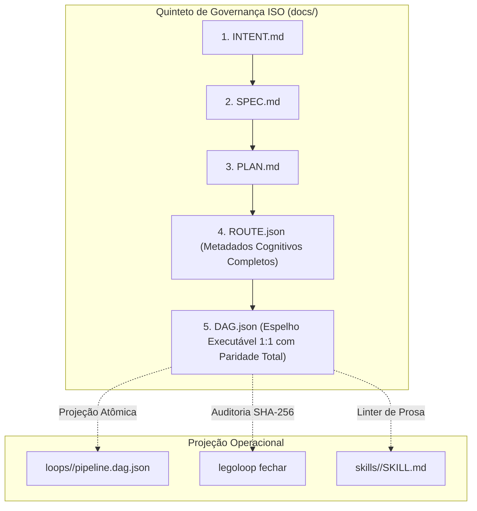

# 📋 SPEC: Quinteto de Governança ISO e Harmonização de Grafos Executáveis

> **Status:** APPROVED (Atualizado com Paridade Total Cognitiva)  
> **Data:** 2026-11-09  
> **Versão:** 1.1.0  
> **Autor:** LegoLoop Core Team & Antigravity  
> **Iniciativa:** I05 — Governança Pentafásica e Harmonia de Grafos Executáveis  
> **Referência da Intenção:** [docs/intents/2026-11-09_INTENT_QUINTETO_GOVERNANCA_ISO.md](../intents/2026-11-09_INTENT_QUINTETO_GOVERNANCA_ISO.md)  
> **Alvo Primário:** `internal/dag/`, `internal/processo/`, `internal/fabricar/`, `internal/compor/`, `internal/fechar/`, `internal/videorea/`, `docs/templates/`, `loops/`  
> **Consome:** INTENT aprovada · **Produz:** PLAN e ROUTE  
> **Template:** TEMPLATE_SPEC.md v2.0.0  

---

## 1. Premissas Técnicas Assumidas (Addy Osmani)

> [!IMPORTANT]
> 1. **Stdlib Go Pura:** Todas as operações de manipulação de JSON, cálculo de hashes SHA-256, manipulação de caminhos e E/S de arquivos utilizam estritamente a biblioteca padrão do Go (`crypto/sha256`, `encoding/json`, `os`, `path/filepath`), sem nenhuma dependência externa no `go.mod`.
> 2. **Isomorfismo e Paridade Total ROUTE ↔ DAG:** O arquivo `docs/dags/YYYY-MM-DD_DAG_<SLUG>.json` é o espelho executável 1:1 de `docs/routes/YYYY-MM-DD_ROUTE_<SLUG>.json`. O DAG **não é uma casca oca** nem um simples executor de comandos de terminal: ele herda e preserva integralmente os contratos cognitivos da ROUTE (`context_in`, `context_out`, `test_seam`, `token_budget`, `isolation`, `tooling`, `cognitive_complexity`, `retry_policy`).
> 3. **Projeção Atômica com Auditoria SHA-256:** O arquivo em `docs/dags/` é a fonte de verdade auditável arquivada; sua projeção operacional reside em `loops/<slug>/pipeline.dag.json` (e no cofre `~/.aidd/canonical/loops/`). O comando `legoloop fechar` audita mecanicamente a igualdade de hash SHA-256 entre ambos.
> 4. **Skill como Prosa Fiel do DAG:** A `SKILL.md` gerada descreve em prosa estruturada cada fase e nó do DAG. Um linter de integridade assegura que nenhum nó do DAG fique órfão sem descrição correspondente na Skill.
> 5. **Normalização de Nomenclatura:** Todos os loops operacionais do acervo adotam compulsoriamente o prefixo `legoloop-*` (`legoloop-video-rea`, `legoloop-video-motion`, `legoloop-video-edition`, `legoloop-fechar`).

---

## 2. Fronteiras de Ação & Regras de Governança (Boundaries — Addy Osmani)

* **Sempre Fazer:**
  * Desenvolver via TDD estrito (teste unitário falhando antes do código de produção).
  * Manter funções pequenas, enxutas e com teto estrito de 35 linhas (`funclen <= 35`).
  * Tratar caminhos com portabilidade Windows/POSIX (`filepath.Join`, `filepath.ToSlash`).
  * Recompilar o binário `bin/legoloop.exe` e instalar via `go install ./cmd/legoloop` ao final de cada alteração em Go.
* **Perguntar Antes:**
  * Alterar schemas estruturais existentes sem compatibilidade retroativa.
  * Modificar a assinatura de interfaces públicas de `processo.Store` ou `fabricar.Materialize`.
* **Nunca Fazer:**
  * Criar funções vazias com `TODO`, `pass`, ou stubs simulados (Lei #1: Zero Stubs).
  * Emitir DAGs sem os metadados cognitivos que tornam os nós reproduzíveis por modelos de IA e agentes autônomos.
  * Salvar DAGs com URLs ou caminhos fixos (*hardcoded*) que impeçam a execução dinâmica de outros alvos.
  * Permitir que `legoloop fechar` aprove um processo cujo DAG em `docs/dags/` divirja de `loops/<slug>/pipeline.dag.json`.

---

## 3. Visão Geral, Arquitetura & Costuras de Teste (Test Seams — Pocock)

A esteira estende a arquitetura de projeções do pacote `internal/processo` e a estrutura de nós de `internal/dag` para garantir a paridade total dos contratos:



### Costuras de Teste (Test Seams — Pocock)
* **Costura Primária (Processo & Projeções):** `processo.Projetar(p Processo, now time.Time) (*Projecoes, error)` — valida se a struct `Projecoes` inclui `DAGNome` e gera os nós do DAG com todos os metadados da ROUTE.
* **Costura Secundária (Fábrica Atômica):** `fabricar.Materialize(ctx context.Context, plan MaterializePlan, fsys FS) (CanonicalArtifacts, error)` — valida se `docs/dags/YYYY-MM-DD_DAG_<SLUG>.json` é persistido com sucesso e sem caminhos absolutos vazados.
* **Costura Terciária (Auditoria de Fechamento):** `fechar.fecharDAG(d *Deps, slug, canon string, dry bool) (string, error)` — valida se a paridade de hash SHA-256 entre `docs/dags/` e `loops/` é auditada.
* **Costura Quaternária (Grafo DAG & Parser):** `dag.Parse(data []byte) (*DAG, error)` — valida se o parser de DAG aceita e preserva os novos campos cognitivos sem quebrar loops legado.

---

## 4. Contratos de Dados & Schemas Formais

### Extensão do Contrato de Nó no DAG (`internal/dag/types.go` e `dag.v1.json` / `dag.v2.json`)
```go
package dag

// Node representa uma etapa executável com todos os contratos operacionais e cognitivos.
type Node struct {
	ID                  string                 `json:"id"`
	Name                string                 `json:"name,omitempty"`
	Type                NodeType               `json:"type"`
	Nature              string                 `json:"nature,omitempty"`
	CognitiveComplexity string                 `json:"cognitive_complexity,omitempty"`
	Ref                 string                 `json:"ref,omitempty"`
	DependsOn           []string               `json:"depends_on,omitempty"`
	Command             []string               `json:"command,omitempty"`
	Routing             RoutingConfig          `json:"routing,omitzero"`
	Isolation           map[string]any         `json:"isolation,omitempty"`
	TokenBudget         map[string]int         `json:"token_budget,omitempty"`
	Tooling             map[string]any         `json:"tooling,omitempty"`
	ContextIn           []string               `json:"context_in,omitempty"`
	ContextOut          []string               `json:"context_out,omitempty"`
	TestSeam            map[string]string      `json:"test_seam,omitempty"`
	Verification        map[string]any         `json:"verification,omitempty"`
	RollbackStrategy    string                 `json:"rollback_strategy,omitempty"`
	Output              OutputConfig           `json:"output,omitzero"`
}
```

---

## 5. Critérios Binários de Aceite por Nó / Ticket (BDD)

### Épico 01 — Núcleo de Projeção & Fábrica (`internal/processo`, `internal/fabricar`, `internal/dag`)
* [x] `AC-E01.1`: **Emissão de `DAGNome` em `Projecoes`**
  * **Dado que:** Um processo canônico válido é projetado via `processo.Projetar(p, agora)`.
  * **Quando:** As projeções são geradas.
  * **Então:** `pr.DAGNome` deve conter a máscara `YYYY-MM-DD_DAG_<SLUG>.json` e `pr.DAG` deve conter JSON válido.
* [x] `AC-E01.2`: **Materialização atômica em `docs/dags/`**
  * **Dado que:** A função `fabricar.Materialize` é executada para um processo `legoloop-teste`.
  * **Quando:** A gravação atômica é concluída.
  * **Então:** O arquivo `docs/dags/YYYY-MM-DD_DAG_LEGOLOOP_TESTE.json` deve existir em disco e seu caminho deve constar em `CanonicalArtifacts.DagIsoPath` mascarado.
* [ ] `AC-E01.3`: **Paridade Total de Metadados Cognitivos ROUTE ↔ DAG**
  * **Dado que:** Uma rota é gerada com nós contendo `context_in`, `token_budget`, `test_seam` e `isolation`.
  * **Quando:** O DAG correspondente é projetado.
  * **Então:** Cada nó do DAG deve preservar 1:1 esses contratos cognitivos, eliminando cascas ocas.

### Épico 02 — Composição e Re-projeção (`internal/compor`)
* [x] `AC-E02.1`: **Atualização do DAG no Quinteto durante `legoloop compor`**
  * **Dado que:** Um sub-loop é acoplado a um processo existente via `compor.Run`.
  * **Quando:** Os arquivos do processo pai são regerados.
  * **Então:** A lista de arquivos a gravar deve incluir `docs/dags/YYYY-MM-DD_DAG_<NOME>.json` atualizado com o novo nó `subloop`.

### Épico 03 — Auditoria Mecânica no Fechamento (`internal/fechar`)
* [x] `AC-E03.1`: **Aprovação quando hashes coincidem**
  * **Dado que:** `docs/dags/` e `loops/<slug>/pipeline.dag.json` possuem conteúdo idêntico.
  * **Quando:** `fechar.fecharDAG` é executado.
  * **Então:** Retorna status `ok` com o caminho validado.
* [x] `AC-E03.2`: **Rejeição quando houver divergência de hash**
  * **Dado que:** O arquivo em `loops/<slug>/pipeline.dag.json` foi alterado manualmente e difere de `docs/dags/`.
  * **Quando:** `fechar.fecharDAG` é executado.
  * **Então:** Retorna erro `ErrDAGDivergente` e barra a canonização.

### Épico 04 — Templates e Teste de Conformidade (`docs/templates/`)
* [x] `AC-E04.1`: **Validação do Quinteto em `templates_test.go`**
  * **Dado que:** A suíte de testes de templates é executada.
  * **Quando:** Roda `go test -v ./docs/templates -run TestTemplatesConformidade`.
  * **Então:** Valida a presença íntegra de `TEMPLATE_INTENT.md`, `TEMPLATE_SPEC.md`, `TEMPLATE_PLAN.md`, `TEMPLATE_ROUTE.json` e `TEMPLATE_DAG.json`.

### Épico 05 — Saneamento do Acervo de Loops e Prefixo Canônico `legoloop-*`
* [x] `AC-E05.1`: **Saneamento e Emissão de DAG ISO para `legoloop-video-rea`**
  * **Dado que:** O pipeline `loops/video-rea` continha nós defeituosos com URL fixa.
  * **Quando:** O saneamento é aplicado.
  * **Então:** O loop foi renomeado para `loops/legoloop-video-rea/pipeline.dag.json`, os comandos usam `--bundle docs/videorea/${SLUG}` e o DAG ISO foi emitido.
* [x] `AC-E05.2`: **Normalização de `video-motion`, `video-edition` e `fechar`**
  * **Dado que:** Loops existentes não utilizavam o prefixo `legoloop-*`.
  * **Quando:** A normalização é executada.
  * **Então:** Todos passam a residir em `loops/legoloop-<slug>/` com seus respectivos DAGs em `docs/dags/`.

---

## 6. Comandos Operacionais & Critério de Conclusão Global (Addy Osmani)

### Comandos de Verificação Mecânica
* **Build:** `go build -o bin/legoloop.exe ./cmd/legoloop`
* **Test:** `go test -count=1 ./...`
* **Estática:** `go vet ./...` e `gofmt -l .` (saída estritamente vazia).
* **Funclen:** `go run ./tools/funclen internal` (zero funções > 35 linhas).

---

🛑 **STOP-GATE 02 DE AUDITORIA HUMANA:**  
*Status: APROVADO pelo operador em 2026-11-09.*
