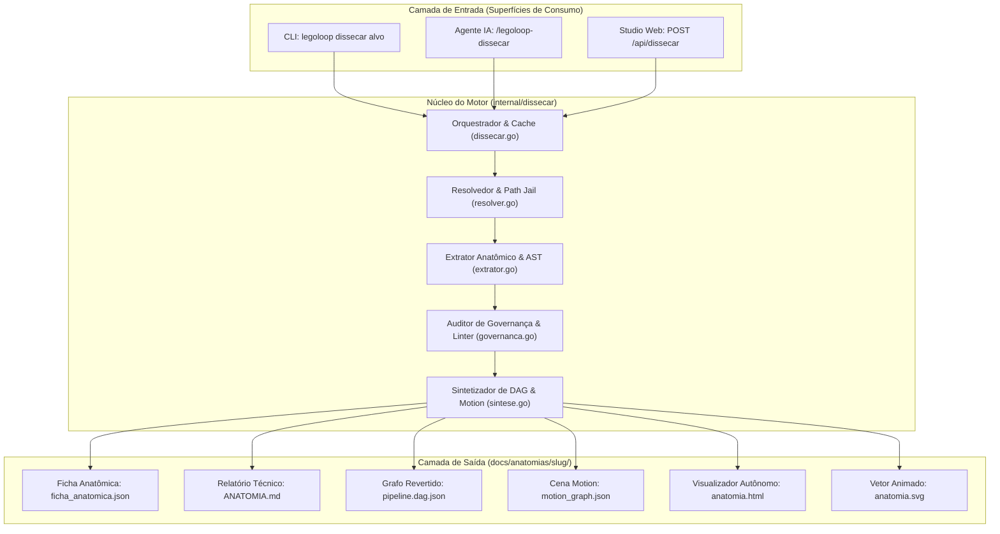
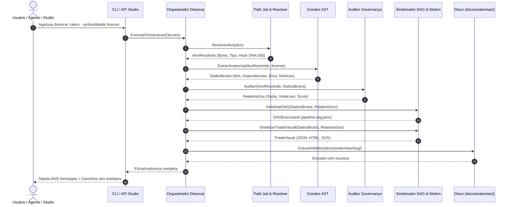

# 📋 SPEC: Oitavo Verbo Canônico `dissecar` — Especificação Técnica Arquitetural Exaustiva

> **Status:** Proposta para Revisão  
> **Data:** 2026-11-10  
> **Versão:** 1.0.0  
> **Autor:** Antigravity AI + Engenheiro Líder (Fusão Addy Osmani + Matt Pocock + AIDD-Spec)  
> **Iniciativa:** I08 — Verbo e Processo de Dissecação Universal do LegoLoop  
> **Referência da Intenção:** [docs/intents/2026-11-10_INTENT_DISSECAR.md](../intents/2026-11-10_INTENT_DISSECAR.md)  
> **Alvo Primário:** `internal/dissecar`, `cmd/legoloop`, `internal/cli`, `internal/studio`  
> **Consome:** INTENT aprovada · **Produz:** PLAN e ROUTE  
> **Template:** TEMPLATE_SPEC.md v2.0.0  

---

## 1. Premissas Técnicas Assumidas (Addy Osmani)

> [!IMPORTANT]
> A IA lista abaixo todas as premissas técnicas adotadas para garantir segurança, desempenho hermético e manutenibilidade do sistema:
1. **Runtime Go Estrito (Zero Dependências Externas):** O motor de análise estática e o CLI rodam com Go stdlib puro conforme o `go.mod`. Nenhuma dependência externa nova é adicionada (`go.mod` e `go.sum` permanecem inalterados). A análise de código Go utiliza os pacotes padrão `go/parser`, `go/token` e `go/ast`; scripts e linguagens dinâmicas são analisados via analisador léxico determinístico por expressões regulares compiladas.
2. **Segurança Hermética (Zero Execução Dinâmica):** A dissecação é estritamente estática. O alvo inspecionado é tratado exclusivamente como **dado**, nunca como instrução executável. O comando `dissecar` jamais executa scripts ou binários sob análise no sistema operacional hospedeiro, prevenindo riscos de execução arbitrária ou injeção de comandos.
3. **Isolamento de Caminho (Path Jail Mecânico):** Qualquer referência a caminho relativo ou absoluto é normalizada via `filepath.Clean`. Caminhos que tentem navegar para fora das raízes sanitizadas autorizadas (o projeto atual ou o Cofre `~/.aidd/canonical/`) são sumariamente bloqueados com erro de segurança.
4. **Desacoplamento do Renderizador de Motion Graphics:** O motor Go não embute nem requer dependências pesadas de processamento de vídeo (`ffmpeg`, `puppeteer`, `chromium`). Ele gera exclusivamente artefatos textuais determinísticos: o JSON de cena (`motion_graph.json`), o visualizador autônomo (`anatomia.html`) e o vetor animado (`anatomia.svg`). A renderização 3D e a gravação de clipes de vídeo rodam no navegador do Studio Web via WebGL e WebCodecs.
5. **Reuso de Infraestrutura Canônica Existente:**
   * `internal/taxonomy`: Auditoria automática de termos proibidos e vocabulário canônico ASD-STE100 (Lei #15).
   * `internal/dag`: Validação e execução de grafos acíclicos sintetizados por engenharia reversa.
   * `internal/studio`: Servidor HTTP loopback seguro com `secure`, `TryLock` e limites de taxa para as novas rotas `/api/dissecar`.
6. **Mapeamento Semântico dos Estilos Audiovisuais (`ai-motion-graphics-10-repos`):**
   * Skills e Documentos Markdown ➔ Estilo infográfico/editorial isométrico (`lemo-opuscar`).
   * Processos e Grafos DAG JSON ➔ Grafo 3D orbital com nós de vidro translúcido (`threejs`).
   * Scripts (.ps1, .sh, .py), Hooks e Gates ➔ Terminal retrô CRT com partículas e shaders (`pixelfx`).
   * Servidores MCP ➔ Arquitetura de barramento e conexões de rede em tempo real.
7. **Design System Rígido da Marca:**
   * Paleta SSOT: Fundo carvão industrial (`#131312`), Superfície de vidro fosco (`#1c1c1a` / `rgba(28,28,26,0.7)`), Laranja Industrial LegoLoop (`#d9480f`), Verde de aprovação (`#2b8a3e`), Vermelho de violação (`#c92a2a`) e Arestas (`#8c8676`).
   * Tipografia: Anton / Space Grotesk para títulos de impacto cinético; Cascadia Code / JetBrains Mono para telemetria e código.
   * Diretriz Visual: **Proibição absoluta de emojis** em código, logs, interfaces web e relatórios gerados. O sistema utiliza exclusivamente ícones vetoriais SVG proprietários.

---

## 2. Fronteiras de Ação & Regras de Governança (Boundaries — Addy Osmani)

O subsistema e seus agentes operadores devem obedecer rigorosamente ao sistema de fronteiras em 3 níveis:

* **Sempre Fazer:**
  * Desenvolver via TDD estrito com ciclos Red-Green e comprovação mecânica por teste de mutação.
  * Manter funções curtas, enxutas e com limite máximo de 35 linhas (`tools/funclen`).
  * Validar rigorosamente todos os caminhos contra escape de diretório antes de qualquer operação de leitura.
  * Tratar caminhos com compatibilidade cruzada Windows e POSIX (`filepath.Join` e `filepath.ToSlash`).
  * Comunicação de agentes em ASD-STE100 puro, sem marcações artificiais `[S]`, `[T]`, `[E]`.
  * Recompilar o binário ao final de alterações em Go (`go build -o bin/legoloop.exe ./cmd/legoloop`) e instalar via `go install ./cmd/legoloop`.
  * Manter os manifestos e relatórios de anatomia persistidos em `docs/anatomias/<slug>/`.

* **Perguntar Antes:**
  * Adicionar qualquer dependência nova no `go.mod`.
  * Alterar schemas JSON persistidos que quebrem retrocompatibilidade de ferramentas existentes.
  * Modificar rotas REST existentes do Studio Web.
  * Alterar regras de governança globais em `AGENTS.md`.

* **Nunca Fazer:**
  * Criar funções vazias com `TODO`, `pass`, `// implementar depois` ou mocks simulados em código de produção (Lei #1: Zero Stubs).
  * Executar código ou subprocessos contidos no arquivo alvo inspecionado.
  * Usar emojis em código, Studio ou mensagens do sistema.
  * Realizar escrita ou modificação no arquivo original sob análise.
  * Emitir arquivos sem validação de conformidade de schema formal.

---

## 3. Visão Geral, Arquitetura & Costuras de Teste (Test Seams — Pocock)

### 3.1 Arquitetura em Quatro Camadas do Pacote `internal/dissecar`

```
internal/dissecar/
├── tipos.go           # Structs de opções, fichas anatômicas, topologia e métricas
├── resolver.go        # Path Jail, detecção de tipo de peça e leitura segura de bytes
├── extrator.go        # Parsing de AST, contagem de linhas/tokens, variáveis de ambiente e syscalls
├── governanca.go      # Auditoria de stubs, conformidade taxonômica ASD-STE100 e cálculo de score
├── sintese.go         # Materialização de Grafo DAG executável e Tríade Visual (JSON, HTML, SVG)
└── dissecar.go        # Orquestrador do motor, gerenciador de cache e gerador de Markdown
```

### 3.2 Diagrama de Fronteiras Arquiteturais (Mermaid)



### 3.3 Diagrama de Sequência da Dissecação Completa



### 3.4 Costuras de Teste (Test Seams — Matt Pocock)

Para garantir 100% de cobertura com testes rápidos (< 10ms) e sem efeitos colaterais:

```go
package dissecar

import "context"

// AlvoFonte representa os dados do alvo resolvidos na memória.
type AlvoFonte struct {
    CaminhoOriginal string
    CaminhoLimpo    string
    Tipo            TipoAlvo
    Conteudo        []byte
    HashSHA256      string
}

// ResolvedorFonte abstrai a resolução de caminhos e leitura de bytes.
type ResolvedorFonte interface {
    Resolver(ctx context.Context, alvo string) (*AlvoFonte, error)
}

// ExtratorAST abstrai a análise léxica e sintática do código.
type ExtratorAST interface {
    Extrair(fonte *AlvoFonte, profundidade Profundidade) (*DadosBrutosAnatomia, error)
}

// AuditorGovernanca abstrai a verificação de regras de taxonomia e stubs.
type AuditorGovernanca interface {
    Auditar(fonte *AlvoFonte, brutos *DadosBrutosAnatomia) (*ResultadoGovernanca, error)
}

// SintetizadorGrafo abstrai a materialização do DAG executável.
type SintetizadorGrafo interface {
    SintetizarDAG(brutos *DadosBrutosAnatomia, gov *ResultadoGovernanca) ([]byte, error)
}

// SintetizadorMotion abstrai a geração dos arquivos da Tríade Visual.
type SintetizadorMotion interface {
    SintetizarTriade(brutos *DadosBrutosAnatomia, gov *ResultadoGovernanca) (*BundleVisual, error)
}
```

---

## 4. Contratos de Dados & Schemas Formais (Pocock)

### 4.1 Estruturas Principais em Go (`internal/dissecar/tipos.go`)

```go
package dissecar

import "time"

type Profundidade string

const (
    ProfundidadeRasa     Profundidade = "rasa"
    ProfundidadeCompleta Profundidade = "completa"
    ProfundidadeForense  Profundidade = "forense"
)

type TipoAlvo string

const (
    TipoSkill    TipoAlvo = "skill"
    TipoProcesso TipoAlvo = "processo"
    TipoScript   TipoAlvo = "script"
    TipoHook     TipoAlvo = "hook"
    TipoMCP      TipoAlvo = "mcp"
    TipoCodigo   TipoAlvo = "codigo"
)

// Opcoes define os parâmetros de entrada para a dissecação.
type Opcoes struct {
    Alvo         string       `json:"alvo"`
    Profundidade Profundidade `json:"profundidade"`
    Formato      string       `json:"formato"`
    PastaSaida   string       `json:"pasta_saida"`
    GerarMotion  bool         `json:"gerar_motion"`
    Forcar       bool         `json:"forcar"`
}

// FichaAnatomica consolida todos os dados extraídos da dissecação.
type FichaAnatomica struct {
    SchemaVersao string           `json:"schema_versao"`
    Alvo         string           `json:"alvo"`
    Slug         string           `json:"slug"`
    Tipo         TipoAlvo         `json:"tipo"`
    HashSHA256   string           `json:"hash_sha256"`
    DataHora     time.Time        `json:"data_hora"`
    Profundidade Profundidade     `json:"profundidade"`
    Metricas     MetricasAnatomia `json:"metricas"`
    Topologia    TopologiaGrafo   `json:"topologia"`
    Governanca   AuditoriaGov     `json:"governanca"`
    EstiloMotion string           `json:"estilo_motion"`
    Artefatos    ArtefatosGerados `json:"artefatos_gerados"`
}

type MetricasAnatomia struct {
    LinhasTotais      int `json:"linhas_totais"`
    LinhasCodigo      int `json:"linhas_codigo"`
    LinhasComentario  int `json:"linhas_comentario"`
    TokensEstimados   int `json:"tokens_estimados"`
    ComplexidadeCiclo int `json:"complexidade_ciclomatica"`
}

type TopologiaGrafo struct {
    Nos     []NoAnatomico     `json:"nos"`
    Arestas []ArestaAnatomica `json:"arestas"`
}

type NoAnatomico struct {
    ID           string   `json:"id"`
    Nome         string   `json:"nome"`
    Tipo         string   `json:"tipo"`
    LinhaInicio  int      `json:"linha_inicio"`
    LinhaFim     int      `json:"linha_fim"`
    Dependencias []string `json:"dependencias"`
    EnvVars      []string `json:"env_vars"`
    SysCalls     []string `json:"sys_calls"`
}

type ArestaAnatomica struct {
    Origem  string `json:"origem"`
    Destino string `json:"destino"`
    Relacao string `json:"relacao"`
}

type AuditoriaGov struct {
    ScoreAptidao float64    `json:"score_aptidao"`
    TemStubs     bool       `json:"tem_stubs"`
    Stubs        []string   `json:"stubs,omitempty"`
    ViolacoesTax []Violacao `json:"violacoes_taxonomicas,omitempty"`
}

type Violacao struct {
    TermoProibido string `json:"termo_proibido"`
    Sugestao      string `json:"sugestao"`
    Linha         int    `json:"linha"`
}

type ArtefatosGerados struct {
    FichaJSON   string `json:"ficha_json"`
    RelatorioMD string `json:"relatorio_md"`
    DAGJSON     string `json:"dag_json,omitempty"`
    MotionJSON  string `json:"motion_json,omitempty"`
    BundleHTML  string `json:"bundle_html,omitempty"`
    VetorSVG    string `json:"vetor_svg,omitempty"`
}

type BundleVisual struct {
    MotionJSON []byte
    BundleHTML []byte
    VetorSVG   []byte
}
```

### 4.2 Contratos de API REST do Studio Web (`internal/studio`)

#### `POST /api/dissecar`
* **Requisição:**
  ```json
  {
    "alvo": "skills/aidd-spec/SKILL.md",
    "profundidade": "forense",
    "gerar_motion": true,
    "forcar": false
  }
  ```
* **Resposta Sucesso (200 OK):**
  ```json
  {
    "sucesso": true,
    "slug": "skill-aidd-spec",
    "tipo": "skill",
    "score_aptidao": 0.95,
    "ficha": { "...": "FichaAnatomica completa" },
    "caminhos": {
      "relatorio": "docs/anatomias/skill-aidd-spec/ANATOMIA.md",
      "ficha_json": "docs/anatomias/skill-aidd-spec/ficha_anatomica.json",
      "dag_json": "docs/anatomias/skill-aidd-spec/pipeline.dag.json",
      "bundle_html": "docs/anatomias/skill-aidd-spec/anatomia.html"
    },
    "acoes": [
      { "id": "instalar_cofre", "label": "Instalar no Cofre", "endpoint": "/api/dissecar/promover" },
      { "id": "executar_dag", "label": "Executar DAG", "endpoint": "/api/dissecar/executar" },
      { "id": "elevar_padrao_ouro", "label": "Elevar para Padrão Ouro", "endpoint": "/api/dissecar/elevar" },
      { "id": "exportar", "label": "Exportar Pacote", "endpoint": "/api/dissecar/exportar" }
    ]
  }
  ```
* **Resposta Erro (400 Bad Request / 403 Forbidden):**
  ```json
  {
    "sucesso": false,
    "erro": "violação de segurança: caminho tenta escapar do diretório raiz sanitizado"
  }
  ```

---

## 5. Épicos & Critérios de Aceitação BDD/EARS (Addy Osmani)

### Épico 01: Motor Estático, Resolução e Governança (`internal/dissecar`)

* **AC-E01.1 (Resolução com Path Jail):**  
  * *Dado* uma string de alvo com tentativa de travessia de diretório (`../../windows/system32/cmd.exe`),  
  * *Quando* o resolvedor `dissecar.Resolver` processa a entrada,  
  * *Então* deve rejeitar com erro imediato `seguranca: escape de jail detectado` e exit status diferente de zero.
* **AC-E01.2 (Detecção Automática de Tipo de Peça):**  
  * *Dado* um arquivo com extensão `.md` contendo frontmatter `name:` e `description:`,  
  * *Quando* o resolvedor inspeciona os bytes iniciais,  
  * *Então* deve classificar o alvo estritamente como `TipoSkill`.
* **AC-E01.3 (Parsing de AST Go sem Execução):**  
  * *Dado* um arquivo de código Go válido com structs, métodos e chamadas de pacotes,  
  * *Quando* o extrator `dissecar.Extrair` analisa o arquivo com profundidade `completa`,  
  * *Então* deve retornar a lista de funções com linhas de início e fim, contagem de linhas e imports sem invocar o compilador nem o binário.
* **AC-E01.4 (Identificação de Variáveis de Ambiente e Syscalls):**  
  * *Dado* um script contendo `$env:9ROUTER_KEY` ou `os.Getenv("PORT")`,  
  * *Quando* o extrator analisa as chamadas,  
  * *Então* deve catalogar `9ROUTER_KEY` e `PORT` no array `EnvVars` da Ficha Anatômica.
* **AC-E01.5 (Auditoria de Stubs e Rebaixamento de Score):**  
  * *Dado* um alvo contendo as palavras `TODO`, `pass`, ou `// implementar depois`,  
  * *Quando* a auditoria de governança for executada,  
  * *Então* deve registrar `TemStubs = true`, listar os stubs encontrados e fixar o `ScoreAptidao` em no máximo `0.60`.
* **AC-E01.6 (Auditoria Taxonômica ASD-STE100):**  
  * *Dado* um alvo contendo termos proibidos pelo dicionário de `internal/taxonomy` (ex: "pipeline" em vez de "processo", "componente" em vez de "peça"),  
  * *Quando* a auditoria de governança for executada,  
  * *Então* deve emitir as violações com linha e sugestão canônica no array `ViolacoesTax`.
* **AC-E01.7 (Materialização de Grafo DAG por Engenharia Reversa):**  
  * *Dado* um alvo analisado com profundidade `forense`,  
  * *Quando* o sintetizador de grafo gerar o arquivo `pipeline.dag.json`,  
  * *Então* o arquivo gerado deve passar no comando `legoloop validate` com zero ciclos e exit code 0.
* **AC-E01.8 (Geração da Tríade Visual de Motion Graphics):**  
  * *Dado* a flag `gerar_motion = true`,  
  * *Quando* a síntese visual for concluída,  
  * *Então* devem ser gerados no disco `motion_graph.json`, `anatomia.html` e `anatomia.svg` contendo estritamente as cores da marca e zero emojis.

### Épico 02: Subcomando CLI Go (`internal/cli/dissecar.go`)

* **AC-E02.1 (Invocação Padrão do CLI):**  
  * *Dado* a execução de `legoloop dissecar skills/legoloop-fabricar/SKILL.md`,  
  * *Quando* o comando finaliza com sucesso,  
  * *Então* deve retornar exit code 0 e imprimir no terminal uma tabela ANSI formatada com os nós, métricas e caminhos dos artefatos.
* **AC-E02.2 (Modo Headless JSON Puro):**  
  * *Dado* a execução de `legoloop dissecar <alvo> --json`,  
  * *Quando* o comando finaliza com sucesso,  
  * *Então* deve emitir exclusivamente o JSON da `FichaAnatomica` no stdout, sem cores ANSI e sem textos auxiliares no stdout.
* **AC-E02.3 (Graduação por Flag `--profundidade`):**  
  * *Dado* a flag `--profundidade rasa`,  
  * *Quando* o comando executa,  
  * *Então* o tempo de execução total deve ser inferior a 15ms e a ficha não deve computar complexidade ciclomática.
* **AC-E02.4 (Tratamento de Alvo Inexistente):**  
  * *Dado* um caminho que não existe no disco,  
  * *Quando* o CLI executa,  
  * *Então* deve emitir exit code 1 e mensagem de erro explicativa no stderr sem disparar pânico.

### Épico 03: Studio Web, Nós 3D e Tríade Visual (`internal/studio`)

* **AC-E03.1 (Rota REST `POST /api/dissecar`):**  
  * *Dado* uma requisição POST válida para `/api/dissecar`,  
  * *Quando* o handler processa a solicitação,  
  * *Então* deve retornar HTTP 200 com a ficha anatômica e os endpoints de ação.
* **AC-E03.2 (Botões em SVG Proprietário e Zero Emojis):**  
  * *Dado* a renderização da interface web do Studio,  
  * *Quando* os cards de peças e a aba de Anatomia são carregados,  
  * *Então* todos os botões de ação e status devem utilizar ícones vetoriais SVG inline, com zero emojis no HTML.
* **AC-E03.3 (Canvas 3D com Three.js e Cores da Marca):**  
  * *Dado* a abertura da aba de Anatomia com uma peça dissecada,  
  * *Quando* a cena 3D é inicializada,  
  * *Então* o fundo deve ser `#131312` e os nós destacados em `#d9480f` e `#2b8a3e`.
* **AC-E03.4 (Disparo das Ações de Ciclo de Vida):**  
  * *Dado* o clique no botão "Instalar no Cofre",  
  * *Quando* o usuário confirma a ação,  
  * *Então* a rota de promoção deve copiar o artefato para `~/.aidd/canonical/` e atualizar o inventário.

### Épico 04: Governança Canônica, Skill e Fechamento

* **AC-E04.1 (Skill Canônica em ASD-STE100 Puro):**  
  * *Dado* o arquivo `skills/legoloop-dissecar/SKILL.md`,  
  * *Quando* o texto é analisado pelo linter de linguagem técnica,  
  * *Então* não deve conter marcações artificiais `[S]`, `[T]`, `[E]` e deve passar no comando `legoloop instalar-skills --dry-run`.
* **AC-E04.2 (Recompilação Fresca e Fechamento):**  
  * *Dado* o encerramento do plano de tickets,  
  * *Quando* a suíte de testes passar 100%,  
  * *Então* o binário deve ser recompilado em `bin/legoloop.exe` e instalado no PATH do usuário.

---

## 6. Matriz de Risco FMEA (Pocock)

| Risco Técnico / Modo de Falha | Severidade (S) | Ocorrência (O) | Detecção (D) | RPN | Ação Preventiva Mecânica |
| :--- | :---: | :---: | :---: | :---: | :--- |
| Parsing de arquivo sintaticamente corrompido causar pânico no motor | 8 | 3 | 1 | **24** | Bloco de `recover()` com tratamento gracioso de erro e registro da falha na Ficha Anatômica. |
| Gravação concorrente na mesma pasta de anatomia | 7 | 2 | 2 | **28** | Mutex de bloqueio por slug de alvo e gravação atômica com arquivo temporário e `os.Rename`. |
| Inclusão acidental de pacotes pesados no `go.mod` | 9 | 1 | 1 | **9** | Portão CI mecânico de `git diff --exit-code -- go.mod go.sum` que falha se o arquivo for tocado. |
| Incompatibilidade de renderização WebGL em navegadores sem GPU | 5 | 3 | 2 | **30** | Fallback automático gracioso para o diagrama vetorial animado `anatomia.svg` e tabela HTML. |
| Violação taxonômica nos nomes de campos da saída | 6 | 2 | 1 | **12** | Testes de unidade com validação estrita contra o dicionário JSON de `internal/taxonomy`. |

---

## 7. Stop-Gate 02: Homologação da Especificação

*A especificação técnica detalhada acima cobre integralmente os requisitos arquiteturais, contratos de dados, diagramas de sequência, interfaces de teste e critérios binários acordados na entrevista socrática.*