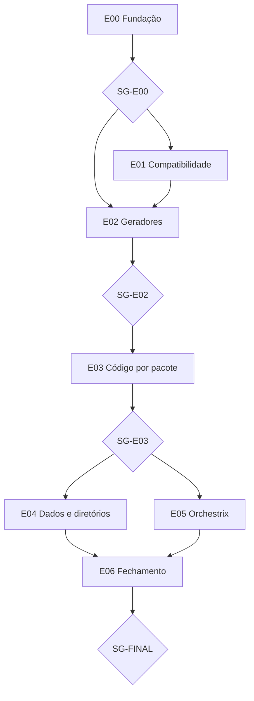

# 📋 SPEC: Refatoração Completa da Lei #15 (ASD-STE100) e Orchestrix sobre Claude Code

> **Status:** Aprovado pelo Usuário (Stop-Gate 02, 2026-11-10)  
> **Data:** 2026-11-10  
> **Versão:** 1.0.0  
> **Autor:** Claude  
> **Referência da Intenção:** [docs/intents/2026-11-10_INTENT_NORMALIZACAO_TAXONOMICA_LEI15.md](../intents/2026-11-10_INTENT_NORMALIZACAO_TAXONOMICA_LEI15.md)  
> **Alvo Primário:** `internal/dag`, `internal/fabricar`, `internal/compor`, `internal/fechar`, `internal/orchestrix`, `internal/runner`, `tools/taxlinter`, `docs/templates`  
> **Consome:** INTENT · **Produz:** PLAN e ROUTE  
> **Template:** TEMPLATE_SPEC.md v2.0.0  

---

## 1. Premissas Técnicas Assumidas

1. Go conforme o `go.mod`, só stdlib. Nenhuma dependência nova.
2. Os Processos vivem em arquivos locais. O Cofre real (`~/.aidd/canonical/`) tem 6 loops `.loop.json` (v1). O repositório tem 15 itens em `loops/`: 9 pastas com `pipeline.dag.json` e 6 arquivos `.loop.json`. Os 15 passam hoje em `legoloop validate` (verificado em 2026-11-10).
3. O Cofre guarda até três arquivos por Processo: `.loop.json` (documento do Studio), `.dag.json` (contrato da CLI) e `.processo.json` (registro v2). Os dois últimos já estão em uso e **permanecem**.
4. O `taxlinter` lê hoje só comentários e literais Go sem `/`, `\`, `-` ou `.`, chaves JSON simples e títulos de Markdown. Ele não lê identificadores Go, chaves compostas (`loop_end`), valores JSON, corpo de Markdown nem `.typ` (experimento de 2026-11-10). A marca "LegoLoop" não é violação no linter atual. O número 412 é um piso.
5. O ROUTE v1.0.0 usa o contrato 2.2.0 vigente: `subagents_allowed: false` (booleano). O valor `ephemeral` e o campo `extreme` entram no contrato no `TICK-00.3`.
6. `internal/processo` (53 importadores) **não** funde com `internal/loop` (22 importadores).
7. O DAG aceita um único `command` por nó (`internal/dag/types.go:118`) e `file_exists` só aceita arquivo regular (`internal/gate/builtins.go:135`). A bateria de verificação vira uma peça única, `tools/ticketgate`, com as opções `-pkgs`, `-tax`, `-gold`, `-build` e `-livros`.
8. O 9Router vivo expõe `code-fast`, `code-free`, `code-preview`, `code-pro` e `megacombo-*`. O combo `code-nano` não existe. Os ids de harness no código são `9router` (provedor), `agy`, `mimo`, `opencode`, `claude` e `ollama` (provedor).
9. O parser de DAG recusa ponto no id de nó (`internal/dag/parse.go:24`). O DAG existente `docs/dags/2026-11-09_DAG_QUINTETO_GOVERNANCA_ISO.json` falha hoje em `legoloop validate`. O DAG também recusa dois nós com o mesmo `output.artifact` e exige `artifact` relativo e não vazio em todo nó, inclusive Stop-Gate (verificado em 2026-11-10).
10. O `claude` instalado aceita `-p`, `--allowedTools`, `--tools`, `--model`, `--effort`, `--add-dir`, `--permission-mode` e `--no-session-persistence`. O executor efêmero usa essas opções.

## 2. Fronteiras de Ação & Regras de Governança

* **Sempre Fazer:**
  * TDD estrito. Teste novo só vale se uma mutação do código o faz falhar.
  * Funções com no máximo 35 linhas (`go run ./tools/funclen internal`).
  * Validar caminhos: sem `..`, sem caminho absoluto fora da raiz, sem symlink externo (Path Jail).
  * Repetir o teste dourado em todo ticket de E01 a E05.
  * Recompilar o binário ao final de cada ticket que altera Go.
* **Perguntar Antes:**
  * Alterar o Cofre real, o schema persistido ou contrato público da CLI e da API do Studio.
  * Modificar o `AGENTS.md` fora do `TICK-00.3`.
  * Adicionar dependência ao `go.mod`.
* **Nunca Fazer:**
  * Remover o leitor dos nomes antigos.
  * Sobrescrever `.dag.json` ou `.processo.json` ao renomear `.loop.json`.
  * Trocar ou escolher conta do `agy` por código.
  * Commitar ou fazer push sem pedido do usuário.
  * Aprovar Stop-Gate sem autorização explícita do usuário.
  * Tocar o Cofre real `~/.aidd` em teste.

---

## 3. Visão Geral, Arquitetura & Costuras de Teste

A refatoração segue sete épicos. E01 cria a compatibilidade (leitor dual, schema v2, migrador). E02 corrige os geradores para os Processos novos nascerem corretos. E03 normaliza o código por pacote. E04 move dados e diretórios. E05 constrói o Orchestrix sobre Claude Code. E06 fecha.



### Costuras de Teste
* **Costura Primária:** `legoloop validate <arquivo>` sobre os loops existentes (teste dourado em `internal/golden`) e `go run ./tools/taxlinter <pasta>` sobre cada pasta normalizada.
* **Justificativa:** as duas costuras são públicas e observam o contrato que o usuário vê. Não dependem de detalhe interno.
* **Costuras Secundárias:** parser de DAG com os dois dialetos, resolvedor de nomes, `legoloop migrar`, roteador, executor efêmero, raias.
* **Dublês Permitidos:** LLM, relógio, subprocesso `claude -p`, `agy`, rede. Nunca dublê de módulo interno.

---

## 4. Contratos de Dados & Schemas Formais

```go
// Contrato do roteador do Orchestrix (TICK-05.2 a TICK-05.4).
package orchestrix

import "errors"

var (
	ErrFerramentaFora   = errors.New("orchestrix: ferramenta fora da lista do ticket")
	ErrExtremeSemGate   = errors.New("orchestrix: natureza extreme exige Stop-Gate")
	ErrAlarmeToS        = errors.New("orchestrix: alarme de Terms of Service")
	ErrRaiaOcupada      = errors.New("orchestrix: ticket fixo em outra raia")
)

// Ordem soft de roteamento. O ticket sobrescreve com justificativa.
var OrdemRoteamento = []string{"9router", "agy", "mimo", "opencode", "claude", "ollama"}

// Modelo por natureza quando o harness é "claude".
var ModeloPorNatureza = map[string]string{
	"nano": "haiku", "micro": "sonnet", "macro": "sonnet", "extreme": "opus",
}
```

Nomes canônicos aprovados pelo usuário em 2026-11-10:

| Atual | Novo | Observação |
| :--- | :--- | :--- |
| `pipeline.dag.json` | `processo.dag.json` | O leitor aceita os dois. |
| `<nome>.loop.json` | `<nome>.studio.json` | `.dag.json` e `.processo.json` permanecem. |
| `loops/` | `processos/` | `git mv` no `TICK-04.1`. |
| Nó `subloop` | `subprocesso` | Schema v2. |
| Gatilho `loop_end` | `processo_fim` | Schema v2. |
| Campo `loop` | `processo` | Schema v2. |
| Rota `/api/loops` | `/api/processos` | Alias de transição com cabeçalho `Deprecation`. |
| `internal/loop`, tipo `Loop` | `internal/studiodoc`, tipo `Documento` | Não funde com `internal/processo`. |

---

## 5. Critérios Binários de Aceite por Nó / Ticket (BDD)

### Épico 00 — Fundação

* [ ] `AC-E00.1`: **Triagem completa**
  * **Dado que:** o `taxlinter` retorna N violações.
  * **Quando:** o `TICK-00.1` gera `scratch/tax_triagem.json`.
  * **Então:** `texto + contrato == N`.
* [ ] `AC-E00.2`: **Teste dourado dos loops**
  * **Dado que:** os 15 loops de `loops/` (e cópias autorizadas dos 6 do Cofre) estão em fixtures.
  * **Quando:** `go test ./internal/golden/...` roda.
  * **Então:** exit 0. Um loop inválido plantado em fixture faz o teste falhar (mutação).
* [ ] `AC-E00.3`: **Governança atualizada**
  * **Dado que:** o `AGENTS.md` tem a regra 4 sem o subagente efêmero.
  * **Quando:** o `TICK-00.3` edita `AGENTS.md`, `TEMPLATE_PLAN.md` e `TEMPLATE_ROUTE.json`.
  * **Então:** a regra 4 lista as seis condições, o item 12 declara a exceção de marca "LegoLoop", o contrato aceita `subagents_allowed: "ephemeral"` e o campo `extreme`, o combo `code-nano` some de `plangen/route.go` e dos templates, e `go test ./docs/templates/... ./internal/plangen/...` passa.
* [ ] `AC-E00.4`: **Linter ampliado**
  * **Dado que:** fixtures com "loop" em identificador Go (`type Loop`, `LoopID`, `loopCount`), em chave composta (`loop_end`, `subloop`), em valor JSON, no corpo de Markdown, em `.typ` e em literal Go com `/`, `-` ou `.`.
  * **Quando:** o `taxlinter` roda.
  * **Então:** cada caso é reportado, "LegoLoop" (comentário, string, identificador, título e chave) **não** é reportado, e `scratch/tax_baseline.txt` guarda o total real.
* [ ] `AC-E00.5`: **Peça ticketgate**
  * **Dado que:** um pacote com arquivo Go mal formatado (`gofmt -l` imprime o nome) e outro limpo.
  * **Quando:** `go run ./tools/ticketgate -pkgs <pacote>` roda em cada um.
  * **Então:** o primeiro retorna exit 1 e imprime o arquivo, o segundo retorna exit 0. Com `-tax` de uma pasta com violação, o exit é 1. Com `-livros` de uma pasta com PDF inexistente, o exit é 1.

### Épico 01 — Compatibilidade

* [ ] `AC-E01.1`: **Resolução única de nomes**
  * **Dado que:** existem 90 literais `"loops"` e 39 de `pipeline.dag.json` em Go.
  * **Quando:** o `TICK-01.1` os centraliza.
  * **Então:** `grep` desses literais fora do pacote central retorna vazio e o teste dourado passa.
* [ ] `AC-E01.2`: **Leitor dual**
  * **Dado que:** dois DAGs equivalentes, um no dialeto antigo e outro no novo.
  * **Quando:** o parser lê cada um.
  * **Então:** os dois produzem a mesma estrutura. Um DAG com mistura inválida retorna erro sentinela. Um nó com id `TICK-01.1` (com ponto) é aceito, e o `ref` de subprocesso com ponto continua recusado.
* [ ] `AC-E01.3`: **Schema v2**
  * **Dado que:** `schemas/dag.v1.json` e `schemas/dag.v2.json`.
  * **Quando:** todos os loops de `loops/` são validados.
  * **Então:** validam contra v1 e contra v2.
* [ ] `AC-E01.4`: **Migrador idempotente**
  * **Dado que:** um Processo v1 só com `.loop.json` em `t.TempDir()`.
  * **Quando:** `legoloop migrar` roda duas vezes.
  * **Então:** a segunda execução não altera nada, o backup existe, e destino já existente retorna erro sem efeito no disco.
* [ ] `AC-E01.5`: **Paridade com os dois nomes**
  * **Dado que:** um Processo com `pipeline.dag.json` e outro com `processo.dag.json`.
  * **Quando:** `legoloop fechar` audita a paridade SHA-256.
  * **Então:** os dois passam.
* [ ] `AC-E01.6`: **Projeção ROUTE para DAG**
  * **Dado que:** a ROUTE desta demanda (38 nós, ids com ponto).
  * **Quando:** `go run ./tools/route2dag <route> <dag>` gera o DAG.
  * **Então:** `legoloop validate` aceita o DAG (38 nós, sem ciclo), cada nó tem `output.artifact` único, o `command` de cada tarefa é o primeiro argv de `verify`, e todos os DAGs de `docs/dags/` validam. Dois nós com o mesmo artefato fazem a projeção falhar.

### Épico 02 — Geradores, templates, prompts, CLI e skills

* [x] `AC-E02.1`: **Geradores com nomes novos**
  * **Dado que:** `fabricar` e `compor` rodam em `t.TempDir()`.
  * **Quando:** gravam o Processo.
  * **Então:** o documento do Studio é `<nome>.studio.json`, `.dag.json` e `.processo.json` ficam intactos, e o artefato passa em `legoloop validate`.
* [ ] `AC-E02.2`: **Templates normalizados**
  * **Dado que:** `docs/templates/*`.
  * **Quando:** o `taxlinter` ampliado roda.
  * **Então:** `taxlinter docs/templates` exit 0 e `go test ./docs/templates/...` passa.
* [ ] `AC-E02.3`: **Prompts normalizados**
  * **Dado que:** um LLM falso responde com o prompt do `fabricar`.
  * **Quando:** o Processo é gerado.
  * **Então:** a saída não contém termo proibido, e reintroduzir um termo no prompt faz o teste falhar.
* [ ] `AC-E02.4`: **CLI normalizada**
  * **Dado que:** a ajuda da CLI e as mensagens de `commands.go`.
  * **Quando:** o `taxlinter` roda sobre os textos.
  * **Então:** nenhum termo proibido aparece na ajuda.
* [ ] `AC-E02.5`: **Skills normalizadas**
  * **Dado que:** `skills/*/SKILL.md`.
  * **Quando:** `taxlinter skills` roda e `legoloop instalar-skills` reinstala.
  * **Então:** exit 0 nas duas operações nos 5 harnesses.

### Épico 03 — Código interno por pacote

* [ ] `AC-E03.1`: **Studio normalizado**
  * **Dado que:** o Studio expõe `/api/loops`.
  * **Quando:** o `TICK-03.1` migra para `/api/processos`.
  * **Então:** a rota antiga responde igual com o cabeçalho `Deprecation`, e `taxlinter internal/studio` exit 0.
* [ ] `AC-E03.2`: **DAG e grafo normalizados**
  * **Dado que:** `internal/dag` e `internal/graph`.
  * **Quando:** o `TICK-03.2` renomeia.
  * **Então:** `taxlinter` exit 0 nas duas pastas e o teste dourado passa.
* [ ] `AC-E03.3`: **Pacote renomeado**
  * **Dado que:** 22 arquivos importam `internal/loop`.
  * **Quando:** o `TICK-03.3` renomeia para `internal/studiodoc`.
  * **Então:** `go build ./...` passa e nenhum import de `internal/loop` resta.
* [ ] `AC-E03.4`: **CLI, fabricar e refinar normalizados**
  * **Dado que:** `internal/cli`, `internal/fabricar`, `internal/refinar`.
  * **Quando:** o `TICK-03.4` renomeia.
  * **Então:** `taxlinter` exit 0 nas três pastas.
* [ ] `AC-E03.5`: **Assets, board, orchestrix e suggest normalizados**
  * **Dado que:** as quatro pastas.
  * **Quando:** o `TICK-03.5` renomeia.
  * **Então:** `taxlinter` exit 0 nas quatro pastas.
* [ ] `AC-E03.6`: **Demais pastas normalizadas**
  * **Dado que:** `internal/runner`, `internal/videorea` e as demais pastas de `internal/` e `cmd/`.
  * **Quando:** o `TICK-03.6` renomeia.
  * **Então:** `taxlinter internal/runner internal/videorea` exit 0.
* [ ] `AC-E03.7`: **Verificação global do código interno**
  * **Dado que:** `TICK-03.1` a `TICK-03.6` concluídos.
  * **Quando:** o `TICK-03.7` roda `taxlinter internal cmd` com o linter ampliado.
  * **Então:** exit 0. Qualquer identificador proibido que sobre em `internal/` ou `cmd/` faz o ticket falhar.

### Épico 04 — Dados e diretórios

* [ ] `AC-E04.1`: **Diretório renomeado**
  * **Dado que:** `loops/` tem 15 itens (9 pastas com `pipeline.dag.json` e 6 `.loop.json`).
  * **Quando:** o `TICK-04.1` executa `git mv loops processos` e `legoloop migrar` nos 15.
  * **Então:** os 15 validam sob os nomes novos (`processo.dag.json` e `.studio.json`). O teste dourado continua passando com as cópias dos nomes antigos.
* [ ] `AC-E04.2`: **Cofre migrado com backup**
  * **Dado que:** o backup do Cofre foi confirmado no `SG-E04-COFRE`.
  * **Quando:** `legoloop migrar` roda nos 6 loops.
  * **Então:** os 6 validam e o backup existe. Sem backup, o comando recusa e não altera nada.
* [ ] `AC-E04.3`: **Documentação e livros atualizados**
  * **Dado que:** 195 arquivos referenciam os nomes antigos.
  * **Quando:** o `TICK-04.3` atualiza e recompila os livros.
  * **Então:** `legoloop legopress auditar` exit 0 em cada livro.
* [ ] `AC-E04.4`: **Depreciação sem remoção**
  * **Dado que:** um Processo no dialeto antigo.
  * **Quando:** a CLI o lê.
  * **Então:** exibe o aviso de depreciação e o Processo continua válido.

### Épico 05 — Orchestrix sobre Claude Code

* [ ] `AC-E05.1`: **Executor efêmero**
  * **Dado que:** um ticket com lista de ferramentas e Write Boundary `strict`.
  * **Quando:** o executor roda o subprocesso falso.
  * **Então:** ferramenta fora da lista retorna `ErrFerramentaFora` e escrita fora do limite falha.
* [ ] `AC-E05.2`: **Roteador**
  * **Dado que:** o harness 1 responde 429.
  * **Quando:** o roteador decide.
  * **Então:** o ticket passa ao próximo harness da `OrdemRoteamento`, nunca troca de conta, e a sobrescrita exige justificativa.
* [ ] `AC-E05.3`: **Raias do `agy`**
  * **Dado que:** duas raias com um ticket fixo em cada uma.
  * **Quando:** a raia 1 recebe 429.
  * **Então:** o ticket não muda de raia e vai ao Mimocode. A saída com "Terms of Service" desliga todas as raias e retorna `ErrAlarmeToS`.
* [ ] `AC-E05.4`: **Modelo por natureza**
  * **Dado que:** um nó `extreme` sem Stop-Gate.
  * **Quando:** o validador de ROUTE roda.
  * **Então:** retorna `ErrExtremeSemGate`. Com Stop-Gate, passa e o modelo é `opus`.
* [ ] `AC-E05.5`: **Paralelismo e assíncrono**
  * **Dado que:** dois tickets com o mesmo arquivo em `source_files`.
  * **Quando:** o scheduler os agenda.
  * **Então:** nunca rodam juntos. Dois tickets disjuntos rodam em paralelo até o limite de workers do harness.
* [ ] `AC-E05.6`: **Telemetria**
  * **Dado que:** um Processo executado com tickets em dois harnesses.
  * **Quando:** o REPORT é gerado.
  * **Então:** contém tokens, tempo e custo por ticket e por harness no formato do `TEMPLATE_REPORT.md`.

### Épico 06 — Fechamento

* [ ] `AC-E06.1`: **Gate global**
  * **Dado que:** todos os épicos concluídos.
  * **Quando:** a cadeia de fechamento do `AGENTS.md` item 11 roda.
  * **Então:** `taxlinter internal cmd processos skills docs/templates` exit 0 com o linter ampliado (`processos` é o nome de `loops/` após o `TICK-04.1`), o binário existe e a ressalva "alvos já normalizados" some do `AGENTS.md`.

### Não funcionais

* [ ] `AC-NF.1`: **Retrocompatibilidade.** Os loops existentes validam antes e depois de cada ticket de E01 a E05.
* [ ] `AC-NF.2`: **Path Jail.** `legoloop migrar` e o executor efêmero recusam `..`, caminho absoluto fora da raiz e symlink externo.
* [ ] `AC-NF.3`: **Hermético.** Nenhum teste lê ou grava `~/.aidd`. Os testes usam `t.TempDir()`.
* [ ] `AC-NF.4`: **Tamanho de função.** `go run ./tools/funclen internal` não reporta função acima de 35 linhas.
* [ ] `AC-NF.5`: **Dependências intactas.** `git diff --exit-code -- go.mod go.sum` retorna 0.

---

## 6. Comandos Operacionais & Critério de Conclusão Global

### Comandos de Verificação Mecânica
* **Bateria por ticket (peça única):** `go run ./tools/ticketgate [-pkgs ...] [-tax ...] [-gold] [-build] [-livros ...]`
* **Build:** `go build -o bin/legoloop.exe ./cmd/legoloop`
* **Test:** `go test -count=1 ./...`
* **Estática e formatação:** `go vet ./...` e `gofmt -l .` (a saída deve ficar vazia; o comando não falha por exit code, então confira a saída).
* **Taxonomia:** `go run ./tools/taxlinter internal cmd loops skills docs/templates` (`processos` no lugar de `loops` após o `TICK-04.1`)
* **Dependências intactas:** `git diff --exit-code go.mod go.sum`

### Critério de Done Global
A especificação está **100% CONCLUÍDA** quando:
- [ ] 100% dos critérios `AC-E{N}.{M}` e `AC-NF.{K}` estiverem atendidos.
- [ ] O comando de Test passar com exit code 0.
- [ ] `go vet ./...` e `gofmt -l .` não reportarem nada.
- [ ] O comando de Build recompilar `bin/legoloop.exe`.
- [ ] Um Processo de duas etapas rodar de ponta a ponta com binário real e LLM real, com o resultado no REPORT.
- [ ] Zero arquivos temporários ou órfãos residuais.

---

🛑 **STOP-GATE 02 DE AUDITORIA HUMANA:**  
*As premissas, as fronteiras, os contratos e os critérios binários acima atendem à sua expectativa?*  
*A ordem dos artefatos foi invertida nesta demanda: o PLAN nasceu antes da SPEC. A aprovação da SPEC valida os dois.*
