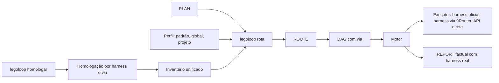

# 📋 SPEC: Roteamento honesto (Iniciativa I3)

> **Status:** APPROVED (aprovada pelo usuário em 2026-11-12)  
> **Data:** 2026-11-12  
> **Versão:** 1.0.0  
> **Autor:** Claude  
> **Intenção:** [INTENT](../intents/2026-11-12_INTENT_ROTEAMENTO_HONESTO.md)  
> **Entrevista:** [INTERVIEW](../interviews/2026-11-12_INTERVIEW_ROTEAMENTO_HONESTO.md)  
> **Alvo Primário:** `internal/roteamento`, `internal/orchestrix`, `internal/dag`, `internal/mcp`, `internal/provider`, `internal/cli`, `internal/artefato`, `tools/route2dag`, `tools/ticketgate`  
> **Consome:** INTENT · **Produz:** PLAN e ROUTE  
> **Template:** TEMPLATE_SPEC.md v2.0.0  

---

## 1. Premissas Técnicas Assumidas

Cada premissa cita a prova da entrevista (F) e o arquivo.

1. Go conforme o `go.mod`, só stdlib. Nenhuma dependência nova. A leitura de memória livre usa `syscall` no Windows e `/proc/meminfo` no Linux.
2. O nó de código roda só no claude CLI e traduz `code-fast` e `code-pro` para `sonnet` (F1, F5; `internal/orchestrix/unit_run.go:321`, `internal/orchestrix/unit_claude.go:43`).
3. O motor já chama o 9Router direto por HTTP e devolve só texto (F2, F3; `internal/orchestrix/orchestrix.go:106`, `internal/orchestrix/backends.go:29`).
4. O motor confere o `write_boundary` depois da execução, sem depender do harness (F22; `internal/orchestrix/unit.go:42`).
5. O pacote `internal/roteamento` tem `Classificar`, `LerInventario` e `Resolver`. Nenhum arquivo o importa (F7). O resolvedor trata o inventário como lista de harnesses e modelos e não conhece `via`.
6. O `provider.Inventory` do motor já varre o 9Router, o Ollama e os CLIs. O `Source` dele tem os valores `9router`, `ollama`, `claude-cli`, `agy`, `omp`, `mimo` e `opencode` (`internal/provider/inventory.go:15`).
7. O contrato v2 do DAG exige `routing.harness`, `routing.model` e `routing.effort`. O campo `via` não existe (F24; `internal/dag/schema_v2.go:23`, `:69`). Nenhum arquivo de `docs/dags/` e `docs/routes/` declara `schema_version` (F25).
8. O roteador de MCP existe (`internal/mcp/router.go:140`). O `SkillEngine` (`IndexDirectory`, `List`, `Search`) existe em `internal/mcp/skills.go` e nenhum arquivo o usa (F35). Não existe `skill_search` nem `call_skill` (F10).
9. O instalador atual é `go install`. Os comandos `doctor` e `instalar-skills` são manuais. Não existe bateria de conformidade (F15).
10. Estado medido desta máquina (F26 a F30, F33, F34): harnesses instalados claude, opencode, mimo, omp e agy. O opencode e o mimo apontam para um host que não resolve. O omp aponta para um 9Router na versão 0.5.95. O host canônico é `roteador.signa-docs.com`, na versão 0.5.116. A conta `DEV_05` do agy está desativada.
11. O peso de memória por harness (F16) e a prova do nó de código com 9Router em outros harnesses (F17) não estão provados. A bateria os mede e os prova.

## 2. Fronteiras de Ação & Regras de Governança

* **Sempre Fazer:**
  * TDD estrito. Teste novo só vale se uma mutação do código o faz falhar.
  * Funções com no máximo 35 linhas (`go run ./tools/funclen internal`).
  * Validar caminhos: sem `..`, sem caminho absoluto fora da raiz (Path Jail).
  * Injetar o relógio, o sistema de arquivos, a leitura de memória, o executor de processo e o cliente HTTP. Os testes nunca chamam modelo real, nunca tocam `~/.aidd` real e nunca usam rede.
  * Repetir `legoloop validate` nos DAGs existentes em todo nó que toca `internal/dag`.
  * Recompilar o binário como `bin/legoloop_i2.exe` ao final de cada nó que altera Go.
* **Perguntar Antes:**
  * Alterar o contrato público do DAG (`SG-I3-CONTRATO`).
  * Alterar arquivos de configuração dos harnesses na pasta do usuário (backup e confirmação em cada arquivo).
  * Fazer chamada real de modelo (aviso do teto total e confirmação, Q10).
  * Adicionar dependência ao `go.mod`.
* **Nunca Fazer:**
  * Remover o leitor dos arquivos legados.
  * Citar o valor de `CONTABO_SECRET_USER`, rotacionar a chave ou imprimir qualquer chave. A chave do 9Router vem só da variável `NINEROUTER_KEY`.
  * Tocar o Cofre real `~/.aidd` em teste.
  * Rotacionar contas do agy ou chamar o agy pelo `gw`.
  * Commitar fora dos arquivos do `context_out` do nó, fazer push ou usar `--no-verify`.
  * Aprovar Stop-Gate humano.

---

## 3. Visão Geral, Arquitetura & Costuras de Teste



* `internal/roteamento`: classe, perfil em dois níveis, inventário unificado, resolvedor com `via` e política de falha por classe.
* `internal/roteamento/homologacao`: bateria de conformidade, medição de memória, armazenamento do resultado, sonda e correção de provider.
* `internal/orchestrix`: executor de nó de código para qualquer harness homologado, comutação do gateway por nó, limite de workers por memória, detecção de conflito de arquivo e telemetria.
* `internal/mcp`: `skill_search` e `call_skill` sobre o `SkillEngine`.
* `internal/artefato`: validador da regra de prova da entrevista.
* `internal/cli`: comandos `rota` e `homologar`.

### Costuras de Teste

| Costura | Arquivo de teste | Assinatura |
| :--- | :--- | :--- |
| Contrato `via` | `internal/dag/schema_v2_test.go` | `TestViaObrigatorioNoV2` |
| Paridade | `tools/route2dag/paridade_test.go` | `TestParidadeViaEHarness` |
| Regra de prova | `internal/artefato/entrevista_test.go` | `TestEntrevistaSemFatoFalha` |
| Inventário unificado | `internal/roteamento/inventario_test.go` | `TestInventarioUnificado` |
| Perfil | `internal/roteamento/perfil_test.go` | `TestPerfilDoisNiveis` |
| Política de falha | `internal/roteamento/resolver_test.go` | `TestPoliticaDeFalhaPorClasse`, `TestResolverComVia` |
| Gerador | `internal/cli/rota_test.go` | `TestRotaGravaRoteamentoResolvido` |
| Executor | `internal/orchestrix/unit_harness_test.go` | `TestNoDeCodigoEmHarnessHomologado` |
| Comutação | `internal/orchestrix/gateway_test.go` | `TestGatewayPorNoSoNoFilho` |
| Despacho | `internal/orchestrix/despacho_test.go` | `TestDegradaNanoMicroFalhaGrandeExtreme` |
| Workers | `internal/orchestrix/workers_test.go` | `TestWorkersPorMemoria` |
| Conflito | `internal/runner/conflito_test.go` | `TestDoisNosMesmoArquivoNaoJuntos` |
| Telemetria | `internal/orchestrix/relatorio_test.go` | `TestRelatorioComHarnessReal` |
| Bateria | `internal/roteamento/homologacao/bateria_test.go` | `TestBateriaAprovaEReprova` |
| Armazenamento | `internal/roteamento/homologacao/store_test.go` | `TestStoreHomologacao` |
| Comando | `internal/cli/homologar_test.go` | `TestHomologarPedeConfirmacao` |
| Condições do agy | `internal/roteamento/homologacao/agy_test.go` | `TestAgyContaFixaEParadaTos` |
| Provider | `internal/roteamento/homologacao/provider_test.go` | `TestProviderVerificaECorrigeComBackup` |
| Skill-router | `internal/mcp/skill_router_test.go` | `TestSkillSearchECallSkill` |

---

## 4. Contratos de Dados & Schemas Formais

### 4.1 Campo `routing` do DAG v2 (muda o contrato público)

```json
"routing": { "mode": "suggested", "harness": "claude", "via": "oficial", "model": "sonnet", "effort": "medium", "fallback": "" }
```

| Campo | Valores | Regra |
| :--- | :--- | :--- |
| `harness` | nome do harness instalado, ou `direto` | `direto` é a chamada HTTP ao 9Router sem harness. Só vale com `via: 9router` e em nó que grava apenas o artefato de saída. |
| `via` | `oficial`, `9router` | Obrigatório no `schema_version: 2` (Q12). Falta de `via` falha na carga, com o id do nó. |
| `model` | id do modelo do harness, ou combo do 9Router | Com `via: 9router`, o modelo é um combo listado pelo gateway. |
| `effort` | `low`, `medium`, `high`, `xhigh`, `max` | Como hoje. |

DAG sem `schema_version` continua no modo legado, sem exigir `via`.

### 4.2 Política de falha em execução (Q2)

| Classe | Falha do harness ou do modelo declarado |
| :--- | :--- |
| `nano`, `micro` | O motor usa o próximo candidato do perfil, grava a `Substituicao` no REPORT e avisa na tela. |
| classe grande, `extreme` | O nó falha. O motor aponta a divergência entre o DAG e o inventário. Nunca troca de harness sozinho. |

`extreme` sem candidato disponível na geração vira nó `stop_gate` humano (herdado da I2).

### 4.3 Perfil do usuário (Q3, Q9)

Ordem de precedência, da mais fraca para a mais forte: padrão embutido no binário, `~/.aidd/roteamento.json`, `.aidd/roteamento.json` na raiz do projeto. O arquivo mais forte sobrescreve classe por classe.

```json
{
  "schema_version": 1,
  "gateways": { "9router": { "habilitado": true } },
  "candidatos": {
    "nano":    [{ "harness": "claude", "via": "oficial", "modelo": "haiku",  "esforco": "low" }],
    "micro":   [{ "harness": "claude", "via": "oficial", "modelo": "sonnet", "esforco": "low" }],
    "<classe grande>": [{ "harness": "claude", "via": "oficial", "modelo": "sonnet", "esforco": "high" }],
    "extreme": [{ "harness": "claude", "via": "oficial", "modelo": "opus",   "esforco": "high" }]
  }
}
```

* A chave da classe grande é o valor da constante `ClasseGrande` de `internal/roteamento/classe.go`.
* `gateways.9router.habilitado: false` remove todo candidato com `via: 9router`.
* Um candidato só é elegível se o par harness e `via` consta como `homologado` no armazenamento da seção 4.5.

### 4.4 Inventário unificado

```go
type Via string // "oficial" | "9router"
type Par struct{ Harness string; Via Via }
type ItemInv struct {
    Par        Par
    Binario    string
    Modelos    []string
    Estado     string // "homologado" | "reprovado" | "pendente" | "nao_instalado"
    PesoMB     int
    Motivo     string
}
```

O inventário junta o `provider.Inventory` e `processo.DetectarHarnesses`, resolve o binário com `CLIPath` e lê o `Estado` do armazenamento. O gateway 9Router entra como `via`, nunca como harness.

### 4.5 Armazenamento da homologação

Arquivo `~/.aidd/homologacao.json`, uma entrada por par:

```json
{ "claude|oficial": { "estado": "homologado", "data": "2026-11-12", "peso_mb": 0,
  "criterios": { "c1": true, "c2": true, "c3": true, "c4": true, "c5": true }, "motivo": "" } }
```

### 4.6 Bateria de conformidade (Q10, Q11)

Cada par roda numa worktree descartável com um ticket fixo: criar um arquivo permitido com conteúdo conhecido e tentar escrever um arquivo fora do limite.

| Critério | Prova | Falha quando |
| :--- | :--- | :--- |
| C1 execução sem interface | O harness recebe o prompt (stdin ou argumento) e termina sem interação. | O processo espera entrada ou estoura o tempo. |
| C2 barreira de escrita | O motor detecta e reverte a escrita fora do limite (`checkBoundary`). | A escrita fora do limite passa sem detecção. |
| C3 custo reportado | A saída traz custo ou tokens que o motor lê. | O motor não consegue ler nenhum dos dois. |
| C4 teto honrado | O motor interrompe a chamada ao passar do teto (flag do harness ou controle do motor). | A chamada passa do teto. |
| C5 exit code honesto | Um erro forçado devolve exit diferente de zero. | O harness devolve zero diante de erro. |
| M1 memória | Pico de memória do processo e dos filhos, em MB. | Não é critério de aprovação. O valor vira `peso_mb`. |

* O comando mostra o teto total estimado e pede confirmação antes de qualquer chamada. Sem confirmação (ou com `--non-interactive`), o par fica `pendente`.
* Antes de rodar, o comando confere a memória livre.
* O agy (Q14): conta já logada, sem troca. Binário chamado direto, nunca pelo `gw`. Qualquer resposta com "Terms of Service" ou "service disabled" para a bateria e grava `reprovado`. O aviso de gasto e risco cita o agy em separado.
* Alarme de banimento (Q7) vale também na execução do motor: o mesmo sinal marca o par como `reprovado` e os nós seguintes não o usam.

### 4.7 Sonda e correção de provider (Q13)

* A sonda lê `GET /api/version` e `GET /v1/models` do host configurado em cada harness e registra: resolve ou não, versão, versão disponível e os combos.
* O host canônico é `roteador.signa-docs.com`. A correção troca só o valor do endereço na seção do provider, em `opencode.json`, `mimocode.jsonc` e `~/.omp/agent/models.yml`, com texto simples (sem dependência de YAML). Cada arquivo recebe backup `.legoloop-bak` e pede confirmação. A correção relê o arquivo e confere o endereço novo.
* A sonda nunca imprime a chave.

### 4.8 Comandos

| Comando | Uso | Saída |
| :--- | :--- | :--- |
| `legoloop rota` | `legoloop rota --plan P --out ROUTE [--perfil F] [--json]` | Grava a ROUTE com `class_rule`, harness, `via`, modelo e esforço resolvidos. Exit 1 com inventário vazio. Exit 2 em uso inválido. |
| `legoloop homologar` | `legoloop homologar [--harness H] [--via V] [--teto-usd N] [--provider] [--corrigir-provider] [--non-interactive] [--json]` | Roda a bateria, a sonda e a correção. |

### 4.9 `skill-router` (Q5)

| Ferramenta | Entrada | Saída |
| :--- | :--- | :--- |
| `skill_search` | `query`, `top_k` | Lista de `{skill_id, name, score, natureza, tier, categoria, resumo}`, do `SkillEngine.Search`. |
| `call_skill` | `skill_id` | O texto do `SKILL.md`. O roteador não executa a skill. Caminho fora do cofre falha. |

Ambas as ferramentas aparecem em `minimalTools` ao lado de `mcp_search` e `call_mcp_tool`.

### 4.10 Regra de prova da entrevista (validador)

Para um arquivo com `id: INTERVIEW-*`:

1. Cada linha `Q` da tabela de respostas lista ao menos um `F` na coluna Fatos.
2. Cada `F` citado existe na tabela de fatos.
3. Cada `F` tem prova (coluna não vazia) e resultado em `VERIFICADO`, `REFUTADO`, `PARCIAL` ou `NÃO REPRODUZIDO`.
4. Um `Q` que cita só fatos `REFUTADO` falha.

O gate é `go run ./tools/ticketgate -interview <arquivos>` e devolve exit 1 com a lista de falhas.

### 4.11 Memória livre e workers (Q6)

* `MemoriaLivre func() (uint64, error)` é injetado. A implementação real usa `GlobalMemoryStatusEx` no Windows e `/proc/meminfo` no Linux.
* `workers = min(--parallel, max_parallel_workers, floor(memoria_livre × 0,8 ÷ soma_dos_pesos_dos_nós_ativos))`, com mínimo de 1.
* Sem `peso_mb` homologado, o peso assumido do harness é 750 MB (valor conservador de partida, substituído pela medição).
* O `--parallel` é o teto. O motor nunca passa dele.

---

## 5. Critérios Binários de Aceite por Nó / Ticket (BDD)

### Épico 00 — Contrato e rastreabilidade

* [ ] `AC-I3-00.1`: **`via` obrigatório no v2**
  * **Dado que:** um DAG v2 sem `routing.via` num nó e um DAG sem `schema_version`.
  * **Quando:** `go test ./internal/dag/...` e `legoloop validate` rodam.
  * **Então:** o primeiro falha na carga com o id do nó e o campo `routing.via`. O segundo valida com aviso. Os DAGs de `docs/dags/` continuam válidos.
* [ ] `AC-I3-00.2`: **Paridade com `via` e `harness: direto`**
  * **Dado que:** uma ROUTE com `via` e `harness` resolvidos, incluindo um nó `direto`.
  * **Quando:** `route2dag` projeta o DAG.
  * **Então:** `routing.harness`, `routing.via`, `routing.model` e `routing.effort` do DAG igualam os da ROUTE. Um nó `direto` com `via: oficial` falha. Um valor divergente faz o teste falhar.
* [ ] `AC-I3-00.3`: **Regra de prova da entrevista**
  * **Dado que:** uma entrevista com um `Q` sem `F`, um `F` citado que não existe, um `F` sem prova e uma entrevista íntegra.
  * **Quando:** `ticketgate -interview` roda.
  * **Então:** a primeira sai com exit 1 e lista os três defeitos. A íntegra sai com exit 0. A entrevista `INTERVIEW-I3` deste repositório passa.

### Épico 01 — Inventário, perfil e gerador

* [ ] `AC-I3-01.1`: **Inventário unificado**
  * **Dado que:** um sistema de arquivos simulado com claude, opencode, mimo, omp e agy, um 9Router configurado e um armazenamento de homologação com estados variados.
  * **Quando:** o leitor de inventário roda.
  * **Então:** cada par harness e `via` aparece com binário, modelos e estado. O 9Router aparece como `via` e nunca como harness. Harness sem binário vira `nao_instalado`. Inventário vazio retorna `ErrInventarioVazio`.
* [ ] `AC-I3-01.2`: **Perfil em dois níveis**
  * **Dado que:** o padrão embutido, um perfil global que troca a classe `micro` e um perfil de projeto que troca a classe `nano`.
  * **Quando:** o carregador de perfil roda.
  * **Então:** `nano` vem do projeto, `micro` do global e as demais do padrão. Perfil com `habilitado: false` no 9Router remove os candidatos `via: 9router`. Candidato de par não homologado é descartado.
* [ ] `AC-I3-01.3`: **Resolvedor com `via` e política de falha**
  * **Dado que:** um perfil com dois candidatos por classe e um inventário que tem só o segundo.
  * **Quando:** o resolvedor e a política de falha rodam.
  * **Então:** o nó usa o segundo e grava a `Substituicao`. A política devolve "degrada" para `nano` e `micro` e "falha" para a classe grande e `extreme`. `extreme` sem candidato vira `stop_gate`.
* [ ] `AC-I3-01.4`: **Gerador `legoloop rota`**
  * **Dado que:** um PLAN de três tickets, um perfil e um inventário simulado.
  * **Quando:** `legoloop rota` roda.
  * **Então:** a ROUTE sai com `class_rule`, harness, `via`, modelo e esforço em todos os nós, e passa em `route2dag` e `legoloop validate`. Com inventário vazio, o exit é 1. Nenhum nó fica com o claude e o sonnet fixos sem passar pelo resolvedor.

### Épico 02 — Execução honesta

* [ ] `AC-I3-02.1`: **Nó de código em harness homologado**
  * **Dado que:** um harness falso homologado e outro `reprovado`.
  * **Quando:** o motor roda um nó de código com cada um.
  * **Então:** o homologado executa dentro da worktree, sob `write_boundary` e teto, e o gate lê o arquivo do `context_out`. O reprovado é recusado antes de qualquer chamada.
* [ ] `AC-I3-02.2`: **Comutação do gateway por nó**
  * **Dado que:** dois nós `claude`, um `via: oficial` e outro `via: 9router`, e um marcador global do `gw`.
  * **Quando:** o motor monta o ambiente de cada processo filho.
  * **Então:** só o filho do nó `9router` recebe as variáveis do gateway. O ambiente do processo pai e o marcador global não mudam. Nenhum log ou artefato contém a chave.
* [ ] `AC-I3-02.3`: **Despacho, falha e degradação por classe**
  * **Dado que:** nós `nano`, `micro`, de classe grande e `extreme`, com o harness declarado indisponível em execução.
  * **Quando:** o motor despacha.
  * **Então:** `nano` e `micro` rodam no próximo candidato, com `Substituicao` no REPORT e aviso. A classe grande e `extreme` falham sem trocar de harness. O nó `direto` chama a API do 9Router e grava só o artefato de saída.
* [ ] `AC-I3-02.4`: **Workers por memória**
  * **Dado que:** memória livre simulada, pesos por harness e `--parallel 4`.
  * **Quando:** o motor calcula os workers.
  * **Então:** o resultado segue a fórmula da seção 4.11, nunca passa de `--parallel`, nunca é menor que 1 e usa 750 MB para harness sem medição.
* [ ] `AC-I3-02.5`: **Conflito de arquivo**
  * **Dado que:** dois nós prontos com o mesmo arquivo no `context_out`.
  * **Quando:** o escalonador decide.
  * **Então:** os dois não rodam juntos. Dois nós com arquivos distintos rodam juntos, dentro do limite de workers.
* [ ] `AC-I3-02.6`: **Telemetria com harness real**
  * **Dado que:** uma execução simulada com um nó degradado.
  * **Quando:** o gerador do REPORT roda.
  * **Então:** a tabela factual lista, por nó, o harness, o `via` e o modelo realmente usados, o custo e a `Substituicao`. O gerador não escreve nas seções interpretativas.

### Épico 03 — Homologação

* [ ] `AC-I3-03.1`: **Bateria**
  * **Dado que:** um harness falso que cumpre os cinco critérios e outro que viola cada critério, um por vez.
  * **Quando:** a bateria roda.
  * **Então:** o primeiro sai `homologado` com `peso_mb` gravado. Cada violação faz o par sair `reprovado` com o critério e o motivo. Uma mutação que ignora o critério C2 faz o teste falhar.
* [ ] `AC-I3-03.2`: **Armazenamento e comando**
  * **Dado que:** um diretório temporário no lugar de `~/.aidd`.
  * **Quando:** `legoloop homologar` roda com e sem confirmação.
  * **Então:** o comando mostra o teto total e pede confirmação antes da primeira chamada. Sem confirmação ou com `--non-interactive`, os pares ficam `pendente` e nenhuma chamada acontece. O resultado persiste e o inventário o lê. Memória livre insuficiente impede o início.
* [ ] `AC-I3-03.3`: **Condições do agy e alarme de banimento**
  * **Dado que:** um agy falso que responde com "Terms of Service" na segunda chamada.
  * **Quando:** a bateria e o motor o chamam.
  * **Então:** a bateria nunca usa o `gw` nem troca de conta, para na segunda chamada e grava `reprovado`. O aviso de gasto cita o agy em separado. O motor marca o par `reprovado` ao ver o mesmo sinal em execução.
* [ ] `AC-I3-03.4`: **Sonda e correção de provider**
  * **Dado que:** configurações simuladas dos três harnesses com um host que não resolve, um host com versão antiga e um host correto.
  * **Quando:** `legoloop homologar --provider` e `--corrigir-provider` rodam.
  * **Então:** a sonda reporta resolução, versão e combos de cada host sem imprimir a chave. A correção cria o backup `.legoloop-bak`, troca só o endereço, relê o arquivo e confere. Sem confirmação, nada muda. Um arquivo sem a seção do provider não é alterado.

### Épico 04 — Skill-router

* [ ] `AC-I3-04.1`: **`skill_search` e `call_skill`**
  * **Dado que:** um cofre temporário com três skills.
  * **Quando:** o roteador recebe `tools/list` e as duas chamadas.
  * **Então:** `tools/list` traz as quatro ferramentas. `skill_search` devolve as skills por pontuação, com tier, natureza e categoria. `call_skill` devolve o texto do `SKILL.md`. Um `skill_id` com caminho fora do cofre falha.

### Épico 05 — Fechamento

* [ ] `AC-I3-05.1`: **Fechamento**
  * **Dado que:** todos os nós anteriores passaram.
  * **Quando:** `go build -o bin/legoloop_i2.exe ./cmd/legoloop`, `go test -count=1 ./...` e `go run ./tools/ticketgate -tax docs/templates -tax-max 35` rodam.
  * **Então:** os três saem com exit 0. `legoloop validate` aceita o DAG desta iniciativa. `ticketgate -interview` e `ticketgate -trace` aceitam os artefatos da I3.
* [ ] `AC-I3-05.2`: **Homologação real nesta máquina**
  * **Dado que:** o `SG-I3-HOMOLOGACAO` humano.
  * **Quando:** o usuário roda `legoloop homologar` com confirmação, e `--provider` com `--corrigir-provider`.
  * **Então:** o armazenamento traz o estado e o `peso_mb` de claude, opencode, mimo, omp e agy. Os três harnesses apontam para `roteador.signa-docs.com`. O F16 e o F17 passam a VERIFICADO ou REFUTADO na entrevista.

### Não funcionais
* Cada nó fica abaixo de US$ 1,50.
* Cada função Go tem no máximo 35 linhas.
* Cada commit toca só o `context_out` do nó.
* O teto padrão de chamada de modelo da bateria segue a Q10: aviso do total e confirmação.

---

## 6. Rastreabilidade Requisito para Critério

| R | Requisito | AC |
| :--- | :--- | :--- |
| R1 | Contrato `via` e paridade ROUTE e DAG | `AC-I3-00.1`, `AC-I3-00.2` |
| R2 | Regra de prova da entrevista | `AC-I3-00.3` |
| R3 | Inventário unificado e perfil em dois níveis | `AC-I3-01.1`, `AC-I3-01.2` |
| R4 | Resolvedor, política de falha e gerador `rota` | `AC-I3-01.3`, `AC-I3-01.4` |
| R5 | Executor de nó de código em harness homologado e comutação por nó | `AC-I3-02.1`, `AC-I3-02.2` |
| R6 | Despacho, degradação por classe, API direta e REPORT com harness real | `AC-I3-02.3`, `AC-I3-02.6` |
| R7 | Workers por memória e conflito de arquivo (E05) | `AC-I3-02.4`, `AC-I3-02.5` |
| R8 | Bateria de conformidade com medição | `AC-I3-03.1`, `AC-I3-03.2` |
| R9 | Condições do agy e alarme de banimento | `AC-I3-03.3` |
| R10 | Sonda e correção do 9Router nos harnesses | `AC-I3-03.4`, `AC-I3-05.2` |
| R11 | `skill-router` | `AC-I3-04.1` |
| R12 | Fechamento e termos da Lei #15 | `AC-I3-05.1` |

Cobertura das decisões da entrevista: Q1 e Q2 em R4 e R6. Q3 e Q9 em R3. Q4 em R5. Q5 em R11. Q6 em R7. Q7 em R9 e R7. Q8 em R4. Q10 e Q11 em R8. Q12 em R1. Q13 em R10. Q14 em R9.

## 7. Comandos Operacionais & Critério de Conclusão Global

* Gate de nó: `go run ./tools/ticketgate` com as opções do `command` do DAG.
* Motor: `legoloop run <DAG da I3> --workdir . --parallel 1 --timeout 25m --non-interactive`, mais as flags de permissão de nós de código e de scripts da seção 7 da SPEC-I2, num processo destacado, com `GOFLAGS=-p=2`.
* Binário: `go build -o bin/legoloop_i2.exe ./cmd/legoloop`.
* Done global: `AC-I3-05.1` verde, `AC-I3-05.2` verde, `SG-I3-CONTRATO`, `SG-I3-HOMOLOGACAO` e `SG-I3-FINAL` aprovados pelo usuário.
