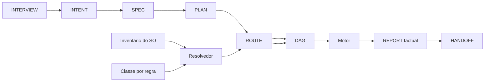

# 📋 SPEC: Sexteto e templates agnósticos (Iniciativa I2)

> **Status:** Aguardando aprovação do usuário  
> **Data:** 2026-11-12  
> **Versão:** 1.0.0  
> **Autor:** Claude  
> **Intenção:** [INTENT](../intents/2026-11-12_INTENT_SEXTETO_E_TEMPLATES.md)  
> **Alvo Primário:** `docs/templates`, `internal/dag`, `internal/artefato`, `internal/capacidade`, `internal/orchestrix`, `tools/route2dag`  
> **Consome:** INTENT · **Produz:** PLAN e ROUTE  
> **Template:** TEMPLATE_SPEC.md v2.0.0  

---

## 1. Premissas Técnicas Assumidas

1. Go conforme o `go.mod`, só stdlib. Nenhuma dependência nova.
2. O parser do DAG vive em `internal/dag/parse.go` e recusa ponto no id de nó de DAGs antigos. A Lei #15 já ajustou isso no `TICK-01.2`. O teste de cada nó repete a validação dos DAGs existentes.
3. O `unit_task` roda só modelos do claude CLI (`internal/orchestrix/unit_run.go`, `unitModelAliases`). O DAG desta iniciativa usa `claude` com `haiku`, `sonnet` e `opus`.
4. O motor tem executores para `agy`, `omp`, `mimo` e `opencode` em `internal/orchestrix/harness.go`. A iniciativa I3 liga esses executores ao `unit_task`.
5. `internal/processo/vinculo.go` detecta os harnesses `claude`, `codex`, `gemini`, `opencode`, `cursor` e `kiro`. O inventário desta iniciativa reaproveita essa lista.
6. O roteador sob demanda existe: `internal/mcp/router.go` expõe `mcp_search` e `call_mcp_tool` sobre o `VaultRegistry`. A auditoria do carregamento sob demanda de skills é o `TICK-I2-04.1`.
7. O `agy` está banido por ToS desde 2026-11-10. Nenhum template cita o `agy` como padrão.
8. `schema_version: 2` marca o contrato de template desta iniciativa (versão 2.3.0 dos templates). Ele coexiste com os `$schema` `dag.v1.json` e `dag.v2.json`. Arquivo sem o campo roda em modo legado.

## 2. Fronteiras de Ação & Regras de Governança

* **Sempre Fazer:**
  * TDD estrito. Teste novo só vale se uma mutação do código o faz falhar.
  * Funções com no máximo 35 linhas (`go run ./tools/funclen internal`).
  * Validar caminhos: sem `..`, sem caminho absoluto fora da raiz (Path Jail).
  * Repetir `legoloop validate` nos DAGs existentes em todo nó que toca `internal/dag`.
  * Recompilar o binário ao final de cada nó que altera Go.
* **Perguntar Antes:**
  * Alterar o contrato público do DAG (`SG-I2-CONTRATO`).
  * Alterar o Cofre real, a CLI pública ou a API do Studio.
  * Adicionar dependência ao `go.mod`.
* **Nunca Fazer:**
  * Remover o leitor dos arquivos legados.
  * Citar o valor de `CONTABO_SECRET_USER` ou rotacionar a chave.
  * Commitar fora dos arquivos do `context_out` do nó, fazer push ou usar `--no-verify`.
  * Aprovar Stop-Gate humano.
  * Tocar o Cofre real `~/.aidd`.

---

## 3. Visão Geral, Arquitetura & Costuras de Teste



* `internal/artefato`: lê front matter e valida a cadeia Q, R, AC, nó e `spec_ref`.
* `internal/capacidade`: classifica o nó, lê o inventário do SO e resolve classe em harness, modelo e esforço.
* `internal/dag`: ganha os campos novos e o modo legado.
* `tools/route2dag`: copia o roteamento já resolvido da ROUTE para o DAG.
* `internal/orchestrix/relatorio.go`: gera a parte factual do REPORT.

### Costuras de Teste

| Costura | Arquivo de teste | Assinatura |
| :--- | :--- | :--- |
| Front matter | `internal/artefato/frontmatter_test.go` | `TestFrontMatter` |
| Rastreabilidade | `internal/artefato/trace_test.go` | `TestCadeiaQuebradaFalha` |
| Contrato v2 | `internal/dag/schema_v2_test.go` | `TestSchemaV2Estrito`, `TestModoLegado` |
| Classe | `internal/capacidade/classe_test.go` | `TestClassePorRegra` |
| Inventário | `internal/capacidade/inventario_test.go` | `TestInventarioPorHarness` |
| Resolvedor | `internal/capacidade/resolver_test.go` | `TestDegradacaoRegistrada`, `TestExtremeSemModeloViraGate` |
| Paridade | `tools/route2dag/paridade_test.go` | `TestParidadeRouteDag` |
| Templates | `docs/templates/templates_test.go` | `TestTemplatesDoSexteto`, `TestPecasAgnosticas` |
| REPORT | `internal/orchestrix/relatorio_test.go` | `TestRelatorioFactual` |

---

## 4. Contratos de Dados & Schemas Formais

### 4.1 Front matter dos artefatos Markdown

```yaml
id: <INTERVIEW-X | INTENT-X | SPEC-X | PLAN-X | REPORT-X | HANDOFF-X>
status: <DRAFT | UNDER_REVIEW | APPROVED>
date: <AAAA-MM-DD>
schema_version: 2
upstream: [<id do artefato anterior>]
covers: [<IDs que o artefato cobre: Q, R, AC>]
interpretative: [<seções escritas por agente ou humano; só REPORT e HANDOFF>]
```

### 4.2 Regras da cadeia (validador do motor)

1. Cada `R` da SPEC tem ao menos um `AC`.
2. Cada `AC` tem ao menos um nó no DAG com `spec_ref` igual ao `AC`.
3. Cada nó de código tem `spec_ref`.
4. Cada `Q` da INTERVIEW aparece em `covers` de ao menos um artefato posterior.
5. O validador roda como gate do ticket (`go run ./tools/ticketgate -trace <pasta ou arquivos>`, opção nova do `TICK-I2-00.2`) e devolve exit 1 com a lista de IDs órfãos.

### 4.3 Modo legado e contrato v2

* Arquivo sem `schema_version`: o motor roda, imprime um aviso por arquivo e não exige campo novo.
* Arquivo com `schema_version: 2`: o motor exige no DAG os campos de nó `name`, `nature`, `context_in`, `context_out`, `isolation.write_boundary`, `limits`, `rollback_strategy`, `tooling`, `verification`, `spec_ref`, `status` e `routing.harness`, `routing.model`, `routing.effort`. Exige no topo `date`, `execution_strategy` e `upstream_signatures`.
* Falta de campo no modo v2 falha na carga, com o nome do nó e do campo.

### 4.4 Classe de capacidade

| Classe | Regra mensurável (primeira que casar, de cima para baixo) |
| :--- | :--- |
| `extreme` | `nature` destrutiva (Cofre, deleção, sobrescrita, contrato público) ou sobrescrita explícita com justificativa. Sempre com Stop-Gate. |
| `macro` | Mais de 4 arquivos em `context_out`, ou entrada acima de 16.000 tokens, ou toca mais de 1 pacote. |
| `micro` | De 2 a 4 arquivos em `context_out`, ou entrada de 8.000 a 16.000 tokens. |
| `nano` | No máximo 1 arquivo em `context_out` e entrada abaixo de 8.000 tokens. |

* Mais de 12 arquivos em `context_out` ou entrada acima de 32.000 tokens: o gerador recusa o nó e exige divisão.
* O nó grava `class_rule` com a regra aplicada. A sobrescrita grava `class_override_reason`.

### 4.5 Perfil de capacidade e inventário

```go
type Candidato struct{ Harness, Modelo, Esforco string }
type Perfil map[string][]Candidato // classe -> candidatos em ordem de preferência
type HarnessInv struct{ Nome, Binario string; Modelos []string }
type Inventario struct{ SO string; Harnesses []HarnessInv }
type Substituicao struct{ No, Classe string; Pedido, Usado Candidato; Motivo string }
```

* O perfil padrão do Claude Code: `nano` haiku `low`, `micro` sonnet `low` ou `medium`, `macro` sonnet `medium` ou `high`, `extreme` opus `high`.
* O usuário troca o perfil por arquivo. O gerador não fixa fornecedor.
* O inventário vem do SO: harnesses de `processo.DetectarHarnesses`, binários de `Inventory.CLIPath` e modelos declarados por harness.

### 4.6 Regras do resolvedor

1. O resolvedor escolhe o primeiro `Candidato` presente no inventário.
2. Sem o primeiro, o resolvedor usa o próximo e grava uma `Substituicao`.
3. A `Substituicao` aparece na ROUTE (`routing.substitutions`) e como aviso visível.
4. `extreme` sem candidato disponível vira nó `stop_gate` humano. Nunca degrada.
5. Inventário vazio: o resolvedor retorna `ErrInventarioVazio`.

### 4.7 REPORT e HANDOFF

* O REPORT tem duas partes. A parte factual lista, por nó: id, commit, custo, gate, harness e modelo reais, divergências do PLAN. O motor a grava e nenhum agente a edita.
* A parte interpretativa lista: divergências aceitas, riscos e próximo passo. O front matter lista essas seções em `interpretative`.
* O HANDOFF recorta do REPORT: estado, bloqueios, Stop-Gates pendentes e o prompt de retomada.

### 4.8 Campos agnósticos de toda peça

| Campo | Valores | Regra |
| :--- | :--- | :--- |
| `execution_modes` | `cli`, `agente`, `estudio` | Lista não vazia. |
| `os_support` | `windows`, `linux`, `macos` | Lista não vazia. |
| `harness_support` | nomes de harness ou `any` | Lista não vazia. |
| `load` | `lazy`, `eager` | `lazy` é o padrão. `eager` exige `eager_reason`. |
| `requires.class` | `nano`, `micro`, `macro`, `extreme` | A peça skill declara classe e nunca um modelo. |

* A peça MCP perde `autoApprove` fixo. Ela registra `name`, `description` e `tools` pesquisáveis no cofre.
* A peça script tem um núcleo por SO (`.ps1` e `.sh`) com o mesmo contrato de argumentos e códigos de saída.

---

## 5. Critérios Binários de Aceite por Nó / Ticket (BDD)

### Épico 00 — Fundação

* [ ] `AC-I2-00.1`: **Front matter**
  * **Dado que:** um Markdown com front matter completo e outro sem `id`.
  * **Quando:** `go test ./internal/artefato/...` roda.
  * **Então:** o primeiro carrega os campos. O segundo retorna erro com o campo ausente. Uma mutação que ignora `id` faz o teste falhar.
* [ ] `AC-I2-00.2`: **Rastreabilidade**
  * **Dado que:** uma cadeia com um `R` sem `AC`, um `AC` sem nó e um nó sem `spec_ref`.
  * **Quando:** o validador roda.
  * **Então:** o exit é 1 e a saída lista os três IDs órfãos. Uma cadeia íntegra sai com exit 0.
* [ ] `AC-I2-00.3`: **Contrato v2 e modo legado**
  * **Dado que:** um DAG sem `schema_version` e um DAG v2 sem `context_out` num nó.
  * **Quando:** `go test ./internal/dag/...` e `legoloop validate` rodam.
  * **Então:** o primeiro valida com aviso. O segundo falha com o id do nó e o campo. Os DAGs de `docs/dags/` continuam válidos.

### Épico 01 — Roteamento por capacidade

* [ ] `AC-I2-01.1`: **Classe por regra**
  * **Dado que:** nós com 1, 3, 6 e 14 arquivos em `context_out` e um nó destrutivo.
  * **Quando:** o classificador roda.
  * **Então:** a saída é `nano`, `micro`, `macro`, recusa por tamanho e `extreme`. O nó grava `class_rule`.
* [ ] `AC-I2-01.2`: **Inventário**
  * **Dado que:** um sistema de arquivos simulado com os harnesses `claude` e `opencode` e outro vazio.
  * **Quando:** o leitor de inventário roda.
  * **Então:** o primeiro lista os dois harnesses com binário e modelos. O segundo retorna inventário vazio.
* [ ] `AC-I2-01.3`: **Resolvedor**
  * **Dado que:** um perfil com dois candidatos por classe e um inventário que tem só o segundo.
  * **Quando:** o resolvedor roda.
  * **Então:** o nó usa o segundo e grava uma `Substituicao`. Com `extreme` sem candidato, o resultado é um nó `stop_gate`. Com inventário vazio, o erro é `ErrInventarioVazio`.
* [ ] `AC-I2-01.4`: **Paridade ROUTE e DAG**
  * **Dado que:** uma ROUTE com roteamento resolvido.
  * **Quando:** `route2dag` projeta o DAG.
  * **Então:** `routing.harness`, `routing.model` e `routing.effort` do DAG igualam os da ROUTE. Um teste com valor divergente falha.

### Épico 02 — Templates do sexteto

* [ ] `AC-I2-02.1`: `TEMPLATE_INTERVIEW.md` existe com front matter, tabela de perguntas com ID `Q`, confiança por rodada e seção de pendências. Zero termo proibido.
* [ ] `AC-I2-02.2`: `TEMPLATE_INTENT.md` tem front matter, a seção "Mapeamento Preliminar de Peças" no lugar de "Blocos e Subloops" e o campo `covers`.
* [ ] `AC-I2-02.3`: `TEMPLATE_SPEC.md` e `TEMPLATE_PLAN.md` têm front matter, IDs `R` e `AC` e a tabela de rastreabilidade.
* [ ] `AC-I2-02.4`: `TEMPLATE_ROUTE.json` e `TEMPLATE_DAG.json` trazem todos os campos da seção 4.3, `schema_version: 2`, `class_rule` e `routing.harness`. O DAG gerado do template passa em `legoloop validate`.
* [ ] `AC-I2-02.5`: `TestTemplatesDoSexteto` confere front matter, seções fixas e campos dos oito templates. Remover uma seção de um template faz o teste falhar.

### Épico 03 — REPORT e HANDOFF

* [ ] `AC-I2-03.1`: `TEMPLATE_REPORT.md` separa a parte factual da interpretativa. `TEMPLATE_HANDOFF.md` existe com estado, bloqueios, Stop-Gates e prompt de retomada.
* [ ] `AC-I2-03.2`: **REPORT factual**
  * **Dado que:** uma execução simulada com três nós, dois commits, um custo e uma divergência.
  * **Quando:** o gerador roda.
  * **Então:** a tabela factual lista os três nós com id, commit, custo, gate, harness e modelo. O gerador não escreve nas seções de `interpretative`.

### Épico 04 — Peças agnósticas

* [ ] `AC-I2-04.1`: `scratch/i2_audit_lazy_skills.md` existe e responde, com arquivo e linha, se há carregamento sob demanda de skills (`skill-router`, `skill_search`) e onde.
* [ ] `AC-I2-04.2`: `TEMPLATE_PIECE_SKILL.md` tem `load`, `requires.class`, `execution_modes`, `os_support` e `harness_support`. O campo `suggested_model` não existe.
* [ ] `AC-I2-04.3`: `TEMPLATE_PIECE_MCP.json` tem `name`, `description`, `tools`, `load` e os campos agnósticos. Não tem `autoApprove` fixo.
* [ ] `AC-I2-04.4`: `TEMPLATE_PIECE_HOOK.json` declara `harness_support`, `os_support` e `execution_modes`, sem caminho nem comando exclusivo de um SO.
* [ ] `AC-I2-04.5`: `TEMPLATE_PIECE_SCRIPT.ps1` e `TEMPLATE_PIECE_SCRIPT.sh` têm o mesmo contrato de argumentos e de códigos de saída. `sh -n` aceita o `.sh`. O analisador do PowerShell aceita o `.ps1`.
* [ ] `AC-I2-04.6`: `TEMPLATE_PIECE_GATE.json` e o template novo de peça de Processo têm os campos agnósticos e o roteamento por classe.

### Épico 05 — Fechamento

* [ ] `AC-I2-05.1`: **Fechamento**
  * **Dado que:** todos os nós anteriores passaram.
  * **Quando:** `go build -o bin/legoloop.exe ./cmd/legoloop`, `go test -count=1 ./...` e `go run ./tools/ticketgate -tax docs/templates -tax-max 35` rodam.
  * **Então:** os três saem com exit 0 (o total do taxlinter em `docs/templates` não passa de 35, a linha de base de 2026-11-12; os termos legados saem na iniciativa I6) e `legoloop validate` aceita o DAG desta iniciativa.

### Não funcionais
* Cada nó fica abaixo de US$ 1,50.
* Cada função Go tem no máximo 35 linhas.
* Cada commit toca só o `context_out` do nó.

---

## 6. Rastreabilidade Requisito para Critério

| R | Requisito | AC |
| :--- | :--- | :--- |
| R1 | Contrato v2 com modo legado | `AC-I2-00.3` |
| R2 | Front matter e rastreabilidade | `AC-I2-00.1`, `AC-I2-00.2` |
| R3 | Classe por regra | `AC-I2-01.1` |
| R4 | Inventário e resolução com degradação | `AC-I2-01.2`, `AC-I2-01.3` |
| R5 | DAG v2 e paridade ROUTE e DAG | `AC-I2-00.3`, `AC-I2-01.4`, `AC-I2-02.4` |
| R6 | Templates do sexteto | `AC-I2-02.1` a `AC-I2-02.5` |
| R7 | REPORT e HANDOFF | `AC-I2-03.1`, `AC-I2-03.2` |
| R8 | Skill e MCP sob demanda | `AC-I2-04.1`, `AC-I2-04.2`, `AC-I2-04.3` |
| R9 | Agnosticidade de SO, harness e modo | `AC-I2-04.4`, `AC-I2-04.5`, `AC-I2-04.6` |
| R10 | Termos da Lei #15 e fechamento | `AC-I2-05.1` |

## 7. Comandos Operacionais & Critério de Conclusão Global

* Gate de nó: `go run ./tools/ticketgate` com as opções do `command` do DAG.
* Motor: `legoloop run docs/dags/2026-11-12_DAG_SEXTETO_E_TEMPLATES.json --allow-unit-tasks --allow-scripts --workdir . --parallel 1 --timeout 25m`.
* Done global: `AC-I2-05.1` verde e `SG-I2-FINAL` aprovado pelo usuário.
