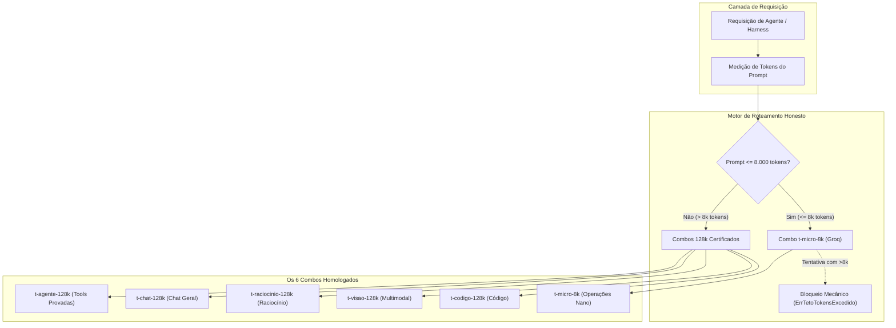

# 📋 SPEC: Combos Honestos do 9Router (Iniciativa I7)

> **Status:** Proposta para Revisão  
> **Data:** 2026-11-13  
> **Versão:** 1.0.0  
> **Autor:** i7-architect (Arquiteto I7)  
> **Iniciativa:** I7 — Combos Honestos do 9Router  
> **Referência da Intenção:** [docs/intents/2026-11-13_INTENT_COMBOS_HONESTOS_9ROUTER.md](../intents/2026-11-13_INTENT_COMBOS_HONESTOS_9ROUTER.md)  
> **Alvo Primário:** `internal/provider`, `internal/combo`, manifestos de configuração do 9Router  
> **Consome:** INTENT-I7 · **Produz:** PLAN-I7, ROUTE-I7 e DAG-I7  
> **Template:** TEMPLATE_SPEC.md v2.0.0  

---

## 1. Premissas Técnicas Assumidas

1. **Evidência Empírica como SSOT:** As seleções e ordens de membros dos combos baseiam-se exclusivamente nos resultados factuais medidos em chamadas reais via `roteador.signa-docs.com` descritos em `docs/plans/2026-11-13_RASCUNHO_COMBOS_9ROUTER.md` e `docs/reports/2026-11-13_REPORT_DIAGNOSTICO_413_9ROUTER.md`.
2. **Eliminação do Groq em Contexto Amplo:** O modelo `groq/openai/gpt-oss-120b` e correlatos possuem teto estrito de 8.000 TPM no plano gratuito `on_demand`. Nenhum combo destinado a agentes ou histórico amplo conterá modelos Groq em suas rotas.
3. **Eliminação de Modelos Cloudflare de Janela Curta:** Modelos como `cf/@cf/meta/llama-3.1-70b-instruct-fp8-fast` e `llama-3.3-70b` falharam com HTTP 413 em 100k tokens e são banidos dos combos de 128k.
4. **Isolamento do `t-micro-8k`:** O combo `t-micro-8k` existe unicamente para operações atômicas e nano (<= 8.000 tokens), alavancando a velocidade de 1,6s-2,0s do Groq, com barreira mecânica que recusa qualquer tráfego excedente.
5. **Zero Stubs e TDD Estrito:** Todas as estruturas, verificadores e exportadores em Go devem conter testes que falham antes da implementação e passam com código 100% funcional.

---

## 2. Fronteiras de Ação & Regras de Governança

* **Sempre Fazer:**
  * Declarar tipos Go com validação explícita de campos obrigatórios (`Nome`, `MaxTokens`, `ExigeFerramentas`, `Membros`).
  * Tratar erros com sentinelas claros (`ErrTetoTokensExcedido`, `ErrComboInvalido`, `ErrFerramentaNaoSuportada`).
  * Garantir compatibilidade reversa para clientes legados através de mapeamento inteligente.
  * Recompilar o binário `bin/legoloop.exe` ao término das alterações em Go.
* **Perguntar Antes:**
  * Modificar rotas ativas de modelos de produção no 9Router sem homologação em staging/scratchpad.
  * Reativar qualquer provedor reprovado nas tabelas de reteste de 100k.
* **Nunca Fazer:**
  * Colocar modelos Groq como primeira opção em combos de uso geral ou de agentes.
  * Ignorar o limite de 8.000 tokens em requisições destinadas ao `t-micro-8k`.
  * Usar mocks ou simulações falsas que mascarem a latência ou o formato real dos membros.

---

## 3. Visão Geral, Arquitetura & Costuras de Teste

A arquitetura estabelece a separação clara entre combos de contexto amplo (128k tokens) e combos de alta velocidade para tarefas atômicas (8k tokens).

### Diagrama de Fronteiras



### Costuras de Teste (Test Seams)
* **Costura Primária:** `combo.ValidarRequisicao(comboNome string, promptTokens int, exigeTools bool) error`.
* **Costura Secundária:** `combo.CatalogoHonesto() map[string]Combo` e `combo.GerarManifesto9Router() ([]byte, error)`.
* **Dublês Permitidos:** Apenas dublês de transporte HTTP nas bordas para simulação de failover; os catálogos e tipos utilizam dados e structs reais.

---

## 4. Contratos de Dados & Schemas Formais

Os contratos definem formalmente os 6 combos e seus membros homologados:

```go
package combo

import (
	"errors"
	"strings"
)

var (
	ErrComboInvalido           = errors.New("combo: nome de combo desconhecido")
	ErrTetoTokensExcedido      = errors.New("combo: teto de tokens excedido para o combo")
	ErrFerramentaNaoSuportada  = errors.New("combo: modelo não suporta chamadas de função")
)

// MembroCombo define um modelo individual participante de um combo.
type MembroCombo struct {
	ID                string  `json:"id"`
	Provedor          string  `json:"provedor"`
	LatenciaMedia100k float64 `json:"latencia_media_100k_s"`
	SuportaFuncao     bool    `json:"suporta_funcao"`
	SuportaImagem     bool    `json:"suporta_imagem"`
}

// ComboHonesto define a especificação completa de um combo certificado.
type ComboHonesto struct {
	Nome             string        `json:"nome"`
	Finalidade       string        `json:"finalidade"`
	MaxTokens        int           `json:"max_tokens"`
	ExigeFerramentas bool          `json:"exige_ferramentas"`
	ExigeImagem      bool          `json:"exige_imagem"`
	Membros          []MembroCombo `json:"membros"`
}

// Validate verifica a integridade estrutural do combo.
func (c ComboHonesto) Validate() error {
	if strings.TrimSpace(c.Nome) == "" || len(c.Membros) == 0 || c.MaxTokens <= 0 {
		return ErrComboInvalido
	}
	return nil
}
```

### Composição Canônica dos 6 Combos:

1. **`t-agente-128k`** (`max_tokens: 131072`, `exige_ferramentas: true`):
   - `mistral/ministral-3b-latest`
   - `gemini/gemini-3.5-flash-lite`
   - `nvidia/nvidia/nemotron-3-nano-omni-30b-a3b-reasoning`
   - `openrouter/dots-studio/dots-3-note-preview:free`
   - `cf/@cf/meta/llama-4-scout-17b-16e-instruct`
   - `mistral/ministral-3b-2512`
2. **`t-chat-128k`** (`max_tokens: 131072`, `exige_ferramentas: false`):
   - `mistral/codestral-latest`
   - `gemini/gemini-3.5-flash-lite`
   - `nvidia/nvidia/nemotron-3-nano-omni-30b-a3b-reasoning`
   - `openrouter/cohere/north-mini-code:free`
   - `cf/@cf/meta/llama-4-scout-17b-16e-instruct`
   - `mistral/ministral-3b-latest`
3. **`t-raciocinio-128k`** (`max_tokens: 131072`, `exige_ferramentas: false`):
   - `gemini/gemini-3.5-flash-lite`
   - `nvidia/nvidia/nemotron-3-nano-omni-30b-a3b-reasoning`
   - `openrouter/nvidia/nemotron-3-nano-omni-30b-a3b-reasoning:free`
   - `cf/@cf/openai/gpt-oss-20b`
   - `gemini/gemini-3-flash-preview`
   - `cf/@cf/openai/gpt-oss-120b`
4. **`t-visao-128k`** (`max_tokens: 131072`, `exige_imagem: true`):
   - `mistral/ministral-3b-latest`
   - `nvidia/nvidia/nemotron-3-nano-omni-30b-a3b-reasoning`
   - `openrouter/dots-studio/dots-3-note-preview:free`
   - `mistral/ministral-3b-2512`
   - `nvidia/nvidia/nemotron-3.5-super-vl-120b-a12b`
   - `openrouter/nvidia/nemotron-3-nano-omni-30b-a3b-reasoning:free`
5. **`t-codigo-128k`** (`max_tokens: 131072`, `exige_ferramentas: false`):
   - `mistral/codestral-latest`
   - `openrouter/cohere/north-mini-code:free`
   - `mistral/codestral-2508`
   - `mistral/mistral-code-latest`
6. **`t-micro-8k`** (`max_tokens: 8000`, `exige_ferramentas: false`):
   - `groq/openai/gpt-oss-120b`
   - `groq/openai/gpt-oss-20b`

---

## 5. Critérios Binários de Aceite por Nó / Ticket (BDD)

### Épico 01 — Catálogo e Validação Go

* [ ] `AC-I7-01.1`: **Definição canônica dos 6 combos honestos**
  * **Dado que:** A suíte de testes inicializa o catálogo de combos.
  * **Quando:** Invoca `CatalogoHonesto()`.
  * **Então:** Retorna exatamente os 6 combos especificados (`t-agente-128k`, `t-chat-128k`, `t-raciocinio-128k`, `t-visao-128k`, `t-codigo-128k`, `t-micro-8k`), com todos os membros válidos e `max_tokens` coerentes.
* [ ] `AC-I7-01.2`: **Barreira mecânica de tokens e ferramentas**
  * **Dado que:** Uma requisição com 9.000 tokens é submetida ao combo `t-micro-8k`.
  * **Quando:** Invoca `ValidarRequisicao("t-micro-8k", 9000, false)`.
  * **Então:** Retorna o erro sentinela `ErrTetoTokensExcedido` e impede a chamada que causaria erro 413 no Groq.
* [ ] `AC-I7-01.3`: **Validação de requisito de chamada de função**
  * **Dado que:** Um agente exige ferramentas (`exigeTools = true`) em um combo sem suporte.
  * **Quando:** Invoca `ValidarRequisicao("t-codigo-128k", 5000, true)`.
  * **Então:** Retorna o erro `ErrFerramentaNaoSuportada`.

### Épico 02 — Sincronização de Combos

* [ ] `AC-I7-02.1`: **Exportação determinística do manifesto para o 9Router**
  * **Dado que:** O catálogo de combos está certificado.
  * **Quando:** Executa a geração do manifesto JSON de sincronização.
  * **Então:** Gera o arquivo `scratch/combos_9router_manifest.json` com schema JSON válido e os 6 combos declarados.
* [ ] `AC-I7-02.2`: **Compatibilidade de nomes legados**
  * **Dado que:** Um cliente solicita um combo legado (`code-pro`, `code-fast`, `code-free`).
  * **Quando:** A função de resolução de modelo processa o nome.
  * **Então:** Resolve para o novo combo equivalente (`t-codigo-128k`, `t-chat-128k`, `t-agente-128k`), sem incluir modelos Groq em requisições de grande porte.

### Épico 03 — Fechamento

* [ ] `AC-I7-03.1`: **Conformidade mecânica total**
  * **Dado que:** Todos os tickets de E01 e E02 foram finalizados.
  * **Quando:** Executa `go test -count=1 ./...`, `go vet ./...` e `legoloop validate`.
  * **Então:** Todas as verificações retornam exit code 0 com zero warnings e zero violações.

### Rastreabilidade Requisito para Critério

| R | Requisito | AC |
| :--- | :--- | :--- |
| `R1` | Catálogo canônico dos 6 combos honestos em Go | `AC-I7-01.1` |
| `R2` | Proteção contra erro 413 e barreira de tokens | `AC-I7-01.2`, `AC-I7-01.3` |
| `R3` | Sincronização do manifesto e compatibilidade legada | `AC-I7-02.1`, `AC-I7-02.2`, `AC-I7-03.1` |

---

## 6. Comandos Operacionais & Critério de Conclusão Global

### Comandos de Verificação Mecânica
* **Build:** `go build -o bin/legoloop.exe ./cmd/legoloop`
* **Test:** `go test -v ./...`
* **Estática e formatação:** `go vet ./...` e `gofmt -l .` (saída vazia).
* **Validação de DAG:** `go run ./cmd/legoloop validate docs/dags/2026-11-13_DAG_COMBOS_HONESTOS_9ROUTER.json`
* **Dependências intactas:** `git diff --exit-code go.mod go.sum`

### Critério de Done Global
A especificação técnica é considerada **100% CONCLUÍDA** quando:
- [ ] 100% dos critérios binários `AC-I7-*` estiverem marcados como atendidos (`[x]`).
- [ ] O comando de **Test** passar com exit code 0.
- [ ] `legoloop validate` aprovar o DAG com zero erros.
- [ ] O comando de **Build** recompilar com sucesso o binário `bin/legoloop.exe`.

---

🛑 **STOP-GATE 02 DE AUDITORIA HUMANA:**  
*Os contratos formais dos 6 combos e os critérios binários acima atendem à sua expectativa?*  
*Somente após a aprovação explícita do usuário, deve-se gerar o PLAN (`TEMPLATE_PLAN.md`) e a ROUTE (`TEMPLATE_ROUTE.json`).*
