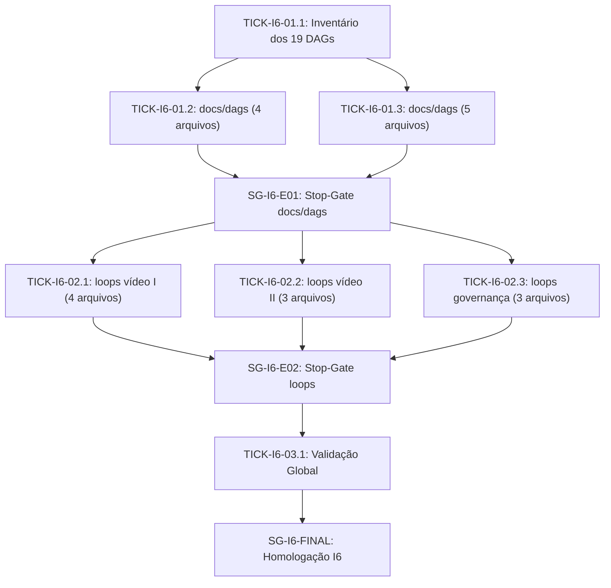

# 📋 SPEC: Migração dos DAGs Legados para Schema v2 e Roteamento Honesto (Iniciativa I6)

> **Status:** Proposta para Revisão  
> **Data:** 2026-11-13  
> **Versão:** 1.0.0  
> **Autor:** i6-preparer (Arquiteto I6)  
> **Iniciativa:** I6 — Migração dos Legados  
> **Referência da Intenção:** [docs/intents/2026-11-13_INTENT_MIGRACAO_LEGADOS.md](../intents/2026-11-13_INTENT_MIGRACAO_LEGADOS.md)  
> **Alvo Primário:** `docs/dags/*.json` (9 arquivos) e `loops/*/pipeline.dag.json` (10 arquivos)  
> **Consome:** INTENT-I6 · **Produz:** PLAN-I6, ROUTE-I6 e DAG-I6  
> **Template:** TEMPLATE_SPEC.md v2.0.0  

---

## 1. Premissas Técnicas Assumidas

1. O contrato `schema_version: 2` é definido por `internal/dag/schema_v2.go` e validado por `go run ./cmd/legoloop validate <arquivo>`.
2. Todos os nós de um DAG `schema_version: 2` exigem: `name`, `nature`, `context_in`, `context_out`, `isolation.write_boundary`, `limits`, `rollback_strategy`, `tooling`, `verification`, `spec_ref`, `status`, `routing.harness`, `routing.via`, `routing.model`, `routing.effort`.
3. O topo de um DAG `schema_version: 2` exige: `schema_version: 2`, `date`, `execution_strategy`, `upstream_signatures`.
4. Os valores homologados da I3 para `unit_task`, `skill`, `script`, `subloop` e `stop_gate` usam `harness: "claude"`, `via: "oficial"`, `model` em `{"haiku", "sonnet", "opus"}` e `effort` em `{"low", "medium", "high"}`.
5. O arquivo `docs/dags/2026-11-10_DAG_MATRIZ_PAPEIS.json` pertence à Iniciativa I5 e não é tocado pela I6.

---

## 2. Fronteiras de Ação & Regras de Governança

* **Sempre Fazer:**
  * Preservar `id`, `depends_on`, `command`, `ref` e a semântica funcional de cada nó legado.
  * Garantir `context_out` estritamente disjunto entre todos os Tickets de uma mesma camada paralela.
  * Validar cada arquivo migrado com `go run ./cmd/legoloop validate <arquivo>`.
* **Perguntar Antes:**
  * Alterar qualquer regra em `internal/dag/schema_v2.go`.
  * Modificar DAGs fora da lista dos 19 arquivos inventariados.
* **Nunca Fazer:**
  * Usar `harness: "antigravity"`, `model: "flash"`, `model: "code-fast"`, `model: "code-pro"` ou `model: "code-nano"` nos arquivos migrados.
  * Deixar `routing.via` vazio em um DAG com `schema_version: 2`.
  * Editar arquivos fora do `context_out` declarado no Ticket.

---

## 3. Visão Geral, Arquitetura & Costuras de Teste

A migração opera em 3 Épicos sequenciais com paralelismo interno por camada disjunta:

### Mapeamento de Roteamento I3 por Natureza

| Natureza legada / Modelo legado | `harness` | `via` | `model` | `effort` |
| :--- | :--- | :--- | :--- | :--- |
| `nano` / `code-nano` / `haiku` | `claude` | `oficial` | `haiku` | `low` |
| `micro` / `code-fast` / `sonnet` | `claude` | `oficial` | `sonnet` | `medium` |
| `macro` / `code-pro` / `flash` | `claude` | `oficial` | `sonnet` | `high` |
| `extreme` / `opus` | `claude` | `oficial` | `opus` | `high` |

### Costuras de Teste (Test Seams)
* **Costura Primária:** `go run ./cmd/legoloop validate <caminho_do_dag>` executando `dag.LoadFile` e `checkSchemaV2`.
* **Costura Secundária:** `go test -count=1 ./internal/dag/...` validando integridade estrutural e `schema_v2_test.go`.

---

## 4. Contratos de Dados & Requisitos

| ID | Requisito |
| :--- | :--- |
| `R1` | Inventariar e migrar os 9 DAGs de `docs/dags/` (excluído `2026-11-10_DAG_MATRIZ_PAPEIS.json`) para `schema_version: 2` e roteamento I3 em camada paralela disjunta. |
| `R2` | Migrar os 10 `pipeline.dag.json` de `loops/*/` para `schema_version: 2` e roteamento I3 em 3 Tickets paralelos com `write_boundary` disjunto por pasta. |
| `R3` | Validar todos os 19 DAGs migrados com `legoloop validate`, `go test -count=1 ./internal/dag/...` e ausência de termos/modelos legados. |

---

## 5. Critérios Binários de Aceite por Ticket (BDD)

### Épico 01 — Inventário e Migração de `docs/dags/`

* [ ] `AC-I6-01.1`: **Inventário determinístico dos 19 DAGs legados**
  * **Dado que:** existem 10 JSONs em `docs/dags/` (1 reservado à I5) e 10 `pipeline.dag.json` em `loops/*/`.
  * **Quando:** o script de inventário inspeciona os 19 alvos da I6.
  * **Então:** gera `scratch/i6_inventario_legados.json` listando os 19 caminhos, suas contagens de nós e campos v2 ausentes, com código de saída `0`.

* [ ] `AC-I6-01.2`: **Migração do Lote A de `docs/dags/` (4 DAGs operacionais)**
  * **Dado que:** `scratch/i6_inventario_legados.json` existe e os 4 arquivos (`2026-11-07_DAG_LEGOLOOP_FECHAR.json`, `2026-11-07_DAG_LEGOLOOP_VIDEO_MOTION.json`, `2026-11-08_DAG_LEGOLOOP_VIDEO_EDITION.json`, `2026-11-09_DAG_LEGOLOOP_VIDEO_REA.json`) estão em modo legado.
  * **Quando:** o Ticket migra apenas esses 4 arquivos para `schema_version: 2` e roteamento I3.
  * **Então:** `go run ./cmd/legoloop validate` retorna `exit_code == 0` para os 4 arquivos e nenhum outro arquivo em disco é modificado.

* [ ] `AC-I6-01.3`: **Migração do Lote B de `docs/dags/` (5 DAGs de governança e I1-I3)**
  * **Dado que:** `scratch/i6_inventario_legados.json` existe e os 5 arquivos (`2026-11-09_DAG_QUINTETO_GOVERNANCA_ISO.json`, `2026-11-10_DAG_DISSECAR.json`, `2026-11-10_DAG_NORMALIZACAO_TAXONOMICA_LEI15.json`, `2026-11-12_DAG_ROTEAMENTO_HONESTO.json`, `2026-11-12_DAG_SEXTETO_E_TEMPLATES.json`) estão sem `schema_version: 2` ou sem `routing.via`.
  * **Quando:** o Ticket migra apenas esses 5 arquivos para `schema_version: 2` e roteamento I3.
  * **Então:** `go run ./cmd/legoloop validate` retorna `exit_code == 0` para os 5 arquivos e `2026-11-10_DAG_MATRIZ_PAPEIS.json` permanece intocado.

### Épico 02 — Migração Paralela de `loops/*/pipeline.dag.json`

* [ ] `AC-I6-02.1`: **Migração do Lote Vídeo I em `loops/` (4 arquivos)**
  * **Dado que:** `SG-I6-E01` foi aprovado.
  * **Quando:** o Ticket migra `loops/ai-motion-graphics/pipeline.dag.json`, `loops/legoloop-video-edition/pipeline.dag.json`, `loops/legoloop-video-master/pipeline.dag.json` e `loops/legoloop-video-motion/pipeline.dag.json`.
  * **Então:** `go run ./cmd/legoloop validate` retorna `exit_code == 0` para os 4 arquivos com `schema_version: 2` e `routing.via` preenchido.

* [ ] `AC-I6-02.2`: **Migração do Lote Vídeo II em `loops/` (3 arquivos)**
  * **Dado que:** `SG-I6-E01` foi aprovado.
  * **Quando:** o Ticket migra `loops/legoloop-canal-redc/pipeline.dag.json`, `loops/legoloop-cartoon-shorts/pipeline.dag.json` e `loops/legoloop-video-rea/pipeline.dag.json`.
  * **Então:** `go run ./cmd/legoloop validate` retorna `exit_code == 0` para os 3 arquivos com `schema_version: 2` e `routing.via` preenchido.

* [ ] `AC-I6-02.3`: **Migração do Lote Governança em `loops/` (3 arquivos)**
  * **Dado que:** `SG-I6-E01` foi aprovado.
  * **Quando:** o Ticket migra `loops/legoloop-dissecar/pipeline.dag.json`, `loops/legoloop-fechar/pipeline.dag.json` e `loops/legoloop-n10-foundry/pipeline.dag.json`.
  * **Então:** `go run ./cmd/legoloop validate` retorna `exit_code == 0` para os 3 arquivos com `schema_version: 2` e `routing.via` preenchido.

### Épico 03 — Validação Global e Homologação

* [ ] `AC-I6-03.1`: **Auditoria mecânica integral dos 19 DAGs migrados**
  * **Dado que:** `SG-I6-E02` foi aprovado.
  * **Quando:** o verificador executa `legoloop validate` nos 19 arquivos, `go test -count=1 ./internal/dag/...` e busca por modelos/harnesses legados (`code-fast`, `code-pro`, `code-nano`, `flash`, `antigravity`).
  * **Então:** todos os comandos retornam `exit_code == 0` e a busca por roteamento legado retorna zero ocorrências nos 19 arquivos.
