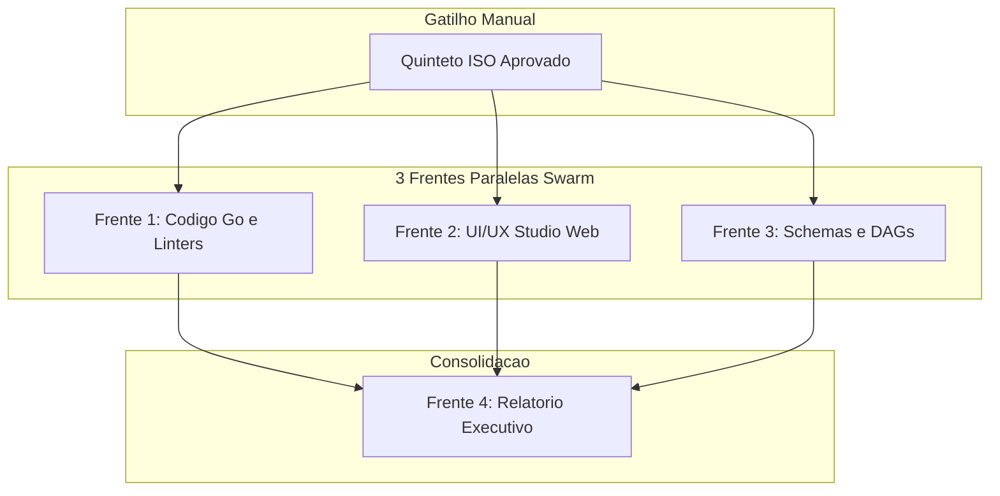

# 📋 SPEC: Auditoria Profunda de Código e UI/UX em Modo Swarm (4 Frentes)

> **Status:** Proposta para Revisão  
> **Data:** 2026-11-14  
> **Versão:** 1.0.0  
> **Autor:** Antigravity (Coordinator)  
> **Iniciativa:** Auditoria Profunda Swarm  
> **Referência da Intenção:** [docs/intents/2026-11-14_INTENT_AUDITORIA_PROFUNDA_SWARM.md](../intents/2026-11-14_INTENT_AUDITORIA_PROFUNDA_SWARM.md)  
> **Alvo Primário:** `internal/`, `cmd/legoloop/`, `internal/studio/`, `loops/`, `schemas/`  
> **Consome:** INTENT aprovada · **Produz:** PLAN, ROUTE e DAG  
> **Template:** TEMPLATE_SPEC.md v2.0.0  

---

## 1. Premissas Técnicas Assumidas (Addy Osmani)

> [!IMPORTANT]
> A IA lista abaixo todas as premissas técnicas adotadas para evitar decisões silenciosas:
1. Runtime Go conforme `go.mod`, sem adição de dependências externas.
2. Armazenamento dos achados em arquivos locais JSON e Markdown dentro de `docs/reports/`.
3. Auditoria do Studio Web realizada sobre os arquivos estáticos e rotas HTTP em `internal/studio/` sem alterar dados do usuário.
4. Reuso integral dos utilitários existentes (`tools/funclen`, `tools/taxlinter`, `legoloop validate`).

---

## 2. Fronteiras de Ação & Regras de Governança (Boundaries — Addy Osmani)

* **Sempre Fazer:**
  * Executar comandos reais de verificação e registrar `exit_code` exato.
  * Isolar cada frente do Swarm em contexto estéril com `write_boundary: strict`.
  * Tratar caminhos de forma compatível com Windows (`filepath.Join` / barras normais).
* **Perguntar Antes:**
  * Aplicar qualquer correção de código ou alteração de layout encontrada na auditoria.
  * Alterar schemas ou contratos públicos.
* **Nunca Fazer:**
  * Criar stubs, achados simulados ou inventar números não observados em saída de ferramenta.
  * Usar `taskkill /IM legoloop.exe` ou tocar no cofre real `~/.aidd`.
  * Usar `alert()`, `confirm()` ou emojis em código de UI.

---

## 3. Visão Geral, Arquitetura & Costuras de Teste (Test Seams — Pocock)

A auditoria opera em 3 frentes paralelas independentes (Código Go, UI/UX Studio, Contratos/DAGs) que convergem para uma 4ª frente de consolidação.

### Diagrama de Fronteiras (Mermaid)

### Costuras de Teste (Test Seams — Pocock)
* **Costura Primária:** Execução real via `go test -count=1 ./...`, `go vet ./...`, `go run ./tools/funclen internal` e `legoloop validate`.
* **Justificativa:** Valida o sistema real em disco sem dublês internos.

---

## 4. Critérios de Aceitação Binários (EARS)

| ID | Requisito | Critério Binário (EARS) |
| :--- | :--- | :--- |
| `AC-E01.1` | `R1` | QUANDO Frente 1 executar `go test -count=1 ./...`, `go vet ./...` e `tools/funclen`, ENTÃO todos os resultados reais devem ser gravados em `docs/reports/audit_f1_go.json`. |
| `AC-E02.1` | `R2` | QUANDO Frente 2 inspecionar `internal/studio/`, ENTÃO os achados de UI/UX, contraste e acessibilidade devem ser gravados em `docs/reports/audit_f2_uiux.json`. |
| `AC-E03.1` | `R3` | QUANDO Frente 3 executar `legoloop validate` nos DAGs, ENTÃO o status de conformidade deve ser gravado em `docs/reports/audit_f3_dags.json`. |
| `AC-E04.1` | `R4` | QUANDO Frentes 1, 2 e 3 concluírem, ENTÃO Frente 4 deve gerar `docs/reports/2026-11-14_REPORT_AUDITORIA_PROFUNDA_SWARM.md` consolidando severidades. |

---

🛑 **STOP-GATE 02 DE AUDITORIA HUMANA:**  
*As fronteiras, premissas e critérios binários da SPEC atendem à sua expectativa?*
