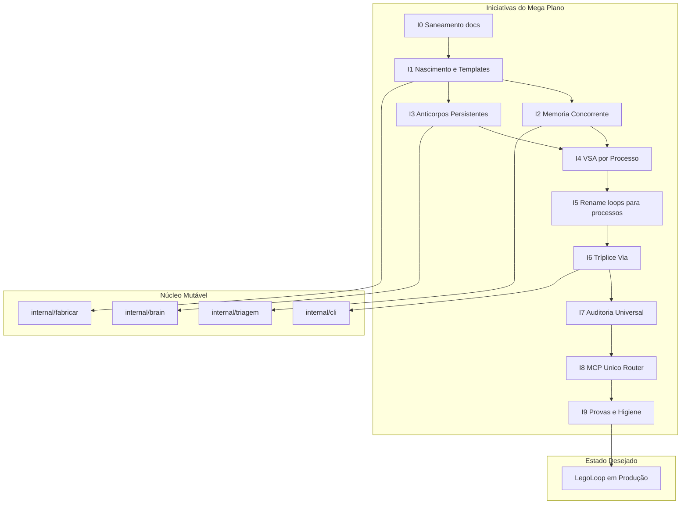

# 📋 SPEC: Mega Plano LegoLoop para Produção

> **Status:** Proposta para Revisão
> **Data:** 2026-11-16
> **Versão:** 1.0.0
> **Autor:** Antigravity AI + Usuário (Fusão Addy Osmani + Matt Pocock + AIDD-Spec)
> **Iniciativa:** Mega Plano — LegoLoop Pronto para Produção (10 Iniciativas / 10 Épicos)
> **Referência da Intenção:** [docs/intents/2026-11-16_INTENT_MEGA_PLANO_LEGOLOOP_PARA_PRODU.md](../intents/2026-11-16_INTENT_MEGA_PLANO_LEGOLOOP_PARA_PRODU.md)
> **Alvo Primário:** `docs/`, `loops/`, `internal/triagem`, `internal/brain`, `internal/fabricar`, `internal/cli`, `skills/`, `cmd/legoloop`
> **Consome:** INTENT aprovada · **Produz:** PLAN e ROUTE
> **Template:** TEMPLATE_SPEC.md v2.2.0

---

## 1. Premissas Técnicas Assumidas (Addy Osmani)

> [!IMPORTANT]
> Premissas técnicas adotadas para evitar decisões silenciosas. Alertar no Stop-Gate 02 caso alguma esteja incorreta:
1. **Runtime:** Go conforme `go.mod`, somente stdlib (Lei 8 — `git diff --exit-code go.mod go.sum`); caminhos via `filepath.Join`/`ToSlash` (Windows + POSIX).
2. **Armazenamento:** arquivos locais do SO. SSOT do projeto = codebase-memory (`.codebase-memory/`) + `MEMORY.md` + `AGENTS.md` + `README.md`. `docs/` = referência viva + arquivo morto (`docs/archive/`).
3. **Locks:** sem middleware central (não depender do `mcp-router`, servidor opcional). Biblioteca compartilhada de lock por arquivo no ponto de escrita (`internal/triagem/memoria.go`), chave = sessão + PID.
4. **Reuso:** reaproveitar `internal/triagem` (memória), `internal/brain/antibodies.go` (Motor III), `internal/fabricar` (molde/Sexteto), `internal/canon` (SHA-256), `tools/taxlinter`, `tools/funclen`. Não tocar em `internal/interview` (motor oficial) nem em contratos públicos sem ticket dedicado.
5. **Ordem de execução:** I0 saneamento → I1 templates/nascimento → I2 memória → I3 anticorpos → I4 VSA → I5 rename → I6 tríplice via → I7 auditoria universal → I8 MCP → I9 provas/higiene. Dependências explícitas no PLAN.
6. **Execução:** modo SWARM (enxame nativo do harness + gates LegoLoop), 1 worker por nano-ticket, mutação prova cada teste novo, parada somente em stop-gates humanos.

---

## 2. Fronteiras de Ação & Regras de Governança (Boundaries — Addy Osmani)

* **Sempre Fazer:**
  * TDD estrito (teste falhando antes do código de produção; mutação prova o teste).
  * Funções < 35 linhas, responsabilidade única.
  * Validar JSONs contra schema formal (`schemas/`); Path Jail (`..`, symlinks, absolutos proibidos).
  * Recompilar o binário ao fim de cada ticket que altere Go (`go build -o bin/legoloop.exe ./cmd/legoloop`; `go install` no fechamento).
  * Prefixo ISO `YYYY-MM-DD_` em todo artefato de `docs/` (Lei 6).
* **Perguntar Antes:**
  * Nova dependência em `go.mod` (proibida por padrão).
  * Alterar schemas persistidos com retrocompatibilidade quebrada (`triagem.v1`, `loop.json`, `pipeline.dag.json`).
  * Alterar contratos públicos de CLI, API do Studio ou `ROUTE.json`.
  * Modificar `AGENTS.md` (Leis) — mudança de lei deliberada (ex.: rename `loops/`).
  * Deletar qualquer arquivo de `docs/` (migração para `docs/archive/` antes; deleção só com aprovação).
* **Nunca Fazer:**
  * Zero stubs (`TODO`, `pass`, mocks em produção) — Lei 1.
  * Editar à mão: `pipeline.dag.json`, `.loop.json`, `.processo.json` — gerar por verbos.
  * `taskkill /IM legoloop.exe` (matar só PID próprio aberto, com autorização).
  * Auto-aprovar stop-gates; commit/push sem pedido explícito.
  * Copiar templates para dentro de processos (templates são SSOT único em `docs/templates/`).
  * Vendor-locking por SO, harness ou linguagem — o novo normal é agnóstico e universal.

---

## 3. Visão Geral, Arquitetura & Costuras de Teste (Test Seams — Pocock)

O Mega Plano transforma o LegoLoop em monólito de código com **processos como fatias verticais autocontidas (VSA)**: cada processo é um mini-projeto (`processos/<slug>/`) com scaffold completo de nascimento (5 manifestos) e seus documentos de governança. O `docs/` raiz enxuto guarda apenas SSOT (templates, vocab, archive, relatórios globais). A execução usa o enxame nativo do harness sob governança de gates LegoLoop.

### Diagrama de Fronteiras (Mermaid)



### Costuras de Teste (Test Seams — Pocock)
* **Costura Primária:** `legoloop fabricar` / `legoloop fechar` / `legoloop validate` como binário (E2E via `go test -tags e2e`), com entrada em `t.TempDir()` — prova de nascimento 5/5 e de saneamento por diretório.
* **Justificativa:** o comportamento visível ao usuário é o binário; testar por ele evita acoplamento interno e valida as 3 vias (CLI, skill, Studio).
* **Costuras Secundárias:** `internal/triagem/memoria.go` (lock por arquivo), `internal/brain/antibodies.go` (persistência), `internal/fabricar/natureza.go` (scaffold por natureza).
* **Dublês Permitidos (bordas):** LLM falso (`code-fast`/`code-pro` simulados), relógio, sistema de arquivos (`t.TempDir()`), rede (loopback). Nunca dublê de Peça interna. Nunca tocar `~/.aidd` real.

---

## 4. Contratos de Dados & Schemas Formais

```go
// Contrato: memória de execução concorrente (I2). Chave = sessão + PID.
package triagem

import (
	"errors"
	"strings"
)

// ErrLockAtivo sinaliza escrita bloqueada por outra sessão viva (PID válido).
var ErrLockAtivo = errors.New("triagem: memória bloqueada por outra sessão")

// Sessao identifica o dono da escrita na memória de execução.
type Sessao struct {
	ID        string `json:"id"`        // identificador único da execução
	PID       int    `json:"pid"`       // processo do SO dono do lock
	Atualizado string `json:"atualizado"` // ISO 8601
}

// Validate checa o contrato antes de qualquer E/S.
func (s Sessao) Validate() error {
	if strings.TrimSpace(s.ID) == "" || s.PID <= 0 {
		return errors.New("triagem: sessão inválida")
	}
	return nil
}
```

```json
{
  "$schema": "https://json-schema.org/draft/2020-12/schema",
  "id": "anticorpos.v1",
  "description": "Vacinas por processo: globais (infra/LLM) compartilhadas; domínio locais. Gravado em processos/<slug>/anticorpos.json.",
  "type": "object",
  "properties": {
    "schema_version": { "const": "anticorpos.v1" },
    "processo": { "type": "string" },
    "globais": { "type": "array", "items": { "$ref": "#/$defs/vacina" } },
    "dominio": { "type": "array", "items": { "$ref": "#/$defs/vacina" } }
  },
  "required": ["schema_version", "processo"],
  "$defs": {
    "vacina": {
      "type": "object",
      "properties": {
        "assinatura": { "type": "string", "description": "SHA-256 do erro (detecção de reincidência)" },
        "erro": { "type": "string" },
        "antidoto": { "type": "string" },
        "recorrencias": { "type": "integer", "minimum": 0 }
      },
      "required": ["assinatura", "erro", "antidoto", "recorrencias"]
    }
  }
}
```

Schemas novos exigidos: `schemas/anticorpos.v1.json`, `schemas/memoria_execucao.v1.json`, `schemas/loop.v1.json` (hoje ausente), `schemas/triagem.v1.json` (formalizar). Templates novos em `docs/templates/`: `TEMPLATE_TRIAGEM.json`, `TEMPLATE_MEMORIA_EXECUCAO.json`, `TEMPLATE_ANTICORPOS.json` (SSOT; processos nunca copiam — `fabricar` instancia).

---

## 5. Critérios Binários de Aceite por Nó / Ticket (BDD)

### Épico 01 — I0 · Saneamento do `docs/` (3598 arquivos, 1,16 GB)

* [ ] `AC-E01.1`: **Inventário classificado** — Dado que `docs/` tem 3598 arquivos; Quando a auditoria SWARM concluir (1 worker por diretório/bloco); Então existe inventário em `docs/reports/` com TODO arquivo classificado em {IMPLEMENTADO, ULTRAPASSADO, SUPERADO, PENDENTE, REVER} e dono (processo/épico) — zero arquivo sem classificação.
* [ ] `AC-E01.2`: **Migração para arquivo morto** — Dado que `videorea/`, `sessions/` e `reports/` históricos são documentação de construção; Quando a migração executar; Então esses arquivos estão em `docs/archive/` e `docs/` raiz contém apenas `templates/`, `vocab/`, `archive/`, Quinteto, `manuals/`, `fichas/`, `books/` e relatórios globais.
* [ ] `AC-E01.3`: **Proteção de lei** — Dado que `docs/templates/` e `docs/vocab/` são lei (Lei 6/15); Quando qualquer deleção for tentada ali; Então a operação é recusada (exit ≠ 0) e registrado no relatório.
* [ ] `AC-E01.4`: **Caminho de falha** — Dado arquivo classificado como PENDENTE sem dono; Quando o saneamento fechar; Então ele vira ticket do PLAN (nenhum pendente silencioso) e `has_binary_criteria` cobre o caso.

### Épico 02 — I1 · Nascimento Completo do Processo (5/5 + Templates)

* [ ] `AC-E02.1`: **Scaffold 5/5** — Dado que `legoloop fabricar "<nome>" --natureza processo` executa; Então `processos/<nome>/` contém exatamente `.loop.json`, `pipeline.dag.json`, `triagem.json`, `memoria_execucao.json`, `anticorpos.json` — todos válidos contra schema (`legoloop validate` exit 0).
* [ ] `AC-E02.2`: **Templates canônicos** — Dado que os 3 templates faltam (`TEMPLATE_TRIAGEM.json`, `TEMPLATE_MEMORIA_EXECUCAO.json`, `TEMPLATE_ANTICORPOS.json`); Quando a demanda fechar; Então existem em `docs/templates/`, `templates_test.go` os valida, e `TEMPLATE_PIECE_LOOP.json` cobre o `.loop.json`.
* [ ] `AC-E02.3`: **Conformidade dos processos existentes** — Dado que existem processos criados com 4/4 arquivos; Quando a adequação rodar; Então todos os processos de `processos/` passam em `legoloop validate` com 5/5 (ou exceção documentada com dono).
* [ ] `AC-E02.4`: **Caminho de falha** — Dado nome de processo inválido (fora do padrão de slug); Quando `fabricar` executar; Então exit code 2, nenhum diretório criado no disco.

### Épico 03 — I2 · Memória de Execução Concorrente (Session+PID+Lock)

* [ ] `AC-E03.1`: **Lock por arquivo** — Dado que 2 sessões distintas gravam `memoria_execucao.json` do mesmo processo; Quando a segunda sessão grava com lock ativo da primeira (PID vivo); Então recebe `ErrLockAtivo` e o arquivo da primeira permanece íntegro (byte a byte).
* [ ] `AC-E03.2`: **Lock órfão** — Dado que o PID do lock não existe mais no SO; Quando a segunda sessão grava; Então o lock é tomado e o `atualizado` avança (ISO 8601).
* [ ] `AC-E03.3`: **Zerar no fechar** — Dado que o processo terminou (`legoloop fechar`); Quando o fechar conclui; Então `memoria_execucao.json` está zerado (schema válido, sem histórico inflado).
* [ ] `AC-E03.4`: **Caminho de falha** — Dado `memoria_execucao.json` corrompido (JSON inválido); Quando a leitura executar; Então erro sentinela, backup `.legoloop-bak` criado, nenhuma escrita cega por cima.

### Épico 04 — I3 · Motor de Anticorpos Persistente (Vacinação de Reincidência)

* [ ] `AC-E04.1`: **Persistência** — Dado que um erro ocorre num processo; Quando `Record` executar; Então a vacina é gravada em `processos/<slug>/anticorpos.json` (schema `anticorpos.v1`) — não mais só em mapa em memória (`internal/brain/antibodies.go:22`).
* [ ] `AC-E04.2`: **Vacinação de reincidência** — Dado que o mesmo erro (assinatura SHA-256) reocorre; Quando `Find` executar; Então `recorrencias` incrementa e o antídoto é injetado preventivamente (contexto) antes da execução — erro com vacina conhecida não executa cego.
* [ ] `AC-E04.3`: **Escopo global vs domínio** — Dado erro de infraestrutura/LLM; Quando gravado; Então vai para `globais` (compartilhado entre processos). Dado erro de regra de domínio; Então vai para `dominio` (local do processo).
* [ ] `AC-E04.4`: **Caminho de falha** — Dado `anticorpos.json` corrompido; Quando a vacinação ler; Então erro sentinela + backup `.legoloop-bak`, processo segue sem vacina (não trava a execução).

### Épico 05 — I4 · VSA por Processo (Fatia Vertical Autocontida)

* [ ] `AC-E05.1`: **Scaffold do slice** — Dado que processo nasce; Então a fatia contém manifestos + `docs/` do processo (INTENT, SPEC, PLAN, ROUTE, REPORT, MANUAL) autocontida — processo executável como mini-projeto.
* [ ] `AC-E05.2`: **docs/ raiz enxuto** — Dado a migração dos 68 intents, 79 specs, 76 plans, 63 routes existentes; Quando o VSA consolidar; Então cada documento pertence ao slice de seu processo (ou `docs/archive/` se órfão) e `docs/` raiz guarda só SSOT + Quinteto global.
* [ ] `AC-E05.3`: **Camada de abstração por SO** — Dado que peças usam `.ps1`/`.sh`; Quando o processo executar em SO diferente; Então o scaffold resolve a peça compatível com o SO automaticamente (sem vendor-locking).
* [ ] `AC-E05.4`: **Caminho de falha** — Dado processo sem dono para um documento do Quinteto; Quando a migração fechar; Então o documento vai para `docs/archive/` com registro no inventário (nenhum órfão silencioso).

### Épico 06 — I5 · Renomeação `loops/` → `processos/` (Conflito Lei 15)

* [ ] `AC-E06.1`: **Referências migradas** — Dado o rename do diretório; Quando a demanda fechar; Então `git grep -l "loops/"` em código Go, schemas, skills e docs retorna apenas menções históricas documentadas — zero referência viva quebrada.
* [ ] `AC-E06.2`: **Binário e schemas** — Dado que `fechar` grava em `loops/<slug>/pipeline.dag.json`; Quando executado após o rename; Então grava em `processos/<slug>/` e `legoloop validate` passa com exit 0.
* [ ] `AC-E06.3`: **Caminho de falha** — Dado comando antigo apontando para `loops/`; Quando executado; Então erro claro com guia de migração (exit 2, mensagem com novo caminho).

### Épico 07 — I6 · Tríplice Via de Invocação (CLI, Harness, Studio)

* [ ] `AC-E07.1`: **Via CLI** — Dado processo criado; Então `legoloop exec <slug>` (ou comando equivalente canônico) o executa com exit 0 e artefatos de saída no disco.
* [ ] `AC-E07.2`: **Via harness/agente** — Dado processo criado; Então `skills/<slug>/SKILL.md` + slash command `/legoloop-<slug>` existem e `legoloop instalar-skills` os distribui para todos os harnesses (sem passo manual).
* [ ] `AC-E07.3`: **Via Studio** — Dado processo criado; Então a peça correspondente está registrada e invocável no Studio (card arrastável) sem registro manual.
* [ ] `AC-E07.4`: **Caminho de falha** — Dado processo com SKILL.md inválido (front matter quebrado); Quando `instalar-skills` rodar; Então exit ≠ 0 aponta o arquivo, nenhum harness corrompido.

### Épico 08 — I7 · Auditoria Universal Agnóstica + 6 Verbos

* [ ] `AC-E08.1`: **Processo `auditoria-atomica`** — Dado alvo arbitrário (verbo, processo, peça, função, documento, binário, repositório externo); Quando o processo executar; Então produz disseção + lacunas + tickets + refatoração (quando aplicável) + veredito — sem conhecer linguagem ou SO do alvo.
* [ ] `AC-E08.2`: **6 verbos auditados** — Dado `matriz`, `listar`, `refinar`, `remover`, `compor`, `fechar`; Quando a auditoria profunda concluir (mesma do `fabricar`); Então cada verbo tem relatório atômico com lacunas, tickets e veredito — `compor` e `fechar` intocados hoje são cobertos.
* [ ] `AC-E08.3`: **Mutações provadas** — Dado todo teste novo da auditoria; Então mutação do código sob teste o faz falhar (Green-Red-Green), restaurada após cada — provado no relatório.
* [ ] `AC-E08.4`: **Caminho de falha** — Dado alvo inexistente ou inacessível; Quando a auditoria executar; Então exit 2 com erro claro, nenhum artefato órfão gerado.

### Épico 09 — I8 · MCP Único via `mcp-router`

* [ ] `AC-E09.1`: **Router como interface única** — Dado qualquer processo que exponha ferramentas; Quando integrado; Então expõe via `legoloop mcp-router` (Governança Lazy Universal) — zero servidor MCP por processo.
* [ ] `AC-E09.2`: **Caminho de falha** — Dado conflito de nome de tool entre processos; Quando o router registrar; Então o segundo registro é recusado (exit ≠ 0) com o conflito nomeado.

### Épico 10 — I9 · Provas Ausentes & Higiene

* [ ] `AC-E10.1`: **Débitos zerados** — Dado 14 violações taxlinter + 3 estouros funclen; Quando a higiene fechar; Então `go run ./tools/taxlinter internal cmd loops skills docs/templates` e `go run ./tools/funclen internal` retornam exit 0 com saída vazia.
* [ ] `AC-E10.2`: **Testes estáveis** — Dado 2 testes flaky (`TestUnifiedPathFileLockExactMentionAndPIDKill`, `TestSwarmSpawnToolRealProcess`); Quando corrigidos; Então `go test -count=1 ./...` verde em 3 execuções consecutivas.
* [ ] `AC-E10.3`: **Provas ausentes** — Dado `-race` (com CGO), LLM real ponta a ponta e grafo semântico; Quando executados; Então cada prova tem registro em `docs/reports/` — ou restam declaradas como NAO_PROVADO com dono e prazo.
* [ ] `AC-NF.1`: **Segurança** — Dado entrada hostil (path `..`, JSON malicioso, PID falso); Quando qualquer comando executar; Então Path Jail bloqueia (exit ≠ 0), nenhum efeito fora da raiz sanitizada — cobre `anticorpos.json`, `memoria_execucao.json` e rename.
* [ ] `AC-NF.2`: **Desempenho** — Dado 50 workers SWARM no pior caso; Quando a auditoria do `docs/` executar; Então o lock por arquivo não serializa workers de processos distintos (sem lock global) e a memória por processo permanece íntegra sob carga.

### Rastreabilidade Requisito para Critério

| R | Requisito | AC |
| :--- | :--- | :--- |
| `R1` | Saneamento do `docs/` (inventário, arquivo morto, proteção de lei) | `AC-E01.1`, `AC-E01.2`, `AC-E01.3`, `AC-E01.4` |
| `R2` | Nascimento completo do processo (5/5 + templates) | `AC-E02.1`, `AC-E02.2`, `AC-E02.3`, `AC-E02.4` |
| `R3` | Memória de execução concorrente (Session+PID+lock) | `AC-E03.1`, `AC-E03.2`, `AC-E03.3`, `AC-E03.4` |
| `R4` | Motor de anticorpos persistente com vacinação | `AC-E04.1`, `AC-E04.2`, `AC-E04.3`, `AC-E04.4` |
| `R5` | VSA por processo (fatia autocontida, SO-agnostic) | `AC-E05.1`, `AC-E05.2`, `AC-E05.3`, `AC-E05.4` |
| `R6` | Renomeação `loops/` → `processos/` (Lei 15) | `AC-E06.1`, `AC-E06.2`, `AC-E06.3` |
| `R7` | Tríplice via de invocação (CLI, harness, Studio) | `AC-E07.1`, `AC-E07.2`, `AC-E07.3`, `AC-E07.4` |
| `R8` | Auditoria universal agnóstica + 6 verbos | `AC-E08.1`, `AC-E08.2`, `AC-E08.3`, `AC-E08.4` |
| `R9` | MCP único via router | `AC-E09.1`, `AC-E09.2` |
| `R10` | Provas ausentes & higiene | `AC-E10.1`, `AC-E10.2`, `AC-E10.3`, `AC-NF.1`, `AC-NF.2` |

---

## 6. Comandos Operacionais & Critério de Conclusão Global (Addy Osmani)

### Comandos de Verificação Mecânica
* **Build:** `go build -o bin/legoloop.exe ./cmd/legoloop`
* **Test:** `go test -count=1 ./...` (e `go test -count=1 -tags e2e ./internal/e2e/...` quando aplicável)
* **Estática e formatação:** `go vet ./...`, `gofmt -l .` (saída vazia), `go run ./tools/taxlinter internal cmd loops skills docs/templates`, `go run ./tools/funclen internal`
* **Dependências intactas:** `git diff --exit-code go.mod go.sum`
* **Validação de manifestos:** `legoloop validate <dags>` para todo processo

### Critério de Done Global
A especificação técnica é considerada **100% CONCLUÍDA** quando:
- [ ] 100% dos critérios binários `AC-E{N}.{M}` e `AC-NF.{K}` marcados como atendidos (`[x]`).
- [ ] Comando **Test** com exit code 0 (3 execuções consecutivas para flaky).
- [ ] `go vet ./...` e `gofmt -l .` sem nada; taxlinter e funclen exit 0.
- [ ] **Build** recompila `bin/legoloop.exe` e `go install ./cmd/legoloop` atualiza o PATH (Lei 5).
- [ ] Zero arquivos temporários ou órfãos residuais; telemetria tempo/tokens/custo no relatório final (Lei 11.9).

---

🛑 **STOP-GATE 02 DE AUDITORIA HUMANA:**
*As premissas assumidas, as fronteiras (boundaries), os contratos e os critérios binários acima atendem à sua expectativa?*
*Somente após a aprovação explícita do usuário, deve-se gerar o PLAN (`TEMPLATE_PLAN.md`) e a ROUTE (`TEMPLATE_ROUTE.json`).*
