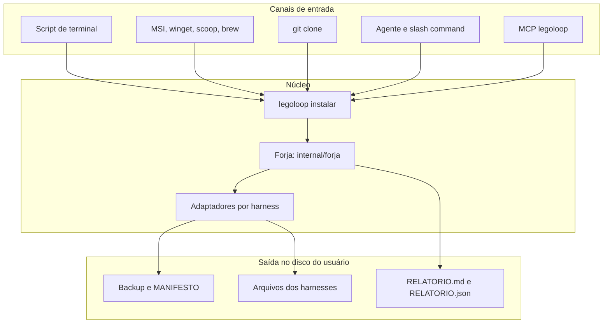

# 📋 SPEC: Distribuição e Forja do LegoLoop

> **Status:** Aprovado pelo Usuário (Stop-Gate 02, 2026-11-21)  
> **Data:** 2026-11-21  
> **Versão:** 1.0.0  
> **Autor:** Claude (Fusão Addy Osmani + Matt Pocock + AIDD-Spec)  
> **Iniciativa:** I01 — Distribuição e Forja  
> **Referência da Intenção:** [docs/intents/2026-11-21_INTENT_DISTRIBUI_O_E_FORJA_DO_LEGOLOO.md](../intents/2026-11-21_INTENT_DISTRIBUI_O_E_FORJA_DO_LEGOLOO.md)  
> **Alvo Primário:** internal/forja, internal/instalar, internal/ste, internal/cli, cmd/legoloop, tools/release, .github/workflows  
> **Consome:** INTENT aprovada · **Produz:** PLAN e ROUTE  
> **Template:** TEMPLATE_SPEC.md v2.0.0  

---

## 1. Premissas Técnicas Assumidas (Addy Osmani)

> [!IMPORTANT]
> Alerte no Stop-Gate 02 caso alguma premissa esteja incorreta.
1. Runtime: Go conforme o `go.mod` (1.27.0), só biblioteca padrão, zero dependências novas. Ferramentas externas de empacotamento (WiX, `cosign`) rodam só no CI e nunca entram no `go.mod`.
2. Armazenamento: arquivos locais do SO. Relatório em `~/.legoloop/forja/<AAAA-MM-DD>/` (`RELATORIO.md`, `RELATORIO.json`). Backups em `~/.aidd/backups/forja_<AAAA-MM-DD>/<harness>/` com `MANIFESTO.tsv`, o mesmo padrão do `skills-migrar`.
3. Segurança: download só por HTTPS, SHA-256 conferido antes de executar, nenhum segredo lido para o relatório, nenhum privilégio de administrador sem aviso.
4. Reuso: `processo.DetectarHarnesses`, `runInstalarSkills`, `cmdSyncHarnesses`, `skills.Migrar`, `skills-custo` e o comando `bootstrap` (que vira a base do `instalar`). Não serão tocados: `internal/interview`, `internal/dag` e o Studio.
5. Fato verificado: o caminho de instalação em Go não chama Python (`instalar-skills`, `sync-harnesses`, `skills-migrar`, `bootstrap` e `stept` têm 0 ocorrências de `python`). O único Python nesse caminho é `tools/steptsync/gemini_md.py`, que gera o bloco do `GEMINI.md`. Vídeo, TTS, auditor do LegoPress e motion usam Python como recurso opcional.
6. Fato verificado: o ambiente de desenvolvimento é só Windows. Linux e macOS são "Não verificado" até o CI da E02 rodar neles.
7. Hoje não existem MSI, `install.sh`, `install.ps1`, CI nem manifestos de pacote (`git ls-files`), e o `go.mod` declara o módulo `legoloop`, sem domínio.

### Decisões do Stop-Gate 02 (pergunta, sugestão e motivo)

1. **Origem oficial do binário e do SHA-256.** Sugestão: GitHub Releases de `heverton-dev/LegoLoop`, com `SHA256SUMS` assinado por `cosign`. Motivo: já é o remoto do projeto, tem URL estável por versão e o CI publica sem infraestrutura nova. **Decisão do usuário: SIM.**
2. **Renomear o módulo `legoloop`.** Sugestão: renomear para `github.com/heverton-dev/LegoLoop`, com a mesma caixa do repositório, já no Épico 01. Motivo: libera `go install github.com/heverton-dev/LegoLoop/cmd/legoloop@latest` como canal sem clone, e quanto mais tarde a troca, mais caro o conserto. O custo é mecânico (troca dos caminhos de importação, conferida por `go build ./...` e `go test ./...`).
3. **Assinatura.** Sugestão: `cosign` sem chave no CI (identidade OIDC do GitHub) para pacotes e `SHA256SUMS`, e Authenticode do MSI numa segunda fase por programa gratuito de assinatura para código aberto, se o repositório for público (elegibilidade não verificada). Motivo: dispensa certificado pago agora, e o relatório declara o MSI como `nao_assinado` até lá.
4. **Ferramenta do MSI no CI.** Sugestão: WiX Toolset v4 (`dotnet tool install --global wix`). Motivo: é o padrão do Windows, roda no `windows-latest` e gera MSI de instalação por usuário (`Scope="perUser"`), que não pede administrador, como a restrição inegociável exige.
5. **Python como recurso opcional.** Sugestão: declarar no `legoloop doctor` como "opcional", com o recurso que depende dele (vídeo, TTS, auditor do LegoPress) e a instrução de instalação por SO; não embutir interpretador. Motivo: embutir soma dezenas de MB por SO e arquitetura e quebra o princípio do binário único.

---

## 2. Fronteiras de Ação & Regras de Governança (Boundaries — Addy Osmani)

* **Sempre Fazer:**
  * TDD estrito (teste falhando antes do código de produção).
  * Funções com menos de 35 linhas (`go run ./tools/funclen internal`).
  * Backup restaurável antes de tocar qualquer arquivo do usuário, com `MANIFESTO.tsv`.
  * `--dry-run` em todo comando que grava fora do repositório.
  * Caminhos compatíveis com Windows e POSIX (`filepath.Join`, `filepath.ToSlash`), sem `.cmd` ou PATH fixo em código comum a todos os SOs.
  * Recompilar o binário ao fim de todo ticket com Go (AGENTS.md, regra 5).
* **Perguntar Antes:**
  * Adicionar dependência ao `go.mod`; renomear o módulo.
  * Alterar contratos públicos de CLI, do DAG ou de `ROUTE.json`.
  * Usar certificado de assinatura do usuário; publicar release.
  * Alterar regras globais do `AGENTS.md`.
* **Nunca Fazer:**
  * Sobrescrever ou apagar arquivo do usuário sem backup.
  * Imprimir ou gravar segredos (valores de variáveis cuja chave contenha SECRET, TOKEN, KEY ou PASSWORD).
  * Executar binário baixado antes de conferir o SHA-256.
  * Criar função vazia, `TODO` ou mock em código de produção (Lei #1).
  * Commitar ou publicar sem o usuário pedir.
  * Mexer no grafo semântico dentro da Forja (a reindexação continua no `legoloop fechar`).

---

## 3. Visão Geral, Arquitetura & Costuras de Teste (Test Seams — Pocock)

Todos os canais de entrada chamam o mesmo comando `legoloop instalar`, que executa a Forja (`internal/forja`). A Forja é um Processo canônico com quatro gatilhos (instalação, CLI, agente, skill) e um só motor. O `AGENTS.md` é o SSOT: cada harness recebe um bloco gerenciado que aponta para ele, sem perder o conteúdo do usuário.

### Diagrama de Fronteiras (Mermaid)



### Costuras de Teste (Test Seams — Pocock)
* **Costura Primária (Highest Seam):** `forja.Executar(ctx context.Context, op forja.Opcao) (forja.Relatorio, error)`, com `Opcao` injetando `Home`, `FS`, `Relogio`, `Medidor` e a lista de harnesses detectados.
* **Justificativa:** um ponto só valida os quatro gatilhos e todos os canais, porque todos chegam nele. A suíte usa `t.TempDir()` como HOME e nunca toca `~/.aidd` real.
* **Costuras Secundárias:** `ste.AplicarBloco` (função pura sobre texto), `forja.PlanejarSettingsClaude` (merge de JSON) e `release.Montar` (empacotamento).
* **Dublês Permitidos (somente nas bordas):** relógio, sistema de arquivos, rede (servidor HTTP de teste para o download) e medidor de tokens. Nunca dublê de Peça interna.

---

## 4. Contratos de Dados & Schemas Formais

```go
// Contrato formal da Forja: tipos, erros sentinela e validação.
package forja

import (
	"errors"
	"strings"
)

var (
	// ErrPerfilDesconhecido sinaliza perfil fora de minimo, padrao e gateway.
	ErrPerfilDesconhecido = errors.New("forja: perfil desconhecido")
	// ErrSemHome sinaliza HOME vazio.
	ErrSemHome = errors.New("forja: home vazio")
)

// Opcao configura uma execução da Forja.
type Opcao struct {
	Home     string   `json:"home"`
	Perfil   string   `json:"perfil"`  // minimo | padrao | gateway
	Sem      []string `json:"sem"`     // harnesses excluídos
	Aplicar  bool     `json:"aplicar"` // false = simula
	Desfazer string   `json:"desfazer,omitempty"` // data do backup a restaurar
}

// EtapaResultado descreve o que uma Etapa da Forja fez ou faria.
type EtapaResultado struct {
	Nome       string   `json:"nome"`
	Harness    string   `json:"harness,omitempty"`
	Estado     string   `json:"estado"` // ok | falha | ignorada | pendente
	Alterados  []string `json:"alterados,omitempty"`
	Backup     string   `json:"backup,omitempty"`
	Mensagem   string   `json:"mensagem,omitempty"`
}

// Relatorio é o artefato de comprovação: os quatro gatilhos geram o mesmo conteúdo.
type Relatorio struct {
	Versao      string           `json:"versao"`
	Data        string           `json:"data"`
	SO          string           `json:"so"`
	Perfil      string           `json:"perfil"`
	Veredito    string           `json:"veredito"` // OK | FALHA
	Etapas      []EtapaResultado `json:"etapas"`
	TokensAntes map[string]int   `json:"tokens_antes,omitempty"`
	TokensDepois map[string]int  `json:"tokens_depois,omitempty"`
}

// Validate checa a Opcao antes de qualquer E/S.
func (o Opcao) Validate() error {
	if strings.TrimSpace(o.Home) == "" {
		return ErrSemHome
	}
	switch o.Perfil {
	case "minimo", "padrao", "gateway":
		return nil
	}
	return ErrPerfilDesconhecido
}
```

Perfis de contexto: `minimo` (só o índice lazy), `padrao` (lazy mais `permissions.deny` das ferramentas pesadas) e `gateway` (uma única ferramenta `call_mcp_tool`). O texto dos lançadores e dos `settings.json` segue o que o relatório `docs/reports/2026-11-21_REPORT_LAZY_CONTEXTO_TOTAL.md` mediu.

---

## 5. Critérios Binários de Aceite por Nó / Ticket (BDD)

> [!NOTE]
> Cada `AC-XX` é verificável por teste ou comando com `exit code == 0`. A ordem dos Épicos é a ordem de implementação aprovada.

### Critérios de Aceitação por Épico

### Épico 01 — Contrato e linha de base

* [ ] `AC-E01.1`: **SPEC, PLAN, ROUTE e DAG sem lacunas**
  * **Dado que:** a SPEC aprovada no Stop-Gate 02.
  * **Quando:** rodar `grep -c "[{][{]" docs/specs/2026-11-21_SPEC_DISTRIBUICAO_FORJA_LEGOLOOP.md`.
  * **Então:** a saída é `0` e `legoloop validate processos/legoloop-forjar/pipeline.dag.json` sai com 0.
* [ ] `AC-E01.2`: **Linha de base gravada**
  * **Dado que:** o HOME do desenvolvedor.
  * **Quando:** rodar `legoloop skills-custo --json > docs/reports/2026-11-21_BASELINE_FORJA.json`.
  * **Então:** o arquivo existe, é JSON válido e tem uma entrada por harness detectado; o relatório registra também a medida real do Claude (`claude -p "ok" --output-format json`).

* [ ] `AC-E01.3`: **Módulo renomeado**
  * **Dado que:** o `go.mod` do repositório.
  * **Quando:** rodar `go list -m` e depois `go build ./... && go test -count=1 ./...`.
  * **Então:** o módulo é `github.com/heverton-dev/LegoLoop`, nenhum arquivo `.go` importa `"legoloop/` e os dois comandos saem com 0.

### Épico 02 — CI nos três SOs

* [ ] `AC-E02.1`: **Fluxo de CI cobre os três SOs**
  * **Dado que:** `.github/workflows/ci.yml`.
  * **Quando:** rodar `go test ./tools/ciworkflow/...`.
  * **Então:** o teste confere `windows-latest`, `ubuntu-latest` e `macos-latest` na matriz e os cinco comandos (`go build`, `go vet`, `gofmt -l`, `go test`, `git diff --exit-code go.mod go.sum`); exit 0.
* [ ] `AC-E02.2`: **CI verde nos três SOs**
  * **Dado que:** o fluxo no remoto.
  * **Quando:** rodar `gh run list --workflow ci.yml --limit 1 --json conclusion`.
  * **Então:** a conclusão é `success` e os três jobs (um por SO) estão `success`.

### Épico 03 — Python do caminho de instalação para Go

* [ ] `AC-E03.1`: **Bloco gerenciado idempotente**
  * **Dado que:** um `GEMINI.md` com texto do usuário e, depois, o mesmo arquivo já com o bloco.
  * **Quando:** chamar `ste.AplicarBloco(arquivo, "stept", conteudo)` uma e duas vezes.
  * **Então:** o texto fora do bloco permanece byte a byte igual; a segunda chamada não altera o arquivo (hash igual).
* [ ] `AC-E03.2`: **Paridade com o script Python**
  * **Dado que:** uma fixture golden gerada por `tools/steptsync/gemini_md.py` antes da remoção.
  * **Quando:** rodar `go test ./internal/ste/ -run TestBlocoIgualAoGolden`.
  * **Então:** a saída de `AplicarBloco` é idêntica à fixture; exit 0. Depois o `git rm tools/steptsync/gemini_md.py` acontece no mesmo ticket.
* [ ] `AC-E03.3`: **Nenhum Python no caminho de instalação**
  * **Dado que:** os pacotes `internal/forja`, `internal/instalar` e `internal/ste`.
  * **Quando:** rodar `go test ./internal/forja/ -run TestCaminhoSemPython`.
  * **Então:** nenhuma ocorrência de `python` nesses pacotes e nos comandos `instalar`, `forjar`, `atualizar`; `legoloop doctor` lista Python como "opcional".

### Épico 04 — Motor da Forja

* [ ] `AC-E04.1`: **Simulação não grava nada**
  * **Dado que:** um HOME de teste com 5 harnesses.
  * **Quando:** `legoloop forjar --dry-run` roda.
  * **Então:** o hash da árvore do HOME é igual antes e depois; o relatório lista as Etapas com estado `pendente`.
* [ ] `AC-E04.2`: **Aplicar cria backup e é idempotente**
  * **Dado que:** o mesmo HOME de teste.
  * **Quando:** `legoloop forjar --apply` roda duas vezes.
  * **Então:** o primeiro run cria `backups/forja_<data>/<harness>/MANIFESTO.tsv` para cada arquivo alterado; o segundo run termina com zero `alterados`.
* [ ] `AC-E04.3`: **Desfazer restaura byte a byte**
  * **Dado que:** o HOME depois do `--apply`.
  * **Quando:** `legoloop forjar --desfazer <data>` roda.
  * **Então:** o hash da árvore volta ao valor de antes do `--apply`.
* [ ] `AC-E04.4`: **Bloco gerenciado preserva o conteúdo do usuário**
  * **Dado que:** `GEMINI.md` e `CLAUDE.md` com texto próprio.
  * **Quando:** o `--apply` roda.
  * **Então:** o texto original continua presente e há um bloco delimitado que aponta para o `AGENTS.md`.
* [ ] `AC-E04.5`: **Merge do `settings.json` preserva chaves desconhecidas**
  * **Dado que:** um `settings.json` com a chave `x_usuario` e um valor secreto.
  * **Quando:** o perfil `padrao` é aplicado.
  * **Então:** `x_usuario` permanece intacta, o `permissions.deny` contém as 8 ferramentas, e o relatório não contém o valor secreto.
* [ ] `AC-E04.6`: **Exclusão e perfil inválido**
  * **Dado que:** `--sem opencode` e depois `--perfil xyz`.
  * **Quando:** o comando roda.
  * **Então:** o opencode fica com estado `ignorada` e nenhum arquivo dele muda; o perfil inválido devolve `ErrPerfilDesconhecido` com exit 2.
* [ ] `AC-E04.7`: **Lançadores por SO, sem PATH fixo**
  * **Dado que:** os SOs Windows e POSIX simulados.
  * **Quando:** a Etapa de lançadores roda.
  * **Então:** Windows recebe `.cmd`; POSIX recebe `sh` executável; nenhum arquivo gerado contém `set PATH=` nem caminho absoluto do HOME do desenvolvedor.
* [ ] `AC-NF.1`: **Segredos fora do relatório**
  * **Dado que:** variáveis de ambiente e arquivos com chaves `*SECRET*`, `*TOKEN*`, `*KEY*`.
  * **Quando:** o relatório é gerado.
  * **Então:** nenhum valor dessas variáveis aparece no `RELATORIO.md`, no `RELATORIO.json` nem na saída do terminal.
* [ ] `AC-NF.2`: **Path jail**
  * **Dado que:** um nome de harness com `..` ou caminho absoluto.
  * **Quando:** a Forja resolve a pasta do harness.
  * **Então:** devolve erro e não escreve fora do HOME.
* [ ] `AC-NF.3`: **Desempenho provisório**
  * **Dado que:** um HOME de teste com 24 harnesses.
  * **Quando:** `legoloop forjar --dry-run` roda.
  * **Então:** termina em até 30 s. O limite é provisório e a E01 o recalibra com a linha de base.

### Épico 05 — `legoloop instalar`

* [ ] `AC-E05.1`: **Instalar encadeia a Forja e entrega o relatório**
  * **Dado que:** um HOME de teste limpo.
  * **Quando:** `legoloop instalar --apply` roda.
  * **Então:** exit 0; `~/.legoloop/forja/<data>/RELATORIO.json` existe com `veredito: OK`; `legoloop skills-custo` mostra 1 skill por harness detectado.
* [ ] `AC-E05.2`: **Dry-run e grafo no PATH**
  * **Dado que:** o mesmo HOME.
  * **Quando:** `legoloop instalar --dry-run` roda e, depois, o `--apply` com o `codebase-memory-mcp` presente.
  * **Então:** o dry-run não grava nada; o `--apply` cria o atalho do grafo na pasta de binários do usuário e `codebase-memory-mcp cli list_projects` sai com 0.
* [ ] `AC-E05.3`: **`bootstrap` continua funcionando**
  * **Dado que:** o comando antigo.
  * **Quando:** `legoloop bootstrap --dry-run` roda.
  * **Então:** exit 0 e uma linha informa que o comando foi substituído por `instalar`.

### Épico 06 — Gate de orçamento de tokens

* [ ] `AC-E06.1`: **Teto estourado reprova**
  * **Dado que:** `docs/governanca/orcamento_tokens.json` com um teto menor que o custo medido de um harness.
  * **Quando:** `legoloop forjar --verificar --orcamento docs/governanca/orcamento_tokens.json` roda.
  * **Então:** exit 1 e a saída cita o harness e o excesso.
* [ ] `AC-E06.2`: **Teto respeitado aprova**
  * **Dado que:** o mesmo arquivo com tetos maiores que o medido.
  * **Quando:** o mesmo comando roda.
  * **Então:** exit 0.

### Épico 07 — Canonizar o Processo Forja

* [ ] `AC-E07.1`: **Fechamento em nove Etapas**
  * **Dado que:** o Processo `legoloop-forjar` implementado.
  * **Quando:** `legoloop fechar legoloop-forjar --json` roda.
  * **Então:** exit 0; existem o manual em `docs/manuals/`, o livro em `docs/books/legoloop-forjar/`, `skills/legoloop-forjar/SKILL.md` e o relatório em `docs/reports/`.
* [ ] `AC-E07.2`: **DAG válido e skill encontrável**
  * **Dado que:** o DAG e a skill.
  * **Quando:** `legoloop validate processos/legoloop-forjar/pipeline.dag.json` e a busca `skill_search "forjar ambiente"` rodam.
  * **Então:** o validate sai com 0 e `legoloop-forjar` aparece na primeira posição.
* [ ] `AC-E07.3`: **Os quatro gatilhos geram o mesmo relatório**
  * **Dado que:** o mesmo HOME de teste.
  * **Quando:** a Forja roda por instalação, por `legoloop forjar`, por `call_mcp_tool` e pela skill.
  * **Então:** os quatro `RELATORIO.json`, sem os campos de tempo, são idênticos (diff vazio).

### Épico 08 — Release reproduzível, assinado e com SBOM

* [ ] `AC-E08.1`: **Build reproduzível**
  * **Dado que:** o mesmo commit.
  * **Quando:** `go run ./tools/release --so linux --arch amd64` roda duas vezes.
  * **Então:** os dois binários têm o mesmo SHA-256.
* [ ] `AC-E08.2`: **Conjunto de artefatos completo**
  * **Dado que:** `go run ./tools/release --all`.
  * **Quando:** o comando termina.
  * **Então:** existe um pacote por SO e arquitetura (windows, linux e darwin, em amd64 e arm64), `SHA256SUMS` confere com `sha256sum -c` (exit 0) e o SBOM lista o módulo e a versão do Go.
* [ ] `AC-E08.3`: **Assinatura declarada**
  * **Dado que:** release sem certificado Authenticode.
  * **Quando:** o relatório do release é gerado.
  * **Então:** o MSI aparece como `nao_assinado`, e os pacotes têm assinatura `cosign` quando o CI a executa.

### Épico 09 — Canais de distribuição

* [ ] `AC-E09.1`: **Script confere o SHA-256 e aborta se divergir**
  * **Dado que:** um servidor HTTP de teste que serve um pacote com SHA-256 errado.
  * **Quando:** `install.sh` e `install.ps1` rodam contra ele.
  * **Então:** ambos terminam com exit diferente de 0 e nenhum binário é instalado.
* [ ] `AC-E09.2`: **Script instala e dispara a Forja**
  * **Dado que:** o servidor de teste com pacote e checksum corretos.
  * **Quando:** o script roda com `--dry-run` e depois sem ele.
  * **Então:** o dry-run não grava nada; sem ele, o binário é instalado e `legoloop instalar` roda com exit 0.
* [ ] `AC-E09.3`: **Manifestos de pacote válidos**
  * **Dado que:** os manifestos de winget, scoop e brew e a definição do MSI.
  * **Quando:** `go test ./tools/release/ -run TestManifestos` roda.
  * **Então:** cada manifesto aponta para o pacote do release, com o SHA-256 correto e a versão igual à do `legoloop --version`.
* [ ] `AC-E09.4`: **Git clone e go install remoto**
  * **Dado que:** um clone limpo e, depois da publicação da tag, o módulo no remoto.
  * **Quando:** `go install ./cmd/legoloop && legoloop instalar --dry-run` roda no clone, e `go install github.com/heverton-dev/LegoLoop/cmd/legoloop@<tag>` roda no CI.
  * **Então:** os dois saem com 0. O segundo só é verificável depois da publicação.
* [ ] `AC-E09.5`: **Agente e MCP**
  * **Dado que:** a skill `legoloop-instalar` no Cofre e o servidor `legoloop`.
  * **Quando:** `call_mcp_tool` chama `legoloop:instalar` com `{"dry_run": true}`.
  * **Então:** a resposta traz o caminho do `RELATORIO.json` e nada é gravado.

* [ ] `AC-E09.6`: **MSI por usuário, sem administrador**
  * **Dado que:** a definição WiX do MSI.
  * **Quando:** `go test ./tools/release/ -run TestMSIPorUsuario` roda.
  * **Então:** a definição declara `Scope="perUser"`, não pede elevação e instala o binário em uma pasta do perfil do usuário; exit 0.

### Épico 10 — Detecção de deriva

* [ ] `AC-E10.1`: **Deriva reprova e nomeia o harness**
  * **Dado que:** um HOME forjado em que se coloca uma skill eager na pasta de um harness.
  * **Quando:** `legoloop forjar --verificar` roda.
  * **Então:** exit 1 e a saída cita o harness e a pasta.
* [ ] `AC-E10.2`: **Corrigir restaura o estado**
  * **Dado que:** o HOME com deriva.
  * **Quando:** `legoloop forjar --verificar --corrigir` roda.
  * **Então:** a skill vai ao Cofre com backup, e um novo `--verificar` sai com 0.

### Épico 11 — Canal de atualização

* [ ] `AC-E11.1`: **SHA-256 divergente mantém o binário atual**
  * **Dado que:** um servidor de teste com pacote adulterado.
  * **Quando:** `legoloop atualizar --canal estavel` roda.
  * **Então:** exit diferente de 0 e o binário instalado não muda (hash igual).
* [ ] `AC-E11.2`: **Atualização guarda o binário anterior**
  * **Dado que:** um servidor de teste com pacote correto.
  * **Quando:** `legoloop atualizar --canal beta` roda.
  * **Então:** o binário novo substitui o atual, o anterior fica como `.prev`, e `legoloop forjar --verificar` roda e sai com 0.

### Rastreabilidade Requisito para Critério

| R | Requisito | AC |
| :--- | :--- | :--- |
| `R1` | Contrato, módulo renomeado e linha de base | `AC-E01.1`, `AC-E01.2`, `AC-E01.3` |
| `R2` | CI nos três SOs | `AC-E02.1`, `AC-E02.2` |
| `R3` | Python do caminho de instalação em Go | `AC-E03.1`, `AC-E03.2`, `AC-E03.3` |
| `R4` | Motor da Forja, perfis, SSOT, relatório, desfazer | `AC-E04.1` a `AC-E04.7`, `AC-NF.1`, `AC-NF.2`, `AC-NF.3` |
| `R5` | `legoloop instalar` | `AC-E05.1`, `AC-E05.2`, `AC-E05.3` |
| `R6` | Gate de orçamento de tokens | `AC-E06.1`, `AC-E06.2` |
| `R7` | Processo Forja canonizado e quatro gatilhos | `AC-E07.1`, `AC-E07.2`, `AC-E07.3` |
| `R8` | Release reproduzível, assinado, com SBOM | `AC-E08.1`, `AC-E08.2`, `AC-E08.3` |
| `R9` | Canais de distribuição | `AC-E09.1` a `AC-E09.6` |
| `R10` | Detecção de deriva | `AC-E10.1`, `AC-E10.2` |
| `R11` | Canal de atualização | `AC-E11.1`, `AC-E11.2` |

> Cada `R` tem ao menos um `AC`. O `covers` do front matter lista todos os `R`.

---

## 6. Comandos Operacionais & Critério de Conclusão Global (Addy Osmani)

### Comandos de Verificação Mecânica
* **Build:** `go build -o bin/legoloop.exe ./cmd/legoloop`
* **Test:** `go test -count=1 ./...`
* **Estática e formatação:** `go vet ./...` e `gofmt -l .` (saída vazia).
* **Funções:** `go run ./tools/funclen internal`
* **Taxonomia:** `go run ./tools/taxlinter internal cmd loops skills docs/templates`
* **Dependências intactas:** `git diff --exit-code go.mod go.sum`
* **CI:** `gh run list --workflow ci.yml --limit 1 --json conclusion`

### Execução pelo Swarm
Cada Ticket vira um worker do Swarm sob as seis condições da lei 4 do `AGENTS.md`: contexto só com os artefatos do Ticket, ferramentas listadas, um worker por Ticket, saída em disco com Gate mecânico, sem sub-workers e `write_boundary` `strict`.

### Critério de Done Global
A especificação é **100% CONCLUÍDA** quando:
- [ ] 100% dos critérios `AC-E{N}.{M}` e `AC-NF.{K}` estiverem atendidos.
- [ ] O comando de **Test** passar com exit code 0 nos três SOs do CI.
- [ ] `go vet`, `gofmt -l`, `funclen` e `taxlinter` não reportarem nada.
- [ ] O comando de **Build** recompilar o binário.
- [ ] Zero arquivos temporários ou órfãos residuais.

---

🛑 **STOP-GATE 02 DE AUDITORIA HUMANA:**  
*As premissas, as fronteiras, os contratos, os critérios binários e as cinco decisões acima atendem à sua expectativa?*  
*Somente após a aprovação explícita do usuário, gerar o PLAN (`TEMPLATE_PLAN.md`) e a ROUTE (`TEMPLATE_ROUTE.json`).*
