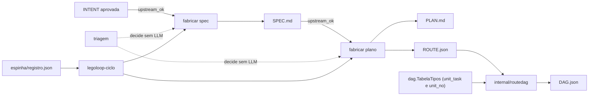

# 📋 SPEC: Processos de especificação e de planejamento (I02 — Revisão Emenda 2)

> **Status:** Revisão Emenda 2 (TICK-I4-09.1, aguardando Stop-Gate final da I04; execução congelada)  
> **Data:** 2026-11-21  
> **Versão:** 2.0.0 (Revisão Emenda 2)  
> **Autor:** Claude (Fusão Addy Osmani + Matt Pocock + AIDD-Spec)  
> **Iniciativa:** I02 — Processos de especificação e de planejamento  
> **Referência da Intenção:** [docs/intents/2026-11-21_INTENT_INICIATIVA_2_DO_MACROPROJETO_D.md](../intents/2026-11-21_INTENT_INICIATIVA_2_DO_MACROPROJETO_D.md)  
> **Emenda Aplicada:** [docs/intents/2026-11-21_EMENDA_2_MACROPLANO.md](../intents/2026-11-21_EMENDA_2_MACROPLANO.md)  
> **Alvo Primário:** internal/routedag, internal/cli, internal/triagem, tools/route2dag, processos/legoloop-especificacao, processos/legoloop-planejamento, processos/legoloop-ciclo, espinha/registro.json  
> **Consome:** INTENT aprovada · **Produz:** PLAN, ROUTE e DAG  
> **Template:** TEMPLATE_SPEC.md v2.0.0  

---

## 1. Premissas Técnicas Assumidas (Addy Osmani)

> [!IMPORTANT]
> Esta revisão aplica a **Emenda 2** sobre a SPEC original (`2026-11-21_SPEC_INICIATIVA_2_DO_MACROPROJETO_D.md`) sem editar a INTENT aprovada da I02. A execução da I02 permanece congelada até o Stop-Gate final da I04.

1. Runtime: Go conforme o `go.mod`, só biblioteca padrão, zero dependências novas.
2. A trava `upstream_ok` já existe (`internal/upstream`). A I02 a reutiliza e não a reescreve.
3. A SPEC é Markdown com seis seções. O Gate de aceite existente (`internal/gate`, `acceptanceRe`) é o único validador. Esta iniciativa não cria schema novo.
4. Nenhum código da I02 começa antes de a I04 fechar e de o TICK-01.2 (renomear o módulo Go) da I01 estar fechado e enviado. Os caminhos `legoloop/internal/...` abaixo valem para o módulo atual; o TICK-01.2 troca só o prefixo.
5. `legoloop plano` nasceu no commit b473a90 e nenhuma versão publicada o contém. Por isso o `fabricar plano` o substitui sem alias.
6. **Emenda 2 — Tabela única de tipos de nó (I04):** a I04 entregou a fonte única de verdade em `internal/dag/tipos.go` (`TabelaTipos`, `dag.DoRoute` e `dag.DoDAG`), mapeando `unit_task` (ROUTE) para `unit_no` (DAG) e demais tipos canônicos. A I02 consome essa tabela em `internal/routedag` e `internal/plangen` e proíbe tabelas paralelas ou strings literais soltas de conversão.
7. **Emenda 2 — Nascimento 5 de 5 e Registro da Espinha (I04):** a I04 entregou o Registro da Espinha (`espinha/registro.json`) e o verificador `legoloop espinha verificar`. Todo Processo novo criado pela I02 (`legoloop-especificacao`, `legoloop-planejamento` e `legoloop-ciclo`) nasce 5 de 5 (`pipeline.dag.json`, `triagem.json`, `memoria_execucao.json`, `anticorpos.json`, `ANTICORPOS.md`) e registrado em `espinha/registro.json`.

### Decisões do Stop-Gate 02 (pergunta, sugestão e motivo)
1. **Divergência do Objetivo 4 da INTENT.** A INTENT manda corrigir `consumes`/`produces` das skills `aidd-spec`, `aidd-planner` e `aidd-tickets`. Fato verificado: elas moram no Cofre global (`~/.aidd/canonical/skills/`), fora do repositório, e a `aidd-planner` produz `PLANNER.json` (blueprint de aplicativo), não o PLAN. **Sugestão:** não editar as três. Os dois Processos novos declaram os contratos corretos (`Artifact:Intent` para `Artifact:Spec`, e `Artifact:Spec` para `Artifact:Plan`) e citam as skills `aidd-*` como Peças. **Motivo:** editar o Cofre global não deixa rastro no Git e a `aidd-planner` pertence a outra cadeia. Esta decisão substitui o Objetivo 4 da INTENT.
2. **Onde moram os comandos.** **Sugestão:** `legoloop fabricar spec` e `legoloop fabricar plano`, como subcomandos de `fabricar`, igual ao `fabricar entrevista`. **Motivo:** o `fabricar` já é a família dos comandos que produzem os artefatos do Quinteto.
3. **Alias de `legoloop plano`.** **Sugestão:** remover, sem alias (premissa 5). **Motivo:** alias sem usuário é débito técnico.
4. **`--estrito` por padrão.** **Sugestão:** o `fabricar plano` sai com 1 se algum critério da SPEC ficar sem Ticket, e o flag `--permissivo` desliga isso. **Motivo:** critério sem Ticket é lacuna do plano, e a lacuna silenciosa já escapou uma vez.
5. **Ordem de execução (Emenda 2).** **Sugestão:** esta revisão da SPEC, o PLAN e a ROUTE ficam prontos para revisão; o código só começa depois da I04 e do TICK-01.2 da I01. **Motivo:** a I04 estabiliza a espinha dorsal e o TICK-01.2 renomeia o módulo.

---

## 2. Fronteiras de Ação & Regras de Governança (Boundaries — Addy Osmani)

* **Sempre Fazer:**
  * TDD estrito (teste falhando antes do código de produção).
  * Funções com menos de 35 linhas (`go run ./tools/funclen internal`).
  * Escrever os artefatos de forma atômica: nada fica gravado se qualquer etapa falhar.
  * Usar `dag.DoRoute` e `dag.DoDAG` (`internal/dag/tipos.go`) para toda conversão entre `unit_task` (ROUTE) e `unit_no` (DAG).
  * Registrar todo Processo novo em `espinha/registro.json` e validar com `legoloop espinha verificar`.
  * Recompilar o binário ao fim de todo ticket com Go (AGENTS.md, regra 5).
  * Decidir roteamento e gerar PLAN, ROUTE e DAG sem LLM.
* **Perguntar Antes:**
  * Adicionar dependência ao `go.mod`.
  * Alterar contratos públicos de CLI, do DAG ou de `ROUTE.json` além do que esta SPEC descreve.
  * Alterar regras globais do `AGENTS.md`.
* **Nunca Fazer:**
  * Alterar a INTENT aprovada da I01 ou da I02.
  * Duplicar tabela ou switch de tipos de nó fora de `internal/dag/tipos.go`.
  * Criar Processo sem os 5 arquivos obrigatórios ou fora de `espinha/registro.json`.
  * Criar validador novo de SPEC ou mudar o formato do DAG (continua JSON).
  * Editar skills do Cofre global em `~/.aidd/canonical`.
  * Criar função vazia, `TODO` ou mock em código de produção (Lei #1).
  * Commitar ou publicar sem o usuário pedir.

---

## 3. Visão Geral, Arquitetura & Costuras de Teste

A I02 transforma em Processos canônicos os passos que hoje são código solto: INTENT para SPEC (`specgen`) e SPEC para PLAN, ROUTE e DAG (`plangen`, `legoloop plano`, `tools/route2dag`), alinhada à espinha dorsal da I04 (tabela única `unit_task`/`unit_no` e Registro da Espinha).

### Diagrama de Fronteiras (Mermaid)


### Costuras de Teste (Test Seams — Pocock)
* `routedag.Projetar(route, saida)` e `routedag.VerificarCadeia`: funções puras que usam `dag.DoRoute`, testadas com fixtures em diretório temporário.
* `fabricar plano`: recebe `Deps` (Stdout, Stderr) e diretório raiz; o teste usa `t.TempDir()`.
* `fabricar spec`: recebe o `interview.LLMClient`; o teste usa um cliente falso que falha o teste se for chamado quando a trava recusa.
* Triagem: `triagem.Decidir` com um `ResolvedorLLM` que quebra o teste se for chamado.
* Registro da Espinha: `legoloop espinha verificar` sobre o repositório com os Processos novos registrados em `espinha/registro.json`.

---

## 4. Contratos de Dados & Schemas Formais

**Comando `legoloop fabricar plano`**
```
legoloop fabricar plano --spec SPEC --tickets tickets.json [--raiz DIR] [--nivel epic] [--data AAAA-MM-DD] [--permissivo] [--json]
```
Saídas: `docs/plans/<data>_PLAN_<tema>.md`, `docs/routes/<data>_ROUTE_<tema>.json` e `docs/dags/<data>_DAG_<tema>.json`.
Exit: `0` sucesso; `1` falha de geração ou critério sem Ticket (sem `--permissivo`); `2` uso inválido ou recusa da trava `upstream_ok`.
Nenhuma saída é gravada quando o exit é diferente de 0.

**Comando `legoloop fabricar spec`**
```
legoloop fabricar spec --intent INTENT [--raiz DIR] [--model M] [--json]
```
Saída: `docs/specs/<data>_SPEC_<tema>.md`. Exit `2` se a INTENT não tem `status: APPROVED` no cabeçalho; nesse caso o LLM não é chamado.

**Tabela única de tipos de nó (`internal/dag/tipos.go` — Emenda 2):**
* `internal/routedag` converte tipos de nó da ROUTE para o DAG exclusivamente via `dag.DoRoute(nome)` (`unit_task` -> `unit_no`, `script`, `stop_gate`, `skill`, `subprocesso`, `mcp`).
* `internal/plangen` e `internal/routedag` nunca mantêm tabela paralela de tipos de nó; tipo desconhecido retorna erro envolvendo `dag.ErrTipoDesconhecido`.

**Front matter das skills novas**
```yaml
consumes: Artifact:Intent
produces: Artifact:Spec
```
e, no Processo de planejamento:
```yaml
consumes: Artifact:Spec
produces: Artifact:Plan
```

**Nascimento 5 de 5 e Registro da Espinha (Emenda 2):**
Cada Processo novo (`legoloop-especificacao`, `legoloop-planejamento`, `legoloop-ciclo`) nasce com os 5 arquivos obrigatórios (`pipeline.dag.json`, `triagem.json`, `memoria_execucao.json`, `anticorpos.json`, `ANTICORPOS.md`) e uma entrada correspondente em `espinha/registro.json`.

**Pacote `internal/routedag`:** exporta `Projetar`, `VerificarCadeia` e `Executar(args, stdout, stderr) int`. O `tools/route2dag/main.go` só chama `routedag.Executar`.

---

## 5. Critérios Binários de Aceite por Nó / Ticket (BDD)

> [!NOTE]
> Cada `AC-XX` é verificável por teste ou comando com `exit code == 0`. A ordem dos Épicos é a ordem de implementação.

### Critérios de Aceitação por Épico

### Épico 01 — Pacote `internal/routedag`

* [ ] `AC-E01.1`: **Código movido sem perder comportamento**
  * **Dado que:** os testes de `tools/route2dag` (paridade, cadeia, stop-gate) copiados para `internal/routedag`.
  * **Quando:** rodar `go test ./internal/routedag/...`.
  * **Então:** o comando sai com 0 e o número de testes não é menor que o de `tools/route2dag` antes da mudança.
* [ ] `AC-E01.2`: **`tools/route2dag` vira um `main` mínimo**
  * **Dado que:** o pacote `internal/routedag` pronto.
  * **Quando:** rodar `wc -l tools/route2dag/main.go`, `go build ./tools/route2dag` e `go run ./tools/route2dag` sem argumentos.
  * **Então:** o arquivo tem no máximo 15 linhas e só chama `routedag.Executar`, o `build` sai com 0 e a execução sem argumentos sai com 2 e imprime o uso.
* [ ] `AC-E01.3`: **DAG da Forja continua idêntico**
  * **Dado que:** a ROUTE `docs/routes/2026-11-21_ROUTE_DISTRIBUICAO_FORJA_LEGOLOOP.json`.
  * **Quando:** rodar `go run ./tools/route2dag docs/routes/2026-11-21_ROUTE_DISTRIBUICAO_FORJA_LEGOLOOP.json <tmp>/dag.json` e comparar com `docs/dags/2026-11-21_DAG_DISTRIBUICAO_FORJA_LEGOLOOP.json`.
  * **Então:** o comando sai com 0 e `diff` sai com 0.
* [ ] `AC-E01.4`: **Vocabulário de tipo de nó usa a tabela única `unit_task` e `unit_no` da I04**
  * **Dado que:** a tabela única `dag.TabelaTipos` (`dag.DoRoute` e `dag.DoDAG`) em `internal/dag/tipos.go`.
  * **Quando:** rodar `go test ./internal/routedag/ -run TestConverterUsaTabelaUnicaTipos` e `grep -rn "dag.DoRoute" internal/routedag`.
  * **Então:** o teste sai com 0 provando que `unit_task` projeta `unit_no` via `dag.DoRoute`, que tipos desconhecidos falham com `dag.ErrTipoDesconhecido` e que não existe mapa paralelo de tipos em `internal/routedag`.

### Épico 02 — `fabricar plano`

* [ ] `AC-E02.1`: **Os três artefatos em um comando**
  * **Dado que:** uma INTENT aprovada, uma SPEC que a referencia e um `tickets.json` que cobre todos os critérios, em `t.TempDir()`.
  * **Quando:** rodar `legoloop fabricar plano --spec S --tickets T --raiz D`.
  * **Então:** sai com 0 e existem o PLAN, a ROUTE e o DAG, com cadeia de assinaturas válida (`routedag.VerificarCadeia` sem erro).
* [ ] `AC-E02.2`: **Recusa sem INTENT aprovada, sem gravar nada**
  * **Dado que:** uma SPEC cuja INTENT está em `UNDER_REVIEW`.
  * **Quando:** rodar `legoloop fabricar plano ...`.
  * **Então:** sai com 2, a mensagem cita "legoloop-concepcao" e as pastas `docs/plans`, `docs/routes` e `docs/dags` não ganham arquivo.
* [ ] `AC-E02.3`: **Estrito por padrão**
  * **Dado que:** um `tickets.json` que deixa um critério da SPEC sem Ticket.
  * **Quando:** rodar sem flag e depois com `--permissivo`.
  * **Então:** sem o flag sai com 1 e não grava nada; com `--permissivo` sai com 0, grava e imprime o aviso em stderr.
* [ ] `AC-E02.4`: **Falha em qualquer etapa não deixa arquivo pela metade**
  * **Dado que:** uma ROUTE que gera um DAG com ciclo.
  * **Quando:** rodar `legoloop fabricar plano ...`.
  * **Então:** sai com 1 e nenhum dos três artefatos permanece em disco.
* [ ] `AC-E02.5`: **`legoloop plano` removido**
  * **Dado que:** o binário recompilado.
  * **Quando:** rodar `legoloop plano` e `grep -rn "legoloop plano" AGENTS.md README.md docs/prompts internal`.
  * **Então:** o comando antigo sai com 2 por comando desconhecido e o `grep` não acha nenhuma ocorrência.

### Épico 03 — Processo de especificação

* [ ] `AC-E03.1`: **`fabricar spec` com INTENT aprovada**
  * **Dado que:** uma INTENT `APPROVED` e um cliente LLM falso que devolve uma SPEC válida.
  * **Quando:** rodar `legoloop fabricar spec --intent I`.
  * **Então:** sai com 0, grava `docs/specs/<data>_SPEC_<tema>.md` e o Gate de aceite aprova o arquivo.
* [ ] `AC-E03.2`: **Recusa sem chamar o LLM**
  * **Dado que:** uma INTENT em `UNDER_REVIEW` e um cliente LLM que falha o teste se for chamado.
  * **Quando:** rodar `legoloop fabricar spec --intent I`.
  * **Então:** sai com 2 e o cliente falso registra zero chamadas.
* [ ] `AC-E03.3`: **Processo canônico com contrato correto**
  * **Dado que:** o diretório `processos/legoloop-especificacao`.
  * **Quando:** rodar `legoloop validate processos/legoloop-especificacao/pipeline.dag.json` e ler o front matter da skill.
  * **Então:** o `validate` sai com 0 e a skill declara `consumes: Artifact:Intent` e `produces: Artifact:Spec`.
* [ ] `AC-E03.4`: **Nascimento 5/5 e Registro da Espinha**
  * **Dado que:** o Processo `legoloop-especificacao` recém-criado.
  * **Quando:** listar `processos/legoloop-especificacao`, consultar `espinha/registro.json` e rodar `legoloop espinha verificar`.
  * **Então:** existem `pipeline.dag.json`, `triagem.json`, `memoria_execucao.json`, `anticorpos.json` e `ANTICORPOS.md`, o Processo consta em `espinha/registro.json` e `legoloop espinha verificar` sai com 0.

### Épico 04 — Processo de planejamento

* [ ] `AC-E04.1`: **Processo canônico com contrato correto**
  * **Dado que:** o diretório `processos/legoloop-planejamento`.
  * **Quando:** rodar `legoloop validate processos/legoloop-planejamento/pipeline.dag.json` e ler o front matter da skill.
  * **Então:** o `validate` sai com 0 e a skill declara `consumes: Artifact:Spec` e `produces: Artifact:Plan`.
* [ ] `AC-E04.2`: **Nascimento 5/5 e Registro da Espinha**
  * **Dado que:** o Processo `legoloop-planejamento` recém-criado.
  * **Quando:** listar `processos/legoloop-planejamento`, consultar `espinha/registro.json` e rodar `legoloop espinha verificar`.
  * **Então:** existem `pipeline.dag.json`, `triagem.json`, `memoria_execucao.json`, `anticorpos.json` e `ANTICORPOS.md`, o Processo consta em `espinha/registro.json` e `legoloop espinha verificar` sai com 0.
* [ ] `AC-E04.3`: **O Processo chama o comando, não duplica a lógica**
  * **Dado que:** o `pipeline.dag.json` do planejamento.
  * **Quando:** rodar `grep -c "legoloop fabricar plano" processos/legoloop-planejamento/pipeline.dag.json`.
  * **Então:** a contagem é maior que 0.

### Épico 05 — Triagem conhece os Processos novos

* [ ] `AC-E05.1`: **Roteia "gerar a SPEC" sem LLM**
  * **Dado que:** o catálogo com `triagem.json` de todos os Processos e um `ResolvedorLLM` que quebra o teste se for chamado.
  * **Quando:** rodar `triagem.Decidir` com o texto "gerar a SPEC da intent aprovada".
  * **Então:** a decisão é `legoloop-especificacao`, a camada é determinística e o resolvedor tem zero chamadas.
* [ ] `AC-E05.2`: **Roteia "gerar o PLAN" sem LLM**
  * **Dado que:** o mesmo catálogo.
  * **Quando:** rodar `triagem.Decidir` com o texto "gerar o plano, a rota e o DAG".
  * **Então:** a decisão é `legoloop-planejamento`, determinística, com zero chamadas ao resolvedor.
* [ ] `AC-E05.3`: **Não rouba entradas dos Processos existentes**
  * **Dado que:** os testes atuais de `internal/triagem`.
  * **Quando:** rodar `go test ./internal/triagem/...`.
  * **Então:** sai com 0 e "iniciar uma concepção" continua roteando para `legoloop-concepcao`.

### Épico 06 — Processo composto por `subprocesso`

* [ ] `AC-E06.1`: **Ciclo composto nasce 5/5, registrado na Espinha e valida**
  * **Dado que:** os Processos de concepção, especificação e planejamento.
  * **Quando:** rodar `legoloop fabricar ciclo` (cria `legoloop-ciclo` 5 de 5 e registra em `espinha/registro.json`), depois `legoloop compor legoloop-ciclo legoloop-concepcao@<versão>` e o mesmo com `legoloop-especificacao@<versão>` e `legoloop-planejamento@<versão>`, e por fim `legoloop validate processos/legoloop-ciclo/pipeline.dag.json` e `legoloop espinha verificar`.
  * **Então:** o `fabricar`, os três `compor`, o `validate` e o `espinha verificar` saem com 0, o DAG tem três nós `subprocesso` e `legoloop-ciclo` consta em `espinha/registro.json`.
* [ ] `AC-E06.2`: **Contrato encadeia**
  * **Dado que:** o ciclo composto.
  * **Quando:** rodar o validador de contrato do `validate`.
  * **Então:** o `produces` de cada subprocesso casa com o `consumes` do seguinte (Intent, Spec, Plan) e o `validate` não avisa quebra de contrato.

### Épico 07 — Governança viva

* [ ] `AC-E07.1`: **Documentos vivos atualizados**
  * **Dado que:** o fim da I02.
  * **Quando:** rodar `wc -c AGENTS.md` e `grep -c "fabricar plano" AGENTS.md README.md MEMORY.md`.
  * **Então:** o `AGENTS.md` tem no máximo 24000 bytes e cada arquivo cita `fabricar plano` ao menos uma vez.
* [ ] `AC-E07.2`: **Anticorpos da I02 registrados**
  * **Dado que:** cada achado corrigido durante a I02.
  * **Quando:** rodar `legoloop anticorpos status legoloop-especificacao`.
  * **Então:** sai com 0 e lista ao menos o anticorpo da trava `upstream_ok` herdado da concepção.
* [ ] `AC-E07.3`: **Emendas e prompt de execução**
  * **Dado que:** a Emenda 1 e a Emenda 2 registradas.
  * **Quando:** rodar `grep -c "I02" docs/intents/2026-11-21_EMENDA_2_MACROPLANO.md` e `ls docs/prompts`.
  * **Então:** a contagem é maior que 0 e existe `docs/prompts/*_PROMPT_EXECUCAO_I02.md`.

### Requisitos Não Funcionais

* [ ] `AC-NF.1`: **Zero LLM na decisão e na geração do PLAN**
  * **Dado que:** `internal/routedag`, `internal/triagem` e `fabricar plano`.
  * **Quando:** rodar `grep -rln "interview.LLMClient\|ResolvedorLLM" internal/routedag`.
  * **Então:** o `grep` não acha nenhum arquivo.
* [ ] `AC-NF.2`: **Portão do projeto íntegro**
  * **Dado que:** todos os Épicos entregues.
  * **Quando:** rodar os comandos da seção 6.
  * **Então:** todos saem com 0 e `gofmt -l .` não imprime nada.

### Rastreabilidade Requisito para Critério

| R | Requisito | AC |
| :--- | :--- | :--- |
| `R1` | Pacote `internal/routedag` e tabela única `unit_task`/`unit_no` | `AC-E01.1`, `AC-E01.2`, `AC-E01.3`, `AC-E01.4` |
| `R2` | `fabricar plano` com os três artefatos e a trava | `AC-E02.1` a `AC-E02.5`, `AC-NF.1` |
| `R3` | Processo de especificação (5/5 e Registro da Espinha) | `AC-E03.1` a `AC-E03.4` |
| `R4` | Processo de planejamento (5/5 e Registro da Espinha) | `AC-E04.1` a `AC-E04.3` |
| `R5` | Triagem conhece os Processos novos | `AC-E05.1`, `AC-E05.2`, `AC-E05.3` |
| `R6` | Processo composto por `subprocesso` (5/5 e Registro da Espinha) | `AC-E06.1`, `AC-E06.2` |
| `R7` | Governança viva e portão | `AC-E07.1`, `AC-E07.2`, `AC-E07.3`, `AC-NF.2` |

> Cada `R` tem ao menos um `AC`. O `covers` do front matter lista todos os `R`.

---

## 6. Comandos Operacionais & Critério de Conclusão Global (Addy Osmani)

### Comandos de Verificação Mecânica
* **Build:** `go build -o bin/legoloop.exe ./cmd/legoloop`
* **Test:** `go test -count=1 ./...`
* **Estática e formatação:** `go vet ./...` e `gofmt -l .` (saída vazia).
* **Funções:** `go run ./tools/funclen internal`
* **Taxonomia:** `go run ./tools/taxlinter internal cmd loops skills docs/templates`
* **Espinha:** `legoloop espinha verificar`
* **Dependências intactas:** `git diff --exit-code go.mod`

### Execução pelo Swarm
Cada Ticket vira um worker do Swarm sob as seis condições da lei 4 do `AGENTS.md`: contexto só com os artefatos do Ticket, ferramentas listadas, um worker por Ticket, saída em disco com Gate mecânico, sem sub-workers e `write_boundary` `strict`.

### Critério de Done Global
A especificação é **100% CONCLUÍDA** quando:
- [ ] 100% dos critérios `AC-E{N}.{M}` e `AC-NF.{K}` estiverem atendidos.
- [ ] O comando de **Test** passar com exit code 0.
- [ ] `go vet`, `gofmt -l`, `funclen`, `taxlinter` e `espinha verificar` não reportarem nada.
- [ ] O comando de **Build** recompilar o binário.
- [ ] Zero arquivos temporários ou órfãos residuais.

---

🛑 **STOP-GATE 02 DE AUDITORIA HUMANA (REVISÃO EMENDA 2):**  
*As premissas, as fronteiras, os contratos da Emenda 2 e os critérios binários acima atendem à sua expectativa?*  
*A execução da I02 permanece congelada até o Stop-Gate final da I04.*
