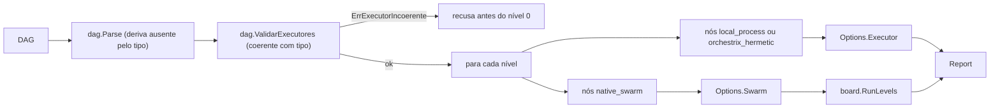

# 📋 SPEC: Despachante de executores no runner (I03 — Revisão Emenda 2)

> **Status:** Revisão Emenda 2 (TICK-I4-09.1, aguardando Stop-Gate final da I04; execução congelada)  
> **Data:** 2026-11-21  
> **Versão:** 2.0.0 (Revisão Emenda 2)  
> **Autor:** Claude (Fusão Addy Osmani + Matt Pocock + AIDD-Spec)  
> **Iniciativa:** I03 — Despachante de executores no runner  
> **Referência da Intenção:** [docs/intents/2026-11-21_INTENT_INICIATIVA_3_I03_DO_MACROPROJE.md](../intents/2026-11-21_INTENT_INICIATIVA_3_I03_DO_MACROPROJE.md)  
> **Emenda Aplicada:** [docs/intents/2026-11-21_EMENDA_2_MACROPLANO.md](../intents/2026-11-21_EMENDA_2_MACROPLANO.md)  
> **Alvo Primário:** internal/dag, internal/runner, internal/board, internal/plangen, internal/routedag, internal/cli  
> **Consome:** INTENT aprovada · **Produz:** PLAN, ROUTE e DAG  
> **Template:** TEMPLATE_SPEC.md v2.0.0  

---

## 1. Premissas Técnicas Assumidas (Addy Osmani)

> [!IMPORTANT]
> Esta revisão aplica a **Emenda 2** sobre a SPEC original (`2026-11-21_SPEC_INICIATIVA_3_I03_DO_MACROPROJE.md`) sem editar a INTENT aprovada da I03. A execução da I03 permanece congelada até o Stop-Gate final da I04.

1. Runtime: Go conforme o `go.mod`, só biblioteca padrão, zero dependências novas.
2. Fatos conferidos no código após a I04:
   * `go list` mostra que `internal/runner` importa `dag`, `gate` e `triagem`, e `internal/board` importa `dag`, `gate` e `taxonomy`. O `runner` importar o `board` não cria ciclo.
   * `Orchestrix.Execute` (`internal/orchestrix/orchestrix.go`) é o único executor atual e já despacha pelo tipo do nó: `script` roda local, `skill` roda pelo LLM. Não existe um segundo executor "local".
   * **Emenda 2 — Coerência por tipo e derivação no `dag.Parse` (I04):** `internal/dag/executor.go` já implementa o vocabulário (`local_process`, `orchestrix_hermetic`, `native_swarm`), `ErrExecutorIncoerente`, `dag.ExecutorPadrao(tipo)` e `d.ValidarExecutores()` invocado dentro de `dag.Parse`. Quando `isolation.executor` está ausente, `dag.Parse` o deriva pelo tipo (`stop_gate` -> `local_process`; `script`, `skill`, `unit_no`, `mcp`, `subprocesso` -> `orchestrix_hermetic`).
   * **Emenda 2 — Valor do Swarm:** continua `native_swarm` (não se cria `swarm_worker`).
   * **Emenda 2 — Cobertura do `board`:** a I04 já elevou e garantiu cobertura de `internal/board` >= 80% antes da I03; a I03 preserva esse piso.
   * O Swarm executa por nível (`board.LevelsFromDAG` e `SwarmBoard.RunLevels`). Um nó só vira worker se não for `stop_gate`, tiver papel (`role` ou `papel`) e tiver `command`.
3. A I03 só executa código depois que a I04 e a I02 fecharem (mexe em `internal/routedag` e na ROUTE).
4. Nenhum LLM entra no despacho nem na validação.

### Decisões do Stop-Gate 02 (atualizadas pela Emenda 2)
1. **Nome do valor do Swarm (corrige a INTENT; mantido na Emenda 2).** A INTENT aprovada cita `swarm_worker`. O valor canônico continua `native_swarm`. O conjunto aceito é `local_process`, `orchestrix_hermetic` e `native_swarm`. O valor `human_in_the_loop` continua recusado.
2. **`local_process` e `orchestrix_hermetic` (corrige a INTENT).** Os dois valores continuam no mesmo executor das `Options`, sem criar um segundo executor. A validação agora exige coerência com o tipo do nó: `stop_gate` aceita apenas `local_process`; nós de execução (`script`, `skill`, `unit_no`, `mcp`, `subprocesso`) aceitam `orchestrix_hermetic` ou `native_swarm`.
3. **Executor ausente derivado pelo tipo no `dag.Parse` (Emenda 2).** Em vez de um padrão fixo único, `dag.Parse` preenche o executor ausente por `dag.ExecutorPadrao(tipo)`: `stop_gate` recebe `local_process`, e os demais tipos recebem `orchestrix_hermetic`. Valor presente incoerente ou desconhecido continua recusado com `ErrExecutorIncoerente`, sem fallback.
4. **Pré-condições do `native_swarm`.** `ValidarExecutores` recusa `native_swarm` em nó `stop_gate` (já garantido pela regra de coerência), sem papel ou sem `command`, e recusa `subagents_allowed: "ephemeral"` fora de `native_swarm`, usando o mesmo erro tipado `ErrExecutorIncoerente`.
5. **Ticket do plangen.** O `Ticket` do `plangen` ganha o campo opcional `executor`, validado pela mesma regra de coerência com o tipo do nó, e é assim que o planejamento escolhe `native_swarm` de propósito.

---

## 2. Fronteiras de Ação & Regras de Governança (Boundaries — Addy Osmani)

* **Sempre Fazer:**
  * TDD estrito (teste falhando antes do código de produção).
  * Funções com menos de 35 linhas (`go run ./tools/funclen internal`).
  * Validar a coerência executor-tipo de todos os nós antes de executar o primeiro (`dag.ValidarExecutores` e `ErrExecutorIncoerente`).
  * Preservar cobertura de `internal/board` >= 80% (garantida pela I04).
  * Recompilar o binário ao fim de todo ticket com Go (AGENTS.md, regra 5).
  * Executar o Swarm só sob as seis condições da lei 4 do `AGENTS.md`.
* **Perguntar Antes:**
  * Adicionar dependência ao `go.mod`.
  * Alterar contratos públicos de CLI, do DAG ou de `ROUTE.json` além do que esta SPEC descreve.
  * Alterar regras globais do `AGENTS.md`.
* **Nunca Fazer:**
  * Alterar a INTENT aprovada da I01, I02 ou I03.
  * Criar o valor duplicado `swarm_worker` (o valor canônico é `native_swarm`).
  * Usar LLM ou heurística de tamanho ou carga na escolha do executor.
  * Cair para um executor padrão quando o valor declarado é incoerente ou desconhecido.
  * Mudar o comportamento dos nós `orchestrix_hermetic` e `local_process` (paridade).
  * Criar função vazia, `TODO` ou mock em código de produção (Lei #1).
  * Commitar ou publicar sem o usuário pedir.

---

## 3. Visão Geral, Arquitetura & Costuras de Teste

Com a I04, `dag.Parse` já deriva `isolation.executor` ausente pelo tipo do nó e valida coerência executor-tipo com `ErrExecutorIncoerente`. A I03 completa as pré-condições de `native_swarm` (`papel`, `command`, `ephemeral`), expõe o campo `executor` no `plangen`/`routedag` e acrescenta no `runner` a validação prévia e o desvio dos nós `native_swarm` de cada nível para o Swarm (`internal/board`, já com cobertura >= 80%).

### Diagrama de Fronteiras (Mermaid)


### Costuras de Teste (Test Seams — Pocock)
* `dag.Parse` e `dag.ValidarExecutores()`: funções puras sobre DAG JSON ou `*dag.DAG` montado no teste.
* `runner.Options.Swarm`: interface `SwarmRunner` com o método `RunLevels(ctx, [][]board.RunNode, board.RunOptions) ([]board.RunLevelResult, error)`. O teste injeta um falso e conta as chamadas.
* `runner.Options.Executor`: o teste injeta um falso que conta as chamadas por nó.
* `board.RunNodeOf(n, global, usados)`: função extraída de `LevelsFromDAG`, testada isolada preservando cobertura >= 80% do `internal/board`.
* `plangen.Render` e `routedag.Projetar`: fixtures em `t.TempDir()`.

---

## 4. Contratos de Dados & Schemas Formais

**Valores aceitos de `isolation.executor` e coerência com o tipo do nó (Emenda 2):**
* `stop_gate`: aceita somente `local_process` (derivado automaticamente no `dag.Parse` quando ausente).
* `script`, `skill`, `unit_no`, `mcp`, `subprocesso`: aceitam `orchestrix_hermetic` (derivado automaticamente no `dag.Parse` quando ausente) ou `native_swarm` (somente quando declarado).
* Qualquer outro valor (`xyz`, `human_in_the_loop`, `swarm_worker`) ou combinação incoerente (ex.: `stop_gate` com `orchestrix_hermetic` ou `script` com `local_process`) é recusada.

**Erro tipado (`internal/dag`):** `ErrExecutorIncoerente` (entregue pela I04), usado com `errors.Is`. A mensagem lista uma linha por nó inválido:
```
nó "TICK-03.1" (tipo unit_no): executor "xyz" incoerente (aceitos: orchestrix_hermetic, native_swarm)
nó "TICK-04.2" (tipo unit_no): native_swarm exige papel e command
```
**Regras de `subagents_allowed`:** `false` vale para qualquer executor; `"ephemeral"` só vale com `native_swarm`.

**Interface do `runner`:**
```go
type SwarmRunner interface {
    RunLevels(ctx context.Context, levels [][]board.RunNode, opt board.RunOptions) ([]board.RunLevelResult, error)
}
```
Campo novo: `Options.Swarm SwarmRunner`. Com `Swarm` nulo e nenhum nó `native_swarm`, o comportamento é idêntico ao de hoje.

**Ticket do `plangen`:** campo opcional `"executor"` no JSON de Tickets, validado pela mesma coerência com o tipo do nó.

---

## 5. Critérios Binários de Aceite por Nó / Ticket (BDD)

> [!NOTE]
> Cada `AC-XX` é verificável por teste ou comando com `exit code == 0`. A ordem dos Épicos é a ordem de implementação.

### Critérios de Aceitação por Épico

### Épico 01 — Coerência de executores e pré-condições do `native_swarm` (`internal/dag`)

* [ ] `AC-E01.1`: **Coerência por tipo e derivação de ausente no `dag.Parse`**
  * **Dado que:** um DAG com nós `stop_gate` e `unit_no`/`script` com executor coerente e com executor ausente.
  * **Quando:** rodar `go test ./internal/dag/ -run TestExecutorCoerenteEDerivado`.
  * **Então:** o teste sai com 0 e prova que `dag.Parse` deriva `local_process` para `stop_gate` ausente e `orchestrix_hermetic` para os demais tipos ausentes, que `native_swarm` é aceito em nós executáveis e que combinações incoerentes (`stop_gate` com `orchestrix_hermetic`, `script` com `local_process`, `xyz`, `human_in_the_loop`) são recusadas.
* [ ] `AC-E01.2`: **Todos os nós inválidos de uma vez**
  * **Dado que:** um DAG com três nós de executor incoerente ou desconhecido em níveis diferentes.
  * **Quando:** rodar `go test ./internal/dag/ -run TestValidarExecutoresListaTodos`.
  * **Então:** o erro satisfaz `errors.Is(err, ErrExecutorIncoerente)` e a mensagem traz uma linha por nó, com o nó, o tipo, o valor recebido e os valores aceitos.
* [ ] `AC-E01.3`: **Regra do `ephemeral`**
  * **Dado que:** nós com `subagents_allowed` igual a `false` e a `"ephemeral"`, em executores diferentes.
  * **Quando:** rodar `go test ./internal/dag/ -run TestSubagentesEfemerosSoNoSwarm`.
  * **Então:** `"ephemeral"` com `native_swarm` passa e `"ephemeral"` com os outros dois executores é recusado com `ErrExecutorIncoerente`.
* [ ] `AC-E01.4`: **Pré-condições do `native_swarm`**
  * **Dado que:** nós `native_swarm` do tipo `stop_gate`, sem papel e sem `command`.
  * **Quando:** rodar `go test ./internal/dag/ -run TestNativeSwarmExigePapelECommand`.
  * **Então:** os três são recusados com `ErrExecutorIncoerente` e um nó executável com papel e `command` passa.
* [ ] `AC-E01.5`: **`legoloop validate` recusa incoerência**
  * **Dado que:** o binário recompilado e um `pipeline.dag.json` com executor `xyz` ou incoerente com o tipo do nó.
  * **Quando:** rodar `legoloop validate` nesse arquivo.
  * **Então:** o comando sai com código diferente de 0 e imprime a linha do nó inválido.

### Épico 02 — Contrato no `plangen` e no `routedag`

* [ ] `AC-E02.1`: **Ticket escolhe o Swarm**
  * **Dado que:** um `tickets.json` com um Ticket de `"executor": "native_swarm"` e os demais sem o campo.
  * **Quando:** rodar `go test ./internal/plangen/ -run TestTicketExecutor`.
  * **Então:** a ROUTE gerada tem `isolation.executor` igual a `native_swarm` nesse nó e o executor coerente com o tipo nos outros.
* [ ] `AC-E02.2`: **Ticket com executor incoerente ou desconhecido é recusado**
  * **Dado que:** um Ticket com `"executor": "xyz"` ou `"executor": "local_process"` em nó `unit_task`.
  * **Quando:** rodar `go test ./internal/plangen/ -run TestTicketExecutorIncoerente`.
  * **Então:** `plangen.Render` devolve erro envolvendo `dag.ErrExecutorIncoerente` e não grava PLAN nem ROUTE.
* [ ] `AC-E02.3`: **A projeção do DAG preserva e valida coerência**
  * **Dado que:** uma ROUTE com um nó `native_swarm` e outra com um nó `xyz`.
  * **Quando:** rodar `go test ./internal/routedag/...`.
  * **Então:** a primeira projeta um DAG que valida com `native_swarm` preservado, e a segunda é recusada com `dag.ErrExecutorIncoerente`.

### Épico 03 — Despachante no `runner`

* [ ] `AC-E03.1`: **Recusa antes de executar qualquer nó**
  * **Dado que:** um DAG de três níveis em que só um nó do último nível tem executor incoerente, e um `Executor` falso que conta chamadas.
  * **Quando:** rodar `go test ./internal/runner/ -run TestRunRecusaAntesDoNivelZero`.
  * **Então:** `runner.Run` devolve erro envolvendo `dag.ErrExecutorIncoerente` com o nó listado e o `Executor` falso registra zero chamadas.
* [ ] `AC-E03.2`: **Despacho por nível**
  * **Dado que:** um DAG de dois níveis, cada um com nós `stop_gate` (`local_process`), `orchestrix_hermetic` e `native_swarm`, um `Executor` falso e um `SwarmRunner` falso.
  * **Quando:** rodar `go test ./internal/runner/ -run TestDespachoPorNivel`.
  * **Então:** o `SwarmRunner` recebe em cada chamada só os nós `native_swarm` do nível, o `Executor` recebe os demais, e os níveis rodam na ordem topológica.
* [ ] `AC-E03.3`: **Nível misto termina com os dois lados**
  * **Dado que:** um nível com um nó `orchestrix_hermetic` e um `native_swarm`, o do Swarm mais lento.
  * **Quando:** rodar `go test ./internal/runner/ -run TestNivelMistoEsperaOsDoisLados`.
  * **Então:** os dois começam sem esperar um pelo outro e o nível seguinte só começa depois que ambos terminam.
* [ ] `AC-E03.4`: **Falha no Swarm interrompe os níveis seguintes**
  * **Dado que:** um `SwarmRunner` falso que reprova o worker de um nó.
  * **Quando:** rodar `go test ./internal/runner/ -run TestFalhaNoSwarmMarcaSkipped`.
  * **Então:** o `Report.OK` é falso, o nó está `error` ou `gate_failed`, e os nós dos níveis seguintes estão `skipped`.
* [ ] `AC-E03.5`: **DAG sem `native_swarm` não toca no Swarm**
  * **Dado que:** um DAG só com `local_process` (em `stop_gate`), `orchestrix_hermetic` e executor ausente derivado pelo `dag.Parse`, e `Options.Swarm` nulo.
  * **Quando:** rodar `go test ./internal/runner/ -run TestSemNativeSwarmNaoUsaSwarm`.
  * **Então:** a execução termina sem pânico, o `Report` é o de hoje e nenhuma chamada ao Swarm acontece.
* [ ] `AC-E03.6`: **`legoloop run` recusa sem criar `worktree`**
  * **Dado que:** o binário recompilado, um repositório git de teste e um DAG com executor `xyz`.
  * **Quando:** rodar `legoloop run` nesse DAG e depois `git worktree list`.
  * **Então:** o `run` sai com 1, imprime todos os nós inválidos e a lista de `worktree` não ganha entrada.

### Épico 04 — Ligação real com o `board`

* [ ] `AC-E04.1`: **`RunNodeOf` extraído preservando cobertura do `board` >= 80%**
  * **Dado que:** o corpo do laço de `board.LevelsFromDAG` e a cobertura >= 80% já garantida pela I04.
  * **Quando:** rodar `go test -cover ./internal/board/...`.
  * **Então:** os testes passam, `LevelsFromDAG` chama `RunNodeOf`, um teste novo cobre o nó sem papel e o nó sem `command`, e a cobertura total de `internal/board` continua >= 80%.
* [ ] `AC-E04.2`: **`legoloop run` entrega ao Swarm real**
  * **Dado que:** o binário recompilado e um DAG de um nível com um nó `native_swarm`, papel e `command` de um processo falso que sai com 0.
  * **Quando:** rodar `go test ./internal/cli/ -run TestRunNativeSwarmBinario`.
  * **Então:** o `run` sai com 0, o relatório mostra o nó `passed` e o `SwarmBoard` registra o worker.
* [ ] `AC-E04.3`: **Sem `native_swarm`, nenhum diretório do Swarm**
  * **Dado que:** o binário recompilado e um DAG só com executores não-Swarm.
  * **Quando:** rodar `legoloop run` e listar o diretório padrão do Swarm.
  * **Então:** o diretório não é criado.

### Épico 05 — Paridade e governança viva

* [ ] `AC-E05.1`: **Todos os DAGs do repositório continuam válidos**
  * **Dado que:** os DAGs de `docs/dags` e os `pipeline.dag.json` de `processos`.
  * **Quando:** rodar `go test ./internal/dag/ -run TestDAGsDoRepositorioValidam`.
  * **Então:** o teste sai com 0 e nenhum DAG é recusado pela validação coerente de executores.
* [ ] `AC-E05.2`: **Relatório idêntico para DAG sem `native_swarm`**
  * **Dado que:** um DAG de referência com os dois executores atuais e um `Executor` falso determinístico.
  * **Quando:** rodar `go test ./internal/runner/ -run TestParidadeDoRelatorio`.
  * **Então:** o `Report` é igual ao registrado antes da mudança (golden gravado no Red).
* [ ] `AC-E05.3`: **Documentos vivos**
  * **Dado que:** o fim da I03.
  * **Quando:** rodar `wc -c AGENTS.md` e `grep -c "native_swarm" AGENTS.md README.md MEMORY.md`.
  * **Então:** o `AGENTS.md` tem no máximo 24000 bytes e cada arquivo cita `native_swarm`.
* [ ] `AC-E05.4`: **Anticorpos e prompt de execução**
  * **Dado que:** cada achado corrigido na I03.
  * **Quando:** rodar `legoloop anticorpos status legoloop-concepcao` e `ls docs/prompts`.
  * **Então:** o comando sai com 0 e existe `docs/prompts/*_PROMPT_EXECUCAO_I03.md`.

### Requisitos Não Funcionais

* [ ] `AC-NF.1`: **Zero LLM no despacho**
  * **Dado que:** `internal/dag` e o código novo do `internal/runner`.
  * **Quando:** rodar `grep -rln "LLMClient\|ResolvedorLLM" internal/dag internal/runner`.
  * **Então:** o `grep` não acha nenhum arquivo.
* [ ] `AC-NF.2`: **Portão do projeto íntegro**
  * **Dado que:** todos os Épicos entregues.
  * **Quando:** rodar os comandos da seção 6.
  * **Então:** todos saem com 0 e `gofmt -l .` não imprime nada.

### Rastreabilidade Requisito para Critério

| R | Requisito | AC |
| :--- | :--- | :--- |
| `R1` | Coerência de executores por tipo, derivação no `dag.Parse` e pré-condições do `native_swarm` | `AC-E01.1`, `AC-E01.2`, `AC-E01.3`, `AC-E01.4`, `AC-E01.5` |
| `R2` | Contrato no `plangen` e no `routedag` | `AC-E02.1`, `AC-E02.2`, `AC-E02.3` |
| `R3` | Validação prévia e despacho por nível no `runner` | `AC-E03.1` a `AC-E03.6`, `AC-NF.1` |
| `R4` | Ligação real com o `board` (cobertura >= 80% preservada) | `AC-E04.1`, `AC-E04.2`, `AC-E04.3` |
| `R5` | Paridade dos executores atuais | `AC-E05.1`, `AC-E05.2` |
| `R6` | Governança viva e portão | `AC-E05.3`, `AC-E05.4`, `AC-NF.2` |

> Cada `R` tem ao menos um `AC`. O `covers` do front matter lista todos os `R`.

---

## 6. Comandos Operacionais & Critério de Conclusão Global (Addy Osmani)

### Comandos de Verificação Mecânica
* **Build:** `go build -o bin/legoloop.exe ./cmd/legoloop`
* **Test:** `go test -count=1 ./...`
* **Cobertura do `board`:** `go test -cover ./internal/board/...` (>= 80%)
* **Estática e formatação:** `go vet ./...` e `gofmt -l .` (saída vazia).
* **Funções:** `go run ./tools/funclen internal`
* **Taxonomia:** `go run ./tools/taxlinter internal cmd loops skills docs/templates`
* **Dependências intactas:** `git diff --exit-code go.mod`

### Execução pelo Swarm
Cada Ticket vira um worker do Swarm sob as seis condições da lei 4 do `AGENTS.md`: contexto só com os artefatos do Ticket, ferramentas listadas, um worker por Ticket, saída em disco com Gate mecânico, sem sub-workers e `write_boundary` `strict`.

### Critério de Done Global
A especificação é **100% CONCLUÍDA** quando:
- [ ] 100% dos critérios `AC-E{N}.{M}` e `AC-NF.{K}` estiverem atendidos.
- [ ] O comando de **Test** passar com exit code 0 e `internal/board` manter cobertura >= 80%.
- [ ] `go vet`, `gofmt -l`, `funclen` e `taxlinter` não reportarem nada.
- [ ] O comando de **Build** recompilar o binário.
- [ ] Zero arquivos temporários ou órfãos residuais.

---

🛑 **STOP-GATE 02 DE AUDITORIA HUMANA (REVISÃO EMENDA 2):**  
*As premissas, as fronteiras, os contratos da Emenda 2 e os critérios binários acima atendem à sua expectativa?*  
*A execução da I03 permanece congelada até o Stop-Gate final da I04.*
