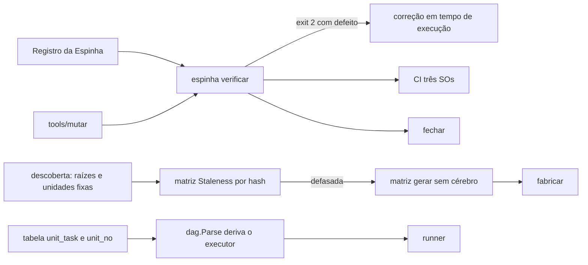

# 📋 SPEC: Espinha dorsal previsível, universal e determinística (I04)

> **Status:** Aprovado pelo Usuário (Stop-Gate 02, 2026-11-21)  
> **Data:** 2026-11-21  
> **Versão:** 1.0.0  
> **Autor:** Claude (Fusão Addy Osmani + Matt Pocock + AIDD-Spec)  
> **Iniciativa:** I04 — Espinha dorsal  
> **Referência da Intenção:** [docs/intents/2026-11-21_INTENT_INICIATIVA_4_I04_DO_MACROPROJE.md](../intents/2026-11-21_INTENT_INICIATIVA_4_I04_DO_MACROPROJE.md)  
> **Alvo Primário:** internal/espinha, internal/descoberta, internal/dag, internal/runner, internal/fabricar, internal/matriz, internal/assets, internal/caminhos, internal/paths, internal/escrita, tools/mutar, tools/cobertura, .github/workflows  
> **Consome:** INTENT aprovada · **Produz:** PLAN, ROUTE e DAG  
> **Template:** TEMPLATE_SPEC.md v2.0.0  

---

## 1. Premissas Técnicas Assumidas (Addy Osmani)

> [!IMPORTANT]
> Alerte no Stop-Gate 02 caso alguma premissa esteja incorreta.
1. Runtime: Go conforme o `go.mod`, só biblioteca padrão, zero dependências novas. O `tools/mutar` usa só `go/ast`, `go/parser`, `go/printer` e `os/exec`.
2. Fatos conferidos no código antes desta SPEC (cada um é a base de um critério):
   * A detecção de Matriz defasada por hash já existe: `matriz.Staleness` compara o `sha256` de cada peça (`internal/matriz/stale.go`). O varredor `assets.Scanner` já existe e usa `DefaultDiscoveryRoots(home)`, que cobre pastas de trabalho sob o HOME, não as unidades do SO (`internal/assets/discover.go:103`).
   * O `fabricar` só lê a Matriz e nunca a atualiza (`ErrSemMatriz`, `fonte_matriz.go`) e descarta `TargetDrives` com o aviso `fabricar.drives_ignorados` (`engine.go:198`).
   * `matriz gerar -sem-cerebro` cataloga só por declaração e palavras-chave, sem LLM. É o caminho determinístico de atualização.
   * `internal/paths` é uma fachada: constantes (`DirProcessos`, `SufixoStudio`, `SufixoAntigo`, `DirAntigo`, `ArquivoDAG`), 4 funções que só delegam a `caminhos` (`CaminhoDAG`, `DirsLeitura`, `CaminhoDAGLeitura`, `DirAntigoEm`, com 2 pontos de chamada) e um "jail" de caminhos hostis (`DentroDaRaiz`, `CampoDeJSON`, `ValidarPID`, `Renomear`) que nenhum arquivo de produção chama. O relatório de auditoria descrevia isso como "duas fachadas únicas"; esta SPEC corrige a descrição.
   * `internal/vault` não tem importador em produção.
   * `go env CGO_ENABLED` é `0` e não há `gcc` nesta máquina Windows, então `go test -race` só roda no CI (Linux e macOS).
   * O mapa de verbos mora em `internal/cli/cli.go` e inclui verbos que o `help` não lista (`commit`, `legoloop-cartoon-shorts`).
   * `Orchestrix.Execute` é o único executor e despacha pelo tipo do nó.
   * **Verificado em Linux de verdade** (WSL Ubuntu, go1.27.0, cópia do `HEAD`): `go build` e `go vet` limpos, mas `go test ./...` falha em 9 testes de 5 pacotes. Três são defeitos reais: o jail de caminhos aceita `..\fora.txt`, `C:\...` e `\\server\...` (`internal/paths/jail_test.go`); o lock da memória da triagem não é exclusivo (`TestMemoriaLockOcupado`); a guarda de deleção aceita `docs\vocab\dicionario.json` (`internal/inventario/guard_test.go`). Seis dependem de ferramenta instalada na máquina (`pandoc`, `pymupdf`, harness) e não são herméticos.
   * `go test -race` rodou limpo em Linux em 12 pacotes da espinha (`dag`, `runner`, `gate`, `plangen`, `orchestrix`, `board`, `interview`, `processo`, `mcp`, `matriz`, `fabricar`, `upstream`); a única falha é a do lock da triagem, que é funcional.
   * Execução de ponta a ponta: um DAG de 2 nós `script`, rodado duas vezes com `--allow-scripts`, deu relatório idêntico (descontadas as durações) e artefatos com o mesmo hash. Só `flight_record.json` e `memoria_execucao.json` mudam, porque guardam horário e sessão.
   * Dos 198 nós dos 33 Processos, 14 chamam `powershell` (em `legoloop-triagem`, `legoloop-video-master` e `legoloop-canal-redc`) e 14 chamam `python`: esses Processos só rodam no Windows.
   * `processos/fechar` (v1.0.0, 6 nós) duplica `processos/legoloop-fechar` (v1.1.0, 8 nós) e guarda um `triagem.json.legoloop-bak`.
   * As gravações de estado crítico não atômicas, conferidas pelo ponto de chamada: `brain/antibodies.go:295,300`, `fechar/fechar.go:295,308,321` (documentos do usuário), `fechar/quarteto.go:95`, `fechar/destilar.go:113`, `cli/sync_harnesses.go:308` (configuração de harness do usuário), `cli/validate_studio.go:57` e `cli/rota.go:251`.
   * Estado global: `dag`, `runner`, `plangen`, `triagem`, `upstream` e `board` não têm `init()` nem variável global mutável. `gate`, `orchestrix` e `interview` têm só tabelas de consulta escritas uma vez, e os `init()` só registram mensagens.
   * O Gate de aceite do projeto (`acceptanceRe` e `checklistRe`, `internal/gate/builtins.go:195`) aprova as SPEC da I02, da I03 e desta.
   * O `tools/mutar` completo tem cerca de 1.960 pontos de mutação nos sete pacotes da espinha (linhas com operador); com 1 a 4 segundos de teste por pacote mais a compilação, uma rodada completa em um núcleo leva de 1 a 3 horas (estimativa, não medição).
3. A execução desta SPEC começa antes da I01, da I02 e da I03, que continuam congeladas (Emenda 2).
4. Fixture com defeito sai com exit 2, a mesma convenção da trava `upstream_ok`. Exit 1 fica para falha de execução.

### Decisões do Stop-Gate 02 (pergunta, sugestão e motivo)
1. **Fachada de caminhos (corrige o Objetivo 4 da INTENT).** A INTENT manda absorver `paths` em `caminhos`. Fato verificado: `paths` não duplica a lógica; ele delega. **Sugestão:** mover as constantes para `caminhos`, apagar as 4 funções delegadas (migrando os 2 pontos de chamada) e renomear o que sobra de `paths` (o jail) para `internal/jail`. **Motivo:** o nome `paths` induz a erro e as funções delegadas são ruído.
2. **O jail sem chamador.** **Sugestão:** ligar o jail aos verbos que recebem nome de Processo da linha de comando (`fabricar`, `compor`, `remover`, `refinar`, `exec`, `sessoes`), que passam a recusar nome com `..` ou separador de pasta com exit 2. **Motivo:** é guarda de segurança que existe e não protege nada; removê-la deixaria a entrada hostil sem barreira.
3. **Descoberta (corrige o desenho da INTENT).** A INTENT fala em "atualizar por hash". O hash já existe. **Sugestão:** o trabalho é ligar três peças que existem: o `fabricar` passa a consultar `matriz.Staleness` e, se defasada, roda a atualização no modo `-sem-cerebro`; o `assets.Scanner` ganha as unidades fixas do SO como raízes; `TargetDrives` filtra essas raízes. Peças que esperam o cérebro ficam em `pendentes` e o relatório as lista. **Motivo:** reaproveita o que está medido (92,7% de cobertura em `matriz`) em vez de escrever um segundo motor.
4. **`matrix` descontinuado.** **Sugestão:** remover o verbo `matrix`, que o help já marca como descontinuado e que `matriz ver` substitui. **Motivo:** verbo morto no help é ruído na espinha.
5. **Processos fora do prefixo `legoloop-` (10 de 33) — ordem do usuário: inserir o prefixo.** Os 10 são `addy-osmani`, `ai-motion-graphics`, `auditoria-atomica`, `fechar`, `fronteira-ai-driven`, `impeccable-design`, `lauren-tan`, `listar`, `matt-pocock` e `mega-pipeline`. Fato verificado: `fechar` colide com o `legoloop-fechar` que já existe (versão mais nova do mesmo Processo), então renomear não serve para ele. **Sugestão:** os 9 sem colisão ganham o prefixo pelo verbo novo `legoloop renomear <antigo> <novo>`, que renomeia a pasta, o `name` do DAG, os manifestos, os vínculos do Cofre e as referências, com `--dry-run`, backup com `MANIFESTO.tsv` e registro em `espinha/renomeados.json`; `fechar` é aposentado (o `legoloop-fechar` o substitui, e os anticorpos do antigo passam para o novo). A regra `processo-sem-prefixo` não tem lista de exceções. **Motivo:** as referências são 4 a 10 arquivos por nome (58 para `fechar` e 57 para `listar`, que também são verbos), então a troca à mão deixaria referência quebrada; um verbo que faz tudo e registra o nome antigo é determinístico e não deixa débito.
6. **`-race`.** **Sugestão:** o CI é o juiz oficial, e o WSL Ubuntu desta máquina serve para rodar antes. **Motivo:** o Windows daqui tem `CGO_ENABLED=0` e não tem `gcc`; o `-race` já rodou limpo no WSL.
7. **Mutador de código.** **Sugestão:** o `tools/mutar` roda por pacote, com um orçamento de tempo, e a lista de mutantes sobreviventes justificados mora em `espinha/mutantes_justificados.json`, cada um com o anticorpo que o explica. A rodada completa (1 a 3 horas, estimativa) roda no fechamento da I04 e em CI noturno; no CI de cada push roda só nos pacotes alterados. **Motivo:** mutante equivalente é inevitável, e justificá-lo por escrito é a única saída sem perder o gate.
8. **Falhas reais em Linux.** **Sugestão:** corrigir os três defeitos (jail, lock da triagem, guarda de deleção) e tornar herméticos os seis testes que dependem de ferramenta instalada, trocando a ferramenta por um falso injetado. **Motivo:** o CI de três SOs ficaria vermelho no primeiro push, e um jail que aceita `..\` em Linux é uma barreira de segurança furada.
9. **Processos que só rodam no Windows.** **Sugestão:** os 14 nós com `powershell` e os 14 com `python` passam a chamar um iniciador portável (`legoloop` ou `go run`), e a regra `comando-exclusivo-de-so` do gate impede a volta. **Motivo:** "universal" vale para o catálogo de Processos também, não só para o binário.

---

## 2. Fronteiras de Ação & Regras de Governança (Boundaries — Addy Osmani)

* **Sempre Fazer:**
  * TDD estrito (teste falhando antes do código de produção) e fixture com defeito saindo com exit 2.
  * Funções com menos de 35 linhas (`go run ./tools/funclen internal`).
  * Descoberta somente leitura, com relatório do que foi lido e recusado.
  * Recompilar o binário ao fim de todo ticket com Go (AGENTS.md, regra 5).
  * Registrar todo achado como anticorpo (lei 16).
* **Perguntar Antes:**
  * Adicionar dependência ao `go.mod`.
  * Alterar contratos públicos de CLI, do DAG ou de `ROUTE.json` além do que esta SPEC descreve.
  * Alterar regras globais do `AGENTS.md`.
* **Nunca Fazer:**
  * Renomear Processo à mão: só pelo verbo `legoloop renomear`, com backup e registro.
  * Alterar as INTENTs da I01, da I02 e da I03.
  * Executar o que a descoberta encontra, ou gravar nas unidades varridas.
  * Usar LLM ou relógio na decisão da espinha (validar, rotear, planejar, despachar, descobrir).
  * Mudar o formato do DAG.
  * Criar função vazia, `TODO` ou mock em código de produção (Lei #1).
  * Descongelar a I01, a I02 ou a I03 sem o usuário pedir.
  * Commitar ou publicar sem o usuário pedir.

---

## 3. Visão Geral, Arquitetura & Costuras de Teste

A I04 acrescenta à espinha um contrato (o Registro) e um gate que o confere, liga a descoberta ao `fabricar`, amarra o vocabulário do DAG, fecha as dívidas médias e baixas da auditoria e prova tudo em três SOs e com mutação.

### Diagrama de Fronteiras (Mermaid)


### Costuras de Teste (Test Seams — Pocock)
* `espinha.Verificar(raiz) []Violacao`: função pura sobre um diretório; os testes montam repositórios mínimos em `t.TempDir()` com um defeito de cada vez.
* `descoberta.Unidades(so Provedor) []string`: o provedor de unidades é uma interface; o teste injeta Windows, Linux e macOS falsos.
* `fabricar.Deps`: já aceita `Matriz` e `Clock`; ganha `Atualizar` (a função que roda o `matriz gerar -sem-cerebro`), que o teste troca por um falso que conta chamadas.
* `escrita.GravarAtomico(caminho, dados)`: o teste injeta uma falha entre o arquivo temporário e o `rename`.
* `mutar.Mutantes(pacote, operadores)`: gera os mutantes sem rodar nada; `mutar.Rodar` recebe o executor de testes, que o teste troca por um falso.

---

## 4. Contratos de Dados & Schemas Formais

**Registro da Espinha** (`espinha/registro.json`):
```json
{
  "schema": "espinha.v1",
  "verbos": [{"nome": "fabricar", "camada": "espinha", "motor": "internal/fabricar", "contrato": "docs/..."}],
  "motores": [{"pacote": "internal/runner", "interface": "Executor", "deterministico": true}],
  "processos": [{"slug": "legoloop-concepcao"}],
  "requisitos": [{"lei": 1, "verificador": "go run ./tools/espinha-stubs", "mecanico": true}]
}
```
`camada` é `espinha` ou `dominio`. Uma lei sem verificador mecânico traz `"mecanico": false` e `"justificativa"`.

**Comando `legoloop espinha verificar [--raiz DIR] [--json]`:** exit `0` sem violação; exit `2` com pelo menos uma. A saída tem uma linha por violação: `regra: <id>; alvo: <nome>; motivo: <texto>`.

**Regras do gate (doze):** `verbo-sem-registro`, `verbo-orfao`, `lei-sem-verificador`, `funcao-duplicada-entre-pacotes`, `processo-incompleto`, `processo-sem-prefixo`, `processo-duplicado`, `executor-incoerente`, `tipo-de-no-fora-da-tabela`, `erro-ignorado-acima-do-limite`, `global-mutavel-nao-justificada`, `comando-exclusivo-de-so`.

**Comando `legoloop renomear <antigo> <novo> [--dry-run] [--vault DIR] [--docs DIR] [--yes] [--json]`:** renomeia um Processo em todos os lugares (pasta, `name` do DAG, `triagem.json`, `anticorpos.json`, vínculos do Cofre e referências nos documentos), com backup e `MANIFESTO.tsv`. Exit `0` ok; exit `2` se o novo nome já existe (colisão), se o antigo não existe ou se o nome é hostil. Grava `espinha/renomeados.json` (`antigo`, `novo`, `data`), e `exec <antigo>` passa a recusar com exit `2` e a mensagem "renomeado para <novo>".

**Executor derivado do tipo** (`internal/dag`): `stop_gate` é `local_process`; `script`, `skill`, `unit_no`, `mcp` e `subprocesso` são `orchestrix_hermetic`; `native_swarm` só quando declarado. Ausente é preenchido pelo tipo no `dag.Parse`. Contradição devolve `ErrExecutorIncoerente`, com uma linha por nó.

**Tabela de tipos** (`internal/dag`): `unit_task` (ROUTE) e `unit_no` (DAG) em uma estrutura única, com as funções `DoRoute(string)` e `DoDAG(string)`.

**Descoberta:** `descoberta.Raizes(home, alvo []string, prov Provedor, confiarRemovivel bool) (raizes []string, recusadas []Recusa)`. Windows pelo tipo de unidade fixa; Linux em `/mnt`; macOS em `/Volumes`. Unidade removível ou de rede entra só com `confiarRemovivel`.

**`tools/mutar`:** `go run ./tools/mutar <pacote>... [--orcamento DUR] [--justificados ARQ]`. Operadores: `==`↔`!=`, `<`↔`<=`, `>`↔`>=`, `&&`↔`||`, `true`↔`false`, remoção de `return err`, troca de `+`↔`-`. Exit `0` se todo mutante morreu ou está justificado; exit `2` se algum sobreviveu.

**`tools/cobertura`:** `go run ./tools/cobertura [--limites ARQ]`. Lê o limite mínimo por pacote e sai com `2` se algum estiver abaixo.

---

## 5. Critérios Binários de Aceite por Nó / Ticket (BDD)

> [!NOTE]
> Cada `AC-XX` é verificável por teste ou comando com `exit code == 0`. A ordem dos Épicos é a ordem de implementação aprovada.

### Critérios de Aceitação por Épico

### Épico 01 — Linha de base executável

* [ ] `AC-E01.1`: **Correção do relatório de auditoria registrada**
  * **Dado que:** o relatório `docs/reports/2026-11-21_REPORT_AUDITORIA_ESPINHA_DORSAL.md`.
  * **Quando:** rodar `grep -c "Correção" docs/reports/2026-11-21_REPORT_AUDITORIA_ESPINHA_DORSAL.md`.
  * **Então:** a contagem é maior que 0 e a linha de G05 descreve `paths` como fachada com jail sem chamador.
* [ ] `AC-E01.2`: **Execução de ponta a ponta duas vezes, relatório idêntico**
  * **Dado que:** o binário recompilado e um DAG de três nós `script` em `t.TempDir()`.
  * **Quando:** rodar `go test ./internal/cli/ -run TestRunScriptsDuasVezesRelatorioIdentico`.
  * **Então:** o teste sai com 0 e os dois relatórios são idênticos, descontadas só as durações.
* [ ] `AC-E01.3`: **`exec` pelo slug também é determinístico**
  * **Dado que:** o mesmo DAG como Processo em um Cofre de teste.
  * **Quando:** rodar `go test ./internal/cli/ -run TestExecDuasVezesRelatorioIdentico`.
  * **Então:** o teste sai com 0 e os artefatos gravados têm o mesmo hash nas duas execuções.

### Épico 02 — Vocabulário e executor (G03, G04)

* [ ] `AC-E02.1`: **Tabela única de tipos**
  * **Dado que:** a tabela `unit_task` e `unit_no` em `internal/dag`.
  * **Quando:** rodar `go test ./internal/dag/ -run TestTabelaDeTipos`.
  * **Então:** o teste sai com 0 e prova a conversão nos dois sentidos, a recusa de nome desconhecido e que `tools/route2dag` e `internal/runner` usam a tabela.
* [ ] `AC-E02.2`: **Alias e literal removidos**
  * **Dado que:** o código atual.
  * **Quando:** rodar `grep -rn "TypeSubloop" --include=*.go internal tools cmd` e `grep -n 'NodeType("unit_no")' internal/runner/runner.go`.
  * **Então:** os dois `grep` não acham nada e `go build ./...` sai com 0.
* [ ] `AC-E02.3`: **Executor ausente é preenchido pelo tipo**
  * **Dado que:** nós sem `isolation.executor` de cada tipo.
  * **Quando:** rodar `go test ./internal/dag/ -run TestParseDerivaOExecutor`.
  * **Então:** o teste sai com 0 e `stop_gate` recebe `local_process` e os demais tipos recebem `orchestrix_hermetic`.
* [ ] `AC-E02.4`: **Contradição é recusada com todos os nós listados**
  * **Dado que:** um DAG com um `stop_gate` rotulado `orchestrix_hermetic` e um `script` rotulado `local_process`.
  * **Quando:** rodar `go test ./internal/dag/ -run TestExecutorIncoerenteListaTodos`.
  * **Então:** o erro satisfaz `errors.Is(err, ErrExecutorIncoerente)` e a mensagem traz uma linha por nó.
* [ ] `AC-E02.5`: **DAGs do repositório corrigidos**
  * **Dado que:** os DAGs de `processos` e de `docs/dags`.
  * **Quando:** rodar `go test ./internal/dag/ -run TestDAGsDoRepositorioValidam`.
  * **Então:** o teste sai com 0 e nenhum `stop_gate` está com rótulo diferente de `local_process`.
* [ ] `AC-E02.6`: **`validate` e `run` recusam com exit 2**
  * **Dado que:** o binário recompilado e um DAG incoerente.
  * **Quando:** rodar `legoloop validate` e `legoloop run` nele.
  * **Então:** os dois saem com 2 e imprimem uma linha por nó incoerente.

### Épico 03 — Fachada de caminhos, nomes de Processo e código morto (G05, G06, G17)

* [ ] `AC-E03.1`: **Constantes e funções em um pacote só**
  * **Dado que:** `internal/caminhos` com as constantes de `paths`.
  * **Quando:** rodar `go test ./internal/caminhos/ -run TestConstantesEFuncoesNoMesmoPacote` e `go list ./internal/paths 2>&1`.
  * **Então:** o teste sai com 0 e o pacote `internal/paths` não existe mais.
* [ ] `AC-E03.2`: **Funções delegadas apagadas e chamadores migrados**
  * **Dado que:** os 2 pontos de chamada (`internal/migrar/migrar.go`, `internal/refinar/refinar.go`) e os 12 arquivos que usam constantes.
  * **Quando:** rodar `go build ./...` e `grep -rnE "paths\.(CaminhoDAG|DirsLeitura|CaminhoDAGLeitura|DirAntigoEm)" --include=*.go internal cmd tools`.
  * **Então:** o `build` sai com 0 e o `grep` não acha nada.
* [ ] `AC-E03.3`: **Jail ligado aos verbos que recebem nome de Processo**
  * **Dado que:** o pacote `internal/jail` e os verbos `fabricar`, `compor`, `remover`, `refinar`, `exec` e `sessoes`.
  * **Quando:** rodar `go test ./internal/cli/ -run TestNomeHostilEhRecusado`.
  * **Então:** cada verbo recusa nomes como `../x`, `a/b` e `..\x` com exit 2 e nada é gravado fora do Cofre.
* [ ] `AC-E03.4`: **Pacote `vault` sem uso removido**
  * **Dado que:** `internal/vault` sem importador em produção.
  * **Quando:** rodar `grep -rl 'internal/vault"' --include=*.go .` e `go build ./...`.
  * **Então:** o `grep` não acha arquivo e o `build` sai com 0.
* [ ] `AC-E03.5`: **Verbo `renomear` seguro**
  * **Dado que:** um Cofre e um projeto de teste com o Processo `velho`, com referências em DAG, triagem, anticorpos, vínculo e documentos, e um Processo `legoloop-velho` já existente.
  * **Quando:** rodar `go test ./internal/renomear/ -run TestRenomear`.
  * **Então:** com `--dry-run` nada muda e o relatório lista cada alteração; sem ele o Processo é renomeado em todos os lugares com backup e `MANIFESTO.tsv`; a colisão com `legoloop-velho` sai com 2 sem tocar em nada; o nome hostil sai com 2.
* [ ] `AC-E03.6`: **Os 9 Processos sem colisão ganham o prefixo**
  * **Dado que:** `addy-osmani`, `ai-motion-graphics`, `auditoria-atomica`, `fronteira-ai-driven`, `impeccable-design`, `lauren-tan`, `listar`, `matt-pocock` e `mega-pipeline`.
  * **Quando:** rodar `legoloop renomear` em cada um e depois `legoloop validate` em cada DAG renomeado.
  * **Então:** todos saem com 0, `ls processos` só tem nomes com `legoloop-` e `espinha/renomeados.json` tem 9 linhas.
* [ ] `AC-E03.7`: **`fechar` aposentado sem perder anticorpo**
  * **Dado que:** `processos/fechar` (v1.0.0) e `processos/legoloop-fechar` (v1.1.0).
  * **Quando:** rodar `legoloop anticorpos status legoloop-fechar` e `ls processos | grep -c "^fechar$"`.
  * **Então:** os anticorpos do antigo constam no novo, a contagem é 0, o `triagem.json.legoloop-bak` não existe mais e `legoloop exec fechar` sai com 2 com a mensagem "renomeado para legoloop-fechar".
* [ ] `AC-E03.8`: **Nenhuma referência ao nome antigo**
  * **Dado que:** os 10 nomes antigos.
  * **Quando:** rodar `go test ./internal/espinha/ -run TestSemReferenciaAoNomeAntigo`.
  * **Então:** nenhum arquivo do repositório (exceto `espinha/renomeados.json` e o histórico em `docs/archive`) cita um nome antigo como Processo, e a regra `processo-sem-prefixo` dispara em zero Processos.

### Épico 04 — Descoberta de peças e Matriz (G01, G02)

* [ ] `AC-E04.1`: **Unidades fixas por SO**
  * **Dado que:** provedores falsos de Windows (unidades `C:` fixa, `D:` fixa, `E:` removível), Linux (`/mnt/dados`, `/media/pen`) e macOS (`/Volumes/Disco`, `/Volumes/Pen`).
  * **Quando:** rodar `go test ./internal/descoberta/ -run TestUnidadesFixasPorSO`.
  * **Então:** só as unidades fixas entram nas raízes e as removíveis aparecem em `recusadas`; com `confiarRemovivel` elas entram.
* [ ] `AC-E04.2`: **`TargetDrives` vale**
  * **Dado que:** um `fabricar` com `TargetDrives` igual a uma unidade só.
  * **Quando:** rodar `go test ./internal/fabricar/ -run TestTargetDrivesRestringeABusca`.
  * **Então:** só essa unidade é varrida e o aviso `fabricar.drives_ignorados` deixou de existir (`grep -rn "drives_ignorados" internal` não acha nada).
* [ ] `AC-E04.3`: **O `fabricar` atualiza a Matriz defasada sozinho**
  * **Dado que:** uma Matriz gravada e uma peça nova colocada numa raiz de teste, sem rodar `matriz gerar`.
  * **Quando:** rodar `go test ./internal/fabricar/ -run TestFabricarAtualizaMatrizDefasada`.
  * **Então:** o `Atualizar` falso é chamado uma vez e a peça nova aparece na Matriz usada pela Fusão.
* [ ] `AC-E04.4`: **Matriz em dia não dispara atualização**
  * **Dado que:** uma Matriz sem diferença.
  * **Quando:** rodar `go test ./internal/fabricar/ -run TestFabricarNaoAtualizaMatrizEmDia`.
  * **Então:** o `Atualizar` falso tem zero chamadas.
* [ ] `AC-E04.5`: **Atualização determinística e somente leitura**
  * **Dado que:** uma raiz de teste com peças e o hash da árvore antes da varredura.
  * **Quando:** rodar `go test ./internal/descoberta/ -run TestDescobertaSomenteLeitura`.
  * **Então:** o hash da árvore é o mesmo depois, o relatório lista o que foi lido e o que foi recusado, e duas execuções geram a mesma Matriz.
* [ ] `AC-E04.6`: **`matriz status` sem diferença depois do `fabricar`**
  * **Dado que:** o fluxo do `AC-E04.3`.
  * **Quando:** rodar `go test ./internal/fabricar/ -run TestMatrizStatusZeroDepoisDoFabricar`.
  * **Então:** `matriz.Staleness` devolve `Defasada() == false`, exceto as peças em `pendentes`, que o relatório lista.

### Épico 05 — Registro da Espinha e gate

* [ ] `AC-E05.1`: **Registro válido**
  * **Dado que:** `espinha/registro.json`.
  * **Quando:** rodar `go test ./internal/espinha/ -run TestRegistroValida`.
  * **Então:** o teste sai com 0 e o schema `espinha.v1` tem as quatro listas, sem nome repetido.
* [ ] `AC-E05.2`: **Todo verbo do mapa está registrado, inclusive os que o help não lista**
  * **Dado que:** `cli.Verbos()` com os nomes do mapa de comandos.
  * **Quando:** rodar `go test ./internal/espinha/ -run TestTodoVerboEstaNoRegistro`.
  * **Então:** o teste sai com 0 e prova `commit` e `legoloop-cartoon-shorts` no Registro.
* [ ] `AC-E05.3`: **Toda lei tem verificador ou justificativa**
  * **Dado que:** as leis numeradas do `AGENTS.md`.
  * **Quando:** rodar `go test ./internal/espinha/ -run TestTodaLeiTemVerificador`.
  * **Então:** o teste sai com 0 e nenhuma lei fica sem `verificador` ou sem `justificativa`.
* [ ] `AC-E05.4`: **Motores e Processos conferidos**
  * **Dado que:** os 32 Processos (33 menos o `fechar` aposentado) e os motores do Registro.
  * **Quando:** rodar `legoloop espinha verificar`.
  * **Então:** sai com 0, todos os Processos têm o prefixo `legoloop-`, nenhum é duplicado e cada motor traz a marca `deterministico`.
* [ ] `AC-E05.5`: **Função duplicada entre pacotes é detectada**
  * **Dado que:** um repositório de teste com duas funções de mesmo nome e mesma assinatura em dois pacotes.
  * **Quando:** rodar `go test ./internal/espinha/ -run TestFuncaoDuplicadaEntrePacotes`.
  * **Então:** a regra `funcao-duplicada-entre-pacotes` dispara.
* [ ] `AC-E05.6`: **Cada regra sai com exit 2 em fixture com defeito**
  * **Dado que:** uma fixture para cada uma das doze regras do gate.
  * **Quando:** rodar `go test ./internal/espinha/ -run TestCadaRegraSaiComExitDois`.
  * **Então:** as doze fixtures saem com 2, cada uma com uma linha `regra: ...; alvo: ...; motivo: ...`.
* [ ] `AC-E05.7`: **Gate no CI e no `fechar`**
  * **Dado que:** a cadeia do `legoloop fechar` e o workflow.
  * **Quando:** rodar `go test ./internal/fechar/ -run TestFecharRodaEspinhaVerificar` e `grep -c "espinha verificar" .github/workflows/ci.yml`.
  * **Então:** o teste sai com 0 e a contagem é maior que 0.

### Épico 06 — Dívidas médias e baixas (G08 a G14)

* [ ] `AC-E06.1`: **Nascimento 5 de 5 completo**
  * **Dado que:** `legoloop-agent-desktop`, `legoloop-matriz` e `listar`.
  * **Quando:** rodar `ls processos/legoloop-agent-desktop/ANTICORPOS.md processos/legoloop-matriz/ANTICORPOS.md processos/legoloop-listar/ANTICORPOS.md`.
  * **Então:** os três arquivos existem e `legoloop espinha verificar` não acusa `processo-incompleto`.
* [ ] `AC-E06.2`: **Verbo `matrix` removido**
  * **Dado que:** o binário recompilado.
  * **Quando:** rodar `legoloop matrix` e `legoloop 2>&1 | grep -c "matrix"` e `grep -rn "legoloop matrix" README.md AGENTS.md docs/prompts`.
  * **Então:** o primeiro sai com 2 por comando desconhecido e os dois `grep` dão zero.
* [ ] `AC-E06.3`: **Cobertura mínima nos três pacotes fracos**
  * **Dado que:** `tools/cobertura` e o arquivo de limites (`board`, `triagem` e `cli` com 80%).
  * **Quando:** rodar `go run ./tools/cobertura`.
  * **Então:** sai com 0 e nenhum pacote do arquivo de limites está abaixo do mínimo.
* [ ] `AC-E06.4`: **Escrita atômica do estado**
  * **Dado que:** os arquivos de estado listados no Registro e `escrita.GravarAtomico` com uma falha injetada entre o temporário e o `rename`.
  * **Quando:** rodar `go test ./internal/escrita/... ./internal/fechar/... ./internal/brain/...`.
  * **Então:** com a falha, o arquivo original continua intacto; e `grep -rn "os.WriteFile" internal/fechar internal/brain` só acha as gravações que o Registro marca como não críticas.
* [ ] `AC-E06.5`: **Erro ignorado não cresce e a telemetria avisa**
  * **Dado que:** a contagem de `_ =` por pacote da espinha gravada no Registro como limite.
  * **Quando:** rodar `legoloop espinha verificar` e `go test ./internal/runner/ -run TestFalhaDeTelemetriaEhRelatada`.
  * **Então:** sai com 0, nenhum pacote passa do limite, e a falha ao gravar a telemetria aparece no relatório.
* [ ] `AC-E06.6`: **Estado global justificado**
  * **Dado que:** as variáveis globais de mapa, fatia e ponteiro e as funções `init()` dos pacotes da espinha.
  * **Quando:** rodar `go test ./internal/espinha/ -run TestGlobaisDaEspinhaEstaoJustificados`.
  * **Então:** cada uma é imutável por construção ou consta no Registro com justificativa.
* [ ] `AC-E06.7`: **O relato do Andon diz o que aconteceu**
  * **Dado que:** um nó `script` recusado antes de executar por falta de `--allow-scripts`.
  * **Quando:** rodar `go test ./internal/runner/ -run TestSBARDeRecusaPreExecucao`.
  * **Então:** o texto do `BACKGROUND` diz que o nó não foi executado e não afirma "exit code 0" (hoje `internal/runner/sbar.go:37` afirma).
* [ ] `AC-E06.8`: **Nenhum arquivo temporário rastreado**
  * **Dado que:** o repositório.
  * **Quando:** rodar `git ls-files scratch | wc -l`.
  * **Então:** a contagem é 0 (hoje `scratch/i6_inventario_legados.json` está rastreado).

### Épico 07 — CI e universalidade (G07, G13)

* [ ] `AC-E07.1`: **Workflow nos três SOs**
  * **Dado que:** `.github/workflows/ci.yml`.
  * **Quando:** rodar `grep -cE "windows-latest|ubuntu-latest|macos-latest" .github/workflows/ci.yml`.
  * **Então:** a contagem é maior ou igual a 3.
* [ ] `AC-E07.2`: **Os mesmos gates nos três SOs**
  * **Dado que:** o workflow.
  * **Quando:** rodar `grep -cE "go test|go vet|funclen|taxlinter|espinha verificar" .github/workflows/ci.yml`.
  * **Então:** a contagem é maior ou igual a 5.
* [ ] `AC-E07.3`: **`-race` no CI**
  * **Dado que:** o job de Linux e de macOS.
  * **Quando:** rodar `grep -c "go test -race" .github/workflows/ci.yml`.
  * **Então:** a contagem é maior que 0.
* [ ] `AC-E07.4`: **Literais do Windows resolvidos por SO**
  * **Dado que:** fonte, `python` e escolha de `powershell` ou `cmd`, com o SO injetado.
  * **Quando:** rodar `go test ./internal/assets/ ./internal/videorea/ -run TestPorSO`.
  * **Então:** o teste sai com 0 e prova fonte, `python3` e shell corretos para Windows, Linux e macOS.
* [ ] `AC-E07.5`: **CI verde**
  * **Dado que:** o push da branch.
  * **Quando:** rodar `gh run list --workflow ci.yml --limit 1 --json conclusion`.
  * **Então:** a conclusão é `success` e o relatório de fechamento lista o que continua "Não verificado" por falta de teste.
* [ ] `AC-E07.6`: **O jail recusa caminho hostil em qualquer SO**
  * **Dado que:** `internal/jail` e as entradas `..\fora.txt`, `a\..\..\fora.txt`, `C:\Windows\system32\evil.txt` e `\\server\share\evil.txt`, além das versões com `/`.
  * **Quando:** rodar `go test ./internal/jail/ -run TestEntradaHostil` em Windows, Linux e macOS.
  * **Então:** o teste sai com 0 nos três e toda entrada devolve `ErrEscapeRaiz` (hoje falha em Linux).
* [ ] `AC-E07.7`: **O lock da memória da triagem é exclusivo em Linux**
  * **Dado que:** um lock retido por outro processo.
  * **Quando:** rodar `go test ./internal/triagem/ -run TestMemoriaLockOcupado` em Linux.
  * **Então:** `SalvarMemoria` devolve `ErrLockOcupado` (hoje devolve `nil`).
* [ ] `AC-E07.8`: **A guarda de deleção normaliza os separadores**
  * **Dado que:** o caminho `docs\vocab\dicionario.json`.
  * **Quando:** rodar `go test ./internal/inventario/ -run TestRecusaDelecaoTemplate` em Linux.
  * **Então:** `RecusaDelecao` recusa o caminho como diretório de lei (hoje aceita).
* [ ] `AC-E07.9`: **Nenhum teste depende de ferramenta instalada**
  * **Dado que:** os testes `TestCanalCLI_RedcAndGerar`, `TestCmdFechar`, `TestLegoPressCLI_Doctor`, `TestLegoPressCLI_Auditar`, `TestVideoMotionCLI_SuporteAModelEEffort` e `TestCompilerBuildArgsAndDoctor`, com a ferramenta externa trocada por um falso injetado.
  * **Quando:** rodar `go test ./internal/cli/ ./internal/legopress/ -count=1` com o `PATH` reduzido à pasta do Go.
  * **Então:** o comando sai com 0.
* [ ] `AC-E07.10`: **Processos sem comando exclusivo de SO**
  * **Dado que:** os 14 nós com `powershell` e os 14 com `python` dos Processos `legoloop-triagem`, `legoloop-video-master`, `legoloop-canal-redc` e outros.
  * **Quando:** rodar `go test ./internal/espinha/ -run TestProcessosSemComandoExclusivoDoSO`.
  * **Então:** nenhum nó chama `powershell`, `cmd` ou `python` direto, todos os DAGs continuam validando e a regra `comando-exclusivo-de-so` do gate não dispara.

### Épico 08 — Mutação

* [ ] `AC-E08.1`: **`tools/mutar` só com biblioteca padrão**
  * **Dado que:** `tools/mutar`.
  * **Quando:** rodar `go list -deps ./tools/mutar | grep -v "^[a-z/]*$" | grep "\."` e `git diff --exit-code go.mod`.
  * **Então:** nenhum import externo aparece e o `go.mod` está intacto.
* [ ] `AC-E08.2`: **Os sete operadores geram mutantes**
  * **Dado que:** um pacote de fixture com um exemplo de cada operador.
  * **Quando:** rodar `go test ./tools/mutar/ -run TestOperadores`.
  * **Então:** o teste sai com 0 e cada operador produz ao menos um mutante que compila.
* [ ] `AC-E08.3`: **Mutante vivo reprova com exit 2**
  * **Dado que:** uma fixture com testes completos e outra com um teste enfraquecido.
  * **Quando:** rodar `go test ./tools/mutar/ -run TestSobreviventeReprova`.
  * **Então:** a primeira sai com 0 e a segunda sai com 2 listando o mutante vivo.
* [ ] `AC-E08.4`: **Pacotes da espinha sem sobrevivente injustificado**
  * **Dado que:** `dag`, `runner`, `gate`, `plangen`, `triagem`, `upstream` e `interview`, e o arquivo `espinha/mutantes_justificados.json`.
  * **Quando:** rodar `go run ./tools/mutar ./internal/dag ./internal/runner ./internal/gate ./internal/plangen ./internal/triagem ./internal/upstream ./internal/interview`.
  * **Então:** sai com 0 e cada sobrevivente consta no arquivo com o anticorpo que o justifica.
* [ ] `AC-E08.5`: **Mutantes das regras da espinha, 100% mortos**
  * **Dado que:** cada regra do gate e o seu mutante (o defeito criado numa cópia temporária).
  * **Quando:** rodar `go test ./internal/espinha/ -run TestMutantesDasRegras`.
  * **Então:** todos os mutantes saem com exit 2 e a taxa de mortos é 100%.

### Épico 09 — Revisão das iniciativas congeladas e fechamento

* [ ] `AC-E09.1`: **SPEC e PLAN revisados da I01, I02 e I03**
  * **Dado que:** a Emenda 2.
  * **Quando:** rodar `ls docs/specs docs/plans | grep -cE "V2|REVISAO"`.
  * **Então:** a contagem é maior ou igual a 6 e cada revisão passou pela trava `upstream_ok` (`legoloop plano` sai com 0).
* [ ] `AC-E09.2`: **Épico de CI removido do plano da I01**
  * **Dado que:** o PLAN revisado da I01.
  * **Quando:** rodar `grep -c "AC-E02" docs/plans/*PLAN_DISTRIBUICAO_FORJA*REVISAO*.md`.
  * **Então:** a contagem é zero e o PLAN lista G01, G02 e G05 como pré-requisito.
* [ ] `AC-E09.3`: **Congelamento só cai com o usuário**
  * **Dado que:** o aviso `EXECUÇÃO CONGELADA` nos três prompts de ativação.
  * **Quando:** rodar `grep -c "EXECUÇÃO CONGELADA" docs/prompts/2026-11-21_PROMPT_EXECUCAO_FORJA.md docs/prompts/2026-11-21_PROMPT_EXECUCAO_I02.md docs/prompts/2026-11-21_PROMPT_EXECUCAO_I03.md`.
  * **Então:** cada contagem é 1 até o usuário aprovar o Stop-Gate final; depois da aprovação, 0.
* [ ] `AC-E09.4`: **Relatório de fechamento da I04**
  * **Dado que:** o fim da I04.
  * **Quando:** rodar `ls docs/reports/*FECHAMENTO_I04*` e `grep -c "Não verificado" docs/reports/*FECHAMENTO_I04*`.
  * **Então:** o arquivo existe e lista cada lacuna das 14 com o seu desfecho.
* [ ] `AC-E09.5`: **Documentos vivos**
  * **Dado que:** o fim da I04.
  * **Quando:** rodar `wc -c AGENTS.md` e `grep -c "espinha verificar" AGENTS.md README.md MEMORY.md`.
  * **Então:** o `AGENTS.md` tem no máximo 24000 bytes e cada arquivo cita `espinha verificar`.

### Requisitos Não Funcionais

* [ ] `AC-NF.1`: **Zero LLM e zero relógio na decisão da espinha**
  * **Dado que:** `internal/espinha`, `internal/descoberta` e `tools/mutar`.
  * **Quando:** rodar `grep -rln "LLMClient\|ResolvedorLLM\|time.Now" internal/espinha internal/descoberta tools/mutar`.
  * **Então:** o `grep` não acha nenhum arquivo.
* [ ] `AC-NF.2`: **Portão do projeto íntegro**
  * **Dado que:** todos os Épicos entregues.
  * **Quando:** rodar os comandos da seção 6.
  * **Então:** todos saem com 0 e `gofmt -l .` não imprime nada.

### Rastreabilidade Requisito para Critério

| R | Requisito | AC |
| :--- | :--- | :--- |
| `R1` | Linha de base executável e correção do relatório | `AC-E01.1`, `AC-E01.2`, `AC-E01.3` |
| `R2` | Vocabulário e executor derivado do tipo | `AC-E02.1` a `AC-E02.6` |
| `R3` | Fachada de caminhos, prefixo dos Processos e código morto | `AC-E03.1` a `AC-E03.8` |
| `R4` | Descoberta de peças e Matriz por hash | `AC-E04.1` a `AC-E04.6` |
| `R5` | Registro da Espinha e gate | `AC-E05.1` a `AC-E05.7`, `AC-NF.1` |
| `R6` | Dívidas médias e baixas | `AC-E06.1` a `AC-E06.8` |
| `R7` | CI e universalidade | `AC-E07.1` a `AC-E07.10` |
| `R8` | Mutação em duas camadas | `AC-E08.1` a `AC-E08.5` |
| `R9` | Revisão das iniciativas congeladas e fechamento | `AC-E09.1` a `AC-E09.5`, `AC-NF.2` |

> Cada `R` tem ao menos um `AC`. O `covers` do front matter lista todos os `R`.

---

## 6. Comandos Operacionais & Critério de Conclusão Global (Addy Osmani)

### Comandos de Verificação Mecânica
* **Build:** `go build -o bin/legoloop.exe ./cmd/legoloop`
* **Test:** `go test -count=1 ./...`
* **Race (só no CI):** `go test -race ./...`
* **Estática e formatação:** `go vet ./...` e `gofmt -l .` (saída vazia).
* **Funções:** `go run ./tools/funclen internal`
* **Taxonomia:** `go run ./tools/taxlinter internal cmd loops skills docs/templates`
* **Espinha:** `legoloop espinha verificar`
* **Cobertura:** `go run ./tools/cobertura`
* **Mutação:** `go run ./tools/mutar ./internal/dag ./internal/runner ./internal/gate ./internal/plangen ./internal/triagem ./internal/upstream ./internal/interview`
* **Dependências intactas:** `git diff --exit-code go.mod`
* **CI:** `gh run list --workflow ci.yml --limit 1 --json conclusion`

### Execução pelo Swarm
Cada Ticket vira um worker do Swarm sob as seis condições da lei 4 do `AGENTS.md`: contexto só com os artefatos do Ticket, ferramentas listadas, um worker por Ticket, saída em disco com Gate mecânico, sem sub-workers e `write_boundary` `strict`.

### Critério de Done Global
A especificação é **100% CONCLUÍDA** quando:
- [ ] 100% dos critérios `AC-E{N}.{M}` e `AC-NF.{K}` estiverem atendidos.
- [ ] O comando de **Test** passar com exit code 0 e o CI estiver verde nos três SOs.
- [ ] `go vet`, `gofmt -l`, `funclen`, `taxlinter`, `espinha verificar`, `cobertura` e `mutar` não reportarem nada.
- [ ] O comando de **Build** recompilar o binário.
- [ ] Zero arquivos temporários ou órfãos residuais.

---

🛑 **STOP-GATE 02 DE AUDITORIA HUMANA:**  
*As premissas, as fronteiras, os contratos, os critérios binários e as nove decisões acima atendem à sua expectativa?*  
*Somente após a aprovação explícita do usuário, gerar o PLAN (`TEMPLATE_PLAN.md`) e a ROUTE (`TEMPLATE_ROUTE.json`).*
