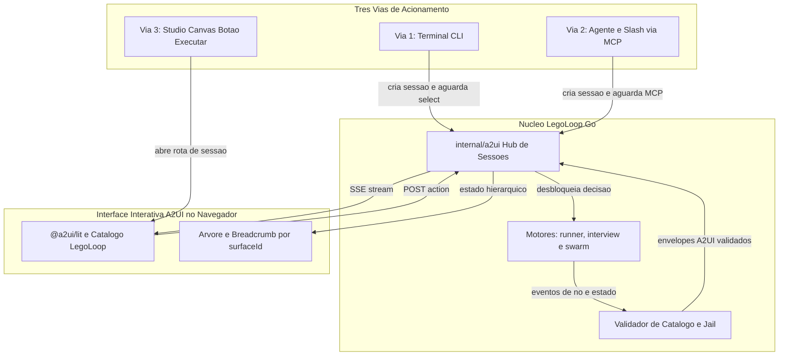

# 📋 SPEC: Motor Único de Interface Declarativa A2UI nas 3 Vias do LegoLoop

> **Status:** Aprovado pelo Usuário (Stop-Gate 02)  
> **Data:** 2026-11-22  
> **Versão:** 1.0.0  
> **Autor:** Antigravity AI + Usuário (Fusão Addy Osmani + Matt Pocock + AIDD-Spec)  
> **Iniciativa:** Interface Interativa A2UI do LegoLoop (Fase 1: Piloto `legoloop-concepcao` · Fase 2: Unificação do Swarm)  
> **Referência da Intenção:** [docs/intents/2026-11-22_INTENT_APLICAR_A2UI_NO_LEGOLOOP_STUDI.md](../intents/2026-11-22_INTENT_APLICAR_A2UI_NO_LEGOLOOP_STUDI.md)  
> **Alvo Primário:** `internal/a2ui` (novo), `internal/studio`, `internal/runner`, `internal/interview`, `internal/mcp`, `cmd/legoloop`  
> **Consome:** INTENT aprovada (`status: APPROVED`) · **Produz:** PLAN e ROUTE  
> **Template:** TEMPLATE_SPEC.md v2.0.0  

---

## 1. Premissas Técnicas Assumidas (Addy Osmani)

> [!IMPORTANT]
> A IA lista abaixo todas as premissas técnicas adotadas para evitar decisões silenciosas. Alerte no Stop-Gate 02 caso alguma premissa esteja incorreta:
1. **Runtime Go sem dependências externas novas no `go.mod`:** todo o backend (`internal/a2ui`, sessão SSE, `POST /action`, validação de catálogo e corrida `stdin` vs. HTTP) usa apenas a biblioteca padrão do Go e pacotes internos existentes (`internal/studio`, `internal/runner`, `internal/interview`, `internal/mcp`, `internal/jail`).
2. **Frontend offline embutido via `go:embed`:** os pacotes `@a2ui/lit` e `@a2ui/web_core` (versão exata v0.9 ou v1.0 conferida no `README.md` do pacote instalado, sem escrever protocolo de memória conforme `a2ui/SKILL.md`) são empacotados em um bundle estático versionado dentro de `internal/studio/static/components/` e servidos pelo `staticFS` (`internal/studio/server.go:37`), sem exigir acesso à internet em runtime.
3. **Segurança e transporte loopback:** todas as rotas da sessão A2UI passam pelo middleware `s.secure(mux)` de `internal/studio/server.go:118` (loopback `127.0.0.1`, Host allowlist, mesma origem, limite de corpo e sanitização). Nenhum HTML bruto ou `<script>` vindo de payloads de agentes é injetado no DOM.
4. **Reuso dos motores existentes:** reaproveitamos integralmente `internal/interview` (sessões `intv_*`, confiança, lacunas e Espelho Canônico), `internal/studio` (SSE de `pecas.go` e `swarm_api.go`, `staticFS`, tokens CSS de `style.css`), `internal/mcp` (padrão de espera bloqueante semelhante a `swarm_wait`) e `internal/jail` (leitura segura de artefatos para o visualizador).
5. **Fallback textual universal:** qualquer falha de conexão SSE, modo `--non-interactive`, ausência de navegador ou payload A2UI inválido degrada automaticamente para o fluxo textual existente sem travar o Terminal (CLI) nem o Chat.
6. **Entrega em 2 fases seguras:** a Fase 1 (Épicos 01 a 05) entrega o motor A2UI nas 3 vias e o piloto `legoloop-concepcao` mantendo `swarm.js`/`swarm.css` intactos; a Fase 2 (Épico 06) migra o monitoramento do Swarm para superfície A2UI, prova paridade por testes e só então remove a UI antiga do Swarm (preservando o backend `swarm_api.go` e `legoloop swarm`).

---

## 2. Fronteiras de Ação & Regras de Governança (Boundaries — Addy Osmani)

O Processo e os agentes devem respeitar estritamente o sistema de fronteiras em 3 níveis:
* **Sempre Fazer:**
  * Desenvolver via TDD estrito (teste unitário falhando antes do código de produção).
  * Manter funções pequenas, enxutas e de responsabilidade única (`≤ 35 linhas`, verificado por `go run ./tools/funclen internal`).
  * Validar rigorosamente todos os inputs JSON A2UI contra a lista branca de componentes do catálogo antes de emitir pelo SSE ou renderizar.
  * Validar caminhos de artefatos exibidos no visualizador exclusivamente via `internal/jail` (sem `..` nem escape fora da raiz do projeto).
  * Tratar caminhos de forma compatível com Windows, Linux e macOS (`filepath.Join` / `filepath.ToSlash`).
  * Recompilar o binário ao final de qualquer ticket que altere Go (`go build -o bin/legoloop.exe ./cmd/legoloop`).
* **Perguntar Antes:**
  * Adicionar qualquer nova dependência externa no `go.mod`.
  * Alterar contratos existentes de `POST /api/run`, `POST /api/interview/*` ou `GET /api/swarm/*` que quebrem clientes atuais.
  * Remover `swarm.js` e `swarm.css` antes de todos os critérios de paridade do Épico 06 passarem.
  * Modificar regras globais no `AGENTS.md`.
* **Nunca Fazer:**
  * Criar funções vazias com `TODO`, `pass` ou mocks simulados em código de produção (Lei #1: Zero Stubs). Dublês de teste ficam em `_test.go`, apenas nas bordas (E/S, LLM, relógio).
  * Aceitar HTML bruto, `innerHTML` não sanitizado, `eval()` ou componente fora do catálogo permitido em mensagens A2UI.
  * Usar `alert()`, `confirm()` ou emojis em código de frontend do Studio (`internal/studio/emojis_test.go`).
  * Escrever nomes de mensagens A2UI de memória sem conferir a documentação da versão instalada de `@a2ui/lit` e `@a2ui/web_core`.
  * Commitar arquivos temporários, segredos ou variáveis de ambiente no git.

---

## 3. Visão Geral, Arquitetura & Costuras de Teste (Test Seams — Pocock)

O motor único A2UI opera como um **barramento de sessão interativa** (`internal/a2ui`) hospedado no servidor local do Studio (`internal/studio`). Toda execução de Processo — disparada via CLI (`legoloop exec` / `legoloop run` / `legoloop fabricar entrevista`), via Agente de IA / Slash Command (MCP `legoloop`) ou via botão Executar do Studio — cria ou anexa-se a uma sessão `sess_<id>` com URL `http://127.0.0.1:<porta>/sessao/<id>`.

O motor traduz eventos estruturados do `runner` (nós do DAG, `progresso.json`, `subprocesso`), do `interview.Engine` (perguntas, confiança, lacunas, Espelho Canônico) e do Swarm (`swarm_api.go`) em envelopes A2UI validados por catálogo, enviados via SSE (`GET /api/sessao/{id}/stream`). Cada processo ou subprocesso escreve em seu próprio `surfaceId` hierárquico (ex: `proc:fabricar:concepcao:entrevista`), garantindo isolamento e navegação por árvore/breadcrumb. Ações do usuário na interface retornam via `POST /api/sessao/{id}/action`, desbloqueando o canal Go onde a CLI, o `runner` ou a ferramenta MCP aguarda (em corrida com `stdin` na CLI).

### Diagrama de Fronteiras (Mermaid)



### Costuras de Teste (Test Seams — Pocock)
* **Costura Primária (Highest Seam):** `(*studio.Server).Handler()` (HTTP `httptest.ResponseRecorder` / `httptest.NewServer`) acoplado a `a2ui.Hub` injetado e motores reais (`interview.Engine` com cliente LLM dublê de borda, `runner` com DAG de teste em `t.TempDir()`).
* **Justificativa:** Exercita todo o ciclo real (autenticação loopback `s.secure`, criação de sessão, stream SSE, validação do catálogo A2UI, isolamento de `surfaceId`, envio de `POST /action`, corrida com entrada textual e leitura segura de artefatos) sem depender de navegador real nos testes unitários.
* **Costuras Secundárias:**
  * `a2ui.ValidateEnvelope(env Envelope, catalog Catalog) error` (função pura de validação e rejeição de componentes/atributos hostis).
  * `a2ui.AwaitAction(ctx context.Context, uiCh <-chan Action, stdin io.Reader) (Action, error)` (função pura para provar a corrida entre `stdin` e navegador sem flakiness).
  * `a2ui.BuildConcepcaoSurface(state interview.TurnState) ([]Envelope, error)` (tradução determinística do estado do piloto `legoloop-concepcao` para superfícies A2UI).
* **Dublês Permitidos (somente nas bordas):** cliente LLM do `interview.Engine`, `io.Reader` simulando `stdin`, relógio e diretório temporário (`t.TempDir()`). Nunca dublê do `a2ui.Hub` nem do validador de catálogo.

---

## 4. Contratos de Dados & Schemas Formais

```go
// Contrato formal do pacote internal/a2ui: tipos, erros sentinela e validação.
package a2ui

import (
	"errors"
	"regexp"
	"strings"
)

var (
	ErrSessaoNaoEncontrada = errors.New("a2ui: sessão não encontrada")
	ErrSurfaceIDInvalido   = errors.New("a2ui: surface_id inválido")
	ErrComponenteProibido  = errors.New("a2ui: componente fora do catálogo confiável")
	ErrPayloadHostil       = errors.New("a2ui: conteúdo executável ou HTML bruto proibido")
	ErrAcaoInvalida        = errors.New("a2ui: ação de usuário inválida")
)

var surfaceIDPattern = regexp.MustCompile(`^[a-zA-Z0-9._:/-]{1,128}$`)

// Envelope encapsula uma mensagem do protocolo A2UI associada a uma superfície isolada.
type Envelope struct {
	SessionID   string         `json:"session_id"`
	SurfaceID   string         `json:"surface_id"`
	ParentID    string         `json:"parent_surface_id,omitempty"`
	ProtocolVer string         `json:"protocol_version"` // "v0.9" ou "1.0"
	MessageType string         `json:"message_type"`     // createSurface, updateComponents, updateDataModel, deleteSurface
	Components  []ComponentRef `json:"components,omitempty"`
	DataModel   map[string]any `json:"data_model,omitempty"`
	FallbackTxt string         `json:"fallback_text,omitempty"`
}

// ComponentRef referencia um componente declarado no catálogo confiável.
type ComponentRef struct {
	ID    string         `json:"id"`
	Kind  string         `json:"kind"` // catálogo básico A2UI ou domínio LegoLoop (LegoDagGraph, LegoProgressMeter, LegoStopGateCard, LegoArtifactViewer, LegoLogStream, LegoSwarmBoard)
	Props map[string]any `json:"props,omitempty"`
}

// Action representa a resposta do usuário enviada via POST /api/sessao/{id}/action ou stdin.
type Action struct {
	SessionID string         `json:"session_id"`
	SurfaceID string         `json:"surface_id"`
	Origin    string         `json:"origin"` // "ui" | "stdin" | "mcp"
	Name      string         `json:"name"`   // ex: "submit_answer", "stop_gate_decision", "swarm_post"
	Payload   map[string]any `json:"payload,omitempty"`
}

// Validate valida o envelope antes de qualquer emissão SSE.
func (e Envelope) Validate(permitidos map[string]bool) error {
	if strings.TrimSpace(e.SessionID) == "" || !surfaceIDPattern.MatchString(e.SurfaceID) {
		return ErrSurfaceIDInvalido
	}
	for _, c := range e.Components {
		if !permitidos[c.Kind] {
			return ErrComponenteProibido
		}
		if contemPadraoHostil(c.Props) {
			return ErrPayloadHostil
		}
	}
	return nil
}
```

### Rotas HTTP e Ferramentas MCP (Contratos Públicos)
* `GET /sessao/{id}`: entrega a página HTML estática do Cockpit A2UI (`go:embed`, design system do Studio, bundle `@a2ui/lit`).
* `POST /api/sessao`: cria sessão interativa e devolve `{ "session_id", "url", "stream_url", "action_url" }`.
* `GET /api/sessao/{id}/stream`: stream SSE (`text/event-stream`) emitindo envelopes `a2ui.Envelope` validados e snapshot inicial para reconexão.
* `POST /api/sessao/{id}/action`: recebe `a2ui.Action`, valida `session_id`/`surface_id` e entrega ao canal de espera da sessão (HTTP 202) ou retorna HTTP 400/404.
* `GET /api/sessao/{id}/artefato?path=<rel>`: lê artefato da sessão protegido por `internal/jail` (rejeita `..` e caminhos fora da raiz com HTTP 403).
* Ferramentas MCP no `legoloop mcp-router`: `sessao_criar` (devolve `session_id` e `url`), `sessao_publicar` (publica envelope A2UI validado) e `sessao_aguardar` (aguarda `Action` com timeout e fallback textual).

---

## 5. Critérios Binários de Aceite por Nó / Ticket (BDD)

> [!NOTE]
> Cada critério `AC-XX` é mecanicamente verificável via teste unitário, integração HTTP ou comando de terminal (`exit code == 0`).

### Épico 01 — Núcleo de Sessão Interativa & Validador A2UI (`internal/a2ui`)

* [ ] `AC-E01.1`: **Criação de sessão, publicação SSE e recebimento de ação**
  * **Dado que:** Um `studio.Server` com `a2ui.Hub` inicializado e catálogo padrão carregado.
  * **Quando:** Um cliente chama `POST /api/sessao`, conecta em `GET /api/sessao/{id}/stream`, publica um envelope `createSurface` válido e envia `POST /api/sessao/{id}/action`.
  * **Então:** O SSE recebe o evento `createSurface` com `session_id` e `surface_id` exatos, o `POST /action` retorna HTTP 202 e o canal de espera recebe a `Action` idêntica em menos de 100ms.
* [ ] `AC-E01.2`: **Rejeição de componente fora do catálogo e payload hostil (caminho de falha)**
  * **Dado que:** Um envelope contendo componente `"RawHTML"` fora do catálogo ou propriedade contendo `"<script>alert(1)</script>"` ou `"javascript:"`.
  * **Quando:** `Envelope.Validate` ou `Hub.Publish` é invocado.
  * **Então:** Retorna `ErrComponenteProibido` ou `ErrPayloadHostil`, nenhum evento é transmitido no SSE e nenhum erro não tratado ocorre.
* [ ] `AC-E01.3`: **Snapshot de reconexão em stream SSE**
  * **Dado que:** Uma sessão já recebeu 2 envelopes (`createSurface` e `updateDataModel`) antes de o navegador abrir a URL.
  * **Quando:** O navegador conecta em `GET /api/sessao/{id}/stream`.
  * **Então:** O servidor envia imediatamente o snapshot consolidado das superfícies ativas antes dos novos eventos em tempo real.

### Épico 02 — Renderizador `@a2ui/lit`, Design System LegoLoop & Catálogo de Domínio (`internal/studio/static/`)

* [ ] `AC-E02.1`: **Bundle offline embutido e servido sem dependência de internet**
  * **Dado que:** O binário compilado com `go:embed` e o servidor rodando em loopback.
  * **Quando:** Um cliente solicita `GET /sessao/sess_teste` e os assets do bundle `@a2ui/lit` em `/components/`.
  * **Então:** Todas as respostas retornam HTTP 200, zero referências a CDNs externas (`https://cdn`, `unpkg`, `jsdelivr`) existem no HTML/JS e `emojis_test.go` passa sem falhas.
* [ ] `AC-E02.2`: **Registro dos componentes de domínio com Design System do Studio**
  * **Dado que:** O cockpit carregando `style.css` e o registro de catálogo LegoLoop sobre `@a2ui/lit`.
  * **Quando:** O teste de contrato frontend (`static_test.go` / `ui_logic_test.go`) verifica o registro do catálogo.
  * **Então:** Os componentes `LegoDagGraph`, `LegoProgressMeter`, `LegoStopGateCard`, `LegoArtifactViewer` e `LegoLogStream` estão registrados com tokens CSS do Studio e zero uso de `innerHTML` bruto ou `alert()`/`confirm()`.
* [ ] `AC-E02.3`: **Leitura segura de artefatos no `LegoArtifactViewer` (caminho de falha)**
  * **Dado que:** Uma sessão ativa e uma requisição `GET /api/sessao/{id}/artefato?path=../../etc/passwd` (ou caminho absoluto fora da raiz).
  * **Quando:** O handler valida o caminho via `internal/jail`.
  * **Então:** Retorna HTTP 403 e nenhum byte do arquivo fora da raiz é exposto.

### Épico 03 — Macroprocessos, Isolamento por `surfaceId` e Árvore/Breadcrumb

* [ ] `AC-E03.1`: **Hierarquia de superfícies em nós `subprocesso`**
  * **Dado que:** Um macroprocesso `proc:fabricar` que dispara um nó `subprocesso` `proc:fabricar:concepcao`.
  * **Quando:** Ambos publicam envelopes com `parent_surface_id: "proc:fabricar"` no filho.
  * **Então:** O estado da sessão mantém os dois `DataModel` isolados (atualizar um não altera o outro) e o endpoint de estado retorna a árvore pai/filho e o breadcrumb ordenado `["proc:fabricar", "proc:fabricar:concepcao"]`.
* [ ] `AC-E03.2`: **Foco automático quando um subprocesso dispara Stop-Gate**
  * **Dado que:** O usuário visualizando a superfície raiz `proc:fabricar` enquanto `proc:fabricar:concepcao` emite um `LegoStopGateCard`.
  * **Quando:** O evento chega ao `Hub`.
  * **Então:** O evento marca `requires_attention: true` na superfície filha e o estado da sessão sinaliza o foco pendente no Stop-Gate até a ação de decisão ser enviada.
* [ ] `AC-E03.3`: **Rejeição de `surface_id` malformado (caminho de falha)**
  * **Dado que:** Um envelope com `surface_id` vazio ou contendo espaços/`../`.
  * **Quando:** `Hub.Publish` é chamado.
  * **Então:** Retorna `ErrSurfaceIDInvalido` e não altera nenhuma superfície existente.

### Épico 04 — Integração nas 3 Vias (Terminal CLI, Agente/Slash via MCP e Studio Canvas)

* [ ] `AC-E04.1`: **Via 1 (CLI) — Corrida `stdin` vs. Navegador (`AwaitAction`)**
  * **Dado que:** `a2ui.AwaitAction` aguardando simultaneamente entrada em `stdin` e no canal HTTP `uiCh`.
  * **Quando:** Em um subteste chega uma ação via `uiCh` primeiro e no outro chega texto via `stdin` primeiro.
  * **Então:** Em ambos os casos a primeira resposta vence imediatamente com `Origin` correto (`"ui"` ou `"stdin"`), sem goroutine leak e sem bloquear a outra entrada.
* [ ] `AC-E04.2`: **Via 2 (MCP `legoloop`) — Ferramentas de sessão interativa**
  * **Dado que:** O `mcp.Router` com ferramentas `sessao_criar`, `sessao_publicar` e `sessao_aguardar`.
  * **Quando:** Um cliente JSON-RPC chama `sessao_criar`, publica um cartão A2UI e envia uma ação HTTP paralela enquanto `sessao_aguardar` espera.
  * **Então:** `sessao_aguardar` retorna o JSON da `Action` com `exit code 0`; se o timeout expirar sem ação, retorna resposta estruturada indicando fallback textual (caminho de falha).
* [ ] `AC-E04.3`: **Via 3 (Studio Canvas) — Botão Executar abre a sessão interativa**
  * **Dado que:** O frontend do Studio (`app.js`) com um DAG carregado.
  * **Quando:** O usuário aciona Executar (`#btn-run`).
  * **Então:** O Studio cria a sessão via `POST /api/sessao`, abre a rota `/sessao/{id}` (ou painel integrado da sessão) preservando retrocompatibilidade dos testes existentes de `POST /api/run`.

### Épico 05 — Projeto Piloto: `legoloop-concepcao` nas 3 Vias

* [ ] `AC-E05.1`: **Fluxo completo da entrevista em A2UI**
  * **Dado que:** Uma sessão de `legoloop-concepcao` com cliente LLM dublê evoluindo confiança `85% -> 95%` e emitindo o Espelho Canônico.
  * **Quando:** A entrevista roda vinculada a uma sessão A2UI.
  * **Então:** O motor emite superfícies contendo `LegoProgressMeter` (confiança e lacunas), formulário de pergunta com palpite editável, cartões do Espelho Canônico, `LegoStopGateCard` (Stop-Gate 01) e `LegoArtifactViewer` exibindo o `INTENT.md` materializado.
* [ ] `AC-E05.2`: **Fallback textual completo do piloto sem navegador (caminho de falha / degradação)**
  * **Dado que:** Execução do `legoloop-concepcao` sem nenhum cliente conectado ao SSE (ou com flag `--non-interactive`/modo texto).
  * **Quando:** O usuário responde apenas via texto/CLI.
  * **Então:** A entrevista conclui normalmente, gera `INTENT.md` e não trava esperando conexão do navegador.

### Épico 06 (Fase 2) — Unificação do Swarm em A2UI & Remoção da UI Antiga

* [ ] `AC-E06.1`: **Superfície `LegoSwarmBoard` alimentada pelo backend real do Swarm**
  * **Dado que:** Uma execução `native_swarm` usando `swarm_api.go` existente.
  * **Quando:** O adaptador Swarm publica estado de workers, quadro de mensagens e progresso na sessão A2UI.
  * **Então:** A superfície `LegoSwarmBoard` exibe workers, mensagens e progresso em tempo real, e `POST /api/sessao/{id}/action` com `name: "swarm_post"` publica mensagem no quadro do Swarm preservando a proteção contra perda de rascunho (`swarm_security_test.go`).
* [ ] `AC-E06.2`: **Remoção controlada da UI web antiga do Swarm após paridade**
  * **Dado que:** `AC-E06.1` verde com paridade funcional comprovada.
  * **Quando:** Os arquivos antigos exclusivos da UI separada do Swarm são removidos e a rota antiga redireciona ou abre a sessão A2UI do Swarm.
  * **Então:** O motor/backend `legoloop swarm` e `swarm_api.go` seguem 100% operacionais, todas as suítes `go test -count=1 ./...` passam com exit code 0 e restam apenas 2 interfaces no LegoLoop (Studio Canvas e Interface Interativa A2UI).

### Critérios Não Funcionais

* [ ] `AC-NF.1`: **Hardening de segurança HTTP e sanitização A2UI**
  * **Dado que:** Requisições com `Host` externo malicioso, `Origin` cruzado ou corpo acima do limite em `/api/sessao/*`.
  * **Quando:** Enviadas ao `(*studio.Server).Handler()`.
  * **Então:** O middleware `s.secure` bloqueia todas com HTTP 403/413, mantendo verdes `security_hardening_test.go` e `swarm_security_test.go`.
* [ ] `AC-NF.2`: **Portabilidade nos 3 SOs e limites de qualidade do repositório**
  * **Dado que:** Todo o código produzido nos Épicos 01 a 06.
  * **Quando:** Executados `go test -count=1 -race ./...`, `go vet ./...`, `go run ./tools/funclen internal`, `gofmt -l .` e `go run ./tools/taxlinter internal cmd loops skills docs/templates`.
  * **Então:** Todos finalizam com exit code 0, saída vazia em `gofmt -l .` e zero alterações não autorizadas em `go.mod`/`go.sum`.
* [ ] `AC-NF.3`: **Zero stubs e zero vazamento de goroutines**
  * **Dado que:** Criação e encerramento de 50 sessões SSE simultâneas em teste automatizado.
  * **Quando:** Todas as conexões SSE são canceladas via `context.CancelFunc`.
  * **Então:** Todas as goroutines de stream encerram em até 500ms e `legoloop espinha verificar` retorna exit code 0.

### Rastreabilidade Requisito para Critério

| R | Requisito (da INTENT aprovada) | AC |
| :--- | :--- | :--- |
| `R1` | Motor central de sessão A2UI (SSE + `POST /action` + validação de catálogo + reconexão) | `AC-E01.1`, `AC-E01.2`, `AC-E01.3`, `AC-NF.1`, `AC-NF.3` |
| `R2` | Renderizador `@a2ui/lit` offline (`go:embed`), Design System LegoLoop e componentes de domínio | `AC-E02.1`, `AC-E02.2`, `AC-E02.3` |
| `R3` | Macroprocessos isolados por `surfaceId` com árvore, breadcrumb e foco em Stop-Gate | `AC-E03.1`, `AC-E03.2`, `AC-E03.3` |
| `R4` | Integração nas 3 vias (CLI corrida `stdin`/UI, MCP no Chat/Slash e botão Executar do Studio) | `AC-E04.1`, `AC-E04.2`, `AC-E04.3` |
| `R5` | Projeto piloto `legoloop-concepcao` nas 3 vias com fallback textual íntegro | `AC-E05.1`, `AC-E05.2` |
| `R6` | Fase 2: unificação do Swarm em A2UI com paridade e remoção da UI antiga do Swarm | `AC-E06.1`, `AC-E06.2` |
| `R7` | Universalidade nos 3 SOs, governança, taxonomia ASD-STE100 e zero regressão | `AC-NF.1`, `AC-NF.2`, `AC-NF.3` |

---

## 6. Comandos Operacionais & Critério de Conclusão Global (Addy Osmani)

### Comandos de Verificação Mecânica
* **Build:** `go build -o bin/legoloop.exe ./cmd/legoloop`
* **Test:** `go test -count=1 ./...` e `go test -count=1 -race ./internal/a2ui/... ./internal/studio/... ./internal/mcp/...`
* **Estática, função e taxonomia:** `go vet ./...`, `gofmt -l .` (saída vazia), `go run ./tools/funclen internal`, `go run ./tools/taxlinter internal cmd loops skills docs/templates` e `legoloop espinha verificar`
* **Dependências intactas:** `git diff --exit-code go.mod go.sum`

### Critério de Done Global
A especificação técnica é considerada **100% CONCLUÍDA** quando:
- [ ] 100% dos critérios binários `AC-E01.1`..`AC-E06.2` e `AC-NF.1`..`AC-NF.3` estiverem marcados como atendidos (`[x]`).
- [ ] Todos os comandos de verificação mecânica passarem com exit code 0 e `gofmt -l .` vazio.
- [ ] O binário `bin/legoloop.exe` recompilar com sucesso e o piloto `legoloop-concepcao` for provado em execução real.
- [ ] Zero stubs, zero arquivos temporários de teste e governança viva atualizada (`AGENTS.md`, `README.md`, `MEMORY.md` e grafo reindexado).

---

🛑 **STOP-GATE 02 DE AUDITORIA HUMANA:**  
*As premissas assumidas, as fronteiras (boundaries), os contratos e os critérios binários (`AC-E01.1`..`AC-E06.2`, `AC-NF.1`..`AC-NF.3`) acima atendem à sua expectativa?*  
*Responda `[1] seguir` (aprova a SPEC para `APPROVED`), `[2] personalizar` (ajusta algum ponto) ou `[0] cancelar`. Somente após a aprovação explícita deve-se gerar o PLAN (`TEMPLATE_PLAN.md`) e a ROUTE (`TEMPLATE_ROUTE.json`).*
