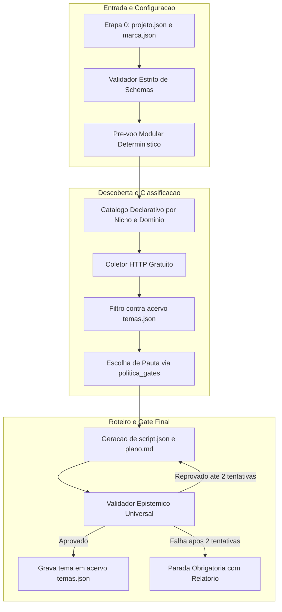

# 📋 SPEC: Processo Canonizado `legoloop-diorama-roteiro` (Ciclo 1 do Macroprocesso)

> **Status:** APPROVED (Stop-Gate 02 aprovado em 2026-11-24)  
> **Data:** 2026-11-24  
> **Versão:** 1.1.0  
> **Autor:** Antigravity AI + Usuário  
> **Referência da Intenção:** [docs/intents/2026-11-24_INTENT_CRIAR_O_PROCESSO_CANONIZADO_LE.md](../intents/2026-11-24_INTENT_CRIAR_O_PROCESSO_CANONIZADO_LE.md)  
> **Alvo Primário:** `internal/diorama/roteiro/`, `internal/cli/diorama_roteiro.go`, `processos/legoloop-diorama-roteiro/`, `skills/legoloop-diorama-roteiro/SKILL.md`  
> **Consome:** INTENT aprovada · **Produz:** PLAN, ROUTE e DAG  
> **Template:** TEMPLATE_SPEC.md v2.2.0  

---

## 1. Premissas Técnicas Assumidas

1. **Runtime:** Go 1.21+ usando apenas a biblioteca padrão e `go.mod` intacto (sem novas dependências externas).
2. **Armazenamento:** Arquivos locais sob Path Jail (`internal/jail`): `projeto.json`, `marca.json`, `fontes_nicho.json`, `script.json`, `plano.md`, `acervo/temas.json` e `acervo/aprendizado.md`.
3. **Comunicação e Segurança:** Requisições HTTP via `net/http` com `User-Agent` explícito, timeout <= 8s, corpo limitado via `io.LimitReader` (10 MB) e lista permitida restrita aos conectores declarados no catálogo.
4. **Reuso Real do Repositório:**
   - `internal/jail`: contenção de caminhos (Path Jail único).
   - `internal/dag`: contrato e validação de DAG v2.
   - `internal/gate`: avaliação determinística de Gates.
   - `internal/processo` e `internal/espinha`: registro e validação 5 de 5.
   - `internal/videorea` / Processo `legoloop-video-rea`: verificação condicional no Cofre quando `video_referencia` estiver preenchido.
   - `internal/redc` / Processo `legoloop-canal-redc`: referência de herança/criação de `marca.json`.

---

## 2. Fronteiras de Ação & Regras de Governança

### Sempre Fazer:
- **TDD estrito:** cada teste unitário falha antes da implementação (Red-Green-Refactor).
- **Funções curtas:** responsabilidade única com no máximo 35 linhas (`go run ./tools/funclen internal`).
- **Validação estrita:** todo JSON decodificado em `struct` tipada + `Validate()` determinístico.
- **Retrocompatibilidade de contrato:** `script.json` mantém o campo `lines[].text` consumido pelo motor e pela síntese de voz.
- **Testes herméticos:** dublês de borda (`httptest.Server`, `t.TempDir()`, relógio injetável) apenas em testes, nunca em produção e nunca tocando `~/.aidd`.
- **Recompilação fresca:** `go build -o bin/legoloop.exe ./cmd/legoloop` ao fechar cada Ticket Go.

### Perguntar Antes:
- Adicionar qualquer dependência externa no `go.mod`.
- Alterar contratos públicos de CLI ou schemas já homologados.
- Alterar regras globais em `AGENTS.md`.

### Nunca Fazer:
- Criar stubs, funções vazias, `TODO` ou mocks simulados em código de produção (Lei #1 e Lei #16).
- Gravar tema em `acervo/temas.json` antes da aprovação do Gate final da Etapa 2.
- Aceitar domínio nível C (fora do catálogo e fora de `fontes_extras`) como prova factual.
- Usar fontes pagas ou violar o limite de 2 tentativas automáticas de correção no Gate final.

---

## 3. Visão Geral, Arquitetura & Costuras de Teste

### Diagrama de Fronteiras



### Costuras de Teste (Test Seams)
- **Costura Primária (`internal/diorama/roteiro/pipeline.go`):**
  ```go
  func (p *Pipeline) Executar(ctx context.Context, opts Opcoes) (*Resultado, error)
  ```
- **Costuras Secundárias:**
  - `internal/diorama/roteiro/schemas.go`: validação de `Projeto`, `Marca`, `CatalogoFontes`, `Script` e consistência cruzada.
  - `internal/diorama/roteiro/prevoo.go`: checagem modular de 5 bloqueantes (`FALTA`) e itens apenas informativos (`AVISO`).
  - `internal/diorama/roteiro/catalogo.go`: seleção de conectores por `perfis_fonte` e classificação fail-closed por domínio (`A`, `B`, `preprint`, `C`).
  - `internal/diorama/roteiro/coletor.go`: coleta HTTP/RSS/JSON com `http.Client` injetável e filtro contra `acervo/temas.json`.
  - `internal/diorama/roteiro/validador.go`: validação das 4 naturezas epistêmicas, laço de no máximo 2 correções e política híbrida de Gates.
  - `internal/diorama/roteiro/acervo.go`: leitura e gravação atômica de `acervo/temas.json` somente pós-Gate aprovado.

---

## 4. Contratos de Dados & Schemas Formais

```go
// internal/diorama/roteiro/schemas.go
package roteiro

type PoliticaGates struct {
	Modo         string   `json:"modo"`                    // "humano" | "mecanico" | "hibrido"
	GatesHumanos []string `json:"gates_humanos,omitempty"` // ex: ["etapa0_config", "etapa1_pauta", "etapa2_roteiro"]
}

type Projeto struct {
	SchemaVersion      int           `json:"schema_version"`
	Slug               string        `json:"slug"`
	Canal              string        `json:"canal"`
	Nicho              string        `json:"nicho"`
	PerfisFonte        []string      `json:"perfis_fonte"`
	FontesExtras       []string      `json:"fontes_extras,omitempty"`
	FontesExcluidas    []string      `json:"fontes_excluidas,omitempty"`
	EstruturaNarrativa string        `json:"estrutura_narrativa"`
	Formatos           []string      `json:"formatos"`
	DuracaoAlvoS       int           `json:"duracao_alvo_s"`
	Voz                string        `json:"voz"`
	EstiloVisual       string        `json:"estilo_visual"`
	Animacao           string        `json:"animacao"`
	PoliticaGates      PoliticaGates `json:"politica_gates"`
	VideoReferencia    string        `json:"video_referencia,omitempty"`
	FlowProjeto        string        `json:"flow_projeto,omitempty"`
}

type Marca struct {
	SchemaVersion int      `json:"schema_version"`
	Nome          string   `json:"nome"`
	Formatos      []string `json:"formatos"`
	Voz           struct {
		Motor      string `json:"motor"`
		Voz        string `json:"voz"`
		Velocidade string `json:"velocidade"`
	} `json:"voz"`
}

type Fonte struct {
	ID       string `json:"id"`
	URL      string `json:"url"`
	Nivel    string `json:"nivel"` // "A" | "B" | "C" (derivado/validado pelo catalogo)
	Entidade string `json:"entidade"`
	Data     string `json:"data"`
}

type LinhaRoteiro struct {
	Text       string   `json:"text"`
	Natureza   string   `json:"natureza"` // "fato_consolidado" | "evidencia_preliminar" | "alegacao_terceiro" | "narrativa_transicao"
	Fontes     []string `json:"fontes,omitempty"`
	Atribuicao string   `json:"atribuicao,omitempty"`
	Escopo     string   `json:"escopo,omitempty"`
	Preprint   bool     `json:"preprint,omitempty"`
	Amostra    string   `json:"amostra,omitempty"`
}

type Script struct {
	SchemaVersion int            `json:"schema_version"`
	Title         string         `json:"title"`
	Idioma        string         `json:"idioma"`
	Estrutura     string         `json:"estrutura"`
	TipoPauta     string         `json:"tipo_pauta"` // "quente" | "perene"
	Sources       []Fonte        `json:"sources"`
	Lines         []LinhaRoteiro `json:"lines"`
}
```

---

## 5. Critérios Binários de Aceite por Épico

### Épico 01: Validação Estrita de Contratos e Pré-voo Modular

* [ ] `AC-E01.1`: **Validação estrita bloqueia schema inválido, campo ausente e inconsistência cruzada**
  * **Dado que:** um par `projeto.json` e `marca.json`.
  * **Quando:** executada `ValidarConfiguracao(proj, marca, catalogo)`.
  * **Então:** retorna erro bloqueante (`ErrSchemaInvalido` ou `ErrConsistenciaConfig`) se `nicho` estiver vazio, `perfis_fonte` estiver vazio ou contiver perfil inexistente no catálogo, `politica_gates.modo` for inválido (ou `hibrido` sem `gates_humanos`), ou se `formatos` ou `voz` de `projeto.json` forem incompatíveis com `marca.json`.

* [ ] `AC-E01.2`: **Pré-voo modular bloqueia nos 5 casos `FALTA` antes de qualquer consulta externa**
  * **Dado que:** configuração válida e ambiente simulado por dublês.
  * **Quando:** executado `PreVoo(ctx, cfg)`.
  * **Então:** retorna `Bloqueado == true` e código de erro quando qualquer um dos 5 casos ocorrer: (1) `legoloop version` retorna exit != 0; (2) catálogo `fontes_nicho.json` ausente ou JSON inválido; (3) pasta do projeto ou `acervo/` sem permissão real de leitura/escrita; (4) nenhum conector compatível com `perfis_fonte` responde na sonda HTTP (timeout <= 8s, status 200); (5) `video_referencia` preenchido e `legoloop-video-rea` ausente do Cofre.

* [ ] `AC-E01.3`: **Itens dos Processos 2 e 3 geram apenas `AVISO` no Processo 1**
  * **Dado que:** Chrome CDP porta `9333` fechado e `FFmpeg`, `Chromium`, `edge-tts` ou `gitleaks` ausentes.
  * **Quando:** executado `PreVoo(ctx, cfg)` com os 5 itens obrigatórios saudáveis.
  * **Então:** retorna `Bloqueado == false`, lista os itens ausentes com `Nivel == "AVISO"` e permite avançar.

### Épico 02: Catálogo Declarativo por Domínio, Coletor e Deduplicação

* [ ] `AC-E02.1`: **Classificação fail-closed por domínio e sufixo institucional**
  * **Dado que:** o catálogo declarativo `fontes_nicho.json` e uma lista de URLs.
  * **Quando:** executada `ClassificarFonte(url, nicho, proj, catalogo)`.
  * **Então:** classifica como `A` domínios/sufixos oficiais e científicos declarados (`.gov.br`, `.gov`, `bcb.gov.br`, `cvm.gov.br`, `sec.gov`, `pubmed.ncbi.nlm.nih.gov`, `doi.org`, `who.int`, `ibge.gov.br`, e releases oficiais `github.com` no nicho software/open source); como `B` a imprensa de referência declarada (Reuters, AP, BBC, Bloomberg, CNBC, Folha, Estadão, G1, Valor); marca preprints (`arxiv.org`, `medrxiv.org`, `biorxiv.org`) exigindo `evidencia_preliminar`; e classifica qualquer domínio fora do catálogo e fora de `fontes_extras` como `C` (bloqueado como prova).

* [ ] `AC-E02.2`: **Seleção por `perfis_fonte` e bloqueio de temas repetidos**
  * **Dado que:** `projeto.json` com `perfis_fonte: ["tecnologia"]`, `fontes_excluidas` e `acervo/temas.json` contendo temas já produzidos.
  * **Quando:** executado `ColetarPautas(ctx, proj, catalogo, acervo)`.
  * **Então:** consulta exclusivamente conectores gratuitos aderentes a `perfis_fonte` (mais `fontes_extras`, menos `fontes_excluidas`), nunca consulta fontes de nicho incompatível (ex.: saúde), descarta automaticamente temas já existentes em `acervo/temas.json` e aplica `politica_gates` (`humano`, `mecanico` ou `hibrido`) na escolha da pauta.

### Épico 03: Validação Epistêmica Universal, Retentativa Limitada e Gravação Pós-Gate

* [ ] `AC-E03.1`: **Validação universal das 4 naturezas epistêmicas sem viés jurídico**
  * **Dado que:** um `script.json` contendo linhas de diferentes naturezas.
  * **Quando:** executada `ValidarRoteiro(script, proj, catalogo)`.
  * **Então:** aprova somente se cada linha cumprir sua regra: `fato_consolidado` (>= 1 fonte nível A ou >= 2 fontes nível B distintas); `evidencia_preliminar` (escopo, preprint ou amostra declarados + fonte válida); `alegacao_terceiro` (`atribuicao` não vazia + fonte válida); `narrativa_transicao` (gancho ou pergunta, sem exigência de citação); e rejeita qualquer uso de fonte nível C como prova, retornando relatório estruturado com `linha`, `natureza` e `regra_violada`.

* [ ] `AC-E03.2`: **Limite estrito de 2 correções automáticas e parada obrigatória**
  * **Dado que:** um gerador que devolve roteiro inválido repetidamente no modo `mecanico` ou `hibrido`.
  * **Quando:** executado `Executar(ctx, opts)`.
  * **Então:** executa no máximo 2 chamadas de correção passando apenas o relatório estruturado do validador; persistindo a falha na 3ª verificação, interrompe o Processo com erro `ErrGateRoteiroReprovado`, entrega o relatório completo e **não grava** o tema em `acervo/temas.json`.

* [ ] `AC-E03.3`: **Gravação do tema em `acervo/temas.json` somente após aprovação do Gate final**
  * **Dado que:** `script.json` e `plano.md` aprovados no Gate final da Etapa 2.
  * **Quando:** concluído `Executar(ctx, opts)`.
  * **Então:** grava `script.json`, `plano.md` e registra o tema de forma atômica em `acervo/temas.json`; uma segunda execução com o mesmo tema é bloqueada na Etapa 1.

### Épico 04: CLI, DAG v2, Skill e Canonização 5 de 5

* [ ] `AC-E04.1`: **Integração CLI, DAG validado e compatibilidade com a Espinha Dorsal**
  * **Dado que:** implementação concluída em `internal/diorama/roteiro/` e `internal/cli/diorama_roteiro.go`.
  * **Quando:** executados `legoloop diorama-roteiro --help`, `legoloop validate processos/legoloop-diorama-roteiro/pipeline.dag.json` e `go test -count=1 ./internal/diorama/roteiro/...`.
  * **Então:** todos retornam exit code 0, com funções <= 35 linhas (`funclen`) e taxonomia válida (`taxlinter`).

### Critérios Não-Funcionais

* [ ] `AC-NF.1`: **Desempenho:** execução com 10 temas e 50 fontes sob dublês locais conclui em <= 2s (e timeout HTTP rígido <= 8s por conector em rede real).
* [ ] `AC-NF.2`: **Segurança e Hermeticidade:** corpo HTTP limitado a 10 MB, zero escritas fora do diretório do projeto (`internal/jail`) e zero acesso a `~/.aidd` durante os testes.

---

### Rastreabilidade Requisito para Critério

| R | Requisito da INTENT | Critérios Binários (AC) |
| :--- | :--- | :--- |
| R1 | Configuração guiada + validação estrita de `projeto.json` e `marca.json` | `AC-E01.1` |
| R2 | Pré-voo modular (5 bloqueantes `FALTA` e itens de P2/P3 como `AVISO`) | `AC-E01.2`, `AC-E01.3` |
| R3 | Catálogo declarativo por nicho e classificação fail-closed por domínio | `AC-E02.1`, `AC-E02.2` |
| R4 | Naturezas epistêmicas universais, até 2 correções e gravação pós-Gate | `AC-E03.1`, `AC-E03.2`, `AC-E03.3` |
| R5 | Canonização CLI/DAG/Skill e limites não-funcionais | `AC-E04.1`, `AC-NF.1`, `AC-NF.2` |

---

## 6. Comandos Operacionais & Critério de Conclusão Global

### Comandos de Verificação Mecânica
- **Build:** `go build -o bin/legoloop.exe ./cmd/legoloop`
- **Testes:** `go test -count=1 ./...`
- **Estática:** `go vet ./...`
- **Tamanho de Função:** `go run ./tools/funclen internal`
- **Taxonomia:** `go run ./tools/taxlinter internal cmd loops skills docs/templates`
- **Formatação:** `gofmt -l .` (saída vazia)
- **Dependências:** `git diff --exit-code -- go.mod go.sum`
- **DAG:** `bin/legoloop.exe validate processos/legoloop-diorama-roteiro/pipeline.dag.json`

### Critério de Done Global
A SPEC é considerada **100% CONCLUÍDA** quando:
- [ ] Todos os critérios binários (`AC-E01.1` a `AC-E04.1`) e não-funcionais (`AC-NF.1`, `AC-NF.2`) passam com testes TDD Red-Green.
- [ ] Todos os portões mecânicos acima retornam exit code 0 com `gofmt -l .` vazio.
- [ ] `bin/legoloop.exe` recompilado com sucesso e Processo elevado com `legoloop upgrade` (Score >= 0.85) e fechado com `legoloop fechar`.

---

🛑 **STOP-GATE 02 DE AUDITORIA HUMANA:**
*A SPEC revisada (`v1.1.0`, 11 critérios binários, pacotes reais do LegoLoop e `upstream` intacto) atende integralmente às suas expectativas para avançarmos ao planejamento (`legoloop-planejamento`)?*
