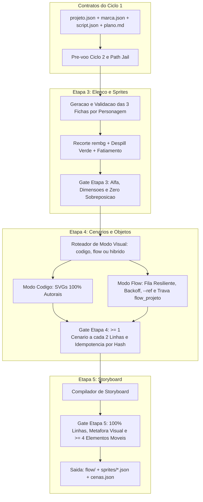

> **Nota de redirecionamento (2026-11-26, AC-E11.4):** o processo `legoloop-diorama-ativos` foi renomeado para `legoloop-video-ativos`. Este documento e historico e mantido sem alteracao de conteudo.


# 📋 SPEC: Processo Canonizado `legoloop-diorama-ativos` (Ciclo 2 — Etapas 3, 4 e 5)

> **Status:** APPROVED (Stop-Gate 02 aprovado em 2026-11-24)  
> **Data:** 2026-11-24  
> **Versão:** 1.1.0  
> **Autor:** Antigravity AI + Usuário  
> **Referência da Intenção:** [docs/intents/2026-11-24_INTENT_LEGOLOOP_DIORAMA_ATIVOS.md](../intents/2026-11-24_INTENT_LEGOLOOP_DIORAMA_ATIVOS.md)  
> **Alvo Primário:** `internal/diorama/ativos/`, `internal/cli/diorama_ativos.go`, `processos/legoloop-diorama-ativos/`, `skills/legoloop-diorama-ativos/SKILL.md`  
> **Consome:** INTENT aprovada · **Produz:** PLAN, ROUTE e DAG  
> **Template:** TEMPLATE_SPEC.md v2.2.0  

---

## 1. Premissas Técnicas Assumidas

1. **Runtime:** Go 1.21+ usando apenas a biblioteca padrão e `go.mod` intacto (sem novas dependências externas).
2. **Armazenamento:** Arquivos locais sob Path Jail (`internal/jail`): leitura imutável de `projeto.json`, `marca.json`, `script.json` e `plano.md` (contratos do Ciclo 1 em `internal/diorama/roteiro`); gravação de `flow/`, `sprites/`, `flow/elenco.json`, `flow/cenarios.json`, `sprites/*.json` e `cenas.json`.
3. **Adaptadores Externos Injetáveis:** Recorte de fundo + despill verde (`RecortadorSprite`, integração `rembg`) e geração Flow (`ClienteFlow`, fila com `--ref` e trava `flow_projeto`) são interfaces Go puras com implementações reais e dublês determinísticos nos testes (100% herméticos e offline).
4. **Reuso Real do Repositório:**
   - `internal/diorama/roteiro`: structs `Projeto`, `Marca`, `Script`, `PoliticaGates` (contrato de entrada imutável).
   - `internal/jail`: contenção de caminhos (Path Jail único).
   - `internal/dag`: contrato e validação de DAG v2.
   - `internal/processo` e `internal/espinha`: registro e validação 5 de 5.

---

## 2. Fronteiras de Ação & Regras de Governança

### Sempre Fazer:
- **TDD estrito:** cada teste unitário falha antes da implementação (Red-Green-Refactor).
- **Cobertura mínima:** `>= 95%` em `internal/diorama/ativos` (`go test -cover ./internal/diorama/ativos/...`).
- **Funções curtas:** responsabilidade única com no máximo 35 linhas (`go run ./tools/funclen internal`).
- **Validação estrita:** todo JSON decodificado em `struct` tipada + `Validar()` determinístico; caminhos sob `internal/jail`.
- **Testes herméticos:** dublês de borda (`t.TempDir()`, relógio/backoff injetável, `RecortadorSprite`, `ClienteFlow`) apenas em `_test.go`, nunca tocando `~/.aidd`.
- **Recompilação fresca:** `go build -o bin/legoloop.exe ./cmd/legoloop` ao fechar cada Ticket Go.

### Perguntar Antes:
- Adicionar qualquer dependência externa no `go.mod`.
- Alterar contratos públicos do Ciclo 1 (`projeto.json`, `marca.json`, `script.json`).
- Alterar regras globais em `AGENTS.md`.

### Nunca Fazer:
- Criar stubs, funções vazias, `TODO` ou mocks simulados em código de produção (Lei #1 e Lei #16).
- Usar código sem licença de `RobbiSkill/`: todo SVG do modo `codigo` é 100% autoral.
- Regerar ativo válido quando o hash de entrada for idêntico (violar idempotência por hash).
- Executar geração Flow sem `flow_projeto` válido (trava obrigatória).

---

## 3. Visão Geral, Arquitetura & Costuras de Teste

### Diagrama de Fronteiras



### Costuras de Teste (Test Seams)
- **Costura Primária (`internal/diorama/ativos/processo.go`):**
  ```go
  func (p *Processo) Executar(ctx context.Context, opts Opcoes) (*Resultado, error)
  ```
- **Costuras Secundárias:**
  - `internal/diorama/ativos/schemas.go`: structs e validação estrita de `FichaPersonagem`, `DescritorSprite`, `BoundingBox`, `Cenario`, `Cena`, `Storyboard`.
  - `internal/diorama/ativos/prevoo.go`: checagem de contratos do Ciclo 1, permissões em `flow/` e `sprites/`, validação do modo visual (`codigo`, `flow`, `hibrido`) e trava `flow_projeto`.
  - `internal/diorama/ativos/elenco.go`: validação das 3 fichas obrigatórias (`turnaround`, `expressoes_3x2`, `poses_6x`), recorte via `RecortadorSprite` (`rembg` + despill), fatiamento e detector de sobreposição de `bounding_box`.
  - `internal/diorama/ativos/cenarios.go`: gerador SVG 100% autoral (modo `codigo`), fila resiliente Flow com retry/backoff, suporte a `--ref`, trava `flow_projeto`, cache/idempotência por hash SHA-256 e Gate de densidade (`>= 1` cenário distinto a cada 2 linhas).
  - `internal/diorama/ativos/storyboard.go`: compilador determinístico de `cenas.json`, validação de 100% das linhas de `script.json`, metáfora visual obrigatória e `>= 4` elementos móveis por linha.

---

## 4. Contratos de Dados & Schemas Formais

```go
package ativos

import "errors"

var (
	ErrPreVooBloqueado      = errors.New("diorama-ativos: pre-voo bloqueado")
	ErrFichaInvalida        = errors.New("diorama-ativos: ficha de elenco invalida")
	ErrSpriteInvalido       = errors.New("diorama-ativos: descritor de sprite invalido")
	ErrSobreposicaoSprite   = errors.New("diorama-ativos: sobreposicao de bounding_box detectada")
	ErrFlowTravaAusente     = errors.New("diorama-ativos: trava flow_projeto obrigatoria")
	ErrDensidadeCenarios    = errors.New("diorama-ativos: densidade insuficiente de cenarios")
	ErrStoryboardInvalido   = errors.New("diorama-ativos: gate de storyboard reprovado")
)

type BoundingBox struct {
	X int `json:"x"`
	Y int `json:"y"`
	W int `json:"w"`
	H int `json:"h"`
}

type FichaPersonagem struct {
	ID                string            `json:"id"`
	Nome              string            `json:"nome"`
	DescricaoImutavel string            `json:"descricao_imutavel"`
	Fichas            map[string]string `json:"fichas"` // obrigatorias: "turnaround", "expressoes_3x2", "poses_6x"
}

type DescritorSprite struct {
	ID           string      `json:"id"`
	PersonagemID string      `json:"personagem_id"`
	Tipo         string      `json:"tipo"` // "pose" | "expressao" | "objeto"
	ArquivoPNG   string      `json:"arquivo_png"`
	Largura      int         `json:"largura"`
	Altura       int         `json:"altura"`
	AlfaValido   bool        `json:"alfa_valido"`
	DespillVerde bool        `json:"despill_verde"`
	BoundingBox  BoundingBox `json:"bounding_box"`
}

type Cenario struct {
	ID          string   `json:"id"`
	Nome        string   `json:"nome"`
	Modo        string   `json:"modo"` // "codigo" | "flow"
	Arquivo     string   `json:"arquivo"`
	HashEntrada string   `json:"hash_entrada"`
	Referencias []string `json:"referencias,omitempty"` // --ref no modo flow
	FlowProjeto string   `json:"flow_projeto,omitempty"`
}

type ElementoMovel struct {
	ID       string `json:"id"`
	Tipo     string `json:"tipo"` // "personagem" | "objeto" | "camera" | "efeito"
	SpriteID string `json:"sprite_id,omitempty"`
	Acao     string `json:"acao"`
}

type Cena struct {
	IndiceLinha     int             `json:"indice_linha"`
	Texto           string          `json:"texto"`
	CenarioID       string          `json:"cenario_id"`
	MetaforaVisual  string          `json:"metafora_visual"`
	ElementosMoveis []ElementoMovel `json:"elementos_moveis"` // minimo 4
}

type Storyboard struct {
	SchemaVersion int    `json:"schema_version"`
	ProjetoSlug   string `json:"projeto_slug"`
	TotalLinhas   int    `json:"total_linhas"`
	Cenas         []Cena `json:"cenas"`
}
```

---

## 5. Critérios Binários de Aceite por Épico

### Épico 01: Pré-voo do Ciclo 2 e Validação de Contratos de Entrada (R1)

* [ ] `AC-E01.1`: **Pré-voo valida contratos do Ciclo 1 e modo visual**
  * **Dado que:** pasta `<projeto>/` contendo `projeto.json`, `marca.json`, `script.json` e `plano.md` válidos, permissões de escrita em `flow/` e `sprites/`, e `estilo_visual` em `{"codigo", "flow", "hibrido"}`.
  * **Quando:** executado `PreVoo(ctx, cfg)`.
  * **Então:** retorna `Bloqueado == false` e aprova o avanço para a Etapa 3.

* [ ] `AC-E01.2`: **Pré-voo bloqueia contrato ausente, modo inválido ou trava `flow_projeto` ausente**
  * **Dado que:** `script.json` ausente/inválido, ou `estilo_visual` inválido, ou `estilo_visual` em `{"flow", "hibrido"}` com `flow_projeto` vazio, ou diretório sem escrita.
  * **Quando:** executado `PreVoo(ctx, cfg)`.
  * **Então:** retorna `Bloqueado == true` e erro tipado (`ErrPreVooBloqueado` ou `ErrFlowTravaAusente`) antes de acionar qualquer gerador.

### Épico 02: Etapa 3 — Fichas de Elenco, `rembg` + Despill e `sprites/*.json` (R2)

* [ ] `AC-E02.1`: **Geração e validação completa de elenco e sprites**
  * **Dado que:** personagens definidos com `id`, `nome`, `descricao_imutavel` e 3 fichas (`turnaround`, `expressoes_3x2`, `poses_6x`), processados por `RecortadorSprite` (`rembg` + despill verde).
  * **Quando:** executada a Etapa 3.
  * **Então:** grava `flow/elenco.json` e `sprites/*.json` com todos os atributos obrigatórios (`id`, `personagem_id`, `tipo`, `arquivo_png`, `largura`, `altura`, `alfa_valido: true`, `despill_verde: true`, `bounding_box` válida) e sem sobreposição.

* [ ] `AC-E02.2`: **Gate da Etapa 3 bloqueia violações de contrato**
  * **Dado que:** ficha obrigatória ausente, ou `alfa_valido == false`, ou `largura`/`altura` abaixo do mínimo (`64px`), ou dois sprites com `bounding_box` sobrepostas na mesma folha.
  * **Quando:** executada a validação da Etapa 3.
  * **Então:** bloqueia o avanço retornando `ErrFichaInvalida`, `ErrSpriteInvalido` ou `ErrSobreposicaoSprite`.

### Épico 03: Etapa 4 — Cenários e Objetos (`codigo`, `flow`, `hibrido`), Backoff e Idempotência (R3)

* [ ] `AC-E03.1`: **Modo `codigo` gera SVGs 100% autorais sem dependência externa**
  * **Dado que:** `estilo_visual == "codigo"` e `script.json` com `N` linhas.
  * **Quando:** executada a Etapa 4.
  * **Então:** gera arquivos `.svg` válidos e 100% autorais em `flow/` e registra `flow/cenarios.json` com `>= ceil(N/2)` cenários distintos, sem chamar `ClienteFlow`.

* [ ] `AC-E03.2`: **Modo `flow` e `hibrido` usam fila resiliente com retry/backoff, `--ref` e trava `flow_projeto`**
  * **Dado que:** `estilo_visual` em `{"flow", "hibrido"}`, `flow_projeto` preenchido e `ClienteFlow` que falha transitoriamente nas 2 primeiras tentativas e sucede na 3ª.
  * **Quando:** executada a Etapa 4.
  * **Então:** aplica backoff exponencial, envia `flow_projeto` e referências `--ref` em cada chamada, conclui com sucesso e bloqueia com `ErrDensidadeCenarios` se o resultado tiver menos de 1 cenário distinto a cada 2 linhas.

* [ ] `AC-E03.3`: **Idempotência por hash SHA-256**
  * **Dado que:** uma segunda execução da Etapa 4 com a mesma entrada e ativos já válidos em disco.
  * **Quando:** executada novamente a Etapa 4.
  * **Então:** detecta `hash_entrada` idêntico e **não** regera o ativo (zero novas chamadas ao `ClienteFlow` ou reescrita desnecessária).

### Épico 04: Etapa 5 — Storyboard, `cenas.json` e Política de Stop-Gates (R4)

* [ ] `AC-E04.1`: **Compilação de `cenas.json` cobrindo 100% das linhas com metáfora e `>= 4` elementos móveis**
  * **Dado que:** `script.json` com `N` linhas, elenco e cenários validados.
  * **Quando:** executada a Etapa 5.
  * **Então:** grava `cenas.json` com exatamente `N` cenas (`indice_linha` de `0` a `N-1`), cada uma vinculada a um `cenario_id` existente, com `metafora_visual` não vazia e `len(elementos_moveis) >= 4`.

* [ ] `AC-E04.2`: **Gate da Etapa 5 bloqueia lacuna de cobertura, metáfora vazia ou `< 4` elementos móveis**
  * **Dado que:** storyboard com linha faltante, `cenario_id` inexistente, `metafora_visual` vazia ou `< 4` elementos móveis.
  * **Quando:** executada `ValidarStoryboard(sb, script, cenarios)`.
  * **Então:** retorna `ErrStoryboardInvalido` listando a linha e a regra violada.

* [ ] `AC-E04.3`: **Política de gates herdada de `projeto.json`**
  * **Dado que:** `projeto.json` com `politica_gates.modo` igual a `humano`, `mecanico` ou `hibrido` (com `gates_humanos` selecionando `etapa3_elenco`, `etapa4_quadros_teste` ou `etapa5_storyboard`).
  * **Quando:** executado `Processo.Executar(ctx, opts)`.
  * **Então:** para exatamente nos Stop-Gates configurados como humanos, devolvendo estado auditável de retomada, e executa direto no modo `mecanico`.

### Épico 05: CLI, DAG v2, Skill, Cobertura `>= 95%` e Fechamento 5 de 5 (R5)

* [ ] `AC-E05.1`: **Integração CLI, DAG v2 e compatibilidade com a Espinha Dorsal**
  * **Dado que:** implementação concluída em `internal/diorama/ativos/`, `internal/cli/diorama_ativos.go`, `processos/legoloop-diorama-ativos/` e `skills/legoloop-diorama-ativos/SKILL.md`.
  * **Quando:** executados `legoloop diorama-ativos --help`, `legoloop validate processos/legoloop-diorama-ativos/pipeline.dag.json` e `legoloop espinha verificar`.
  * **Então:** todos retornam exit code 0, com funções `<= 35` linhas (`funclen`) e taxonomia válida (`taxlinter`).

### Critérios Não-Funcionais

* [ ] `AC-NF.1`: **Cobertura de testes `>= 95%`:** `go test -cover ./internal/diorama/ativos/...` reporta cobertura total `>= 95.0%`, com suíte 100% hermética e determinística (`<= 2s`).
* [ ] `AC-NF.2`: **Segurança e Path Jail:** zero leituras/escritas fora da pasta do projeto (`internal/jail`), zero código de `RobbiSkill/` e zero acesso a `~/.aidd`.

---

### Rastreabilidade Requisito para Critério

| R | Requisito da INTENT | Critérios Binários (AC) |
| :--- | :--- | :--- |
| R1 | Pré-voo do Ciclo 2 e validação de contratos do Ciclo 1 | `AC-E01.1`, `AC-E01.2` |
| R2 | Etapa 3: 3 fichas por personagem, `rembg`+despill, `sprites/*.json` sem sobreposição | `AC-E02.1`, `AC-E02.2` |
| R3 | Etapa 4: modos `codigo`/`flow`/`hibrido`, backoff, `--ref`, trava `flow_projeto`, densidade e idempotência | `AC-E03.1`, `AC-E03.2`, `AC-E03.3` |
| R4 | Etapa 5: `cenas.json` 100% linhas, metáfora visual, `>= 4` elementos móveis e `politica_gates` | `AC-E04.1`, `AC-E04.2`, `AC-E04.3` |
| R5 | CLI, DAG v2, Skill, cobertura `>= 95%`, Path Jail e fechamento 5 de 5 | `AC-E05.1`, `AC-NF.1`, `AC-NF.2` |

---

## 6. Comandos Operacionais & Critério de Conclusão Global

### Comandos de Verificação Mecânica
- **Build:** `go build -o bin/legoloop.exe ./cmd/legoloop`
- **Testes e Cobertura:** `go test -count=1 -cover ./internal/diorama/ativos/...` e `go test -count=1 ./...`
- **Estática:** `go vet ./...`
- **Tamanho de Função:** `go run ./tools/funclen internal`
- **Taxonomia:** `go run ./tools/taxlinter internal cmd loops skills docs/templates`
- **Formatação:** `gofmt -l .` (saída vazia)
- **Dependências:** `git diff --exit-code -- go.mod go.sum`
- **Espinha e Fechamento:** `bin/legoloop.exe espinha verificar` e `bin/legoloop.exe fechar "legoloop-diorama-ativos"`

### Critério de Done Global
A SPEC é considerada **100% CONCLUÍDA** quando:
- [ ] Todos os critérios binários (`AC-E01.1` a `AC-E05.1`) e não-funcionais (`AC-NF.1`, `AC-NF.2`) passam com testes TDD Red-Green.
- [ ] Cobertura em `internal/diorama/ativos` `>= 95%`.
- [ ] Todos os portões mecânicos retornam exit code 0 com `gofmt -l .` vazio.
- [ ] `bin/legoloop.exe` recompilado, instalado e fechado 5 de 5 com `legoloop fechar`.

---

🛑 **STOP-GATE 02 DE AUDITORIA HUMANA:**  
*A SPEC `v1.1.0` (13 critérios binários, 5 Épicos, contratos formais e cobertura >= 95%) atende integralmente às suas expectativas para avançarmos ao planejamento (`PLAN`, `ROUTE` e `DAG`)?*
