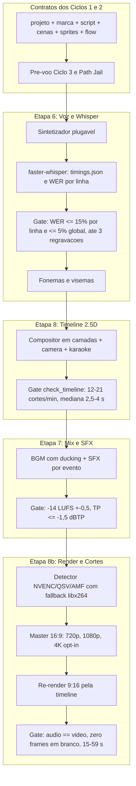

# 📋 SPEC: Processo Canonizado `legoloop-diorama-render` (Ciclo 3 — Etapas 6, 7, 8 e 8b)

> **Status:** APPROVED (Stop-Gate 02 aprovado em 2026-11-25)  
> **Data:** 2026-11-25  
> **Versão:** 1.4.0  
> **Emenda 3 (2026-11-25, TICK-DR-04.2):** elimina o risco de o pico final cair exatamente no teto de `-1,5 dBTP`: o normalizador mira `-2,0 dBTP`, o arquivo final é medido por `ebur128` (independente do `loudnorm`) e, se reprovar, refaz com mais margem (`AC-E04.5`, FMEA F13). Solicitada pelo usuário ("risco zero").  
> **Emenda 2 (2026-11-25, TICKs DR-03.1 a 03.3):** esclarece o `AC-E03.5` (texto do roteiro, tempo do Whisper) e registra as premissas 11 a 13, que são decisões de projeto minhas e aguardam veto do usuário.  
> **Emenda 1 (2026-11-25, TICK-DR-02.2):** o gate de WER passa de `<= 5%` por linha para `<= 15%` por linha e `<= 5%` global (`AC-E02.3`, `AC-E02.4`, novo `AC-E02.7`); a regravação para quando o áudio regravado é idêntico ao anterior. Motivo: prova real com `edge-tts` e `faster-whisper` (achados A1 e A2 em `docs/progress/2026-11-25_plan-legoloop-diorama-render/achados.md`). Aprovada pelo usuário ao seguir a recomendação.  
> **Referência da Intenção:** [docs/intents/2026-11-25_INTENT_LEGOLOOP_DIORAMA_RENDER.md](../intents/2026-11-25_INTENT_LEGOLOOP_DIORAMA_RENDER.md)  
> **Alvo Primário:** `internal/diorama/render/`, `internal/cli/diorama_render.go`, `processos/legoloop-diorama-render/`, `skills/legoloop-diorama-render/SKILL.md`, `internal/videomotion/loudness.go` (correção do teto de True Peak)  
> **Consome:** INTENT aprovada · **Produz:** PLAN, ROUTE e DAG  
> **Template:** TEMPLATE_SPEC.md v2.2.0  

---

## 1. Premissas Técnicas Assumidas

1. **Runtime:** Go 1.21+ só com biblioteca padrão; `go.mod` intacto. Ferramentas externas (`ffmpeg`, `ffprobe`, `faster-whisper`, `edge-tts`) entram por interfaces injetáveis.
2. **Armazenamento:** Path Jail (`internal/jail`). Leitura imutável de `projeto.json`, `marca.json`, `script.json`, `cenas.json`, `sprites/*.json` e `flow/` (contratos dos Ciclos 1 e 2). Gravação em `audio/`, `data/`, `timeline.json`, `renders/` e `renders/shorts/`.
3. **Configuração do Ciclo 3 sem tocar o schema do Ciclo 1:** `render.json` opcional na pasta do projeto (`resolucoes`, `bgm`, `sfx_catalogo`, `reprovas_wer_max`). Ausência usa os padrões: master 16:9 em 1080p, `reprovas_wer_max = 3`.
4. **Provedor de voz plugável:** `marca.json` `voz.motor` seleciona o adaptador (`edge-tts` padrão; `gemini`, `elevenlabs`, `fishaudio` e outros registráveis). `voz.voz` escolhe a voz. Sem voz declarada, o padrão é `pt-BR-ThalitaMultilingualNeural`. O `diorama-demo` declara `pt-BR-AntonioNeural` e essa escolha prevalece.
5. **Formatos:** o master 16:9 sempre é gerado (a timeline é composta em 16:9). `projeto.formatos` acrescenta derivados (`9:16`, `1:1`). O `diorama-demo` declara só `9:16`; o master 16:9 é gerado mesmo assim.
6. **Ordem de execução (confirmada no turno 6):** Etapa 6, Etapa 8 (timeline), Etapa 7 (mix com SFX nos eventos da timeline), render 8b. Títulos seguem a numeração do pedido.
7. **Reuso real do repositório:**
   - `internal/diorama/roteiro`: `Projeto`, `Marca`, `VozMarca`, `Script`, `LinhaRoteiro`.
   - `internal/diorama/ativos`: `Cena`, `Storyboard`, `ElementoMovel`, `DescritorSprite`, `BoundingBox`.
   - `internal/videomotion`: `ParseLoudnormOutput`, `LoudnessMetrics`, `CalculateVerticalCrop` e `CropWindow.ToFFmpegFilter`.
   - `internal/jail`, `internal/dag`, `internal/processo`, `internal/espinha`.
8. **Achado corrigido (autorizado no Stop-Gate 02):** `videomotion.BuildLoudnormFilter` usa `TP=-1.5`, mas `ValidateLoudnessConformity` só barra True Peak acima de `-1.0`. O Ticket `TICK-DR-04.1` corrige o teto para `-1,5` em `internal/videomotion/loudness.go` com TDD (`AC-E04.4`), e o gate do Ciclo 3 reutiliza essa função. Fonte única do teto, sem gate duplicado. Os testes existentes já usam TP `-1.5` e continuam válidos.
9. **Harmonia entre documentos (Stop-Gate 02):** a configuração do Ciclo 3 vive em `render.json`, nunca em `projeto.json`. O Espelho foi emendado de `projeto.json` para `render.json`.
10. **Medição real do WER (Emenda 1):** com 17 palavras, um único erro de escuta do Whisper dá 5,9% e reprovaria o limite de 5% por linha. O `edge-tts` é determinístico (duas sínteses, 245.454 bytes cada), então regravar a mesma linha não muda o áudio. Por isso o limite por linha é 15%, o limite global é 5% (erros totais sobre palavras totais) e a regravação para ao devolver áudio idêntico.
11. **Composição (TICK-DR-03.1, decisões a vetar):** quadro base 1920x1080; narrador a 65% da largura; sprite com 70% da altura mantendo a proporção; nas falas `alegacao_terceiro` e `evidencia_preliminar` a pose troca pela expressão do mesmo personagem, quando existe; a câmera vem da ação do storyboard (`zoom`, `shake`, `pan` ou `estatica`).
12. **Segmentação (TICK-DR-03.2, decisões a vetar):** alvo de 3,25 s por batida; corte na fronteira de palavra mais próxima do ponto ideal, com desvio máximo de 35% do passo; a câmera alterna `pan` e `zoom` nas batidas ímpares da mesma fala; o gate `check_timeline` mede cortes por minuto como número de batidas sobre os minutos de duração.
13. **Legendas (TICK-DR-03.3, decisões a vetar):** a legenda mostra o texto do roteiro, e o Whisper só dá o tempo, porque ele pode ouvir errado ("atingir" no lugar de "atingiu"); o alinhamento usa distância de edição por palavra; as palavras de karaokê ficam na camada `legenda` de cada batida; o SRT tem um bloco por batida, 42 caracteres por linha e duas linhas equilibradas.
14. **Mixagem (TICK-DR-04.2, decisões a vetar):** a mixagem usa `voice.wav` em estéreo pleno (`pan`, sem a atenuação de 3 dB do `-ac 2`), BGM com `sidechaincompress` sob a fala, SFX por evento com `adelay` e `loudnorm` em duas passadas. Medição real no `voice.wav` do demo: alvo de pico `-1,5` entrega `-1,5 dBTP` finais, sem folga; alvo `-2,0` entrega `-14,0 LUFS` e `-2,0 dBTP`. Por isso a margem de 0,5 dB (Emenda 3). O `loudnorm` desloca os timestamps de saída em 28 ms: o corte exato da duração é por amostra (`apad` e `atrim=end_sample`), nunca por `-t`, que descartaria 28 ms de áudio válido (medido no demo).
15. **Eventos de SFX e ativos sonoros (TICK-DR-04.2, decisões a vetar):** `troca_cena` na primeira batida e em cada troca de cenário; `movimento_objeto` 0,25 s depois do início da primeira batida de cada fala que tem adereços; `destaque` nas batidas com câmera `shake`. O catálogo vem de `render.json` (`sfx_catalogo`, `bgm`); sem ele, o pacote sintetiza SFX e BGM próprios com `ffmpeg` em `audio/sfx/` e `audio/bgm.wav`, sem uso de material de terceiros. Arquivos: `sfx.go`, `ativos_sonoros.go`, `mix.go`.
16. **Nível do BGM (TICK-DR-04.2, achado do usuário):** o BGM sintético soava 46 dB abaixo da voz. O padrão passa a `bgm_ganho_db = +3` (faixa −40 a +12, em `render.json`) com ducking `threshold 0.04, ratio 6, release 600 ms`. Medido: −20,5 dB na fala e −12,2 dB nas pausas. Trilha própria em `bgm` exige ajustar `bgm_ganho_db` (ex.: −14).

---

## 2. Fronteiras de Ação & Regras de Governança

### Sempre Fazer:
- **TDD estrito:** cada teste falha antes da implementação (Red-Green-Refactor).
- **Cobertura mínima:** `>= 95%` em `internal/diorama/render`.
- **Funções curtas:** máximo de 35 linhas (`go run ./tools/funclen internal`).
- **Validação estrita:** todo JSON em `struct` tipada com `Validar()`; caminhos sob `internal/jail`.
- **Testes herméticos:** dúblês de borda (`Sintetizador`, `Transcritor`, `Codificador`, `Sondador`, relógio) só em `_test.go`.
- **Chaves de API:** lidas de variável de ambiente e nunca gravadas em artefato.
- **Recompilação fresca:** `go build -o bin/legoloop.exe ./cmd/legoloop` ao fechar cada Ticket Go.

### Perguntar Antes:
- Adicionar dependência ao `go.mod`.
- Alterar contratos dos Ciclos 1 e 2. A correção do True Peak em `internal/videomotion` já foi autorizada.
- Alterar regras globais em `AGENTS.md`.

### Nunca Fazer:
- Stubs, funções vazias, `TODO` ou mocks em código de produção (Leis #1 e #16).
- Código do `RobbiSkill/`: o motor é autoral.
- Chamar provedor pago sem passar pelo gate de créditos.
- Usar timestamps nativos do provedor: o alinhamento vem sempre do `faster-whisper`.
- Usar visão computacional no 9:16.

---

## 3. Visão Geral, Arquitetura & Costuras de Teste

### Diagrama de Fronteiras



### Costuras de Teste (Test Seams)
- **Costura Primária (`internal/diorama/render/processo.go`):**
  ```go
  func (p *Processo) Executar(ctx context.Context, opts Opcoes) (*Resultado, error)
  ```
- **Costuras Secundárias:**
  - `schemas.go`: `ConfigRender`, `Timings`, `Timeline`, `CamadaItem`, `EventoSFX`, `RelatorioRender` com `Validar()`.
  - `prevoo.go`: contratos, cobertura 100% de `script.json` por `cenas.json`, existência de `sprite_id` em `sprites/`, adaptador de voz registrado, `ffmpeg` e `faster-whisper` disponíveis, gate de créditos.
  - `voz.go`: interface `Sintetizador`, registro de provedores, adaptador `edge-tts`, adaptadores pagos atrás do gate de créditos.
  - `whisper.go`: interface `Transcritor`, cálculo de WER por linha e global, `timings.json`, ciclo de regravação das linhas reprovadas.
  - `visemas.go`: mapeamento determinístico de fonemas PT-BR para visemas simples.
  - `timeline.go`: compositor de camadas, câmera, troca de pose/expressão, segmentação em batidas e `check_timeline`.
  - `legendas.go`: karaokê palavra a palavra e `legenda.srt`.
  - `mix.go`: BGM, ducking, SFX por evento, `loudnorm` em duas passadas e gate de loudness.
  - `encoder.go`: sonda de encoders, escolha com fallback, argumentos do ffmpeg por resolução.
  - `vertical.go`: cálculo de janela 9:16 por bounding box e área segura da legenda.

---

## 4. Contratos de Dados & Schemas Formais

```go
package render

import "errors"

var (
	ErrPreVooBloqueado   = errors.New("diorama-render: pre-voo bloqueado")
	ErrProvedorDesconhecido = errors.New("diorama-render: provedor de voz nao registrado")
	ErrCreditosNegados   = errors.New("diorama-render: gate de creditos negou chamada paga")
	ErrWERAcimaLimite    = errors.New("diorama-render: WER acima do limite")
	ErrTimelineRitmo     = errors.New("diorama-render: timeline fora do ritmo")
	ErrLoudnessReprovado = errors.New("diorama-render: loudness fora do alvo")
	ErrRenderInvalido    = errors.New("diorama-render: render reprovado")
	ErrCorteVertical     = errors.New("diorama-render: corte 9:16 reprovado")
)

type ConfigRender struct {
	SchemaVersion   int      `json:"schema_version"`
	Resolucoes      []string `json:"resolucoes"`        // "720p" | "1080p" | "4k"; padrao ["1080p"]
	BGM             string   `json:"bgm,omitempty"`
	SFXCatalogo     string   `json:"sfx_catalogo,omitempty"`
	ReprovasWERMax  int      `json:"reprovas_wer_max"`  // padrao 3
}

type PalavraTempo struct {
	Texto    string  `json:"texto"`
	InicioS  float64 `json:"inicio_s"`
	FimS     float64 `json:"fim_s"`
}

type LinhaTempo struct {
	IndiceLinha int            `json:"indice_linha"`
	InicioS     float64        `json:"inicio_s"`
	FimS        float64        `json:"fim_s"`
	WER         float64        `json:"wer"`
	Regravacoes int            `json:"regravacoes"`
	Palavras    []PalavraTempo `json:"palavras"`
	Visemas     []VisemaTempo  `json:"visemas"`
}

type Timings struct {
	SchemaVersion int          `json:"schema_version"`
	Provedor      string       `json:"provedor"`
	Voz           string       `json:"voz"`
	WERGlobal     float64      `json:"wer_global"`
	Linhas        []LinhaTempo `json:"linhas"`
}

type CamadaItem struct {
	ID        string      `json:"id"`
	Camada    string      `json:"camada"` // "cenario" | "aderecos" | "sprite" | "efeito" | "legenda"
	Profundidade int      `json:"profundidade"`
	SpriteID  string      `json:"sprite_id,omitempty"`
	Caixa     BoundingBox `json:"caixa"`
}

type Batida struct {
	IndiceLinha int          `json:"indice_linha"`
	InicioS     float64      `json:"inicio_s"`
	FimS        float64      `json:"fim_s"`
	CenarioID   string       `json:"cenario_id"`
	Camera      string       `json:"camera"` // "zoom" | "pan" | "shake" | "estatica"
	Camadas     []CamadaItem `json:"camadas"`
	SFX         []EventoSFX  `json:"sfx,omitempty"`
}

type Timeline struct {
	SchemaVersion int      `json:"schema_version"`
	DuracaoS      float64  `json:"duracao_s"`
	Batidas       []Batida `json:"batidas"`
}

type EventoSFX struct {
	Tipo    string  `json:"tipo"` // "troca_cena" | "movimento_objeto" | "destaque"
	TempoS  float64 `json:"tempo_s"`
	Arquivo string  `json:"arquivo"`
}

type RelatorioRender struct {
	Encoder       string             `json:"encoder"`      // ex.: "h264_nvenc" ou "libx264"
	ProvedorVoz   string             `json:"provedor_voz"`
	LUFS          float64            `json:"lufs"`
	TruePeakDBTP  float64            `json:"true_peak_dbtp"`
	Renders       map[string]string  `json:"renders"`      // resolucao/formato -> caminho
	Shorts        []string           `json:"shorts"`
}
```

---

## 5. Critérios Binários de Aceite por Épico

### Épico 01: Pré-voo do Ciclo 3 e Contratos de Entrada (R1)

* [ ] `AC-E01.1`: **Pré-voo aprova projeto válido**
  * **Dado que:** pasta com `projeto.json`, `marca.json`, `script.json`, `cenas.json` (100% das linhas), todos os `sprite_id` existentes em `sprites/`, `voz.motor` registrado, `ffmpeg` e `faster-whisper` disponíveis e `render.json` válido ou ausente.
  * **Quando:** executado `PreVoo(ctx, cfg)`.
  * **Então:** retorna `Bloqueado == false`.

* [ ] `AC-E01.2`: **Pré-voo bloqueia cada violação com erro tipado**
  * **Dado que:** `cenas.json` com menos linhas que `script.json`, ou `sprite_id` inexistente, ou `voz.motor` não registrado, ou ferramenta ausente, ou `render.json` com resolução fora de `{720p, 1080p, 4k}`.
  * **Quando:** executado `PreVoo`.
  * **Então:** retorna `ErrPreVooBloqueado` ou `ErrProvedorDesconhecido` e nenhum adaptador é acionado.

### Épico 02: Etapa 6 — Voz Neural, Whisper e Visemas (R2)

* [ ] `AC-E02.1`: **Síntese por provedor plugável gera áudio por linha**
  * **Dado que:** `Sintetizador` registrado e `script.json` com `N` linhas.
  * **Quando:** executada a Etapa 6.
  * **Então:** grava `audio/voice.wav` com as `N` linhas em ordem e registra provedor e voz em `data/timings.json`.

* [ ] `AC-E02.2`: **Troca de provedor não altera o contrato**
  * **Dado que:** dois `Sintetizador` distintos, um deles sem timestamps nativos.
  * **Quando:** executada a Etapa 6 com cada um.
  * **Então:** ambos produzem `timings.json` com o mesmo schema, alinhado pelo `Transcritor` e ignorando timestamps nativos.

* [ ] `AC-E02.3`: **Gate de WER por linha (`<= 15%`) com regravação seletiva**
  * **Dado que:** `Transcritor` que devolve WER `> 15%` para a linha 2 nas 2 primeiras tentativas e `<= 15%` na 3ª, e linha com WER entre 5% e 15% que passa sem regravação.
  * **Quando:** executada a Etapa 6.
  * **Então:** regrava só a linha 2, mantém as demais intactas e grava `regravacoes: 2` na linha 2.

* [ ] `AC-E02.4`: **Esgotadas as regravações, ou áudio idêntico, o gate bloqueia**
  * **Dado que:** linha com WER `> 15%` após `reprovas_wer_max` regravações, ou cuja regravação devolve áudio idêntico ao anterior.
  * **Quando:** executada a Etapa 6.
  * **Então:** retorna `ErrWERAcimaLimite` citando a linha e o WER medido; no caso de áudio idêntico para na 2ª síntese, sem repetir as demais; nada é gravado em `audio/` nem em `data/`.

* [ ] `AC-E02.5`: **Provedor pago exige gate de créditos**
  * **Dado que:** adaptador marcado como pago e `GateCreditos` negando.
  * **Quando:** executada a Etapa 6.
  * **Então:** retorna `ErrCreditosNegados` e a síntese não é chamada.

* [ ] `AC-E02.7`: **Gate de WER global (`<= 5%`)**
  * **Dado que:** todas as linhas com WER `<= 15%`, e `Transcritor` cujo total de erros de palavra dividido pelo total de palavras de referência é `> 5%`.
  * **Quando:** executada a Etapa 6.
  * **Então:** retorna `ErrWERAcimaLimite` citando o WER global; com global `<= 5%` grava `wer_global` em `data/timings.json`.

* [ ] `AC-E02.6`: **Visemas determinísticos**
  * **Dado que:** `timings.json` com palavras alinhadas.
  * **Quando:** executado `GerarVisemas`.
  * **Então:** cada palavra recebe visemas contidos em `[inicio_s, fim_s]`, em ordem crescente e reproduzíveis byte a byte em duas execuções.

### Épico 03: Etapa 8 — Timeline 2.5D, Câmera e Karaokê (R3)

* [ ] `AC-E03.1`: **Composição em camadas ordenadas por profundidade**
  * **Dado que:** `cenas.json`, `script.json`, `sprites/*.json` e `timings.json` válidos.
  * **Quando:** executada a Etapa 8.
  * **Então:** grava `timeline.json` em que cada batida tem camadas `cenario`, `aderecos`, `sprite`, `efeito` e `legenda` com `profundidade` estritamente crescente.

* [ ] `AC-E03.2`: **Leitura estrita de entrada**
  * **Dado que:** `cenas.json` com campo desconhecido, ou `indice_linha` duplicado, ou `cenario_id` sem arquivo em `flow/`.
  * **Quando:** executada a Etapa 8.
  * **Então:** retorna erro tipado e não grava `timeline.json`.

* [ ] `AC-E03.3`: **Troca de pose/expressão e efeitos de câmera**
  * **Dado que:** elementos móveis `gesto_enfatiza`, `travelling_suave` e `particulas_profundidade`, e sprites `pose` e `expressao` do mesmo personagem.
  * **Quando:** executada a Etapa 8.
  * **Então:** a batida referencia o `sprite_id` correto, a câmera é `zoom`, `pan` ou `shake` conforme a `acao`, e na falta de sprite de expressão mantém a pose sem falhar.

* [ ] `AC-E03.4`: **Segmentação em batidas e gate de ritmo**
  * **Dado que:** linhas longas do `diorama-demo` (6 linhas, alvo de 45 s).
  * **Quando:** executado `check_timeline`.
  * **Então:** a timeline tem de 12 a 21 cortes por minuto e mediana de batida entre 2,5 s e 4 s; fora disso retorna `ErrTimelineRitmo` com a métrica violada.

* [ ] `AC-E03.5`: **Legenda karaokê e SRT**
  * **Dado que:** `timings.json` válido e `script.json`.
  * **Quando:** gerada a legenda.
  * **Então:** cada palavra do **roteiro** realça exatamente no tempo alinhado pelo Whisper, uma vez só (o texto vem do roteiro, o tempo vem do Whisper); `renders/legenda.srt` cobre todas as linhas com blocos ordenados, sem sobreposição e com no máximo 42 caracteres por linha.

### Épico 04: Etapa 7 — Mixagem, Ducking, SFX e Loudness (R4)

* [ ] `AC-E04.1`: **BGM com ducking sob a narração**
  * **Dado que:** `audio/voice.wav`, BGM e `timings.json`.
  * **Quando:** montada a mixagem.
  * **Então:** o grafo de filtros aplica ducking sobre a BGM enquanto há fala e grava `audio/soundtrack.wav`.

* [ ] `AC-E04.2`: **SFX sincronizados aos eventos da timeline**
  * **Dado que:** `timeline.json` com eventos `troca_cena` e `movimento_objeto`.
  * **Quando:** montada a mixagem.
  * **Então:** cada evento gera um SFX em `tempo_s` com erro `<= 40 ms`, e evento sem arquivo no catálogo bloqueia com erro tipado.

* [ ] `AC-E04.3`: **Gate de loudness EBU R128**
  * **Dado que:** métricas medidas pelo `loudnorm` em duas passadas.
  * **Quando:** executado o gate.
  * **Então:** reutiliza `videomotion.ValidateLoudnessConformity(m, -14, 0.5)`; aprova com LUFS integrado em `-14 ± 0,5` e True Peak `<= -1,5 dBTP`; reprova com `ErrLoudnessReprovado` se LUFS sair da faixa ou se o True Peak ficar acima de `-1,5`, inclusive em `-1,2`.

* [ ] `AC-E04.4`: **Teto de True Peak corrigido em `videomotion`**
  * **Dado que:** `LoudnessMetrics` com `OutputTruePeakDBFS` igual a `-1.2` e LUFS `-14.0`.
  * **Quando:** executado `videomotion.ValidateLoudnessConformity(m, -14.0, 0.5)`.
  * **Então:** retorna `ErrLoudnessConformityFailed`; com `-1.5` retorna `nil`; o teste novo falha antes da correção (Red) e a suíte `go test ./internal/videomotion/...` segue verde.

* [ ] `AC-E04.5`: **Margem de pico e verificação independente do arquivo final**
  * **Dado que:** uma mixagem a normalizar e `TruePeakTetoDBTP = -1,5`.
  * **Quando:** executada a normalização da Etapa 7.
  * **Então:** o alvo de pico do `loudnorm` é o teto menos 0,5 dB (`-2,0 dBTP`); o arquivo final é medido por `ebur128` com `peak=true`, medição independente da previsão do `loudnorm`; se a medição violar `-14 ± 0,5 LUFS` ou `<= -1,5 dBTP`, refaz com mais 0,5 dB de margem de pico e compensa o LUFS medido, até 3 tentativas; esgotadas, retorna `ErrLoudnessReprovado` e **nada é gravado** (`audio/soundtrack.wav`, `timeline.json` e `data/mix.json` ficam como estavam); com sucesso, `data/mix.json` registra LUFS, True Peak, tentativas e eventos de SFX; o `soundtrack.wav` tem exatamente `round(duração × 48000)` amostras, diferença zero em relação à timeline; as gravações são em lote (temporários e renomeação), sem estado parcial.

### Épico 05: Etapa 8b — Render Multiformato e Cortes 9:16 (R5)

* [ ] `AC-E05.1`: **Escolha de encoder com fallback**
  * **Dado que:** `Sondador` que lista `h264_nvenc`, ou só `h264_qsv`, ou só `h264_amf`, ou nenhum.
  * **Quando:** escolhido o encoder.
  * **Então:** seleciona o de hardware disponível por essa ordem (NVENC, QSV, AMF) e `libx264` quando nenhum existe; se o encoder de hardware falhar na execução, repete com `libx264`; o encoder usado vai para `RelatorioRender.Encoder`.

* [ ] `AC-E05.2`: **Master 16:9 em 720p, 1080p e 4K**
  * **Dado que:** `ConfigRender.Resolucoes` com valores válidos.
  * **Quando:** executado o render.
  * **Então:** grava `renders/v1.mp4` e variantes por resolução pedida (padrão 1080p; 4K só se listado); render existente não é sobrescrito e gera `v2.mp4`.

* [ ] `AC-E05.3`: **Gate de integridade do render**
  * **Dado que:** MP4 gerado.
  * **Quando:** executado o gate.
  * **Então:** exige duração de áudio igual à de vídeo (tolerância 1 frame) e zero frames em branco; violação retorna `ErrRenderInvalido`.

* [ ] `AC-E05.4`: **Cortes 9:16 re-renderizados pela timeline**
  * **Dado que:** `timeline.json` com caixas do narrador e do elemento de ação.
  * **Quando:** gerados os cortes.
  * **Então:** a janela 9:16 contém inteira a caixa do narrador, a legenda fica fora dessa caixa e dentro da área segura, e a saída dura de 15 s a 59 s; fora disso retorna `ErrCorteVertical`.

* [ ] `AC-E05.5`: **Corte sem trecho válido**
  * **Dado que:** timeline mais curta que 15 s.
  * **Quando:** solicitado o corte vertical.
  * **Então:** não grava short e registra o motivo no relatório, sem falhar o render master.

### Épico 06: CLI, DAG v2, Skill, Cobertura e Fechamento 5 de 5 (R6)

* [ ] `AC-E06.1`: **Integração CLI, DAG v2 e Espinha Dorsal**
  * **Dado que:** implementação em `internal/diorama/render/`, `internal/cli/diorama_render.go`, `processos/legoloop-diorama-render/` e `skills/legoloop-diorama-render/SKILL.md`.
  * **Quando:** executados `legoloop diorama-render --help`, `legoloop validate processos/legoloop-diorama-render/processo.dag.json` e `legoloop espinha verificar`.
  * **Então:** todos retornam exit code 0, com `funclen` e `taxlinter` verdes.

* [ ] `AC-E06.2`: **E2E hermético no `diorama-demo`**
  * **Dado que:** `projetos/video-diorama/diorama-demo` com dúblês de borda.
  * **Quando:** executado `Processo.Executar`.
  * **Então:** percorre as Etapas 6, 8, 7 e 8b e grava `timings.json`, `timeline.json`, `soundtrack.wav`, `renders/v1.mp4`, `renders/legenda.srt` e ao menos 1 short, passando em todos os gates.

### Critérios Não-Funcionais

* [ ] `AC-NF.1`: **Cobertura:** `go test -cover ./internal/diorama/render/...` reporta `>= 95.0%`, suíte hermética e determinística (`<= 5 s`).
* [ ] `AC-NF.2`: **Segurança:** zero acesso fora do Path Jail, zero código do `RobbiSkill/`, zero chave de API gravada em artefato (varredura `gitleaks` limpa).
* [ ] `AC-NF.3`: **Determinismo:** duas execuções com mesmas entradas e dúblês produzem `timeline.json` e `timings.json` idênticos byte a byte.

---

## 6. Análise de Modos de Falha (FMEA)

Escala 1 a 10. RPN = Severidade × Ocorrência × Detecção. Acima de 100 exige critério binário dedicado.

| # | Modo de falha | Efeito | S | O | D | RPN | Mitigação | AC |
| :--- | :--- | :--- | :-: | :-: | :-: | :-: | :--- | :--- |
| F1 | Timeline com 6 cenas gera menos de 12 cortes/min | Gate de ritmo reprova o demo | 7 | 9 | 2 | 126 | Segmentar cada linha em batidas por pausas de `timings.json` | `AC-E03.4` |
| F2 | `ValidateLoudnessConformity` do `videomotion` aceita TP até `-1,0` | Plataforma recodifica e distorce | 8 | 6 | 3 | 144 | Corrigir o teto em `videomotion` (TDD) e reutilizá-lo | `AC-E04.3`, `AC-E04.4` |
| F3 | Provedor sem timestamps por palavra | Karaokê e visemas sem base | 8 | 7 | 2 | 112 | Alinhamento sempre pelo `faster-whisper` | `AC-E02.2` |
| F4 | WER alto por números e siglas (`82,9%`, `PIB`) | Regravação em loop | 6 | 8 | 3 | 144 | Limite de 15% por linha e 5% global, limite de regravações, parada em áudio idêntico e erro tipado; `pronuncia.json` aplicado antes da síntese | `AC-E02.3`, `AC-E02.4`, `AC-E02.7` |
| F5 | Encoder de hardware listado mas falha ao executar | Render aborta | 7 | 5 | 3 | 105 | Repetir com `libx264` e registrar o encoder real | `AC-E05.1` |
| F6 | Provedor pago consome créditos sem aval | Custo inesperado | 8 | 3 | 2 | 48 | Gate de créditos antes da chamada | `AC-E02.5` |
| F7 | Janela 9:16 corta o narrador | Corte inutilizável | 7 | 5 | 2 | 70 | Janela calculada pela caixa do narrador e gate de contenção | `AC-E05.4` |
| F8 | Falta de sprite de expressão para a batida | Timeline quebra | 5 | 6 | 2 | 60 | Manter a pose e não falhar | `AC-E03.3` |
| F9 | Dessincronia áudio e vídeo após o ducking | Fala fora da imagem | 8 | 4 | 3 | 96 | Gate de duração e tolerância de SFX | `AC-E05.3`, `AC-E04.2` |
| F10 | `projeto.formatos` só com `9:16` (caso do demo) | Master 16:9 não sai | 5 | 7 | 2 | 70 | Master 16:9 sempre gerado | `AC-E05.2` |
| F11 | Re-render sobrescreve versão anterior | Perda de histórico | 6 | 4 | 2 | 48 | Versão numerada sem sobrescrita | `AC-E05.2` |
| F12 | Chave de API vaza em artefato | Segurança | 10 | 2 | 3 | 60 | Chave só por ambiente e `gitleaks` | `AC-NF.2` |
| F13 | Pico final exatamente no teto (`-1,5`) e reprovado por arredondamento de medição | Entrega bloqueada sem causa real | 8 | 5 | 3 | 120 | Alvo de pico com 0,5 dB de margem, medição independente do arquivo final e refação com mais margem | `AC-E04.5` |

---

### Rastreabilidade Requisito para Critério

| R | Requisito da INTENT | Critérios Binários (AC) |
| :--- | :--- | :--- |
| R1 | Pré-voo e contratos de entrada | `AC-E01.1`, `AC-E01.2` |
| R2 | Etapa 6: voz plugável, Whisper, WER por linha e global, visemas | `AC-E02.1` a `AC-E02.7` |
| R3 | Etapa 8: timeline 2.5D, câmera, karaokê, `check_timeline` | `AC-E03.1` a `AC-E03.5` |
| R4 | Etapa 7: ducking, SFX, `-14 LUFS`, `-1,5 dBTP` | `AC-E04.1` a `AC-E04.5` |
| R5 | Etapa 8b: encoder, 720p/1080p/4K, cortes 9:16 | `AC-E05.1` a `AC-E05.5` |
| R6 | CLI, DAG v2, cobertura, E2E e fechamento 5 de 5 | `AC-E06.1`, `AC-E06.2`, `AC-NF.1` a `AC-NF.3` |

---

## 7. Comandos Operacionais & Critério de Conclusão Global

### Comandos de Verificação Mecânica
- **Build:** `go build -o bin/legoloop.exe ./cmd/legoloop`
- **Testes e Cobertura:** `go test -count=1 -cover ./internal/diorama/render/...`, `go test -count=1 ./internal/videomotion/...` e `go test -count=1 ./...`
- **Estática:** `go vet ./...`
- **Tamanho de Função:** `go run ./tools/funclen internal`
- **Taxonomia:** `go run ./tools/taxlinter internal cmd loops skills docs/templates`
- **Formatação:** `gofmt -l .` (saída vazia)
- **Dependências:** `git diff --exit-code -- go.mod go.sum`
- **Espinha e Fechamento:** `bin/legoloop.exe espinha verificar` e `bin/legoloop.exe fechar "legoloop-diorama-render"`

### Critério de Done Global
- [ ] Todos os critérios `AC-E01.1` a `AC-E06.2` e `AC-NF.1` a `AC-NF.3` passam com TDD Red-Green.
- [ ] Cobertura `>= 95%` em `internal/diorama/render`.
- [ ] Todos os portões mecânicos com exit code 0 e `gofmt -l .` vazio.
- [ ] `bin/legoloop.exe` recompilado e `legoloop fechar` 5 de 5.

---

🛑 **STOP-GATE 02 DE AUDITORIA HUMANA:**  
*A SPEC `v1.4.0` (6 Épicos, 29 critérios binários, FMEA com 13 modos de falha) atende às suas expectativas para avançarmos ao planejamento (`PLAN`, `ROUTE` e `DAG`)?*
