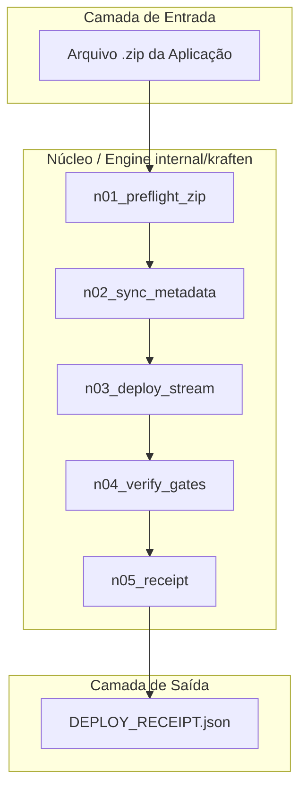

# 📋 SPEC: Transformar pipeline de deploy determinístico do Studio Launcher (`legoloop-kraften-deploy`)

> **Status:** Proposta para Revisão  
> **Data:** 2026-11-26  
> **Versão:** 1.0.0  
> **Autor:** Usuário + Agente (motor `legoloop fabricar spec`)  
> **Referência da Intenção:** [docs/intents/INTENT.md](C:/Users/trcnologia/Desktop/LegoLoop/docs/intents/INTENT.md)  
> **Alvo Primário:** `internal/kraften/` (motor) e `cmd/legoloop` (comando CLI)  
> **Consome:** INTENT aprovada · **Produz:** PLAN e ROUTE  
> **Template:** TEMPLATE_SPEC.md v2.2.0  

---

## 1. Premissas Técnicas Assumidas (Addy Osmani)

1. **Runtime:** Go conforme o `go.mod` atual, tipos nativos, dependências padrão da biblioteca Go (`archive/zip`, `net/http`, `os/exec`, `path/filepath`), sem novas dependências externas de terceiros.
2. **Armazenamento:** Sistema de arquivos local do SO para manipulação do `.zip`, extração anti-zip-slip e gravação de `DEPLOY_RECEIPT.json`.
3. **Comunicação:** Chamadas locais via API REST v4 da Cloudflare e API interna do Studio Launcher, com validação estrita de URLs e timeouts controlados (`context.Context`).
4. **Reuso:** Reaproveitamento dos pacotes internos existentes de motor DAG e utilitários de E/S do LegoLoop, isolando a nova esteira no pacote `internal/kraften/`.

---

## 2. Fronteiras de Ação & Regras de Governança (Boundaries — Addy Osmani)

* **Sempre Fazer:**
  * Desenvolver via TDD estrito (teste unitário falhando antes do código de produção).
  * Manter funções pequenas, enxutas e de responsabilidade única (< 35 linhas).
  * Validar rigorosamente todos os inputs e decodificações de JSON, incluindo caminhos (sem `..`, sem caminho absoluto fora da raiz).
  * Tratar caminhos de forma compatível com Windows e POSIX (`filepath.Join` / `filepath.ToSlash`).
  * Recompilar o binário ao final de qualquer ticket que altere Go (AGENTS.md, regra 5).
* **Perguntar Antes:**
  * Adicionar qualquer nova dependência externa no `go.mod`.
  * Alterar schemas persistidos no disco que possam quebrar retrocompatibilidade.
  * Alterar contratos públicos de CLI, de API do Studio, do DAG do Processo ou de `ROUTE.json`.
  * Modificar regras globais no `AGENTS.md`.
* **Nunca Fazer:**
  * Criar funções vazias com `TODO`, `pass`, `// implementar depois` ou mocks simulados em código de produção (Lei #1: Zero Stubs). Dublês de teste ficam em `_test.go`, apenas nas bordas (E/S, LLM, relógio).
  * Commitar arquivos temporários, segredos ou variáveis de ambiente no git.
  * Ignorar testes falhando ou quebrar a suíte global de testes.
  * Usar `alert()`, `confirm()` ou emojis em frontend (quando houver UI).
  * Mutar o `Dockerfile` original da aplicação durante o deploy.

---

## 3. Visão Geral, Arquitetura & Costuras de Teste (Test Seams — Pocock)

Implementação da esteira determinística `legoloop-kraften-deploy` em `internal/kraften/` contendo 5 nós sequenciais (`n01_preflight_zip`, `n02_sync_metadata`, `n03_deploy_stream`, `n04_verify_gates`, `n05_receipt`), executando extração segura anti-zip-slip, sincronização de CNAME na Cloudflare, build e deploy no Docker Swarm, verificação de gates binários e emissão de recibo JSON sem uso de LLM.

### Diagrama de Fronteiras (Mermaid)



### Costuras de Teste (Test Seams — Pocock)
* **Costura Primária (Highest Seam):** `func ExecutePipeline(ctx context.Context, cfg Config) (Receipt, error)` em `internal/kraften/pipeline.go`.
* **Justificativa:** Centraliza a execução dos 5 nós com injeção de clientes HTTP e sistema de arquivos, evitando acoplamento global e garantindo testes determinísticos isolados.
* **Costuras Secundárias (opcionais):** Validador anti-zip-slip (`ExtractZipSafe`) e gerador de CNAME Cloudflare (`SyncCloudflareDNS`).
* **Dublês Permitidos (somente nas bordas):** Clientes HTTP para Cloudflare e Studio Launcher API, relógio do sistema, sistema de arquivos temporário.

---

## 4. Contratos de Dados & Schemas Formais

```go
// Contrato formal: tipos, erros sentinela e regras de validação.
package kraften

import (
	"errors"
	"strings"
)

var ErrInvalidDeployInput = errors.New("kraften: entrada de deploy inválida ou insegura")

type DeployConfig struct {
	AppID       string `json:"app_id"`
	ZipPath     string `json:"zip_path"`
	Subdomain   string `json:"subdomain"`
	TargetHost  string `json:"target_host"`
}

type DeployReceipt struct {
	AppID     string `json:"app_id"`
	Status    string `json:"status"` // "done" ou "failed"
	Timestamp string `json:"timestamp"`
	CFStatus  int    `json:"cf_status"`
	HTTPCode  int    `json:"http_code"`
}

func (c DeployConfig) Validate() error {
	if strings.TrimSpace(c.AppID) == "" || strings.TrimSpace(c.ZipPath) == "" {
		return ErrInvalidDeployInput
	}
	if strings.Contains(c.ZipPath, "..") {
		return ErrInvalidDeployInput
	}
	return nil
}
```

---

## 5. Critérios Binários de Aceite por Nó / Ticket (BDD)

### Épico 01 — Nó 01 e 02: Preflight Zip Seguro e Sincronização de Metadados

* [ ] `AC-E01.1`: **Extração anti-zip-slip bem-sucedida**
  * **Dado que:** Um arquivo `.zip` contendo `Dockerfile`, `docker-stack.yml` e sem caminhos maliciosos (`..`)
  * **Quando:** O nó `n01_preflight_zip` executa a validação e extração
  * **Então:** Os arquivos são extraídos na pasta de destino sem escapar do diretório raiz e retorna `nil`
* [ ] `AC-E01.2`: **Rejeição de caminho malicioso no zip (Caminho de Falha)**
  * **Dado que:** Um arquivo `.zip` contendo caminhos com `../` (Zip Slip)
  * **Quando:** O nó `n01_preflight_zip` processa o arquivo
  * **Então:** Retorna o erro sentinela `ErrInvalidDeployInput` e aborta a extração
* [ ] `AC-E01.3`: **Rejeição de pacote sem os 3 artefatos universais (Caminho de Falha)**
  * **Dado que:** Um arquivo `.zip` sem `Dockerfile`, sem `docker-stack.yml` na rede `network_conexao`, sem `HEALTHCHECK` ou sem as variáveis padronizadas (`ADMIN_USER`/`ADMIN_PASS`)
  * **Quando:** O nó `n01_preflight_zip` executa a validação
  * **Então:** Retorna o erro sentinela `ErrInvalidDeployInput` e aborta antes de qualquer chamada de rede
* [ ] `AC-E01.4`: **Criação de CNAME Cloudflare (Caminho Feliz)**
  * **Dado que:** Configuração válida de subdomínio e credenciais Cloudflare
  * **Quando:** O nó `n02_sync_metadata` é executado
  * **Então:** A API da Cloudflare registra o CNAME e retorna status HTTP 200/201

### Épico 02 — Nó 03, 04 e 05: Deploy Stream, Verificação de Gates e Recibo

* [ ] `AC-E02.1`: **Execução do Deploy Stream e Verificação de Gates**
  * **Dado que:** O `.zip` validado e metadados sincronizados
  * **Quando:** Os nós `n03_deploy_stream` e `n04_verify_gates` rodam em sequência
  * **Então:** O job retorna `status == "done"`, `CF_OLD=0`, `CF_NEW=1`, `TLS=0`, `HTTP=200`
* [ ] `AC-E02.2`: **Falha de HTTP Gate (Caminho de Falha)**
  * **Dado que:** O serviço implantado responde com HTTP 500
  * **Quando:** O nó `n04_verify_gates` valida o endpoint
  * **Então:** Retorna erro de verificação e interrompe a esteira sem gerar recibo de sucesso
* [ ] `AC-NF.1`: **Integridade do Recibo JSON e Isolamento de Erros**
  * **Dado que:** Todos os 5 nós executados com sucesso
  * **Quando:** O nó `n05_receipt` grava o arquivo no disco
  * **Então:** O arquivo `DEPLOY_RECEIPT.json` é criado estritamente na raiz do projeto com permissões corretas e conteúdo válido em JSON

### Rastreabilidade Requisito para Critério

| R | Requisito | AC |
| :--- | :--- | :--- |
| `Q1` | Pipeline determinístico de 5 nós sem LLM | `AC-E01.1`, `AC-E01.2`, `AC-E01.3`, `AC-E01.4`, `AC-E02.1`, `AC-E02.2`, `AC-NF.1` |

---

## 6. Comandos Operacionais & Critério de Conclusão Global (Addy Osmani)

### Comandos de Verificação Mecânica
* **Build:** `go build -o bin/legoloop.exe ./cmd/legoloop`
* **Test:** `go test -v ./...`
* **Estática e formatação:** `go vet ./...` e `gofmt -l .` (saída vazia).
* **Dependências intactas:** `git diff --exit-code go.mod go.sum`

### Critério de Done Global
A especificação técnica é considerada **100% CONCLUÍDA** quando:
- [ ] 100% dos critérios binários `AC-E{N}.{M}` e `AC-NF.{K}` estiverem marcados como atendidos (`[x]`).
- [ ] O comando de **Test** passar com exit code 0.
- [ ] `go vet ./...` e `gofmt -l .` não reportarem nada.
- [ ] O comando de **Build** recompilar com sucesso o binário `bin/legoloop.exe`.
- [ ] Zero arquivos temporários ou órfãos residuais.

---

🛑 **STOP-GATE 02 DE AUDITORIA HUMANA:**  
*As premissas assumidas, as fronteiras (boundaries), os contratos e os critérios binários acima atendem à sua expectativa?*  
*Somente após a aprovação explícita do usuário, deve-se gerar o PLAN (`TEMPLATE_PLAN.md`) e a ROUTE (`TEMPLATE_ROUTE.json`).*