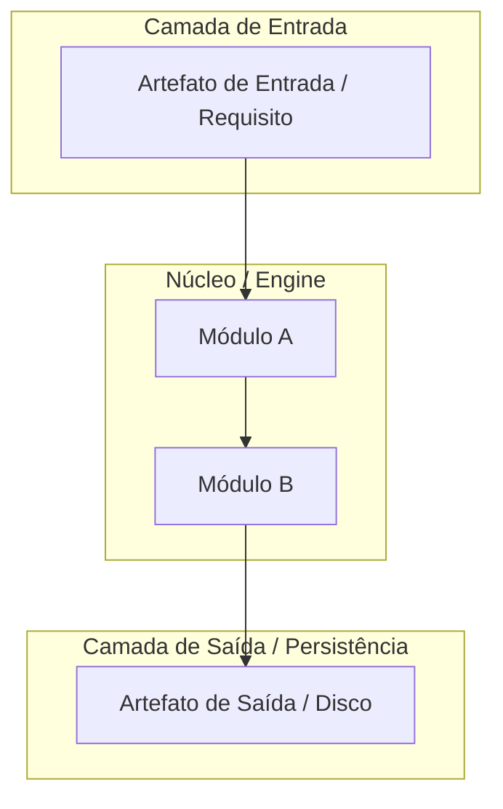

# 📋 SPEC: [Tema da Especificação Técnica]

> **Status:** [Proposta para Revisão | Aprovado pelo Usuário]  
> **Data:** YYYY-MM-DD  
> **Versão:** 1.0.0  
> **Autor:** Antigravity AI + Usuário  
> **Referência da Intenção:** [docs/intents/YYYY-MM-DD_INTENT_NOME.md](file:///C:/Users/trcnologia/Desktop/LegoLoop/docs/intents/YYYY-MM-DD_INTENT_NOME.md)  
> **Alvo Primário:** [Ex: internal/dag, internal/studio, cmd/legoloop]  

---

## 1. Visão Geral & Arquitetura da Solução

[Descrição técnica de alto nível. Explique as fronteiras do sistema, componentes envolvidos, fluxo de dados e decisões fundamentais de design.]

### Diagrama de Fronteiras / Arquitetura (Mermaid)



---

## 2. Contratos de Dados & Schemas Formais

> [!IMPORTANT]
> Todos os tipos, structs e schemas JSON devem ser estritamente tipados e compatíveis com a linguagem alvo. Zero inferências dinâmicas não documentadas.

### 2.1 Tipagem Go / JSON Schema

```go
// Exemplo de tipagem do contrato formal
package modelo

type ContratoExemplo struct {
    ID          string            `json:"id"`
    Nome        string            `json:"nome"`
    Status      string            `json:"status"`
    Metadados   map[string]string `json:"metadados,omitempty"`
}
```

### 2.2 Insumos & Produtos por Épico

| Épico ID | Nome do Épico | Artefatos Consumidos (Inputs) | Artefatos Produzidos (Outputs) |
|---|---|---|---|
| **E01** | [Nome do Épico 01] | `[caminho/arquivo]` | `[caminho/arquivo]` |
| **E02** | [Nome do Épico 02] | `[caminho/arquivo]` | `[caminho/arquivo]` |

---

## 3. Critérios Binários de Aceite por Nó / Ticket (BDD)

> [!NOTE]
> Cada critério `AC-XX` deve ser mecanicamente verificável via teste unitário, asserção ou comando de terminal (`exit code == 0`). Evite critérios subjetivos como "deve ser rápido" ou "deve ser bonito".

### Épico 01 — [Nome do Épico 01]

* [ ] `AC-E01.1`: **[Título do Critério]**
  * **Dado que:** [Estado inicial do sistema / fixtures]
  * **Quando:** [Ação disparada / função invocada]
  * **Então:** [Resultado determinístico esperado e asserções binárias]
* [ ] `AC-E01.2`: **[Título do Critério]**
  * **Dado que:** ...
  * **Quando:** ...
  * **Então:** ...

### Épico 02 — [Nome do Épico 02]

* [ ] `AC-E02.1`: **[Título do Critério]**
  * **Dado que:** ...
  * **Quando:** ...
  * **Então:** ...

---

## 4. Requisitos Não Funcionais & Restrições Inegociáveis

1. **Zero Stubs:** Todas as funções devem possuir implementação real e testada (sem `TODO`, `pass` ou mocks vazios).
2. **Cobertura & TDD:** Toda nova unidade de código deve possuir teste unitário falhando previamente (Red ➔ Green).
3. **Isolamento de Execução:** Execuções de tarefas devem respeitar os modos de isolamento estéril contratados.
4. **Economia de Recursos & Performance:** Execuções pontuais de scripts ou transformações devem rodar com teto de timeout explícito.

---

## 5. Critério de Conclusão Global (Done Definition)

A especificação técnica é considerada **100% ATENDIDA E CONCLUÍDA** quando:
- [ ] 100% dos critérios binários `AC-E{N}.{M}` estiverem marcados como atendidos (`[x]`).
- [ ] Todos os testes automatizados da suíte passarem sem erros (`go test ./...` ou equivalente).
- [ ] O binário da aplicação for recompilado com sucesso: `go build -o bin/legoloop.exe ./cmd/legoloop`.
- [ ] Zero resíduos de arquivos temporários órfãos em diretórios não autorizados.

---

🛑 **STOP-GATE 02 DE AUDITORIA HUMANA:**  
*A SPEC técnica acima descreve com precisão a arquitetura, contratos e critérios binários necessários?*  
*Somente após a aprovação explícita do usuário, deve-se gerar o PLAN (`TEMPLATE_PLAN.md`) e a ROUTE (`TEMPLATE_ROUTE.json`).*
