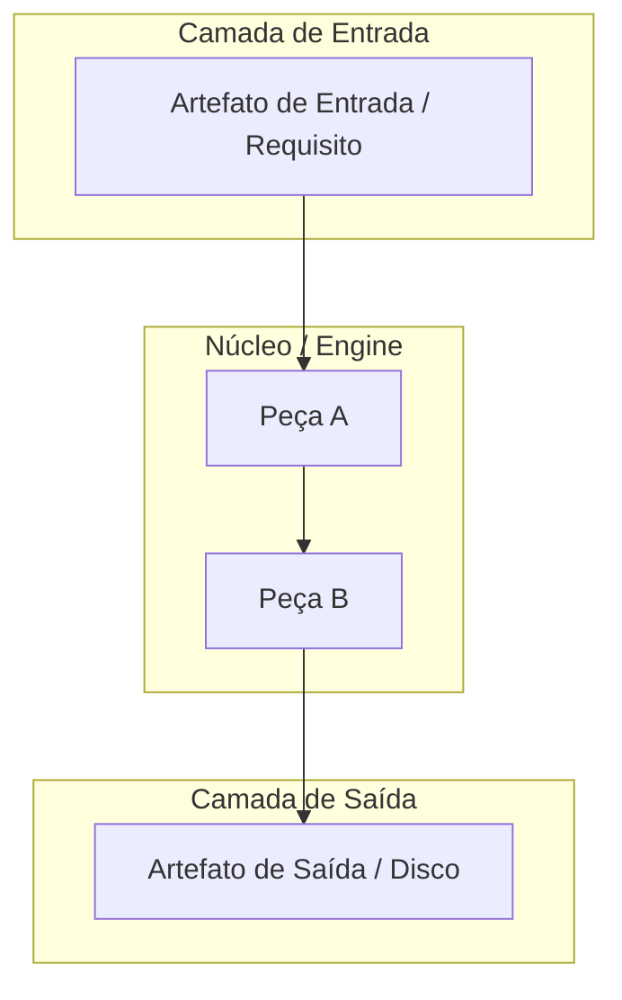

# 📋 SPEC: {{TEMA_DA_ESPECIFICACAO}}

> **Status:** {{Proposta para Revisão | Aprovado pelo Usuário}}  
> **Data:** {{DATA}}  
> **Versão:** {{1.0.0}}  
> **Autor:** {{AUTOR}} (Fusão Addy Osmani + Matt Pocock + AIDD-Spec)  
> **Iniciativa:** {{NOME_OU_ID_DA_INICIATIVA | Opcional para demandas amplas}}  
> **Referência da Intenção:** [docs/intents/{{DATA}}_INTENT_{{NOME}}.md](../intents/{{DATA}}_INTENT_{{NOME}}.md)  
> **Alvo Primário:** {{Ex: internal/dag, internal/studio, cmd/legoloop}}  
> **Consome:** INTENT aprovada · **Produz:** PLAN e ROUTE  
> **Template:** TEMPLATE_SPEC.md v2.0.0  

<!--
GUIA DE PREENCHIMENTO (apague este trecho ao concluir)
- Toda premissa, fronteira, contrato e critério precisa ser verificável. Frase vaga = critério reprovado.
- Antes de escrever contratos e ACs, leia o código existente do alvo: reuse pacotes já presentes em vez de reinventar.
- Em demandas amplas, múltiplos Épicos podem ser agrupados opcionalmente sob uma Iniciativa (ex: I01 — Nome).
- Fechamento: !has_pattern('docs/specs/<arquivo>.md', '\{\{') e has_binary_criteria + has_acceptance_criteria.
-->

---

## 1. Premissas Técnicas Assumidas (Addy Osmani)

> [!IMPORTANT]
> A IA lista abaixo todas as premissas técnicas adotadas para evitar decisões silenciosas. Alerte no Stop-Gate 02 caso alguma premissa esteja incorreta:
1. {{Premissa de runtime — Ex: Go conforme o `go.mod`, tipos nativos, zero dependências externas novas}}
2. {{Premissa de armazenamento — Ex: arquivos locais do SO, sem banco externo}}
3. {{Premissa de comunicação/segurança — Ex: HTTP loopback com Host allowlist, mesma origem e corpo limitado}}
4. {{Premissa de reuso — Ex: quais pacotes internos existentes serão reaproveitados e quais não serão tocados}}

---

## 2. Fronteiras de Ação & Regras de Governança (Boundaries — Addy Osmani)

O Processo e os agentes devem respeitar estritamente o sistema de fronteiras em 3 níveis:
* **Sempre Fazer:**
  * Desenvolver via TDD estrito (teste unitário falhando antes do código de produção).
  * Manter funções pequenas, enxutas e de responsabilidade única (< 35 linhas).
  * Validar rigorosamente todos os inputs e decodificações de JSON, incluindo caminhos (sem `..`, sem caminho absoluto fora da raiz).
  * Tratar caminhos de forma compatível com Windows e POSIX (`filepath.Join` / `filepath.ToSlash`).
  * Recompilar o binário ao final de qualquer ticket que altere Go (AGENTS.md, regra 5).
* **Perguntar Antes:**
  * Adicionar qualquer nova dependência externa no `go.mod`.
  * Alterar schemas persistidos no disco que possam quebrar retrocompatibilidade.
  * Alterar contratos públicos de CLI, de API do Studio, do DAG do Processo ou de `ROUTE.json`.
  * Modificar regras globais no `AGENTS.md`.
* **Nunca Fazer:**
  * Criar funções vazias com `TODO`, `pass`, `// implementar depois` ou mocks simulados em código de produção (Lei #1: Zero Stubs). Dublês de teste ficam em `_test.go`, apenas nas bordas (E/S, LLM, relógio).
  * Commitar arquivos temporários, segredos ou variáveis de ambiente no git.
  * Ignorar testes falhando ou quebrar a suíte global de testes.
  * Usar `alert()`, `confirm()` ou emojis em frontend (quando houver UI).
  * {{NUNCA_ESPECIFICO_DESTA_SPEC}}

---

## 3. Visão Geral, Arquitetura & Costuras de Teste (Test Seams — Pocock)

{{Descrição técnica de alto nível da solução, das fronteiras arquiteturais e do que é reaproveitado do código existente.}}

### Diagrama de Fronteiras (Mermaid)



### Costuras de Teste (Test Seams — Pocock)
* **Costura Primária (Highest Seam):** {{Assinatura exata da função ou interface pública onde a suíte bate para validar o comportamento fim a fim, incluindo as dependências injetáveis.}}
* **Justificativa:** {{Por que esta costura minimiza o acoplamento interno e evita testes frágeis.}}
* **Costuras Secundárias (opcionais):** {{Funções puras ou bordas que merecem teste próprio, como normalização de entrada e parsers.}}
* **Dublês Permitidos (somente nas bordas):** {{Ex: LLM, relógio, sistema de arquivos, rede. Nunca dublê de Peça interna.}}

---

## 4. Contratos de Dados & Schemas Formais

```go
// Contrato formal: tipos, erros sentinela e regras de validação.
package {{pacote}}

import (
	"errors"
	"strings"
)

// ErrInvalido sinaliza entrada que não satisfaz o contrato.
var ErrInvalido = errors.New("{{pacote}}: entrada inválida")

type {{Contrato}} struct {
	ID        string            `json:"id"`
	Nome      string            `json:"nome"`
	Status    string            `json:"status"` // valores permitidos: {{enumere}}
	Metadados map[string]string `json:"metadados,omitempty"`
}

// Validate checa o contrato antes de qualquer E/S.
func (c {{Contrato}}) Validate() error {
	if strings.TrimSpace(c.ID) == "" || strings.TrimSpace(c.Nome) == "" {
		return ErrInvalido
	}
	return nil
}
```

---

## 5. Critérios Binários de Aceite por Nó / Ticket (BDD)

> [!NOTE]
> Cada critério `AC-XX` deve ser mecanicamente verificável via teste unitário, asserção ou comando de terminal (`exit code == 0`). Use valores concretos (tabela de casos) em vez de adjetivos. Cada épico deve ter ao menos um critério de caminho de falha (entrada inválida, erro de E/S, estado já existente).

### Épico 01 — {{NOME_DO_EPICO_01}}

* [ ] `AC-E01.1`: **{{Título do Critério (caminho feliz)}}**
  * **Dado que:** {{Estado inicial do sistema / fixtures concretas}}
  * **Quando:** {{Ação disparada / função invocada}}
  * **Então:** {{Resultado determinístico esperado, com valores exatos e asserções binárias}}
* [ ] `AC-E01.2`: **{{Título do Critério (caminho de falha)}}**
  * **Dado que:** {{Entrada inválida ou falha injetada}}
  * **Quando:** {{Ação disparada}}
  * **Então:** {{Erro esperado (sentinela), nenhum efeito colateral no disco, exit code definido}}

### Épico 02 — {{NOME_DO_EPICO_02}}

* [ ] `AC-E02.1`: **{{Título do Critério}}**
  * **Dado que:** ...
  * **Quando:** ...
  * **Então:** ...
* [ ] `AC-NF.1`: **{{Critério não funcional: segurança, desempenho ou robustez}}**
  * **Dado que:** {{Condição de carga, entrada hostil ou recurso lento}}
  * **Quando:** {{Ação disparada}}
  * **Então:** {{Limite mensurável: tempo, memória, bloqueio de caminho fora da raiz}}

---

## 6. Comandos Operacionais & Critério de Conclusão Global (Addy Osmani)

### Comandos de Verificação Mecânica
* **Build:** `go build -o bin/legoloop.exe ./cmd/legoloop`
* **Test:** `go test -v ./...`
* **Estática e formatação:** `go vet ./...` e `gofmt -l .` (saída vazia). `golangci-lint run ./...` é opcional e só vale se estiver instalado e configurado no repositório.
* **Dependências intactas:** `git diff --exit-code go.mod go.sum`

### Critério de Done Global
A especificação técnica é considerada **100% CONCLUÍDA** quando:
- [ ] 100% dos critérios binários `AC-E{N}.{M}` e `AC-NF.{K}` estiverem marcados como atendidos (`[x]`).
- [ ] O comando de **Test** passar com exit code 0.
- [ ] `go vet ./...` e `gofmt -l .` não reportarem nada.
- [ ] O comando de **Build** recompilar com sucesso o binário `bin/legoloop.exe`.
- [ ] Zero arquivos temporários ou órfãos residuais.

---

🛑 **STOP-GATE 02 DE AUDITORIA HUMANA:**  
*As premissas assumidas, as fronteiras (boundaries), os contratos e os critérios binários acima atendem à sua expectativa?*  
*Somente após a aprovação explícita do usuário, deve-se gerar o PLAN (`TEMPLATE_PLAN.md`) e a ROUTE (`TEMPLATE_ROUTE.json`).*
