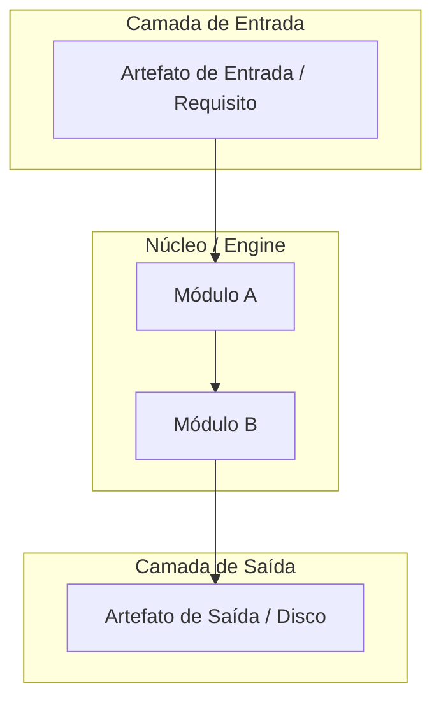

# 📋 SPEC: [Tema da Especificação Técnica]

> **Status:** [Proposta para Revisão | Aprovado pelo Usuário]  
> **Data:** YYYY-MM-DD  
> **Versão:** 1.0.0  
> **Autor:** Antigravity AI + Usuário (Fusão Addy Osmani + Pocock + AIDD-Spec)  
> **Referência da Intenção:** [docs/intents/YYYY-MM-DD_INTENT_NOME.md](file:///C:/Users/trcnologia/Desktop/LegoLoop/docs/intents/YYYY-MM-DD_INTENT_NOME.md)  
> **Alvo Primário:** [Ex: internal/dag, internal/studio, cmd/legoloop]  

---

## 1. Premissas Técnicas Assumidas (Addy Osmani)

> [!IMPORTANT]
> A IA lista abaixo todas as premissas técnicas adotadas para evitar decisões silenciosas. Alerte no Stop-Gate 02 caso alguma premissa esteja incorreta:
1. [Premissa 1 — Ex: O runtime padrão é Go 1.23+ com tipos nativos e zero dependências externas pesadas]
2. [Premissa 2 — Ex: O armazenamento persiste em arquivos locais do SO sem dependência de banco de dados externo]
3. [Premissa 3 — Ex: O protocolo de comunicação é HTTP REST loopback protegido contra DNS rebinding e CSRF]

---

## 2. Fronteiras de Ação & Regras de Governança (Boundaries — Addy Osmani)

O pipeline e os agentes devem respeitar estritamente o sistema de fronteiras em 3 níveis:
* **Sempre Fazer:**
  * Desenvolver via TDD estrito (teste unitário falhando antes do código de produção).
  * Manter funções pequenas, enxutas e de responsabilidade única (< 35 linhas).
  * Validar rigorosamente todos os inputs e decodificações de JSON.
* **Perguntar Antes:**
  * Adicionar qualquer nova dependência externa no `go.mod`.
  * Alterar schemas persistidos no disco que possam quebrar retrocompatibilidade.
  * Modificar regras globais no `AGENTS.md`.
* **Nunca Fazer:**
  * Criar funções vazias com `TODO`, `pass`, `// implementar depois` ou mocks simulados (Lei #1: Zero Stubs).
  * Commitar arquivos temporários, segredos ou variáveis de ambiente no git.
  * Ignorar testes falhando ou quebrar a suíte global de testes.

---

## 3. Visão Geral, Arquitetura & Costuras de Teste (Test Seams — Pocock)

[Descrição técnica de alto nível da solução e fronteiras arquiteturais.]

### Diagrama de Fronteiras (Mermaid)



### Costuras de Teste (Test Seams — Pocock)
* **Costura Primária (Highest Seam):** [Nome da interface ou função pública exata onde a suíte de testes baterá para validar o comportamento fim a fim].
* **Justificativa:** [Por que esta costura única minimiza o acoplamento interno e evita testes frágeis].

---

## 4. Contratos de Dados & Schemas Formais

```go
// Exemplo de tipagem do contrato formal
package modelo

type ContratoExemplo struct {
    ID          string            `json:"id"`
    Nome        string            `json:"nome"`
    Status      string            `json:"status"`
    Metadados   map[string]string `json:"metadados,omitempty"`
}
```

---

## 5. Critérios Binários de Aceite por Nó / Ticket (BDD)

> [!NOTE]
> Cada critério `AC-XX` deve ser mecanicamente verificável via teste unitário, asserção ou comando de terminal (`exit code == 0`).

### Épico 01 — [Nome do Épico 01]

* [ ] `AC-E01.1`: **[Título do Critério]**
  * **Dado que:** [Estado inicial do sistema / fixtures]
  * **Quando:** [Ação disparada / função invocada]
  * **Então:** [Resultado determinístico esperado e asserções binárias]
* [ ] `AC-E01.2`: **[Título do Critério]**
  * **Dado que:** ...
  * **Quando:** ...
  * **Então:** ...

### Épico 02 — [Nome do Épico 02]

* [ ] `AC-E02.1`: **[Título do Critério]**
  * **Dado que:** ...
  * **Quando:** ...
  * **Então:** ...

---

## 6. Comandos Operacionais & Critério de Conclusão Global (Addy Osmani)

### Comandos de Verificação Mecânica
* **Build:** `go build -o bin/legoloop.exe ./cmd/legoloop`
* **Test:** `go test -v ./...`
* **Lint:** `golangci-lint run ./...`

### Critério de Done Global
A especificação técnica é considerada **100% CONCLUÍDA** quando:
- [ ] 100% dos critérios binários `AC-E{N}.{M}` estiverem marcados como atendidos (`[x]`).
- [ ] O comando de **Test** passar com exit code 0.
- [ ] O comando de **Build** recompilar com sucesso o binário `bin/legoloop.exe`.
- [ ] Zero arquivos temporários ou órfãos residuais.

---

🛑 **STOP-GATE 02 DE AUDITORIA HUMANA:**  
*As premissas assumidas, as fronteiras (boundaries), os contratos e os critérios binários acima atendem à sua expectativa?*  
*Somente após a aprovação explícita do usuário, deve-se gerar o PLAN (`TEMPLATE_PLAN.md`) e a ROUTE (`TEMPLATE_ROUTE.json`).*
