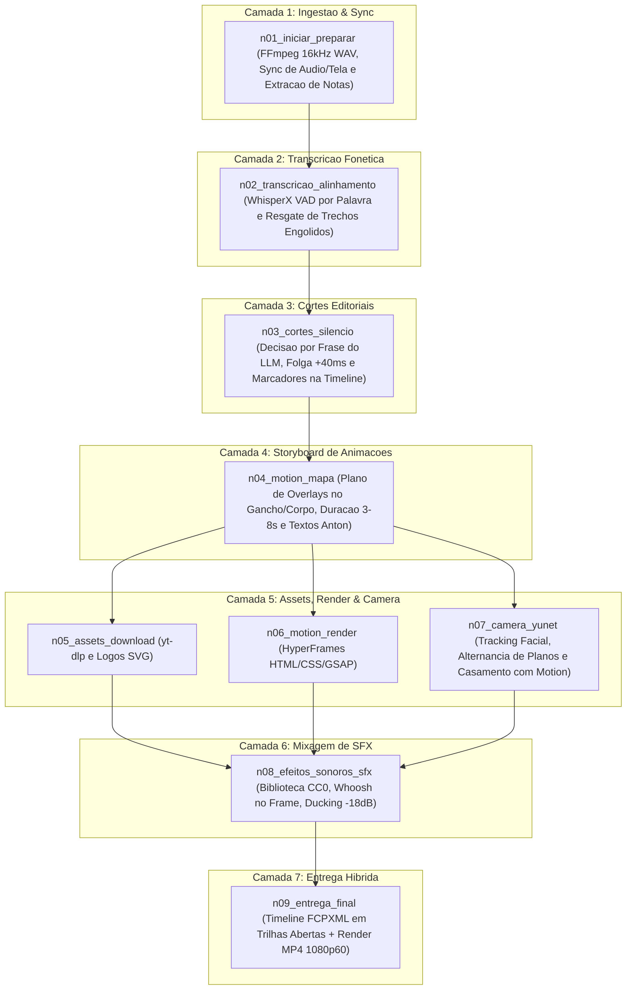

# 📋 SPEC: Edição Automatizada de Vídeo Soberana (video-edition)

> **Status:** APPROVED  
> **Data:** 2026-11-08  
> **Versão:** 1.0.0  
> **Autor:** LegoLoop Video-REA Engine (Fidelidade Estrita aos 13 Guias Autorais de Lucas Leite)  
> **Iniciativa:** Mega-Pipeline Audiovisual Soberano  
> **Referência da Intenção:** [2026-11-08_INTENT_VIDEO_EDITION.md](2026-11-08_INTENT_VIDEO_EDITION.md)  
> **Alvo Primário:** `loops/video-edition`, `skills/legoloop-video-edition`, `internal/videorea`  
> **Consome:** INTENT aprovada · **Produz:** PLAN e ROUTE  
> **Template:** TEMPLATE_SPEC.md v2.0.0  

---

## 1. Premissas Técnicas Assumidas & Princípios de Ofício (Lucas Leite)

> [!IMPORTANT]
> A esteira canoniza o método integral de Lucas Leite sob soberania LegoLoop (custo zero):
1. **O LLM Decide sobre o Texto, os Scripts Calculam os Frames:** O modelo de IA nunca calcula milissegundos ou frames de cabeça. O LLM lê a transcrição por frases para tomar decisões editoriais (escolher o melhor take, filtrar hesitações, planejar motion e som). Scripts em Python e FFmpeg realizam todas as medições numéricas de energia sonora, bordas de corte, keyframes e alinhamento à taxa real de quadros (fps).
2. **Memória nos Arquivos e Estado Persistido (`scratch/projeto.json`):** Toda a inteligência e decisões de cada etapa ficam gravadas no arquivo de estado no disco. O chat pode ser limpo a qualquer momento sem perder o ponto do projeto.
3. **Cortes Não-Destrutivos com Marcadores na Timeline:** Nenhum arquivo de mídia bruta é picotado. A esteira gera clipes com pontos *In* e *Out* ancorados no arquivo original e insere marcadores visuais no FCPXML (dúvida de take, hesitação preservada, nota, alerta técnico).
4. **Câmera Dinâmica Casada com o Motion:** O auto-framing e a câmera virtual com YuNet são calculados **depois** que as animações estão prontas, permitindo que a câmera acelere na direção da entrada do cartão ou dê espaço para overlays laterais.
5. **Sound Design Paramétrico Baseado em Eventos Visuais:** O som segue rigorosamente o que se vê. O pipeline extrai eventos de cortes, acelerações de câmera e batidas de motion; o pico dos whooshes cai no frame exato da frenagem/troca; e todo som sofre atenuação automática (Ducking de -18dB) com base no LUFS da voz.
6. **Soberania Econômica Absoluta (R$ 0,00/mês):** Substituição de Adobe Premiere Pro (R$ 124/mês) por FFmpeg FCPXML; Claude Pro (R$ 110/mês) por 9Router local/modelos abertos; Epidemic Sound (R$ 95/mês) por acervo CC0/Freesound catalogado por categorias; e Whisper API por WhisperX local com VAD.

---

## 2. Fronteiras de Ação & Regras de Governança (Boundaries — Lucas Leite & Osmani)

* **Sempre Fazer:**
  * **Remoção de Notas de Edição Faladas:** Detectar expressões de direção na gravação (*"nota de edição … fim da nota"*) e extirpar o bloco inteiro da montagem final.
  * **Margem de Segurança Pré-Fala (+40ms a +100ms):** Preservar a energia de áudio antes do fonema para nunca cortar consoantes oclusivas ("p", "t", "c").
  * **Pico do SFX no Frame do Evento:** O transiente de impacto cai no frame exato do choque; o pico do whoosh cai no frame da frenagem da câmera ou troca de tela.
  * **Altura dos Olhos no Plano Fechado:** No reenquadramento YuNet, manter a linha dos olhos a 35% do topo do quadro (evita cortar testa ou afundar o rosto).
  * **Ducking Estrito (-18dB):** Nenhum efeito sonoro pode sobrepor ou competir com a voz principal do apresentador.
  * **Desenvolvimento via TDD Estrito:** Zero stubs, funções com menos de 35 linhas e validação topológica.
* **Perguntar Antes:**
  * Adicionar dependências externas ao `go.mod`.
  * Alterar a tolerância de pausas silenciosas (padrão: 0.4s).
* **Nunca Fazer:**
  * Salto de escala instantâneo de câmera no meio de um take visível (salto só permitido em corte ou saída de tela cheia).
  * Repetir o mesmo efeito sonoro da biblioteca em um intervalo menor que 20 segundos.
  * Criar funções vazias com `TODO` ou mocks simulados em produção (Lei #1: Zero Stubs).
  * Usar tags HTML em diagramas Mermaid (Lei #9).

---

## 3. Arquitetura dos 8 Nós & Fluxo Acíclico (Ordem dos 13 Guias)

A arquitetura organiza os 13 guias autorais em 8 nós encadeados em 7 camadas topológicas:



### Costuras de Teste (Test Seams — Pocock)
* **Costura Primária (Highest Seam):** `legoloop validate loops/video-edition/pipeline.dag.json` que valida a ausência de ciclos e integridade dos nós.
* **Costura de Transcrição e Notas:** Teste unitário de parsing que localiza `"nota de edição"` e remove o trecho entre timecodes.
* **Costura de Sound Design (SFX):** Teste de atenuação que calcula a curva de ducking e comprova o nível em -18dB na presença de fala.
* **Golden Fixture:** `loop/fixture_3s.mp4` sintetizado com track estéreo para verificação mecânica rápida.

---

## 4. Contratos de Dados & Schemas Formais

```go
package videorea

import (
	"errors"
	"strings"
)

// ErrInvalidPipeline indica configuração inválida na esteira de edição.
var ErrInvalidPipeline = errors.New("video-edition: configuração inválida")

// EditionDecisionList representa a lista de cortes e decisões do LLM.
type EditionDecisionList struct {
	Slug            string           `json:"slug"`
	Cuts            []CutSegment     `json:"cuts"`
	SpokenNotes     []SpokenNote     `json:"spoken_notes"`
	TimelineMarkers []TimelineMarker `json:"markers"`
	Config          PipelineConfig   `json:"config"`
}

type CutSegment struct {
	ID        string  `json:"id"`
	StartSec  float64 `json:"start_sec"`
	EndSec    float64 `json:"end_sec"`
	Keep      bool    `json:"keep"`
	TakeOrder int     `json:"take_order"` // preferência pelo último take completo
	Text      string  `json:"text_snippet"`
}

type SpokenNote struct {
	StartSec float64 `json:"start_sec"`
	EndSec   float64 `json:"end_sec"`
	RawText  string  `json:"raw_text"` // "nota de edição... fim da nota"
}

type TimelineMarker struct {
	TimeSec float64 `json:"time_sec"`
	Kind    string  `json:"kind"` // "duvida_take", "hesitacao", "nota", "alerta"
	Note    string  `json:"note"`
}

type PipelineConfig struct {
	SilenceThresholdSec float64 `json:"silence_threshold_sec"` // padrão: 0.4s
	PreSpeechMarginSec  float64 `json:"pre_speech_margin_sec"`  // padrão: 0.04s (+40ms)
	DuckingVolumeDB     float64 `json:"ducking_volume_db"`      // padrão: -18.0 dB
	EyesHeightRatio     float64 `json:"eyes_height_ratio"`      // padrão: 0.35 (35% do topo)
}

func (c PipelineConfig) Validate() error {
	if c.SilenceThresholdSec <= 0 || c.PreSpeechMarginSec < 0.04 || c.DuckingVolumeDB > -6.0 {
		return ErrInvalidPipeline
	}
	return nil
}
```

---

## 5. Critérios Binários de Aceite por Nó / Ticket (BDD)

### Épico 01 — Preparação, Notas de Edição e Cortes

* [ ] `AC-E01.1`: **Detecção e Extirpação de Notas de Edição Faladas**
  * **Dado que:** Uma transcrição contendo o trecho *"nota de edição usa o próximo take fim da nota"*.
  * **Quando:** O nó `n01_iniciar_preparar` executa o filtro.
  * **Então:** O trecho completo é anotado em `spoken_notes` e seus timestamps são excluídos da lista de cortes `cuts` com zero resíduo sonoro.
* [ ] `AC-E01.2`: **Margem Pré-Fala (+40ms) e Preservação de Fonemas**
  * **Dado que:** Uma borda de corte de fala detectada no segundo 12.500s.
  * **Quando:** O script de ajuste fino de bordas é acionado.
  * **Então:** O corte é fixado em 12.460s (40ms antes), arredondado para o frame anterior exato.

### Épico 02 — Câmera YuNet Casada com Motion e SFX com Ducking

* [ ] `AC-E02.1`: **Tracking Facial YuNet com Olhos a 35% do Topo**
  * **Dado que:** Um vídeo 4K com o apresentador no enquadramento.
  * **Quando:** O nó `n07_camera_yunet` gera os keyframes de enquadramento 1080p.
  * **Então:** A coordenada vertical dos olhos do rosto rastreado mantém-se estabilizada a 35% ($\pm 3\%$) da altura do quadro.
* [ ] `AC-E02.2`: **Ducking de SFX a -18dB e Pico de Whoosh no Frame do Evento**
  * **Dado que:** Uma transição de animação que finaliza no frame 180 com voz do apresentador ativa.
  * **Quando:** O nó `n08_efeitos_sonoros_sfx` alinha a camada sonora.
  * **Então:** O pico da onda do whoosh coincide exatamente com o frame 180 e a trilha de SFX é atenuada em 18dB em relação ao LUFS da voz.

### Épico 03 — Entrega Híbrida e Governança

* [ ] `AC-E03.1`: **Exportação FCPXML Não-Destrutiva e Render MP4 1080p60**
  * **Dado que:** A conclusão do pipeline pelo nó `n09_entrega_final`.
  * **Quando:** Invocado o empacotamento final.
  * **Então:** São produzidos o arquivo `output/final_edit.fcpxml` (com tracks separadas de câmera, overlays e SFX) e o vídeo renderizado `output/final_edit.mp4`.
* [ ] `AC-NF.1`: **Portões de Qualidade e Limpeza de Código**
  * **Dado que:** As alterações em Go e scripts do módulo.
  * **Quando:** Executados `go test -count=1 ./internal/videorea/...`, `go vet` e `tools/funclen`.
  * **Então:** 100% dos testes passam com zero warnings e funções $\le 35$ linhas.

---

## 6. Comandos Operacionais & Critério de Conclusão Global (Lucas Leite & Osmani)

### Comandos de Verificação Mecânica
* **Validação do Grafo DAG:** `go run ./cmd/legoloop validate loops/video-edition/pipeline.dag.json`
* **Testes da Suíte de Vídeo:** `go test -count=1 ./internal/videorea/...`
* **Estática e Formatação:** `go vet ./internal/videorea/...` e `gofmt -l internal/videorea`
* **Linter de Comprimento:** `go run ./tools/funclen internal/videorea`
* **Build Limpo:** `go build -o bin/legoloop.exe ./cmd/legoloop`

### Critério de Done Global
- [ ] 100% dos critérios binários `AC-E01.1`, `AC-E01.2`, `AC-E02.1`, `AC-E02.2`, `AC-E03.1` e `AC-NF.1` aprovados no Stop-Gate.
- [ ] Grafo acíclico sem ciclos validado em 7 camadas topológicas.
- [ ] Zero stubs em código de produção e integridade de arquivos em disco.
