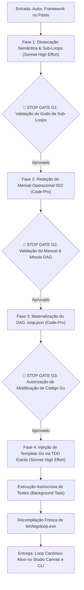

# 🗺️ LegoLoop Loop Map — Orquestrador de Canonização de Loops & Frameworks

> **Autoridade:** Ecossistema LegoLoop  
> **Status:** Ativo & Canônico  
> **Escopo:** Dissecação de autores/frameworks, extração de taxonomias de sub-loops, redação de manuais operacionais ISO, materialização de DAGs `.loop.json`, injeção em templates de Canvas com TDD e recompilação do binário do LegoLoop.

---

## 1. Visão Geral e Contrato de Entrada

A skill `legoloop-loop-map` automatiza a jornada de absorção de metodologias e repositórios de agentes (ex: Matt Pocock, Impeccable/Paul Bakaus, Addy Osmani, Eric Ries, etc.), transformando-os em blocos operacionais de primeira classe dentro do **LegoLoop**.

### Parâmetros de Ingestão:
* **Entrada Primária:** Nome do Autor, Projeto ou Skill a ser mapeada (ex.: `Matt Pocock`, `impeccable`, `addy-osmani`).
* **Alvo de Dissecação:** Caminho local do repositório/pasta upstream ou URL remota/repositório Git.
* **Prefixo de Domínio:** Identificador canônico para o ID da esteira (ex.: `matt-pocock`, `impeccable-design`).

---

## 2. Matriz de Roteamento Cognitivo, Efforts & Sincronismo

A execução é rigorosamente compartimentada entre modelos especializados e estratégias de execução:

| Fase da Jornada | Papel Cognitivo | Modelo Recomendado | Effort | Modo de Execução |
|---|---|---|---|---|
| **Fase 1: Dissecação & Taxonomia** | Análise Semântica de Grafo | `Sonnet` | High Effort | Síncrono (Interativo) |
| **Fase 2: Redação do Manual ISO** | Síntese Arquitetural & Docs | `Code-Pro` | Médio | Síncrono (Bloco Único) |
| **Fase 3: Materialização DAG JSON** | Validação de Schema DAG | `Code-Pro` | Médio | Síncrono (Cirúrgico) |
| **Fase 4: TDD & Injeção em Go** | Engenharia de Sistemas em Go | `Sonnet` | High Effort | Síncrono (Red-Green) |
| **Fase 4.1: Suíte de Testes** | Execução de Testes (`go test`) | Runner Local / Go Toolchain | N/A | **Assíncrono** (Background Task) |
| **Fase 4.2: Recompilação Go** | Build do Binário (`go build`) | Go Toolchain | N/A | **Assíncrono** (Background Task) |

---

## 3. Isolamento de Ações e Execução Estéril por Bloco (Orchestrix)

Seguindo as Leis de Operação do LegoLoop:
1. **Contexto Estéril:** Cada fase consome estritamente o artefato produzido pela fase anterior. Nenhuma fase carrega histórico sujo ou ferramentas não pertinentes.
2. **Sem Polling:** Tarefas assíncronas de compilação ou testes são disparadas em background e aguardam o *Reactive Wakeup* do harness, sem repetição de chamadas de status.
3. **Zero Stubs:** Nenhum template ou arquivo de teste é gerado com stubs vazios ou `TODO`.

---

## 4. O Fluxo de Execução com 3 Stop Gates Humanos



---

### 🛑 STOP GATE G1: Validação da Taxonomia de Sub-Loops
* **Gatilho:** Ao término da análise do repositório/metodologia.
* **Comportamento:** O agente apresenta:
  1. O Loop Mestre de Engenharia (passo a passo de Ideia $\to$ Entrega);
  2. A tabela com a taxonomia dos sub-loops modulares identificados e suas ferramentas/skills subordinadas;
  3. Pergunta interativa com opções de ajuste ou confirmação.
* **Critério de Saída:** Autorização explícita do usuário para seguir para a documentação.

---

### 🛑 STOP GATE G2: Validação do Manual e da Minuta do DAG
* **Gatilho:** Após a escrita do manual em `docs/manuals/YYYY-MM-DD_MANUAL_<SLUG>_LOOP.md`.
* **Comportamento:** O agente apresenta:
  1. O link do manual gerado com formatação ISO;
  2. O schema proposto para o arquivo DAG `loops/<slug>.loop.json` (nós, dependências, modelos e artefatos de saída com gates `file_exists`).
* **Critério de Saída:** Validação do usuário de que as dependências e gates refletem o fluxo desejado.

---

### 🛑 STOP GATE G3: Autorização para Modificação de Código-Fonte e Recompilação
* **Gatilho:** Antes de editar `internal/studio/templates.go`.
* **Comportamento:**
  1. Exibe a minuta exata da alteração do teste TDD (`templates_test.go`) e da struct `Template` a ser injetada em `BuiltinTemplates()`;
  2. Solicita confirmação explícita para aplicar o patch em Go e iniciar o ciclo de recompilação do binário.
* **Critério de Saída:** "Sim" do usuário para disparar o TDD, os testes assíncronos e o `go build`.

---

## 5. Passo a Passo Detalhado de Cada Fase

### Fase 1: Dissecação Semântica & Taxonomia de Sub-Loops
1. Consultar a base de arquivos da metodologia via leitura seletiva (StartLine/EndLine) e busca semântica.
2. Identificar:
   * **Fluxo Principal:** A espinha dorsal sequencial (ex.: Grilling $\to$ Spec $\to$ Tickets $\to$ TDD $\to$ Review).
   * **Sub-Loops Modulares:** Clusters de skills afins (Concepção, Prototipação, Especificação, Construção, Diagnóstico, Fechamento).
   * **Ferramentas de Apoio:** Primitivos reutilizáveis, comandos utilitários e vocabulários de arquitetura.
3. Formatar a minuta da arquitetura e aguardar aprovação no **Stop Gate G1**.

### Fase 2: Geração do Manual Operacional ISO
1. Criar o arquivo no padrão canônico: `docs/manuals/YYYY-MM-DD_MANUAL_<NOME_DO_LOOP>.md`.
2. O manual deve obrigatoriamente conter:
   * **Visão Geral e Filosofia:** Princípios inegociáveis do autor.
   * **O Loop Mestre:** Diagrama em Mermaid com estágios e gates.
   * **Taxonomia dos Sub-Loops:** Tabela e detalhamento de cada sub-loop com entradas, comandos e artefatos de saída.
   * **Matriz de Roteamento Cognitivo:** Modelos, fallbacks e esforços sugeridos.
   * **Higiene de Contexto:** Regras de fronteira de fase (`/clear`, `/compact`, `/handoff`, sessões contínuas).
   * **Guia de Execução no LegoLoop:** Comandos da CLI e uso no Studio Canvas.
3. Submeter ao **Stop Gate G2**.

### Fase 3: Materialização do Loop Declarativo DAG
1. Criar o arquivo em `loops/<slug>.loop.json`.
2. Respeitar o schema `$schema: https://legoloop.dev/schemas/dag.v1.json`:
   * Identificador único (`id`), nome descritivo e versão `1.0.0`.
   * Array de `nodes`, onde cada nó representa um sub-loop com `ref`, `routing`, `depends_on`, `inputs` e `output` com gate determinístico (`file_exists('...')`).

### Fase 4: Integração TDD no Studio Canvas, Validação & Recompilação
1. **Aprovação do Stop Gate G3.**
2. **Ciclo TDD Red:**
   * Editar `internal/studio/templates_test.go` adicionando o novo template no mapa de IDs esperados (`"<slug>": false`).
   * Executar teste pontual para verificar a expectativa de falha controlada.
3. **Ciclo TDD Green:**
   * Inserir o novo `Template` em `BuiltinTemplates()` dentro de `internal/studio/templates.go`, com categoria, ícone canônico (escolhido entre os SVGs suportados em `icons.js`) e a lista de nós e edges da composição.
   * Reexecutar o teste: `go test -v ./internal/studio -run TestTemplatesEndpointReturnsAtLeastThreeValidTemplates`.
4. **Execução de Build e Sanidade Assíncrona:**
   * Disparar a recompilação fresca do binário:
     ```powershell
     go build -o bin/legoloop.exe ./cmd/legoloop
     ```
   * Rodar a suíte completa de testes para garantir integridade do ecossistema:
     ```powershell
     go test ./...
     ```
5. **Apresentação Final:**
   * Exibir relatório sintético com links diretos para o Manual, o arquivo DAG `.loop.json`, o template no código Go e a confirmação de binário pronto.

---

## 6. Invariantes & Regras Negativas (Negative Guardrails)

> [!CAUTION]
> **REGRAS NEGATIVAS INVIOLÁVEIS:**
1. **NUNCA** altere código-fonte Go sem a aprovação explícita no Stop-Gate G3.
2. **NUNCA** deixe de validar o DAG gerado com `legoloop validate`.
3. **NUNCA** crie nós ou templates com stubs vazios ou funções simuladas.
4. **NUNCA** pule a recompilação fresca obrigatória do binário `legoloop` após injetar templates no código.
